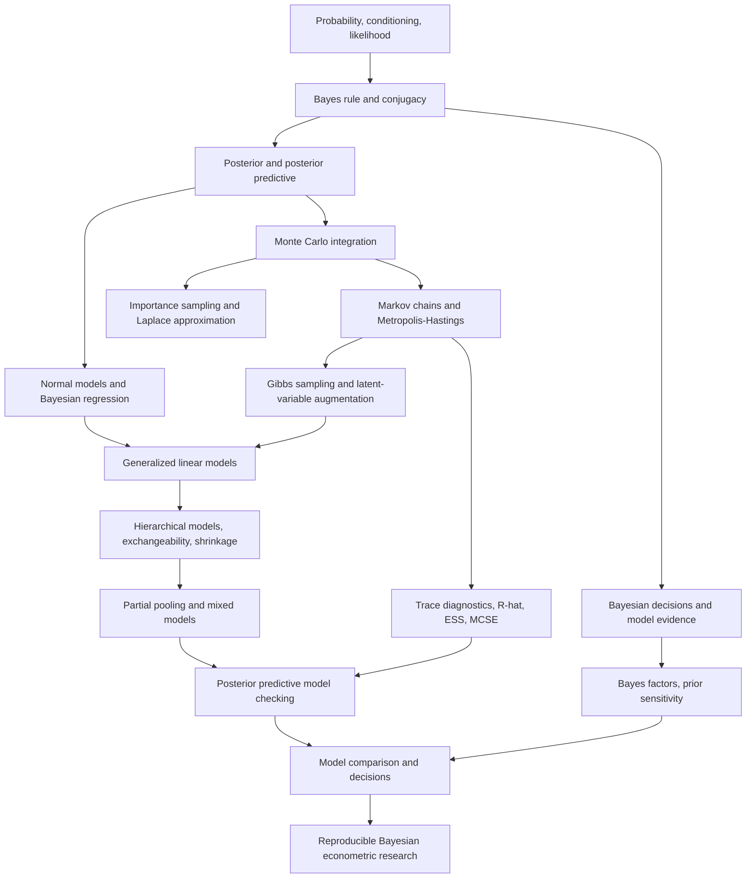

# AMS 206 — Applied Bayesian Statistics

**Graduate curriculum / 12-week independent-study quarter**  
**Focus:** probability and Bayesian reasoning → conjugate inference → decisions and model comparison → simulation and MCMC → regression and generalized linear models → multilevel modeling → predictive validation and applied research.  
**Mathematics:** all standalone LaTeX expressions use `$$ ... $$`; inline expressions use `$ ... $`.

> **Scope and provenance.** This is a **constructed self-study syllabus**, not a claim about a particular instructor's week-by-week schedule. It is grounded in the uploaded **AMS 206 - Applied Bayesian** archive and the [UCSC AMS 206 course description](https://courses.engineering.ucsc.edu/courses/ams206). The course description identifies prior/posterior updating, Bayes factors, conjugacy, hierarchical modeling and shrinkage, MCMC, Laplace approximations, and linear/generalized linear mixed models as core subjects. The archive additionally contains lecture sequences from several authors and dates, original R code and exam work, and a separate PyMC3 workshop. These are identified explicitly below rather than presented as a single unified course packet. The 12-week timetable, assignments, reading order, assessments, and capstone are **proposed self-study elements**, not recovered original course requirements.

**Navigation:** [Outcomes](#learning-outcomes) · [Prerequisites](#prerequisites-and-study-method) · [Knowledge map](#concept-dependency-map) · [12-week route](#12-week-learning-plan) · [Computational laboratories](#computational-laboratories) · [Reference formulas](#mathematical-reference) · [Research capstone](#integrated-research-capstone) · [Resource index](#archive-and-resource-index).

## Why this course belongs in Core Econometrics

Classical estimation asks how an estimator behaves across hypothetical repeated samples. Bayesian analysis instead represents uncertainty about unknown quantities through a probability model, updates that uncertainty with data, and carries it through to predictions or decisions. It is not a substitute for design-based causal identification: a sophisticated posterior cannot, by itself, resolve endogeneity, confounding, or invalid sampling assumptions.

The econometric connection is therefore **likelihood + regularization + uncertainty propagation + simulation + prediction + decision analysis**. This course complements the existing ECON 216 linear and causal econometrics, ECON 217 nonlinear models and statistical learning, and ECON 211C stochastic processes and state-space methods. It supplies a second inferential paradigm and the computational methods needed for hierarchical and latent-variable models.

| Question | Bayesian concept | Applied output |
|---|---|---|
| What did we believe before seeing data? | Prior and prior predictive distribution | Explicit assumptions and plausible effect ranges |
| What does the evidence change? | Likelihood and posterior | Parameter probabilities and credible intervals |
| What are the implications for new observations? | Posterior predictive distribution | Calibrated predictive distributions |
| Which action is warranted? | Loss functions and posterior expected utility | Decision threshold / optimal intervention |
| Does a complex model generalize? | Shrinkage, hierarchical modeling, predictive validation | Stable subgroup estimates and out-of-sample assessment |
| Can the posterior actually be computed? | MCMC, Monte Carlo, Laplace approximation | Estimated posterior summaries with numerical error |
| How reliable are findings? | Prior sensitivity, diagnostics, model checking | Qualified and reproducible conclusions |

## Learning outcomes

By the end of the quarter, a learner should be able to:

1. Derive posteriors, marginal likelihoods, posterior predictives, and Bayes actions for tractable models.
2. Explain and evaluate **proper vs. improper priors**, conjugacy, sensitivity, posterior probability, credible regions, Bayes factors, and exchangeability.
3. Derive conjugate normal linear-regression updating and explain Gaussian shrinkage and partial pooling.
4. Implement Monte Carlo integration, importance sampling, random-walk Metropolis–Hastings, and Gibbs sampling; recognize when these methods fail.
5. Report mixing and convergence diagnostics, effective sample size, Monte Carlo standard error, and posterior checks without confusing algorithmic error and statistical uncertainty.
6. Fit Bayesian linear, logistic, Poisson, ANOVA, and hierarchical models in R; adapt examples to econometric and financial data.
7. Compare candidate models with sensitivity analyses and predictive checks, explaining the different questions answered by Bayes factors, posterior predictive checks, and cross-validation.
8. Deliver a reproducible study with a documented likelihood, justified prior, sensitivity analysis, computation validation, posterior interpretation, predictive performance, and a decision-oriented conclusion.

## Prerequisites and study method

**Required knowledge:** calculus (including change of variables and multiple integration); linear algebra (matrix products, quadratic forms, eigenvalues); probability (conditional probability, expectation, common distributions); inferential statistics (MLE, likelihood, uncertainty); and multiple regression. ECON 216 provides especially useful preparation. **Helpful:** basic Markov chains, numerical optimization, conditional independence, and R scripting. Applied economists can learn these topics alongside the course, but should not skip matrix algebra or integration.

**Weekly load:** approximately **12–16 hours**: 3–4 hours reading, 2–3 hours mathematical derivations, 4–6 hours computational labs, 1–2 hours interpretation and writing. A 12-week quarter is intensive; optional reading paths may require longer.

**Working environment:** use **R** first, since the archive's numbered scripts are `.R` and the applied lessons use R; use `nimble`, `coda`, `mvtnorm`, `MCMCpack`, or JAGS only for the relevant exercises. The archived scripts are demonstrations—not guaranteed to run without package/API changes. Optional Python notebooks in the bundled PyMC3 workshop are **historical** and may need modern PyMC migration. Record package versions, random seeds, numerical tolerances, and session information.

**For every model:** write (i) the data-generating assumptions, (ii) likelihood, (iii) prior and implied prior predictive behavior, (iv) posterior or sampling algorithm, (v) estimand, (vi) numerical and statistical diagnostics, (vii) predictive check, and (viii) economic interpretation. An R output table alone is not mastery.

## Concept dependency map



The [standalone Mermaid file](knowledge-map.mmd) contains an expanded cross-course map, including ECON 216, ECON 217, and ECON 211C connections.

## 12-week learning plan

| Week | Primary topic | Mathematical milestone | Core lab / deliverable |
|---|---|---|---|
| **1** | Bayesian foundations, probability, priors | Bayes' theorem and posterior odds | Beta-binomial prior updating; a prior elicitation memo |
| **2** | Conjugacy, predictive inference, exchangeability | Beta, Gamma, Dirichlet, Normal conjugate updates | Compare analytical posteriors against simulation |
| **3** | Bayesian decisions, evidence, objective priors | Expected loss and marginal likelihoods | Bayes-factor sensitivity and an explicit decision problem |
| **4** | Bayesian normal models, regression, shrinkage | Multivariate normal posterior for regression coefficients | Reproduce linear-regression examples; prior sensitivity |
| **5** | Monte Carlo, importance sampling, Laplace methods | MC error, weights, posterior mode/Hessian | Compare integration methods on a tractable posterior |
| **6** | Markov chains and Metropolis–Hastings | Detailed balance and MH acceptance ratio | Write and tune a Metropolis sampler; proposed midterm |
| **7** | Gibbs sampling and data augmentation | Full conditional distributions | Gibbs sampler with missing or latent data |
| **8** | Convergence and numerical reliability | Autocorrelation, ESS, Monte Carlo SE | Multiple-chain diagnostic report |
| **9** | Bayesian linear, ANOVA, logistic, Poisson models | GLM likelihoods and posterior nonconjugacy | Regression/GLM comparison with predictive checks |
| **10** | Hierarchical inference and mixed models | Partial pooling and hyperparameter learning | Varying-intercept model and shrinkage visualization |
| **11** | Model criticism, sensitivity and comparison | Predictive discrepancies, Bayes factors and LOO targets | Robustness dossier for chosen empirical model |
| **12** | Integrated research and communication | Full uncertainty propagation | Reproducible capstone code, report, and defense |

### Week 1 — Probability, prior specification, and posterior updating

**Concepts.** Conditional probability, likelihood as a function of unknown parameters, Bayesian posterior, normalization, posterior odds, posterior means/medians/modes, credible sets, and the distinction between frequentist coverage and conditional posterior probability. Discuss subjectivist and frequency interpretations as interpretations—not mathematical contradictions. Elicit plausible parameter ranges before seeing the data.

**Central identity:**

$$
p(\theta\mid y)=\frac{p(y\mid\theta)p(\theta)}{\int p(y\mid\vartheta)p(\vartheta)\,d\vartheta}.
$$

For a binomial outcome with a Beta prior, use the exact posterior instead of numerical integration:

$$
Y\mid\theta\sim\operatorname{Binomial}(n,\theta),\quad
\theta\sim\operatorname{Beta}(a,b)
\quad\Longrightarrow\quad
\theta\mid Y=y\sim\operatorname{Beta}(a+y,b+n-y).
$$

**Core reading:** [course material/bayes/lecture1-introToBayes.pdf](<course material/bayes/lecture1-introToBayes.pdf>), [lecture2-introToBayes.pdf](<course material/bayes/lecture2-introToBayes.pdf>), [notes/intro/bayes.pdf](<notes/intro/bayes.pdf>), [notes/intro/commonDistributions.pdf](<notes/intro/commonDistributions.pdf>). **Code:** [Code 1.R](<course material/code/Code 1.R>).

**Practice:** Derive the posterior kernel, mean, variance and equal-tail interval for $n=40$ and $y=11$ under three explicit priors; compare plots of prior, scaled likelihood and posterior. Compute and interpret $P(\theta>0.25\mid y)$. Use sensitivity analysis rather than labeling a single prior uninformative.

**Deliverable:** a two-page analytical notebook and one-page prior justification. **Mastery check:** Can you explain why a 95% credible interval and a 95% frequentist confidence interval have different conditional interpretations?

### Week 2 — Conjugate families, predictions, and exchangeability

**Concepts.** Sufficient statistics, exponential families, conjugate analysis, posterior predictive integration, Gamma–Poisson and Dirichlet–multinomial models, Normal updating, and the relationship between exchangeability and latent mixing distributions. De Finetti's theorem requires the appropriate infinite-exchangeability setting; it does not imply that every finite exchangeable process is iid.

$$
Y_i\mid\lambda\overset{\mathrm{iid}}\sim\operatorname{Poisson}(\lambda),\qquad
\lambda\sim\operatorname{Gamma}(a,b)\ \text{(shape–rate)}
\quad\Longrightarrow\quad
\lambda\mid\boldsymbol y\sim\operatorname{Gamma}\left(a+\sum_i y_i,b+n\right).
$$

$$
p(\tilde y\mid y)=\int p(\tilde y\mid\theta,y)p(\theta\mid y)\,d\theta.
$$

**Core reading:** [lecture4-more-bayes.pdf](<course material/bayes/lecture4-more-bayes.pdf>), [lecture5-more-bayes.pdf](<course material/bayes/lecture5-more-bayes.pdf>), [dirichlet-multinomial.pdf](<course material/bayes/dirichlet-multinomial.pdf>), [notes/DeFinettiTheorem.pdf](notes/DeFinettiTheorem.pdf). **Code:** [Code 3.R](<course material/code/Code 3.R>), [Code 4.R](<course material/code/Code 4.R>).

**Practice:** Derive a Beta-binomial predictive probability for the next observation; derive Gamma–Poisson posterior predictive mean and variance; simulate repeated future samples and compare theoretical moments. Fit category probabilities to counts with a Dirichlet prior and explain how pseudo-counts influence small samples.

**Deliverable:** a conjugate-family calculation sheet with analytic vs. simulation verification. **Mastery check:** Why is a posterior distribution over $\theta$ not itself a posterior predictive distribution for a new $Y$?

### Week 3 — Decisions, Bayes factors, and prior discipline

**Concepts.** Utility/loss, Bayes actions, predictive decision rules, posterior odds vs. prior odds, marginal likelihood, Bayes factors, the dependence of Bayes factors on prior dispersion, proper/improper priors, Jeffreys-type constructions, and model uncertainty. Link directly to microeconomic expected utility without treating a loss function as a causal identification strategy.

$$
a^*(y)=\operatorname*{arg\,min}_{a\in\mathcal A}
\mathbb E[L(a,\theta)\mid y].
$$

$$
BF_{10}=\frac{p(y\mid M_1)}{p(y\mid M_0)},\qquad
p(y\mid M_k)=\int p(y\mid\theta_k,M_k)p(\theta_k\mid M_k)\,d\theta_k.
$$

**Core reading:** [lecture3-decision-theory.pdf](<course material/bayes/lecture3-decision-theory.pdf>), [lecture6-objectivev2.pdf](<course material/bayes/lecture6-objectivev2.pdf>), [lecture7-objective.pdf](<course material/bayes/lecture7-objective.pdf>), [notes/Basic Analysis/likelihood.pdf](<notes/Basic Analysis/likelihood.pdf>). **Code:** [Code 2.R](<course material/code/Code 2.R>).

**Practice:** Choose whether to fund a pilot program under asymmetric false-positive/false-negative losses. Compute a two-model Bayes factor, vary prior scales, and contrast it with the posterior probability of a continuous parameter exceeding an economically meaningful threshold. Do not use an arbitrary improper prior in a marginal-likelihood calculation without addressing the missing normalization.

**Deliverable:** an evidence-and-decision memo with a prior sensitivity table. **Mastery check:** Why do evidence for a point-null model and probability of a positive effect answer different questions?

### Week 4 — Gaussian updating, linear models, and shrinkage

**Concepts.** Multivariate Normal distributions, conditional Gaussian formulas, regression likelihood, Gaussian coefficient priors, Normal–inverse-Gamma (or Normal–inverse-Wishart) conjugacy, correlation and prior covariance, posterior shrinkage, uncertainty for predictions, and connections to regularized regression. Introduce Bayesian ANOVA as a regression design-matrix problem.

With $y\mid\beta\sim N(X\beta,\sigma^2 I)$ and $\beta\sim N(\mu_0,\Sigma_0)$, assuming $\sigma^2$ known,

$$
\Sigma_n=\left(\Sigma_0^{-1}+\frac{X^\top X}{\sigma^2}\right)^{-1},\qquad
\mu_n=\Sigma_n\left(\Sigma_0^{-1}\mu_0+\frac{X^\top y}{\sigma^2}\right),
$$

$$
\beta\mid y\sim N(\mu_n,\Sigma_n).
$$

**Core reading:** [course material/bayes/linear-regression.pdf](<course material/bayes/linear-regression.pdf>), [multivariate-normal.pdf](<course material/bayes/multivariate-normal.pdf>), [notes/Linear Regression/Lesson 7_ Linear regression.pdf](<notes/Linear Regression/Lesson 7_ Linear regression.pdf>), [notes/intro/regression review.pdf](<notes/intro/regression review.pdf>). **Code:** compare manual formulas to standard regression implementations; [Code 5.R](<course material/code/Code 5.R>) introduces sampling-based Normal-model calculations.

**Practice:** Fit infant mortality vs. income using the `car::Leinhardt` example documented in the archive lesson; standardize covariates, choose priors on interpretable scales, compare ordinary least squares and posterior coefficient distributions; predict for held-out covariates. Show how prior precision changes posterior means and uncertainty.

**Deliverable:** a regression derivation and a predictive interval plot. **Mastery check:** Under which special assumptions does a Gaussian-prior posterior mode match ridge regression, and why is the mapping not universal?

### Week 5 — Computational integration, importance sampling, and Laplace approximation

**Concepts.** Exact vs. approximate inference; iid Monte Carlo integration; standard errors from independent draws; transformation and rejection methods; importance sampling and weight collapse; Monte Carlo integration for rare-event probabilities; Laplace approximation at a posterior mode; when Gaussian approximation is misleading (small samples, boundary constraints, multimodality).

$$
\mathbb E[g(\theta)\mid y]\approx\frac{1}{S}\sum_{s=1}^{S}g\left(\theta^{(s)}\right),\qquad \theta^{(s)}\overset{\mathrm{iid}}\sim p(\theta\mid y).
$$

$$
\widehat{\mathbb E}[g]\;=\;
\frac{\sum_{s=1}^S w_sg(\theta_s)}{\sum_{s=1}^S w_s},\qquad
w_s=\frac{p(y\mid\theta_s)p(\theta_s)}{q(\theta_s)},\qquad
\theta_s\sim q.
$$

$$
\log p(\theta\mid y)\approx\log p(\hat\theta\mid y)
-\tfrac12(\theta-\hat\theta)^\top H(\theta-\hat\theta),
\quad H=-\nabla^2\log p(\hat\theta\mid y).
$$

**Core reading:** [lecture8-monte-carlo.pdf](<course material/bayes/lecture8-monte-carlo.pdf>), [lecture9-monte-carlo.pdf](<course material/bayes/lecture9-monte-carlo.pdf>), [notes/Basic Analysis/monte carlo.pdf](<notes/Basic Analysis/monte carlo.pdf>); the [compiled computational lecture notes](<course material/AMS 206 - Course Lecture Notes.pdf>) include computational diagnostics and Laplace material.

**Practice:** Estimate the same posterior tail probability using exact integration, iid Monte Carlo, and importance sampling. Plot error against $S$. Construct a skewed likelihood and compare its numerical posterior with a Laplace approximation, including tail errors.

**Deliverable:** a numerical-methods comparison, with runtime and error. **Mastery check:** When can more importance samples fail to rescue a catastrophically poor proposal distribution?

### Week 6 — Markov chains and Metropolis–Hastings

**Concepts.** Transition kernels, irreducibility, aperiodicity, invariant distributions, burn-in, Markov chain dependence, detailed balance, Metropolis–Hastings, random-walk proposal scaling, acceptance rate as a diagnostic rather than sole objective, multimodal and badly scaled posteriors.

$$
\alpha(\theta,\theta')=\min\left\{1,
\frac{p(y\mid\theta')p(\theta')q(\theta\mid\theta')}
{p(y\mid\theta)p(\theta)q(\theta'\mid\theta)}\right\}.
$$

**Core reading:** [markov-chain-monte-carlo.pdf](<course material/bayes/markov-chain-monte-carlo.pdf>), [metropolis.pdf](<course material/bayes/metropolis.pdf>), [notes/MCMC/Lesson 4_ Metropolis-Hastings.pdf](<notes/MCMC/Lesson 4_ Metropolis-Hastings.pdf>), [notes/Basic Analysis/markov chains.pdf](<notes/Basic Analysis/markov chains.pdf>). **Code:** [Code 7.R](<course material/code/Code 7.R>).

**Practice:** Derive the MH rule from detailed balance; implement it in log-density form for a Normal target (known analytic answer), then for a nonconjugate location model. Compare proposal scales, trace plots, lag-one correlation, acceptance, and effective sample size per computational second. Reproduce the Gumbel-location concept in Code 7 where feasible.

**Deliverable:** commented sampler, unit tests against a known target, and a short proposed **midterm** mixing analytical derivations and code. **Mastery check:** Why does a visually smooth histogram of correlated draws not prove correct exploration of the posterior?

### Week 7 — Gibbs sampling, latent data, and conditional updates

**Concepts.** Multivariate posterior factorizations, full conditional distributions, coordinate updates, two-stage and blocked Gibbs, Gaussian missing observations, data augmentation, JAGS/NIMBLE syntax, and the advantage and limitations of exploiting conditional conjugacy.

$$
\theta_1^{(s+1)}\sim p(\theta_1\mid\theta_2^{(s)},y),\qquad
\theta_2^{(s+1)}\sim p(\theta_2\mid\theta_1^{(s+1)},y).
$$

**Core reading:** [one-stage-gibbs.pdf](<course material/bayes/one-stage-gibbs.pdf>), [two-stage-gibbs.pdf](<course material/bayes/two-stage-gibbs.pdf>), [data-augmentation.pdf](<course material/bayes/data-augmentation.pdf>), [notes/MCMC/Lesson 5_ Gibbs sampling.pdf](<notes/MCMC/Lesson 5_ Gibbs sampling.pdf>), [Introduction to JAGS.pdf](<notes/MCMC/Introduction to JAGS.pdf>). **Code:** [Code 8.R](<course material/code/Code 8.R>), [Code 9.R](<course material/code/Code 9.R>).

**Practice:** Derive Gibbs updates for a two-variable Gaussian model. Then extend to partially missing bivariate observations, alternating latent-data imputation with updates for mean/covariance. Investigate how correlation and parameterization affect mixing. Compare against a direct implementation if available.

**Deliverable:** a derivation of every full conditional and an imputation sensitivity report. **Mastery check:** Why can exact full-conditional draws still produce a poorly mixing overall chain?

### Week 8 — Convergence diagnostics and computational integrity

**Concepts.** Separation of posterior uncertainty vs. numerical Monte Carlo error; independent chains; overdispersed initializations; trace and autocorrelation; split/rank-normalized $\widehat R$, effective sample size (bulk and tail when available), Monte Carlo standard error, sufficient chain length, multimodality, failure to converge, sensitivity to parameterization, and posterior simulation checks.

For a scalar stationary chain with normalized autocorrelation $\rho_k$, the heuristic effective sample size is

$$
N_{\mathrm{eff}}\approx\frac{N}{1+2\sum_{k=1}^{\infty}\rho_k},
$$

with the infinite sum **estimated using a stable truncation rule**, rather than blindly summing noisy high lags.

**Core reading:** [notes/MCMC/Lesson 6_ Convergence Diagnostics.pdf](<notes/MCMC/Lesson 6_ Convergence Diagnostics.pdf>), [notes/MCMC/autocorrelation.pdf](<notes/MCMC/autocorrelation.pdf>), and the MCMC-diagnostics section in [AMS 206 - Course Lecture Notes.pdf](<course material/AMS 206 - Course Lecture Notes.pdf>).

**Practice:** Run at least four chains on a pathological correlated posterior and an easier baseline, vary initial conditions and tuning, report $\widehat R$, ESS, MCSE, and traces for target quantities. Include a deliberate failed case and explain the failure. Do not reduce the whole diagnostic verdict to a single threshold such as $\widehat R<1.01$.

**Deliverable:** a diagnostic appendix with a decision: *usable*, *rerun with changes*, or *cannot conclude*. **Mastery check:** How can between-chain agreement coexist with inadequate tail exploration?

### Week 9 — Bayesian ANOVA, logistic and Poisson regression

**Concepts.** Gaussian ANOVA as a regression with contrasts; Bernoulli likelihood with logit link; Poisson log link and exposure offsets; nonconjugate coefficient posteriors; separation, sparsity, weakly informative priors, posterior predictive group comparisons, and interpretation on the original outcome scale. Mixed-effect GLMs are introduced here and developed in Week 10.

$$
\operatorname{logit}\{P(Y_i=1\mid x_i,\beta)\}=x_i^\top\beta,
\qquad
Y_i\mid x_i,\beta\sim\operatorname{Bernoulli}(p_i),
$$

$$
Y_i\mid x_i,\beta\sim\operatorname{Poisson}(\lambda_i),
\qquad\log\lambda_i=\log E_i+x_i^\top\beta,
$$

where $E_i$ is a known exposure, when the application calls for a rate model.

**Core reading:** [Lesson 8_ ANOVA.pdf](<notes/Linear Regression/Lesson 8_ ANOVA.pdf>), [Lesson 8H_ Two Factor ANOVA.pdf](<notes/Linear Regression/Lesson 8H_ Two Factor ANOVA.pdf>), [Lesson 9_ Logistic regression.pdf](<notes/Linear Regression/Lesson 9_ Logistic regression.pdf>), [Lesson 10_ Poisson regression.pdf](<notes/Hierarchical Modeling/Lesson 10_ Poisson regression.pdf>). **Code:** [Code 10.R](<course material/code/Code 10.R>) and [Code 11.R](<course material/code/Code 11.R>) introduce `nimble` model-building and prediction.

**Practice:** Replicate the archive's `PlantGrowth` or `warpbreaks` analysis; build a logistic model (the archive illustrates `boot::urine`) and a Poisson count model (archive's `COUNTS`-package `badhealth`). Explain probability changes and predicted rates, not merely regression coefficients. Compare posterior predictive distributions in subgroups and assess overdispersion as a model misfit signal.

**Deliverable:** short model-comparison report with coefficient-scale and probability/rate-scale interpretations. **Mastery check:** Why can a Bayesian model show small posterior coefficient uncertainty but still fit observed count dispersion poorly?

### Week 10 — Hierarchical models and partial pooling

**Concepts.** Exchangeable group effects, hyperpriors and pooling, borrowing strength, varying intercepts and slopes, Gaussian and Poisson group models, mixed-effects interpretation, shrinkage, uncertainty of group rankings, model parameterization, and correlated responses. Small cells are a key application: partial pooling can reduce noisy extremes, but depends on exchangeability assumptions.

$$
y_{ij}\mid\mu_j,\sigma^2\sim N(\mu_j,\sigma^2),\qquad
\mu_j\mid\mu_0,\tau^2\sim N(\mu_0,\tau^2).
$$

For known $\mu_0,\tau^2,\sigma^2$, the conditional posterior mean of group $j$ is

$$
\mathbb E[\mu_j\mid\boldsymbol y_j,\mu_0,\tau^2,\sigma^2]
=\frac{(n_j/\sigma^2)\bar y_j+(1/\tau^2)\mu_0}{n_j/\sigma^2+1/\tau^2}.
$$

**Core reading:** [Lesson 11_ Hierarchical modeling.pdf](<notes/Hierarchical Modeling/Lesson 11_ Hierarchical modeling.pdf>), [notes/Hierarchical Modeling/normal Hierarchical.pdf](<notes/Hierarchical Modeling/normal Hierarchical.pdf>), [applications.pdf](<notes/Hierarchical Modeling/applications.pdf>). **Optional:** [Lesson 11H_ Mixture models.pdf](<notes/Hierarchical Modeling/Lesson 11H_ Mixture models.pdf>) and [introToBNP.pdf](<course material/bayes/introToBNP.pdf>) for flexible distributions beyond basic parametric pooling.

**Practice:** Replicate the grouped chocolate-chip counts example using the packaged lesson's format, or use the `radon.csv` workshop data. Fit no-pooling, complete-pooling, and hierarchical models; visualize group posteriors and shrinkage against group sample size; predict for a new group. State whether group effects are modeled as conditionally independent or exchangeable and why.

**Deliverable:** group-level shrinkage plots, predictive comparison, and a note on assumptions. **Mastery check:** Why is a two-stage empirical Bayes plug-in analysis generally less uncertain than a full joint hierarchical posterior?

### Week 11 — Posterior criticism, sensitivity, and model comparison

**Concepts.** Prior predictive and posterior predictive checks; discrepancy functions for means, tails, missingness and dispersion; prior scale/shape sensitivity; model misspecification; leave-one-out and K-fold validation; expected log predictive density; Bayes factors; different roles of model averaging and prediction; and why sample splitting can be important after exploration. Assess both numerical and scientific robustness.

$$
p(\tilde y\mid y,M)=\int p(\tilde y\mid\theta,M)p(\theta\mid y,M)\,d\theta.
$$

$$
\operatorname{elpd}_{\mathrm{LOO}}=\sum_{i=1}^n\log p(y_i\mid y_{-i}),
$$

where $y_{-i}$ means fitting or approximating a fit that excludes observation $i$. (Grouped and time-dependent data require an appropriate cross-validation unit and split.)

**Core reading:** [Prior sensitivity analysis.pdf](<notes/Hierarchical Modeling/Prior sensitivity analysis.pdf>), [lecture3-decision-theory.pdf](<course material/bayes/lecture3-decision-theory.pdf>), the simulation diagnostics in [AMS 206 lecture notes](<course material/AMS 206 - Course Lecture Notes.pdf>). **Computational companion:** [historical PyMC3 workshop / model checking](<mcmc_pydata_london_2019-master/notebooks/4-Model_Checking.ipynb>). Formal PSIS-LOO, modern HMC diagnostics, and stacking are **extensions**, not guaranteed to be in the archived core lecture series.

**Practice:** For the Week 10 model, vary group-level variance priors and likelihood families. Compare at least two posterior predictive discrepancies and a principled held-out or cross-validation score. Explain any disagreement among predictive ranking, Bayes factor, and parameter probability.

**Deliverable:** a **robustness dossier** with prior rationale, MCMC diagnostics, predictive checks, predictive scoring, and explicit limitations. **Mastery check:** Why does a good posterior predictive replication not prove the model is the true data-generating process?

### Week 12 — Synthesis and complete empirical project

Revisit each component in the order needed for a defensible research claim: **question → likelihood and sampling process → prior → posterior computation → diagnostic checks → posterior predictions → decision criterion → sensitivity → limitations**. Present an integrated applied problem and a reproducible workflow (see [capstone](#integrated-research-capstone)). Conduct a short oral or written defense of the most fragile assumption and the strongest decision-relevant conclusion.

**Deliverable:** runnable code, data dictionary, theory derivation appendix, research memo, diagnostic figures, and a slide summary suitable for a research seminar. **Mastery check:** Can another reader identify precisely which conclusions reflect the data, which depend on the prior/model, and which reflect a chosen loss function?

## Computational laboratories

These six labs are integrated into the weekly plan; each has a **derivation**, **code**, **diagnostics**, and **interpretation** deliverable. The exercises are newly designed around the supplied material and should not be mistaken for original assignment instructions.

### Lab A — Posterior updating and decisions (Weeks 1–3)

**Data:** synthetic Bernoulli successes/failures, plus an optional diagnostic-testing example. **Tasks:** derive three priors, compute exact posteriors, simulate posterior probabilities, calculate a predictive distribution, and choose an action with asymmetric losses. **Stress test:** resample with small $n$ and compare how posterior and decision change. **Evidence standard:** distinguish uncertainty about a success probability from the variability of a future observed count.

Suggested anchor: [Code 1.R](<course material/code/Code 1.R>), [Code 2.R](<course material/code/Code 2.R>), [Code 4.R](<course material/code/Code 4.R>).

### Lab B — Bayesian regression and prior regularization (Weeks 4–5)

**Data:** `car::Leinhardt` (documented in the regression lesson), or an economic cross-section with continuous outcomes. **Tasks:** implement closed-form Gaussian posterior updating for known error variance; then fit unknown-variance regression using either a conjugate prior or MCMC, carefully noting the difference in assumptions. Cross-check with OLS; examine shrinkage and out-of-sample prediction. **Stress test:** collinear regressors and small sample size. **Evidence standard:** model scale, units, priors and predictive target must be transparent.

Suggested anchor: [Lesson 7_ Linear regression.pdf](<notes/Linear Regression/Lesson 7_ Linear regression.pdf>), [multivariate-normal.pdf](<course material/bayes/multivariate-normal.pdf>).

### Lab C — Two samplers, one target (Weeks 5–8)

**Data:** simulated bivariate Normal distribution with strong correlation, plus a skewed location posterior. **Tasks:** implement iid Monte Carlo (when possible), random-walk MH, and Gibbs; compare point estimates and interval estimates; benchmark against analytic moments and/or numerically evaluated integrals. Run multiple chains with distinct initial states. **Stress test:** badly scaled proposals, initializations in different modes, and near-perfect parameter correlation. **Evidence standard:** report numerical uncertainty for all displayed posterior summaries.

Suggested anchor: [Code 7.R](<course material/code/Code 7.R>), [Code 8.R](<course material/code/Code 8.R>), [MCMC diagnostics lesson](<notes/MCMC/Lesson 6_ Convergence Diagnostics.pdf>).

### Lab D — Bayesian GLM (Week 9)

**Data:** documented classroom examples `boot::urine` and `COUNTS::badhealth` (the latter package/dataset may require installation or adaptation). **Tasks:** compare a linear-probability specification and Bayesian logit for a binary outcome, or Bayesian Poisson vs. a dispersion-appropriate alternative for counts. Produce population-average predicted probabilities/rates and predictive interval coverage. **Stress test:** rare outcomes or near-separation. **Evidence standard:** a strong fitted coefficient is not proof of a causal effect.

Suggested anchor: [Lesson 9_ Logistic regression.pdf](<notes/Linear Regression/Lesson 9_ Logistic regression.pdf>), [Lesson 10_ Poisson regression.pdf](<notes/Hierarchical Modeling/Lesson 10_ Poisson regression.pdf>), [Code 10.R](<course material/code/Code 10.R>).

### Lab E — Hierarchical pooling (Weeks 10–11)

**Data:** chocolate-chip-by-location examples in [Lesson 11](<notes/Hierarchical Modeling/Lesson 11_ Hierarchical modeling.pdf>) or bundled [radon.csv](mcmc_pydata_london_2019-master/data/radon.csv). **Tasks:** estimate a global mean, group-specific means, and a partial-pooling hierarchy; compare individual group intervals and held-out predictions, with special attention to small groups. **Stress test:** remove a group, change group-level variance prior, or add a group with very few observations. **Evidence standard:** explicitly describe the exchangeability assumption and the implications if it is violated.

### Lab F — Model validity and decision (Weeks 11–12)

**Data:** reuse Lab D/E or choose a justified economics, policy, health, or financial question. **Tasks:** simulate from the prior predictive and posterior predictive, compare at least two plausible likelihoods, run prior sensitivity, quantify computation error, score future predictions, and evaluate an explicit threshold decision. **Stress test:** re-run under a narrower/wider prior and at least one data-quality perturbation. **Evidence standard:** separate conclusions robust across assumptions from those that reverse under credible alternatives.

## Mathematical reference

These formulas are **study aids**. Check the parameterization of each distribution before applying it: Gamma distributions can be parameterized by rate or scale, inverse-Gamma uses multiple conventions, and regression priors may or may not scale with $\sigma^2$.

### Bayesian probability and prediction

Bayes updating is likelihood times prior, normalized by evidence:

$$
p(\theta\mid y,M)\propto p(y\mid\theta,M)p(\theta\mid M).
$$

The posterior predictive integrates over parameter uncertainty:

$$
p(\tilde y\mid y,M)=\int p(\tilde y\mid\theta,M)p(\theta\mid y,M)\,d\theta.
$$

For a Beta–Binomial model, one new Bernoulli trial succeeds with probability

$$
P(\tilde Y=1\mid Y=y)=\frac{a+y}{a+b+n}.
$$

For a Dirichlet prior over $K$ category probabilities, with observed counts $n_1,\ldots,n_K$,

$$
\boldsymbol p\sim\operatorname{Dirichlet}(\alpha_1,\ldots,\alpha_K)
\quad\Rightarrow\quad
\boldsymbol p\mid\boldsymbol n\sim\operatorname{Dirichlet}(\alpha_1+n_1,\ldots,\alpha_K+n_K).
$$

### Gaussian conjugacy

For known observation variance $\sigma^2$ with independent $y_i\sim N(\mu,\sigma^2)$ and prior $\mu\sim N(m_0,s_0^2)$:

$$
\begin{aligned}
s_n^2 &=\left(\frac{1}{s_0^2}+\frac{n}{\sigma^2}\right)^{-1},\\
m_n &=s_n^2\left(\frac{m_0}{s_0^2}+\frac{n\bar y}{\sigma^2}\right),\\
\mu\mid\boldsymbol y&\sim N(m_n,s_n^2).
\end{aligned}
$$

This illustrates the precision-weighted compromise between prior and sample information. If the variance is unknown, the joint prior and posterior involve additional conditional distributions and can yield Student-$t$ marginal results.

### Bayesian model evidence and a decision threshold

For competing models, posterior odds equal the prior odds multiplied by the Bayes factor:

$$
\frac{P(M_1\mid y)}{P(M_0\mid y)}
=\frac{P(M_1)}{P(M_0)}\,BF_{10}.
$$

Suppose treating incurs cost $c$ and yields benefit $b>c$ if a condition is present, but zero benefit otherwise. Under an explicitly specified net-benefit convention, treating is preferred to not treating when

$$
P(\text{condition}\mid y)>\frac{c}{b}.
$$

The precise threshold **changes with the economic loss/payoff table**; write that table before interpreting the result.

### Laplace approximation and MCMC

If $\hat\theta$ maximizes the log posterior and its negative Hessian $H$ is positive definite, the local Gaussian approximation is

$$
p(\theta\mid y)\approx N(\hat\theta,H^{-1}).
$$

The MCMC estimator of $\mathbb E[g(\theta)\mid y]$ is

$$
\hat\mu_g=\frac{1}{S}\sum_{s=1}^{S}g(\theta^{(s)}).
$$

For dependent draws, a simple iid standard error based on raw $S$ can be misleading. A Monte Carlo standard error should account for the chain's autocorrelation (or use an established diagnostic library).

### Hierarchical uncertainty and missingness

Group-level estimates are conditionally informed by a common distribution:

$$
p(\boldsymbol\theta,\phi\mid y)
\propto p(\phi)\prod_{j=1}^Jp(\theta_j\mid\phi)
\prod_{i\in j}p(y_{ij}\mid\theta_j).
$$

For missing $z$, data augmentation treats it as uncertain rather than filling it once and pretending it is known:

$$
p(\theta,z\mid y_{\mathrm{obs}})
\propto p(y_{\mathrm{obs}},z\mid\theta)p(\theta).
$$

A Gibbs algorithm may alternate draws from $p(z\mid\theta,y_{\mathrm{obs}})$ and $p(\theta\mid z,y_{\mathrm{obs}})$. Such a workflow does **not** automatically fix nonignorable missingness; the missingness mechanism may require explicit modeling.

## Estimator and workflow selection guide

| Situation | Reasonable starting method | Check before trusting it |
|---|---|---|
| Conjugate single parameter | Closed-form posterior | Likelihood, prior support and hyperparameters |
| Easy iid posterior sampling | Direct Monte Carlo | Monte Carlo error and predictive quality |
| Integrals with convenient external proposal | Importance sampling | Weight concentration, tail coverage, effective sample size |
| Smooth unimodal posterior | Laplace approximation | Skew, multimodality, boundaries, curvature |
| Nonconjugate low-dimensional posterior | Metropolis–Hastings | Proposal tuning, multi-chain mixing, MCSE |
| Tractable full conditionals | Gibbs sampling | Slow mixing, conditional updates, parameterization |
| Multiple groups and noisy cells | Hierarchical model | Hyperprior sensitivity, partial-pooling assumptions |
| Count/binary response | Bayesian GLM | Link, separation, exposure/dispersion, predictive calibration |
| Competing models | Predictive validation and/or marginal likelihood | Different target questions, proper priors for Bayes factors |
| Research or operational decision | Expected posterior loss | Correct loss specification, external validity, fairness and stakes |

A numerical method is not a scientific identification assumption. Robust inference additionally requires thoughtful model specification, appropriate study design, and data-generating-process scrutiny.

## Integrated research capstone

### Deliverable: Bayesian Economic Uncertainty and Decision Report

Choose **one** coherent question. The following are suggested applications, not assignments claimed to have been issued in the source course:

1. **Regional outcomes:** Estimate income–infant-mortality patterns with partial pooling by region. Quantify predictive uncertainty and how conclusions change under strong vs. weak prior regularization.
2. **Environmental heterogeneity:** Use the included county/building **radon** data (a statistical example in the workshop) to develop a multilevel measurement-and-prediction model, then frame a resource-allocation threshold decision.
3. **Credit/financial risk:** Model a binary default or stress-event rate and calculate a posterior loss threshold for intervention, noting that forecasting risk is not itself causal identification.
4. **Program performance:** Compare noisy subgroup outcomes using a hierarchy, then address whether any observed differences could be interpreted causally given the sampling design.

**Required report structure:**

- **A. Research question and estimand.** Population, outcome, time period, prediction vs. causal claim, and action the result informs.
- **B. Data provenance and generating process.** Data dictionary, missingness, grouping, sampling and exposures.
- **C. Likelihood and prior.** Formula, rationale, scale, domain support, and prior predictive simulations.
- **D. Derivation or sampling mechanism.** State where analytic steps end and approximation begins. Provide one hand-derived conditional/posterior wherever possible.
- **E. Computation.** Code, dependencies, seed, settings, multiple chains, acceptance/tuning where applicable, $\widehat R$, ESS and MCSE.
- **F. Model criticism.** Posterior predictive discrepancies, residual/group patterns, data-quality caveats and competing specifications.
- **G. Sensitivity and prediction.** At least two prior scenarios; a justified held-out or cross-validation design; uncertainty in point forecasts and decisions.
- **H. Decision and limitations.** Interpretable effect or predictive target, expected loss, implications, and what the model cannot establish.

**Suggested evaluation rubric** (a proposed rubric for self-study):

| Dimension | Weight |
|---|---:|
| Mathematical model and derivations | 20% |
| Prior reasoning and sensitivity | 15% |
| Correct computation and diagnostics | 20% |
| Predictive/model checks | 20% |
| Economic or scientific interpretation | 15% |
| Reproducibility and communication | 10% |

**Minimum standard:** An apparently precise posterior estimate **without documented diagnostics or sensitivity** does not pass, and statements of policy impact from observational associations must acknowledge any unverified identification assumptions.

## Reproducible code template

The following simple R example works without additional Bayesian packages and serves as a sanity check before moving to MCMC:

```r
set.seed(206)
n <- 40L
successes <- 11L
prior_a <- 2
prior_b <- 2

post_a <- prior_a + successes
post_b <- prior_b + n - successes

posterior_samples <- rbeta(100000, post_a, post_b)
posterior_mean <- post_a / (post_a + post_b)
credible_interval <- qbeta(c(0.025, 0.975), post_a, post_b)
prob_exceeds_threshold <- mean(posterior_samples > 0.25)
next_success_probability <- posterior_mean

stopifnot(abs(mean(posterior_samples) - posterior_mean) < 0.01)
print(list(mean = posterior_mean, interval = credible_interval,
           p_above_025 = prob_exceeds_threshold,
           predictive_prob_next = next_success_probability))

sessionInfo()
```

When moving to the archived NIMBLE examples, keep separate files for the **data ingestion**, **model specification**, **sampler settings**, **diagnostic summaries**, and **publication figures**. Historic code snippets contain local Windows paths and may need their file locations generalized. For example, the archived student-exam code expects `interestrate.csv`, `orbits.txt`, and `lifetime.txt`; these datasets are **not present as standalone source files in this archive**, so do not present those scripts as immediately reproducible without replacements. The midterm's underlying AR(1)-style parameter inference and the final's simulation models can still be used as mathematical exercises.

## Archive and resource index

The ZIP for this curriculum contains the **original files**, with folder hierarchy preserved. For an immediately usable study library, open the references below from this README after extracting the ZIP. Copyright notices and third-party licenses in the original material remain applicable.

### A. Source layers and how to use them

| Source layer | What is actually in the archive | How to use it |
|---|---|---|
| **Official syllabus anchor** | [AMS 206 course description](https://courses.engineering.ucsc.edu/courses/ams206) (external) | Establish scope and stated graduate prerequisites; not a week-by-week calendar |
| **Applied lesson sequence** | `notes/` with numbered R-oriented lessons 4–11 plus mathematical preliminaries | **Primary worked examples** for MCMC, regression, ANOVA, GLMs and hierarchical modeling |
| **Bayesian theory lectures** | `course material/bayes/`, including Steorts lecture slides on Bayes, decisions, default priors, conjugate models and Monte Carlo | **Theory and derivation readings**, a separately sourced sequence |
| **Computational lecture compilation** | `course material/AMS 206 - Course Lecture Notes.pdf`, including Rodríguez slides on computational Bayesian inference | **Advanced computational reference** for MCMC, diagnostics, Laplace methods; do not treat its initial list of lecture filenames as complete linked lessons |
| **R source scripts** | `course material/code/Code 1.R` through `Code 11.R` | Reimplement and validate computations; update paths and software when needed |
| **Student and examination artifacts** | `Exams/` contains quiz solutions, an archived midterm and final submission, plus R scripts | **Additional practice examples**, not necessarily an official comprehensive homework answer set |
| **External workshop, 2019** | `mcmc_pydata_london_2019-master/` with radon data and PyMC3 notebooks | **Optional Python route**; version-sensitive legacy software |
| **Pre-existing resource links** | [resources-archive.md](resources-archive.md), preserved from the uploaded ZIP | Curated additional online references; not verified course-assigned readings |

### B. Direct topical reading links

| Subject | Source |
|---|---|
| Probability and likelihood | [intro/background](<notes/intro/background.pdf>), [intro/distributions](<notes/intro/distributions.pdf>), [Basic Analysis/likelihood](<notes/Basic Analysis/likelihood.pdf>), [continuous Bayes](<notes/continuous bayes.pdf>) |
| Introductory Bayes and decision theory | [Steorts lecture 1](<course material/bayes/lecture1-introToBayes.pdf>), [lecture 2](<course material/bayes/lecture2-introToBayes.pdf>), [lecture 3](<course material/bayes/lecture3-decision-theory.pdf>) |
| Default priors and model evidence | [objective Bayes v2](<course material/bayes/lecture6-objectivev2.pdf>), [review](<course material/bayes/lecture7-objective.pdf>), [Code 2.R](<course material/code/Code 2.R>) |
| Conjugacy and distributions | [Dirichlet-multinomial](<course material/bayes/dirichlet-multinomial.pdf>), [multivariate Normal](<course material/bayes/multivariate-normal.pdf>), [normal posterior](<notes/intro/normal posterior.pdf>) |
| Monte Carlo and MCMC | [Monte Carlo 1](<course material/bayes/lecture8-monte-carlo.pdf>), [Monte Carlo 2](<course material/bayes/lecture9-monte-carlo.pdf>), [MH](<notes/MCMC/Lesson 4_ Metropolis-Hastings.pdf>), [Gibbs](<notes/MCMC/Lesson 5_ Gibbs sampling.pdf>) |
| MCMC validation and diagnostics | [Convergence diagnostics](<notes/MCMC/Lesson 6_ Convergence Diagnostics.pdf>), [autocorrelation](<notes/MCMC/autocorrelation.pdf>), [Rodríguez computational slides](<course material/AMS 206 - Course Lecture Notes.pdf>) |
| Linear and categorical models | [regression](<notes/Linear Regression/Lesson 7_ Linear regression.pdf>), [ANOVA](<notes/Linear Regression/Lesson 8_ ANOVA.pdf>), [two-factor ANOVA](<notes/Linear Regression/Lesson 8H_ Two Factor ANOVA.pdf>), [logistic](<notes/Linear Regression/Lesson 9_ Logistic regression.pdf>) |
| Counts and hierarchies | [Poisson](<notes/Hierarchical Modeling/Lesson 10_ Poisson regression.pdf>), [hierarchy](<notes/Hierarchical Modeling/Lesson 11_ Hierarchical modeling.pdf>), [sensitivity](<notes/Hierarchical Modeling/Prior sensitivity analysis.pdf>) |
| Software | [NIMBLE Code 10](<course material/code/Code 10.R>), [NIMBLE Code 11](<course material/code/Code 11.R>), [JAGS introduction](<notes/MCMC/Introduction to JAGS.pdf>), [workshop README](mcmc_pydata_london_2019-master/README.md) |
| Further extensions | [mixture models](<notes/Hierarchical Modeling/Lesson 11H_ Mixture models.pdf>), [Bayesian nonparametrics](<course material/bayes/introToBNP.pdf>), [de Finetti](notes/DeFinettiTheorem.pdf) |

### C. Further-study directions — explicitly outside the 12-week core

- **Modern Hamiltonian Monte Carlo and NUTS:** useful for large, correlated Bayesian regressions; not a replacement for learning the MH/Gibbs derivations in the provided material.
- **Modern PyMC, Stan, or NumPyro:** software modernization; avoid assuming archived `PyMC3` notebooks will run unmodified.
- **Bayesian causal inference:** propensity scores, Bayesian nonparametric adjustments, synthetic controls, mediation and causal diagrams need a **separate identification framework**; posterior simulation is only a component.
- **Bayesian time series and state-space models:** AR processes, stochastic volatility, latent-state models and smoothing connect to ECON 211C.
- **Nonparametric Bayes / mixture modeling:** extend parametric distributions when fixed-family assumptions are too restrictive; use the supplied Steorts introduction and mixture notes as starting points.
- **Sequential Monte Carlo and more sophisticated approximations:** mentioned in the computational lecture compilation, but beyond the central quarter's required methods.

## Connections to the wider Core Econometrics curriculum

| Neighboring guide | Conceptual bridge | Why it matters |
|---|---|---|
| **ECON 216 — Linear Models** | Likelihood, regression, identifiability, diagnostics, causal design | Priors and posterior inference extend an estimator framework but do not replace design assumptions |
| **ECON 217 — Generalized Linear Models** | Nonlinear likelihoods, logit/Poisson, flexible methods, resampling | Bayesian GLMs add regularization, integrated uncertainty and hierarchical structure |
| **ECON 211C — Time Series** | Markov dependence, state spaces, latent variables, simulation, GMM | Bayesian filtering/smoothing and stochastic volatility are natural later extensions |
| **Graduate Microeconomics** | Decisions under uncertainty, utility, asymmetric loss | Translate posterior probabilities into welfare-relevant actions |
| **Macroeconomics** | DSGE parameter uncertainty, priors on elasticities and shocks | Bayesian estimation requires likelihood construction and validated dynamic models |
| **Finance** | Tail probabilities, factor uncertainty, partial pooling | Economic decisions depend on **predictive losses**, not only coefficient significance |

## Self-study completion checklist

- [ ] Each analytic conjugacy result reproduced by derivation and simulation.
- [ ] A proper prior specified and justified for every primary analysis.
- [ ] A posterior predictive quantity computed and clearly separated from a parameter posterior.
- [ ] At least one nontrivial Bayes factor computed with sensitivity to alternative proper priors.
- [ ] Metropolis–Hastings written from scratch and validated on a known target.
- [ ] Gibbs full conditionals derived and tested against a benchmark.
- [ ] Multiple-chain diagnostics reported, including Monte Carlo error rather than chain count alone.
- [ ] A Bayesian GLM fitted with original-scale interpretation.
- [ ] Complete, no-, and partial-pooling models compared on grouped data.
- [ ] Robustness and prediction checks documented before recommending an action.
- [ ] Final capstone reproducible from a clean environment, without undocumented local file paths.

---

**Research standard:** Bayesian econometrics is strongest when uncertainty is treated as a modeling object throughout the project—not just added as a final credible interval. The end state is the ability to defend the full inferential chain from assumptions to decisions, including **model**, **computational**, **predictive**, and **decision** uncertainty.
