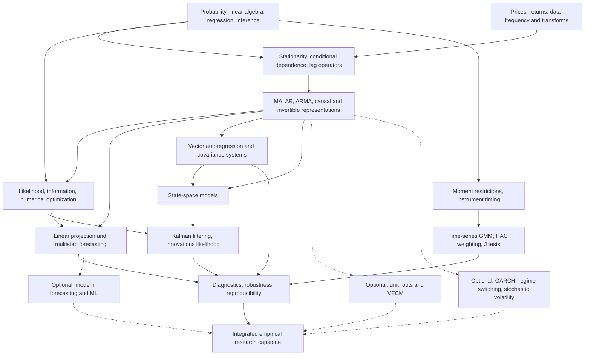

# ECON 211C — Advanced Econometrics III: Time Series Analysis

**Historical UCSC / Eric Aldrich curriculum · Graduate self-study edition · 12 weeks**

> **Scope and provenance.** This guide reconstructs a coherent **12-week self-study course** from the archived ECON 211C material in this folder, especially the *Econ 211C — Course Lecture Notes* and the original assignments and exams. It is anchored to [Eric Aldrich's ECON 211C teaching page](https://ealdrich.github.io/Teaching/Econ211C/), **not** to later UCSC incarnations of this course. The [UCSC 2020–21 catalog entry](https://catalog.ucsc.edu/en/2020-2021/general-catalog/courses/econ-economics/graduate/econ-211c) provides historical context but does not override the lecture sequence in the archived notes. The weekly pacing, labs, checkpoints, and capstone here are **self-study designs**, not claimed to be the historical instructor's original weekly syllabus.

## The purpose of the course

Time-series econometrics asks how observations evolve **through time** and how their dependence changes estimation, inference, forecasting, and economic interpretation. The archived lectures use **financial time series** as recurring examples, but the underlying tools also apply to macroeconomic indicators, interest rates, exchange rates, production, labor markets, and risk analysis.

The intellectual progression is:

**Data and returns → stochastic dependence and stationarity → linear dynamic processes → likelihood and numerical estimation → optimal forecasting → multivariate systems → unobserved-state estimation → GMM and asset-pricing moments → reproducible empirical research.**

The course has three intertwined tasks:

1. **Model a dynamic data-generating process.** Specify a probabilistic law for serial dependence; distinguish stationarity, causality in the time-series sense, and invertibility.
2. **Estimate and forecast it.** Derive appropriate estimators, quantify sampling and forecast uncertainty, check diagnostics, and evaluate forecasts on data not used to fit the model.
3. **Use models responsibly.** Separate predictive relationships from structural causal effects, state identification conditions, and test model-implied restrictions.

**Expected end state:** You can derive, implement, compare, and critique ARMA/VAR forecasts; estimate a latent-state model via the Kalman filter; formulate and estimate time-series moment conditions using GMM; and present an independently reproducible applied study.

---

## 1. Source hierarchy: what is actually in this archive?

The materials below have **different roles**. Do not treat every notebook in the archive as an original Aldrich lecture or required assignment.

| Priority | Source | Role |
|---|---|---|
| **Primary (historical course)** | [Econ 211C — Course Lecture Notes](<Econ 211C - Course Lecture Notes.pdf>) | 118-page compilation of 21 lecture units: financial preliminaries, stationarity, lag operators and ARMA, likelihood, prediction, VARs, state-space/Kalman, and GMM. **This defines the core.** |
| **Primary (historical coursework)** | [Homework](<Homework/Assignment 1.pdf>) folder: [PS1](<Homework/Assignment 1.pdf>), [PS2](<Homework/Assignment 2.pdf>), [PS3](<Homework/Assignment 3.pdf>), [PS4 solutions](<Homework/Assignment 4 Solutions.pdf>), [midterm](<Homework/midterm.pdf>), [final](<Homework/Econ 211C Final.pdf>) | Actual mathematical, simulation, estimation, forecasting, VAR, state-space, and asset-pricing GMM exercises. Some originals have solutions and R/Rmd files. |
| **Foundational reference** | [Hamilton — *Time Series Analysis*](<Hamilton_Time-Series-Analysis.pdf>) | Comprehensive advanced theory. Original PS1 explicitly cites exercises 3.1 and 3.8; PS4 solutions cite problems 13.2 and 13.4. Use other topics by subject; pagination/printing may differ. |
| **Supporting probability** | [Applied Stochastic Processes](<Applied Stochastic Processes.pdf>) | Additional probability theory, Markov chains, renewal processes, Poisson processes, continuous-time chains, and Brownian motion. **Not a prerequisite to cover in full.** |
| **Supplementary applied notebooks** | [`Applied-Econometric-Time-Series-master/`](<Applied-Econometric-Time-Series-master/README.md>) | Independent project notebooks on ARMA, GARCH, VAR/VECM, risk and applied financial econometrics. These expand rather than define the original course. |
| **Supplementary modern state space** | [`tsa-notebooks/`](<tsa-notebooks/README.md>) | Python notebooks on state-space filtering, regimes, dynamic factors, stochastic volatility, and computational extensions. |
| **Supplementary forecasting/ML** | [`Time-Series-Analysis-and-Forecasting/`](Time-Series-Analysis-and-Forecasting/) and [`End-to-End-Time-Series/`](<End-to-End-Time-Series/README.md>) | Python forecasting tutorials, including SARIMA/SARIMAX, Prophet, anomaly detection, and neural methods. Optional, not retroactively attributed to 2017. |
| **Resource directory** | [`resources.md`](resources.md) | Curated outside links for forecasting, stochastic processes, computational finance, and related tools. |

**Historical scope distinction:** The 2020–21 catalog describes linear time-series models, numerical estimation, forecasting, VAR, Kalman filtering, unit roots, and cointegration. **The archived Aldrich lecture compilation instead ends with GMM**, and does not contain a numbered unit devoted to unit-root/cointegration theory. Those topics are included below as clearly labeled **supplementary extension**, supported by the archive's VECM and cointegration notebooks. This avoids conflating course iterations.

### Navigation

- [Preparation and mathematical toolkit](#2-prerequisites-and-mathematical-toolkit)
- [Complete 12-week study plan](#3-twelve-week-sequence)
- [Detailed weekly learning guide](#4-detailed-weekly-learning-guide)
- [Derivations and model reference](#5-mathematical-reference-and-derivation-checkpoints)
- [Applied labs and capstone](#6-research-labs-and-capstone)
- [Estimator and model selection](#7-model-selection-and-identification-guide)
- [Original lecture, homework and resource index](#8-source-index)
- [Self-study and reproducibility](#9-study-workflow-and-assessment)
- [Concept dependency map](#10-concept-dependency-map)

---

## 2. Prerequisites and mathematical toolkit

**Audience:** Learners with graduate econometrics, economics, statistics, mathematics, operations research, or financial engineering preparation. The historical catalog lists ECON 211B as prerequisite; learners using this stand-alone guide should meet the equivalent competencies below.

### Expected prior knowledge

- Probability: conditional expectation, variance/covariance, normal and chi-square distributions, laws of large numbers, CLT, joint distributions, conditional density, basic measure/probability language.
- Linear algebra: vectors/matrices, eigenvalues, determinants, positive definiteness, matrix inversion, quadratic forms, matrix derivatives.
- Statistics/econometrics: OLS, ML, consistency, asymptotic normality, hypothesis testing, covariance estimation, and interpretation of regression coefficients.
- Computing: basic R objects, loops/functions, random-number generation, plotting, numerical optimization, reproducible random seeds.
- Finance examples: the difference between prices and simple/log returns; no prior derivatives-pricing course is required.

### Mathematical tools to practice first

For a series $y_t$, define the lag operator $L$ and first-difference operator $\Delta$:

$$
Ly_t=y_{t-1},\qquad L^j y_t=y_{t-j},\qquad \Delta y_t=(1-L)y_t.
$$

For a covariance-stationary process:

$$
E[y_t]=\mu,\qquad \gamma(h)=\operatorname{Cov}(y_t,y_{t-h}),\qquad \rho(h)=\frac{\gamma(h)}{\gamma(0)}.
$$

For a dynamic conditional expectation:

$$
\widehat y_{T+h\mid T}=E[y_{T+h}\mid \mathcal F_T],
$$

where $\mathcal F_T$ denotes information observed by time $T$. Distinguish the distribution of $y_{T+h}$ from its **conditional predictive distribution**.

**Optional refresher:** Read the relevant sections of *Applied Stochastic Processes* for Markov dynamics; review Gaussian likelihood and multivariate normal conditioning before Weeks 5 and 9.

### Tools

- **R is primary**, reflecting the original notes, assignments, `.R`, and `.Rmd` files. Useful libraries include `stats`, `forecast`, `quantmod`, `vars`, `KFAS` or `dlm`, and `sandwich` (verify availability locally).
- **Python is a parallel option** for supplemental notebooks: `numpy`, `pandas`, `scipy`, `statsmodels`, `matplotlib` and optional `arch`/state-space packages.
- For every empirical task, use fixed seeds, record software/package versions, and save an auditable analysis script. Historical examples use legacy data-provider endpoints; **replace broken downloads with a documented current data source**, without silently modifying the substantive exercise.

---

## 3. Twelve-week sequence

**Recommended effort:** 12–16 hours/week. Each week: theory/proofs (4–5 h), exercises (3–4 h), implementation and diagnostics (3–4 h), interpretation/report (2–3 h). All 12 weeks are a **designed self-study schedule**; the original lectures have different internal numbering.

| Week | Main problem | Historical source | Deliverable |
|---|---|---|---|
| **1** | How should economic and financial time series be represented? | Lecture 1 (PDF pp. 2–11) | Price/return analysis and data-quality notebook |
| **2** | What does stationarity mean and why does serial dependence matter? | Lecture 2 (pp. 12–18), 3.1 (pp. 19–23) | ACF/PACF and stationarity simulation report |
| **3** | How do MA, AR and ARMA models generate dynamics? | Lectures 3.2–3.5 (pp. 24–46), PS1 | Proofs of autocovariances, roots, simulation and invertibility |
| **4** | How do we infer model parameters? | Lectures 4.1–4.3 (pp. 47–70), PS2 | Conditional/ML estimation and optimizer comparison |
| **5** | What is the best linear forecast and its uncertainty? | Lectures 5.1, 5 (pp. 71–83), PS3 | Forecast derivations and rolling holdout comparison |
| **6** | How are several series modeled jointly? | Lectures 6.1–6.2 (pp. 84–92), PS3 | Multivariate VAR, forecasts, covariance analysis |
| **7** | What happens when relevant states are unobserved? | Lecture 7.1 (pp. 93–96) | State-space specification and simulated latent states |
| **8** | How are latent states filtered and estimated? | Lectures 7.2–7.3 (pp. 97–104), PS4 | Kalman implementation and likelihood checks |
| **9** | How can economic theory imply estimable moments? | Lectures 8.1–8.2 (pp. 105–111) | Derive/estimate moment conditions and identification analysis |
| **10** | How do we obtain valid GMM inference and test restrictions? | Lectures 8.3–8.4 (pp. 112–118), final | HAC weighting, efficient GMM, J test and asset-pricing exercise |
| **11** | How robust are competing dynamic models? | Original material review + supplementary notebooks | Pre-specified out-of-sample model comparison; optional GARCH/VECM |
| **12** | Can you complete and defend a reproducible empirical study? | Entire core + selected extensions | Final paper, code, figures, reproducibility audit |

Suggested graded-equivalent self-evaluation: derivations 25%, historical exercises 25%, applied labs 25%, capstone 25%. These are **recommendations**, not documented original grading weights.

---

## 4. Detailed weekly learning guide

### Week 1 — Financial data, returns, time indexing and empirical workflow

**Primary reading:** [Course Lecture Notes](<Econ 211C - Course Lecture Notes.pdf>) **Lecture 1, pp. 2–11**. This lecture opens with financial price data, `quantmod`, and simple versus continuously compounded returns.

**Core concepts:** price vs return, one- and multi-period return, compounding and log additivity, index alignment, sampling frequency, missing sessions, adjustment for splits/dividends, aggregation of financial series, plotting and exploratory statistics. Convert calendar time to observation time carefully: financial markets do not trade every calendar day.

**Essential mathematics:**

$$
R_t=\frac{P_t}{P_{t-1}},\qquad r_t=R_t-1,\qquad \ell_t=\log P_t-\log P_{t-1}.
$$

$$
\sum_{j=0}^{h-1}\ell_{t-j}=\log\left(\frac{P_t}{P_{t-h}}\right),\qquad
\prod_{j=0}^{h-1}(1+r_{t-j})=\frac{P_t}{P_{t-h}}.
$$

**Work:** import a daily financial series and a monthly macro series, preserve a raw copy, compute returns/growth rates, document adjustments, plot levels and transformed observations, create summary measures by subperiod. Explain why modeling price levels and modeling returns can give fundamentally different statistical problems.

**Checkpoint:** derive the multi-period formulas and explain the data-generating assumptions needed before fitting any model. **Submit:** a short data dictionary, plots, and reproducible import/cleaning script. **Application:** interest-rate or exchange-rate return diagnostics.

### Week 2 — Stochastic processes, stationarity, dependence and lag operators

**Primary reading:** Lectures **2 (pp. 12–18)** and **3.1 (pp. 19–23)**; Hamilton topics on stationarity/autocovariance.

**Core concepts:** processes as sequences of random variables, strict versus covariance stationarity, white noise versus independent innovations, ACF, partial autocorrelation as conditional linear relationships, conditional/unconditional moments, stochastic trends and structural changes. Work with lag polynomials as operators rather than treating $L$ as a numerical parameter.

**Derivation:** Show that covariance stationarity requires finite variance, time-constant mean, and autocovariance dependent only on lag; construct a nonstationary random walk and contrast it with a stationary AR(1). Show that differencing a random walk produces its innovation sequence.

**Work:** simulate white noise, stationary AR(1), near-unit-root AR(1), and random walk (multiple sample lengths). Compare sample ACF/PACF to their population implications and record how persistent series can mislead casual visual interpretation.

**Checkpoint:** can you distinguish white noise, iid, martingale differences, and stationarity? **Submit:** annotated simulation notebook and two-page interpretation memo. **Application:** equity returns versus the price level; inflation rate versus price index.

### Week 3 — Linear models: MA, AR, ARMA, stability and invertibility

**Primary reading:** Lectures **3.2–3.5 (pp. 24–46)**; [PS1](<Homework/Assignment 1.pdf>), [PS1 solutions](<Homework/Assignment 1 Solutions.pdf>). Hamilton **exercises 3.1 and 3.8 are cited in PS1**.

**Core concepts:** Wold-style linear innovation representations, finite MA and autoregressive recursions, ARMA lag polynomials, the roots outside the unit circle criterion, stationary/causal AR expansions, invertible MA expansions, spectral intuition, observational equivalence of invertible/noninvertible representations.

**Derivation tasks:** compute the MA(1) autocovariance sequence; derive stationary AR(1) mean, variance and ACF; express a causal ARMA as $\psi(L)\varepsilon_t$; explain how invertibility recovers innovations from observed series. The time-series technical term **causal process** is about representation in current/past innovations—not an econometric identification claim.

**Historical exercise:** PS1 asks for autocovariances, an invertible representation of an MA(2), simulation comparisons for MA(1) signs, and recursion/simulation exercises for an ARMA process. Replicate the Monte Carlo with fixed seeds and explain finite-sample departures.

**Checkpoint:** draw roots in the complex plane and explain which parameter restrictions guarantee stationarity versus invertibility. **Submit:** derivation set, root checker, and simulation table. **Application:** persistence and shock propagation in financial returns.

### Week 4 — Likelihood, estimation, numerical optimization and finite-sample behavior

**Primary reading:** Lectures **4.1–4.3 (pp. 47–70)**; [PS2](<Homework/Assignment 2.pdf>) and [solutions](<Homework/Assignment 2 Solutions.pdf>). Review the [midterm](<Homework/midterm.pdf>) as a formative exam.

**Core concepts:** joint and conditional likelihood, normal innovations, conditional versus exact ML for dynamic models, estimation by least squares, score and information, Hessian, asymptotic covariance, numerical grid search and gradient methods, initial conditions, near-boundary behavior, optimizer convergence.

**Derive:** the conditional Gaussian AR(1)/AR($p$) log likelihood; compare a Gaussian AR(1) conditional ML estimate with OLS under matching conditioning assumptions. Write general score and observed information expressions and explain how correlated observations alter a likelihood factorization.

**Historical exercise:** PS2 contains Weibull likelihood/information calculations and Monte Carlo AR model comparison; the midterm includes Poisson ML and finite-sample coverage simulations. Treat the distribution exercises as **generic estimation tools** later reused for time series.

**Work:** program a conditional AR($p$) log-likelihood function and estimate with `optim()`; benchmark against a package, use multiple starts, constrain admissible parameters, and examine bias/RMSE across simulation sizes.

**Checkpoint:** diagnose a local optimum, nonpositive Hessian, and incorrectly initialized likelihood. **Submit:** simulation study plus inference summary. **Application:** forecasting models estimated on short financial samples.

### Week 5 — Prediction, projection, multistep forecasting and uncertainty

**Primary reading:** Lectures **5.1 (pp. 71–78)** and **5 (pp. 79–83)**; [PS3](<Homework/Assignment 3.pdf>) forecasting exercise.

**Core concepts:** conditional expected-value prediction, linear projection, forecast information sets, infinite-past and finite-sample predictors, orthogonality, one-step versus iterated $h$-step forecasts, innovations, forecast errors and mean-squared error, parameter uncertainty, rolling/expanding windows.

**Derive:** the AR(1) $h$-step forecast and its error variance from a causal innovation expansion. Solve projection coefficients from covariance equations and explain when a linear predictor coincides with the full conditional expectation.

**Historical exercise:** PS3 asks for exact finite-sample and multistep forecasts for an ARMA process, simulation comparisons, and estimated-model forecast accuracy. It is an ideal mid-course assessment.

**Work:** design a rolling-origin benchmark with a random-walk/no-change forecast, AR(1), ARMA, and historical-mean model; compare RMSE/MAE, prediction-interval coverage and interval width. Avoid **random train/test shuffling** on chronological data.

**Checkpoint:** identify leakage in a forecasting procedure, distinguish uncertainty conditional on known parameters from parameter uncertainty. **Submit:** rolling forecast evaluation and a concise model-selection decision. **Application:** forecasting CPI inflation, business-cycle indicators, or market returns.

### Week 6 — Vector autoregressions and multivariate dependence

**Primary reading:** Lectures **6.1–6.2 (pp. 84–92)**; [PS3](<Homework/Assignment 3.pdf>) **Question 2** on EUR/USD returns and order flow.

**Core concepts:** VAR($p$) as a multivariate AR, cross-lag coefficients, reduced-form innovations and contemporaneous covariance, stationarity via companion-matrix eigenvalues, vector autocovariances, impulse responses to reduced-form innovations, multivariate prediction, lag selection and residual cross-correlation.

**Core equation:**

$$
\mathbf y_t=\mathbf c+\sum_{j=1}^{p}A_j\mathbf y_{t-j}+\mathbf u_t,
\qquad E[\mathbf u_t\mathbf u_t']=\Sigma_u.
$$

**Derive:** the matrix form of a VAR(2), vector MA recursion $\Psi_h$, and $\Gamma(-h)=\Gamma(h)'$. Check that arbitrary reduced-form shocks are **not automatically identified economic shocks**; an economic interpretation of structural impulse responses requires additional restrictions.

**Historical exercise:** estimate a VAR for one-minute exchange-rate returns and signed order flow, document the contemporaneous covariance and predictive cross-lags. The original question references a dataset not necessarily included in this ZIP; if it is missing, **record that limitation and use a declared substitute**, not an invented original dataset.

**Checkpoint:** tell a VAR coefficient, a forecast impulse response, and a structural causal impulse response apart. **Submit:** VAR report and diagnostic plots. **Application:** macro indicator interactions, interest-rate yield movements, liquidity/order-flow dynamics.

### Week 7 — Hidden states, state-space representations and observation noise

**Primary reading:** Lecture **7.1 (pp. 93–96)**. Optional support: [`tsa-notebooks/local_level_nile.ipynb`](tsa-notebooks/local_level_nile.ipynb) and [`tsa-notebooks/state_space_python.ipynb`](tsa-notebooks/state_space_python.ipynb).

**Core concepts:** latent states, measurement equation versus transition equation, process noise vs measurement noise, linear-Gaussian assumptions, initial distributions, observability/identifiability, representing ARMA models in state-space form, why different state choices can encode equivalent observation models.

**Model:**

$$
\mathbf x_t=F\mathbf x_{t-1}+\mathbf w_t,\quad \mathbf w_t\sim (0,Q),
\qquad \mathbf y_t=H\mathbf x_t+\mathbf v_t,\quad \mathbf v_t\sim(0,R).
$$

**Work:** construct a local-level model ($x_t=x_{t-1}+w_t$, $y_t=x_t+v_t$), simulate with multiple signal-to-noise ratios, and explain why simply regressing observations on time does not recover a latent dynamic state in general. Specify an AR(1) as state-space and trace dimensions of every matrix.

**Checkpoint:** identify what is observed, what is latent, and what is assumed independent. **Submit:** a model specification sheet and simulated hidden-state data. **Application:** real-time extraction of a latent economic trend or underlying market price.

### Week 8 — Kalman filtering and likelihood for state-space models

**Primary reading:** Lectures **7.2 (pp. 97–102)** and **7.3 (pp. 103–104)**; [PS4 solution document](<Homework/Assignment 4 Solutions.pdf>) (Hamilton problems 13.2, 13.4). Optional Python: [`kalman_filter_initialization_stationary.ipynb`](tsa-notebooks/kalman_filter_initialization_stationary.ipynb).

**Core concepts:** predict-update recursion, Gaussian innovations, forecast mean/covariance, Kalman gain, filtering versus smoothing, steady-state filtering, likelihood from one-step errors, practical initialization and numerical stability.

**Derive:** the innovations $\nu_t$, forecast covariance $S_t$, and the gain minimizing mean-squared state estimation error. Explain how the filter yields a likelihood for observed data under Gaussian conditions. Implement the simple model from Week 7 both from first principles and in a vetted library; compare the two.

**Historical exercise:** PS4 solution derives state-space representations for ARMA special cases and works through likelihood/filtering algebra; verify results without copying. **Checkpoint:** monitor positive-semidefinite covariance estimates and explain the meaning of the innovation test. **Submit:** filter implementation, filtered-state plot with uncertainty intervals, and likelihood comparison. **Application:** nowcasting, term-structure factors, time-varying latent trends.

### Week 9 — Method of moments and GMM identification

**Primary reading:** Lectures **8.1 (pp. 105–108)** and **8.2 (pp. 109–111)**.

**Core concepts:** matching population to sample moments, moment restrictions, instruments, identified versus overidentified models, consistency under stationary/ergodic dependence and regularity, nonlinear optimization of sample moments. Distinguish the **economic source of a moment restriction** from the numerical objective used to estimate parameters.

**Derive:** a simple method-of-moments estimator; formulate moment conditions for a linear orthogonality model, then for a consumption-based asset-pricing Euler equation. Count parameters and usable moment restrictions and discuss instrument relevance/validity, not merely the number of conditions.

**Work:** write a function that evaluates a vector of time-series sample moments; build an exactly identified and an overidentified experiment. Compare GMM point estimates under two valid, positive-definite weighting matrices in finite samples.

**Checkpoint:** can you explain what economic assumption implies each $E[h(\theta,Y_t)]=0$ restriction? **Submit:** moment-mapping table and initial GMM estimator. **Application:** asset pricing and macroeconomic Euler-equation estimation.

### Week 10 — Efficient weighting, long-run covariance, and GMM tests

**Primary reading:** Lectures **8.3 (pp. 112–114)** and **8.4 (pp. 115–118)**; [historical final](<Homework/Econ 211C Final.pdf>), [final R code](<Homework/Final Code.R>).

**Core concepts:** serially correlated sample moment conditions, long-run covariance, HAC estimation, feasible optimal weighting, sandwich variance, two-step and iterated GMM, weak identification cautions, overidentifying-restrictions J test, numerical sensitivity and model rejection.

**Derive:** asymptotic covariance for a general GMM estimator and simplify it under the optimal weighting matrix. Explain why the $J$ test asymptotically uses degrees of freedom equal to **number of overidentifying moment restrictions**, under its validity conditions.

**Historical exercise:** the final sets a consumption-based asset-pricing model and asks students to write instrumented Euler-equation moments, estimate parameters and test overidentifying restrictions. Reproduce the **logic** independently, using the original provided data if present or a clearly documented substitute.

**Checkpoint:** distinguish rejection of model-implied orthogonality from proof of a particular alternative economic mechanism. **Submit:** well-commented GMM estimation code and 3–5-page technical memo. **Application:** empirical asset pricing, monetary-policy rules, macroeconomic structural restrictions.

### Week 11 — Diagnostic robustness and carefully separated advanced extensions

**Primary source:** Revisit Weeks 3–10 and the original assignments. **Optional extensions** chosen from notebooks below; none should be confused with the numbered Aldrich lectures.

**Core synthesis:** compare estimates and forecasts as sample period, lag order, initialization, distributional assumptions, and frequency change. Test parameter stability and residual dependence; document multiple-comparison and post-selection concerns. Decide what evidence favors a model and what remains unresolved.

**Choose one extension path (not all):**

- **Financial volatility:** [`Volatility Modelling.ipynb`](<Applied-Econometric-Time-Series-master/Univariate Volatility Models/Volatility Modelling.ipynb>) and [`GARCH Process and The Box-Jenkins Methodology.ipynb`](<Applied-Econometric-Time-Series-master/Univariate Volatility Models/GARCH Process and The Box-Jenkins Methodology.ipynb>) for ARCH/GARCH variance dynamics.
- **Unit roots / cointegration / VECM:** [`Cointegrated VAR and VECM.ipynb`](<Applied-Econometric-Time-Series-master/Multivariate Time Series Analysis/Cointegrated VAR and VECM.ipynb>) for integration, long-run equilibrium relations and error correction; explicitly **catalog-aligned extension, not a numbered 2017 lecture**.
- **State-space beyond Gaussian linear models:** [`markov_regression.ipynb`](tsa-notebooks/markov_regression.ipynb), [`stochastic_volatility_qmle.ipynb`](tsa-notebooks/stochastic_volatility_qmle.ipynb), or [`statespace_large_dynamic_factor_models.ipynb`](tsa-notebooks/statespace_large_dynamic_factor_models.ipynb).
- **Modern forecasting comparisons:** [`10- ARMA_and_ARIMA.ipynb`](<Time-Series-Analysis-and-Forecasting/10- ARMA_and_ARIMA.ipynb>), [`11- SARIMA.ipynb`](<Time-Series-Analysis-and-Forecasting/11- SARIMA.ipynb>), or the Prophet/LSTM examples under `End-to-End-Time-Series/`; treat these as empirical benchmarks rather than automatically superior methods.

**Work:** pre-register one principal metric, use chronologically valid training/validation windows, and report uncertainty and sensitivity. **Submit:** model-comparison memo and extension notebook. **Application:** financial risk forecasts, macro nowcasting, or equilibrium error-correction analysis.

### Week 12 — Integrative research and oral defense

**Objective:** deliver a piece of reproducible applied time-series econometrics that uses at least **two major methods from different parts of the historical core** (for example ARMA + VAR, VAR + Kalman, or ARMA + GMM).

**Minimum final product:** research question; economic context; explicit forecasting or structural objective; data provenance; mathematical model assumptions; derivation/estimation; diagnostics; chronological holdout; alternative specifications; uncertainty; limitations; and a concise account of what is **predictive** versus **causal**.

**Suggested projects:** jointly model inflation and an interest rate with a VAR, filter a latent inflation trend and compare forecasts, study high-frequency exchange-rate returns/order flow, evaluate a consumption-based Euler equation with time-series GMM, or compare ARMA and volatility forecasts in a market-risk setting.

**Submit:** 10–15-page paper, code/run instructions, data dictionary, saved outputs, and a 10-minute recorded or written defense addressing identification, uncertainty, alternative specifications, and reproducibility.

---
## 5. Mathematical reference and derivation checkpoints

This section provides the **minimum mathematical spine** of the course. It is a map of results to derive, not a substitute for the course notes or Hamilton. Unless stated otherwise, assume the needed finite moments, stability, regularity, and distributional conditions.

### 5.1 Returns, logarithms and scale

For an asset price $P_t>0$, simple and log returns are different objects:

$$
R_t^{(\mathrm{simple})}=\frac{P_t-P_{t-1}}{P_{t-1}},\qquad
r_t^{(\log)}=\log P_t-\log P_{t-1}=\log\bigl(1+R_t^{(\mathrm{simple})}\bigr).
$$

A log return aggregates by addition over time, but **cross-asset portfolio returns** are weighted averages of **simple** returns (with beginning-of-period weights), not generally of log returns.

**Derive:** why time aggregation of continuously compounded returns is exact; why compounding matters for multi-period return evaluation; how data transformations affect the interpretation of a shock.

### 5.2 White noise, weak stationarity and innovations

$$
E[\varepsilon_t]=0,\qquad
\operatorname{Var}(\varepsilon_t)=\sigma_\varepsilon^2,\qquad
\operatorname{Cov}(\varepsilon_t,\varepsilon_s)=0 \quad(t\ne s).
$$

White noise is **uncorrelated**, not necessarily independent or Gaussian. Weak stationarity is a restriction on first and second moments; strict stationarity concerns all finite-dimensional distributions. Economic data can also feature regime changes and time-varying variance, so specify precisely which form is assumed.

### 5.3 MA(1): autocovariance cut-off and invertibility

$$
y_t=\mu+\varepsilon_t+\theta\varepsilon_{t-1}.
$$

$$
\gamma(0)=(1+\theta^2)\sigma_\varepsilon^2,\qquad
\gamma(1)=\theta\sigma_\varepsilon^2,\qquad
\gamma(h)=0\quad(|h|>1).
$$

A standard invertible MA(1) representation has $|\theta|<1$. Distinct parameter/innovation-variance choices can lead to the same second-order distribution of observations. **Derive** the autocovariance expressions and an invertible observationally equivalent representation for a noninvertible MA(1).

### 5.4 AR(1): persistence, stationarity, and forecast error

$$
y_t=c+\phi y_{t-1}+\varepsilon_t,\qquad |\phi|<1.
$$

$$
\mu=\frac{c}{1-\phi},\qquad
\operatorname{Var}(y_t)=\frac{\sigma_\varepsilon^2}{1-\phi^2},\qquad
\rho(h)=\phi^{|h|}.
$$

For known parameters, the $h$-step conditional mean and innovation forecast-error variance are:

$$
\widehat y_{T+h\mid T}=\mu+\phi^h(y_T-\mu),
$$

$$
\operatorname{Var}(y_{T+h}-\widehat y_{T+h\mid T}\mid\mathcal F_T)
=\sigma_\varepsilon^2\sum_{j=0}^{h-1}\phi^{2j}
=\sigma_\varepsilon^2\frac{1-\phi^{2h}}{1-\phi^2}.
$$

**Derive:** every formula from repeated substitution, explaining where future innovations disappear under conditional expectation. Test the MSE expression by Monte Carlo as in the original midterm.

### 5.5 ARMA($p,q$): lag-polynomial representation

$$
\phi(L)(y_t-\mu)=\theta(L)\varepsilon_t,
$$

$$
\phi(L)=1-\sum_{j=1}^p\phi_jL^j,\qquad
\theta(L)=1+\sum_{j=1}^q\theta_jL^j.
$$

The usual causal stationary ARMA representation requires roots of $\phi(z)=0$ outside the complex unit circle; invertibility requires roots of $\theta(z)=0$ outside the unit circle. Under these conditions:

$$
y_t-\mu=\psi(L)\varepsilon_t,
\qquad \psi(L)=\frac{\theta(L)}{\phi(L)}=\sum_{j=0}^{\infty}\psi_jL^j.
$$

**Derive:** the first few $\psi_j$ coefficients for an ARMA(1,1), recursion for $\psi_j$, and consequences for impulse persistence. **Terminology:** a *causal ARMA representation* does **not** establish an economic intervention effect.

### 5.6 Likelihood and numerical estimation

For Gaussian conditional AR($p$), with $T-p$ modeled observations and $e_t(\theta)=y_t-c-\sum_{j=1}^p\phi_j y_{t-j}$:

$$
\ell_c(\theta)=
-\frac{T-p}{2}\log(2\pi)
-\frac{T-p}{2}\log(\sigma^2)
-\frac{1}{2\sigma^2}\sum_{t=p+1}^{T}e_t(\theta)^2.
$$

The objective differs from an **exact unconditional likelihood**, which also models the joint distribution of initial observations. Define:

$$
s_T(\theta)=\frac{\partial\ell_T(\theta)}{\partial\theta},\qquad
\mathcal J_T(\theta)=-\frac{\partial^2\ell_T(\theta)}{\partial\theta\partial\theta'}.
$$

**Derive:** conditional likelihood and its connection to OLS under Gaussian AR assumptions. Explain why a numerically small gradient alone does not guarantee a global solution or a correctly specified dynamic model.

### 5.7 Linear projection and forecast evaluation

With $Y$ the target and $X$ a vector of predictors, the mean-square optimal **linear** forecast of $Y$ takes the form $a+b'X$ with:

$$
b=\operatorname{Var}(X)^{-1}\operatorname{Cov}(X,Y),\qquad
a=E[Y]-b'E[X],
$$

assuming an invertible covariance matrix. The full conditional mean $E[Y\mid X]$ is the best measurable predictor under squared error, and is linear under appropriate assumptions such as joint Gaussianity.

A rolling or expanding-origin experiment with forecast errors $e_{t+h\mid t}$ can compare:

$$
\operatorname{RMSE}=\sqrt{\frac{1}{N}\sum_{t=1}^{N}e_{t+h\mid t}^2},\qquad
\operatorname{MAE}=\frac{1}{N}\sum_{t=1}^{N}|e_{t+h\mid t}|.
$$

**Required safeguards:** same holdout observations, same horizons, data known as of forecast origin, declared loss function, no look-ahead optimization, and honest interval coverage.

### 5.8 VAR and multivariate dynamic effects

For a mean-adjusted stable VAR($p$):

$$
\mathbf z_t=\sum_{j=1}^p A_j\mathbf z_{t-j}+\mathbf u_t,
\qquad E[\mathbf u_t\mathbf u_t']=\Sigma_u.
$$

A stable VAR admits the innovation expansion:

$$
\mathbf z_t=\sum_{h=0}^{\infty}\Psi_h\mathbf u_{t-h},
\qquad \Psi_0=I,\quad
\Psi_h=\sum_{j=1}^{\min(h,p)}A_j\Psi_{h-j}.
$$

The response $\Psi_h\mathbf v$ depends on how the proposed innovation $\mathbf v$ is defined. **Reduced-form residuals can be correlated.** Cholesky orthogonalization assumes an ordering; structurally identified shocks require economic or other credible additional restrictions.

**Derive:** a two-variable VAR(1) matrix forecast, 2-step covariance and first three $\Psi_h$ matrices. **Explain:** Granger predictability is about incremental conditional forecasting performance and does not by itself establish structural causation.

### 5.9 State-space models and the Kalman filter

With the Week 7 timing convention, let

$$
\begin{aligned}
\mathbf x_t &=F\mathbf x_{t-1}+\mathbf w_t,\qquad \mathbf w_t\sim N(0,Q),\\
\mathbf y_t &=H\mathbf x_t+\mathbf v_t,\qquad \mathbf v_t\sim N(0,R),
\end{aligned}
$$

with independent state/measurement innovations under the simple formulation. Let $m_{t-1}$ and $P_{t-1}$ denote the **filtered** previous state mean and covariance. Prediction:

$$
\begin{aligned}
a_t&=Fm_{t-1},\\
P_t^-&=FP_{t-1}F'+Q,\\
\nu_t&=\mathbf y_t-Ha_t,\\
S_t&=HP_t^-H'+R.
\end{aligned}
$$

Update:

$$
\begin{aligned}
K_t&=P_t^-H'S_t^{-1},\\
m_t&=a_t+K_t\nu_t,\\
P_t&=(I-K_tH)P_t^-.
\end{aligned}
$$

The last covariance form is algebraically standard but may lose symmetry numerically; the **Joseph form** is preferable for numerical robustness:

$$
P_t=(I-K_tH)P_t^-(I-K_tH)'+K_tRK_t'.
$$

For Gaussian observation innovations of dimension $n$, the innovations log likelihood is

$$
\ell(\theta)=-\frac12\sum_{t=1}^{T}
\left[n\log(2\pi)+\log|S_t|+\nu_t'S_t^{-1}\nu_t\right].
$$

**Derive:** the Kalman gain via linear mean-square error minimization, and illustrate how a local-level model trades off measurement precision against state evolution. Check matrix shapes at each step. The archived notes use a slightly different state timing/transpose convention; reconcile notation instead of assuming a contradiction.

### 5.10 GMM: moments, dependence, optimal weighting and model tests

For true parameter $\theta_0\in\mathbb R^k$, moment function $h_t(\theta)\in\mathbb R^r$ ($r\ge k$), and average $\bar g_T(\theta)$:

$$
E[h_t(\theta_0)]=0,\qquad
\bar g_T(\theta)=\frac1T\sum_{t=1}^T h_t(\theta).
$$

A GMM estimate minimizes:

$$
\widehat\theta=\arg\min_\theta\;\bar g_T(\theta)'W_T\bar g_T(\theta),
\qquad W_T\succ0.
$$

Under valid stationary time-series asymptotics, the long-run covariance of moments is

$$
S=\sum_{j=-\infty}^{\infty}\Gamma_j,
\qquad \Gamma_j=E[h_t(\theta_0)h_{t-j}(\theta_0)'].
$$

With $D=E[\partial h_t(\theta_0)/\partial\theta']$ and limiting positive-definite $W$, the asymptotic covariance of $\sqrt T(\widehat\theta-\theta_0)$ is

$$
V(W)=(D'WD)^{-1}D'WSWD(D'WD)^{-1}.
$$

For optimal $W=S^{-1}$, this simplifies to

$$
V_{\mathrm{eff}}=(D'S^{-1}D)^{-1},
$$

so the approximate covariance of $\widehat\theta$ itself is $V_{\mathrm{eff}}/T$. With $r>k$, the overidentification statistic is

$$
J_T=T\,\bar g_T(\widehat\theta)'\widehat S^{-1}\bar g_T(\widehat\theta)
\;\xrightarrow{d}\;\chi^2_{r-k},
$$

**under the null and the necessary validity/regularity assumptions.** A small $J$-test $p$-value is evidence against the **joint** moment restrictions; it does not reveal which moment or economic assumption is false. Weak identification, moment misspecification, poor HAC bandwidth choice, and insufficient sample size complicate inference.

### 5.11 Economic moment restrictions: a consumption-based example

A representative asset-pricing Euler restriction, under the associated preference and market assumptions, is

$$
E_t\!\left[\beta\left(\frac{C_{t+1}}{C_t}\right)^{-\gamma}R_{t+1}-1\right]=0.
$$

With $\mathcal F_t$-measurable instruments $Z_t$, unconditional moments are

$$
E\!\left[Z_t\left\{\beta\left(\frac{C_{t+1}}{C_t}\right)^{-\gamma}R_{t+1}-1\right\}\right]=0.
$$

**Derive:** why valid instruments must belong to the decision-maker's relevant time-$t$ information set and why overidentification tests are useful but cannot, on their own, validate all modeling assumptions. Confirm timing carefully when translating between simple and gross returns.

### 5.12 Optional advanced formulas — not original numbered lectures

Unit-root and cointegration analysis (catalog-aligned supplementary material):

$$
\Delta y_t=\alpha+\rho y_{t-1}+\sum_{j=1}^p\delta_j\Delta y_{t-j}+u_t
$$

is a standard ADF-type representation when testing for a unit root via $\rho=0$ (the relevant null distribution is nonstandard). For cointegrated variables, a VECM may take the form

$$
\Delta\mathbf y_t=\Pi\mathbf y_{t-1}+\sum_{j=1}^{p-1}\Gamma_j\Delta\mathbf y_{t-j}+\mathbf u_t,
\qquad \Pi=\alpha\beta'.
$$

A supplementary GARCH(1,1) volatility model uses

$$
\varepsilon_t=\sqrt{h_t}z_t,\qquad
h_t=\omega+\alpha\varepsilon_{t-1}^2+\beta h_{t-1},
$$

with common positivity and persistence restrictions. Such volatility models explain conditional second-moment dynamics rather than the main ARMA conditional mean alone. Do not confuse a good volatility forecast with a correct mean or return forecast.

---

## 6. Research labs and capstone

All labs below are **proposed practice activities** designed around the historical sources, not claims about unprovided original assignments.

| Lab | Core connection | Required output | Suggested archive support |
|---|---|---|---|
| **A. Stationary-process simulation** | Wk 2–4: theoretical autocovariance ↔ simulated evidence | 1,000+ replications across sample sizes, theoretical-versus-sample ACF, estimator bias/RMSE | PS1, PS2, R/Rmd scripts |
| **B. Genuine out-of-sample forecasting** | Wk 5: projection ↔ time-valid prediction | AR/ARMA benchmarks, error by horizon, test-set decision, coverage plots | PS3, `arma11_cpi_inflation.ipynb` |
| **C. Multivariate exchange-rate microstructure** | Wk 6: reduced-form VAR ↔ joint dynamics | Lag selection, cross-covariance, forecasts, shock interpretation limitations | PS3 Q2; supplementary VAR notebooks |
| **D. Hidden state / Kalman** | Wk 7–8: latent process ↔ measurement/noise | Hand-coded filter vs library, log likelihood, uncertain state estimate | PS4; Nile / Python state-space notebooks |
| **E. Euler-equation GMM** | Wk 9–10: economic theory ↔ valid moments | Instrument set, HAC covariance, optimal weighting, J test, sensitivity | Original final, Final Code.R |
| **F. Competing models / stress test** | Wk 11–12: fit ↔ stability ↔ practical decision | Rolling-origin comparative study, break/regime critique, reproducible memo | Any original + clearly labeled optional notebook |

### Capstone design: one coherent question, two methodologies

Choose **one primary research question** with an explicit target. Examples:

1. **Macro forecasting:** Do ARMA and latent-state filtering materially improve inflation forecasts relative to persistence and naïve benchmarks?
2. **FX dynamics:** Do order-flow innovations help forecast exchange-rate returns after controlling for own lags? What is predictable without inferring structural causality?
3. **Interest rates:** How well do VAR and Kalman factor models summarize yield movements? Does performance hold across policy regimes?
4. **Finance + economic theory:** Can a consumption Euler equation explain returns under alternative instruments and HAC specifications?
5. **Volatility supplement:** Does forecasting time-varying conditional variance improve risk forecasts over constant-variance models?

**Research sequence:** formulate question → document dataset → specify information sets and estimands → derive model → implement → check assumptions and residual behavior → evaluate out of sample where appropriate → test sensitivity → report economic interpretation and remaining uncertainty.

**Required reproducibility artifacts:** `README` explaining execution, version/session information, scripts/Rmd/IPYNB, source or retrieval recipe for data, fixed seeds, frozen outputs, and an explicit note identifying which parts use the original course versus your supplementary investigation.

**Proposed paper structure:** (1) question/motivation, (2) theory and prior modeling assumptions, (3) data, (4) methods and identification, (5) estimation/diagnostics, (6) forecasting or moment-test evidence, (7) robustness, (8) interpretation, (9) limitations, (10) references/code.

### Technical quality checklist

- [ ] Date and frequency alignment is correct; no future information used at earlier dates.
- [ ] Training, validation and test periods are declared before model comparison.
- [ ] Means/variance assumptions and unit-root/stability concerns are explicit.
- [ ] Parameter restrictions (roots, variances, eigenvalues) are checked and reported.
- [ ] Likelihood initial conditions, numerical tolerances and convergence diagnostics are documented.
- [ ] Multistep forecasts and intervals use the correct information set and horizon.
- [ ] Residual ACF, heteroskedasticity, instability and distributional misspecification are examined.
- [ ] VAR shocks are not labeled structural without an identification argument.
- [ ] Kalman initialization and state/observation-noise assumptions are explained.
- [ ] GMM instrument timing, identification and long-run covariance construction are defensible.
- [ ] Model complexity and tuning do not exploit future test data.
- [ ] Conclusion states the practical magnitude, uncertainty, limitations, and whether evidence is predictive or causal.

---

## 7. Model selection and identification guide

Choose methods by the **research question, dependence structure, and maintained assumptions**, not by novelty.

| Observed problem | First method to consider | Essential validation | A common wrong inference |
|---|---|---|---|
| Persistent, approximately stationary single series | AR, MA, ARMA | Roots, innovation diagnostics, rolling forecasts | 'High in-sample fit means useful forecast' |
| Model parameters must be estimated from dependent data | Conditional/exact likelihood, dynamic regression | Likelihood construction, information, optimizer, initial conditions | 'Optimized likelihood means correct model' |
| Multiple mutually predictive variables | VAR | Companion stability, residual covariance, lag order, rolling validation | 'Granger prediction proves policy causation' |
| Unobserved changing economic state | Linear-Gaussian state space and Kalman | State observability, noise covariance, initialization, innovations | 'Filtered state is directly observed truth' |
| Theory imposes orthogonality conditions | Time-series GMM | Instruments, rank, serial-correlation robust covariance, J tests | 'A passed J test establishes the theory' |
| Integrated levels with potential equilibrium relation | Unit-root / cointegration / VECM **extension** | Integration order, deterministic terms, rank, specification | 'Spurious levels regression demonstrates equilibrium' |
| Volatility clusters in returns | ARCH/GARCH **extension** | Conditional variance diagnostics and volatility holdout | 'Good volatility model predicts price direction' |
| Suspected regime changes | Structural-break tests, Markov switching **extension** | Stability, transition identification, predictive validation | 'Every parameter change is a known policy regime' |
| Black-box forecast may be competitive | Statistical learning **extension** | Chronological splits, baselines, leakage, computational cost | 'Lowest historical training error will generalize' |

### The five meanings of “dynamic causality” worth separating

1. **ARMA causal representation:** can $y_t$ be expressed using current/past innovations?
2. **Invertibility:** can innovations be recovered from current/past observations?
3. **Granger causality/predictability:** do past values of one series add predictive information for another, conditional on the chosen information set?
4. **Structural impulse response:** what is the effect of a particular identified economic shock given identifying restrictions?
5. **Policy causal effect:** what outcome would change under an actual intervention, requiring a suitable research design or substantive identification strategy?

These are **not synonyms**. ECON 211C builds the mathematical machinery for (1)–(3); it supports discussions of (4) and (5) only with additional identifying assumptions or other methods.

---

## 8. Source index

### Lecture-by-lecture map

All page references below mean **PDF page numbers of the bundled 118-page** [Course Lecture Notes](<Econ 211C - Course Lecture Notes.pdf>), **not** Hamilton chapter/page numbers.

| Notes unit | PDF pages | Topic | Self-study week |
|---|---:|---|---:|
| Lecture 1 | 2–11 | Finance preliminaries, return calculations, R/quantmod | 1 |
| Lecture 2 | 12–18 | Stationarity and time-series dependence | 2 |
| Lecture 3.1 | 19–23 | Lag operators | 2 |
| Lecture 3.2 | 24–31 | MA processes and ACF | 3 |
| Lecture 3.3 | 32–39 | AR processes and dynamics | 3 |
| Lecture 3.4 | 40–42 | ARMA processes | 3 |
| Lecture 3.5 | 43–46 | Causality and invertibility | 3 |
| Lecture 4.1 | 47–60 | ML estimation and statistical foundations | 4 |
| Lecture 4.2 | 61–66 | ARMA ML | 4 |
| Lecture 4.3 | 67–70 | Numerical optimization | 4 |
| Lecture 5.1 | 71–78 | ARMA forecasting | 5 |
| Lecture 5 | 79–83 | Linear projection / forecasting | 5 |
| Lecture 6.1 | 84–88 | VARs | 6 |
| Lecture 6.2 | 89–92 | Vector autocovariances | 6 |
| Lecture 7.1 | 93–96 | State-space model formulation | 7 |
| Lecture 7.2 | 97–102 | Kalman filtering | 8 |
| Lecture 7.3 | 103–104 | State-space ML | 8 |
| Lecture 8.1 | 105–108 | Method of moments | 9 |
| Lecture 8.2 | 109–111 | GMM estimator | 9 |
| Lecture 8.3 | 112–114 | Optimal GMM weighting | 10 |
| Lecture 8.4 | 115–118 | Overidentifying restrictions | 10 |

**Observation:** This is an unusually useful source map because it follows the archived lecture headings exactly. It gives later econometrics courses a precise dependency trail without importing later ECON 211C topics.

### Historical assignment and exam map

| Source | Verified substantive focus | Where it fits |
|---|---|---|
| [Assignment 1](<Homework/Assignment 1.pdf>) / [solutions](<Homework/Assignment 1 Solutions.pdf>) / [Rmd](<Homework/Assignment 1.Rmd>) | MA/ARMA autocovariances, invertibility, analytical-vs-simulated results, finite-sample comparisons | Weeks 2–3 |
| [Assignment 2](<Homework/Assignment 2.pdf>) / [solutions](<Homework/Assignment 2 Solutions.pdf>) / [Rmd](<Homework/Assignment 2.Rmd>) | Parametric likelihood/information, dynamic-model Monte Carlo and model specification | Week 4 |
| [Assignment 3](<Homework/Assignment 3.pdf>) / [solutions](<Homework/Assignment 3 Solutions.pdf>) / [Rmd](<Homework/Assignment 3.Rmd>) | Finite-sample, multi-step ARMA forecasts; EUR/USD returns and order-flow VAR | Weeks 5–6 |
| [Assignment 4 solutions](<Homework/Assignment 4 Solutions.pdf>) | Hamilton 13.2 and 13.4; state-space/ARMA conversion and Kalman likelihood | Weeks 7–8 |
| [Midterm](<Homework/midterm.pdf>) / [Rmd](<Homework/midterm.Rmd>) | Poisson likelihood/CLT simulation and AR(1) multi-step forecast MSE/Monte Carlo | Weeks 4–5 |
| [Final exam](<Homework/Econ 211C Final.pdf>) / [R code](<Homework/Final Code.R>) | Consumption-based asset-pricing model, GMM conditions, estimation, J test | Weeks 9–10 |

**Missing-source warning:** The archive has an **Assignment 4 solutions file** but not an obvious separate `Assignment 4.pdf`; reconstruct the questions only from the provided solution document, and label any new exercises as new. The PS3 exercise refers to `ps3Dat.csv` and the historical final refers to a downloaded data file; verify availability before relying on either. Do not claim a dataset is packaged if it is not.

### Where supplementary collections fit

| Topic/path | Archive material | Classification |
|---|---|---|
| Reproducible ARMA and inflation forecast | [`tsa-notebooks/arma11_cpi_inflation.ipynb`](tsa-notebooks/arma11_cpi_inflation.ipynb) | Implementation supplement for Week 5 |
| Advanced state-space and real-time macro factors | [`tsa-notebooks/dfm_coincident.ipynb`](tsa-notebooks/dfm_coincident.ipynb), [`tsa-notebooks/state_space_diagnostics.ipynb`](tsa-notebooks/state_space_diagnostics.ipynb) | Post-Week-8 extension |
| Cointegration / interest-rate VECM | [`Applied-Econometric-Time-Series-master/Multivariate Time Series Analysis/`](<Applied-Econometric-Time-Series-master/Multivariate Time Series Analysis/>) | Optional catalog-aligned extension |
| ARCH/GARCH and risk | [`Applied-Econometric-Time-Series-master/Univariate Volatility Models/`](<Applied-Econometric-Time-Series-master/Univariate Volatility Models/>) | Optional financial-econometrics extension |
| Regime shifts / nonlinear stochastic volatility | [`tsa-notebooks/markov_autoregression.ipynb`](tsa-notebooks/markov_autoregression.ipynb), [`tsa-notebooks/stochastic_volatility_mcmc.ipynb`](tsa-notebooks/stochastic_volatility_mcmc.ipynb) | Advanced research extension |
| ARIMA/SARIMA/SARIMAX and applied Python | [`Time-Series-Analysis-and-Forecasting/`](Time-Series-Analysis-and-Forecasting/) | Alternative implementation/benchmark |
| Prophet, neural forecasting and anomalies | [`End-to-End-Time-Series/`](<End-to-End-Time-Series/README.md>) | Optional modern application, not core 2017 course |
| Markov processes and Brownian motion | [Applied Stochastic Processes](<Applied Stochastic Processes.pdf>) | Theory enrichment, targeted only |

**Do not assume a notebook will execute unchanged.** Some archived repositories use historical data feeds, obsolete package interfaces or external datasets. Record repairs, environment versions and replacements explicitly. Review third-party notebooks for accuracy before using their output as evidence.

---

## 9. Study workflow and assessment

### Weekly loop

1. **Read and reconstruct:** read the assigned Aldrich lecture range; produce an annotated concept summary and list each theorem's assumptions.
2. **Prove:** derive a result without looking at the solution, and compare with the original notes or Hamilton.
3. **Simulate:** create a process with known parameters, estimate it repeatedly, and compare sample behavior to the theory.
4. **Fit real data:** clearly distinguish the observed series, model, transformations, data vintage, and forecast target.
5. **Diagnose:** check residual dependence, distributional assumptions, parameter stability, and numerical convergence.
6. **Interpret:** write one paragraph on what the model **can and cannot** tell an economist or risk manager.
7. **Archive:** commit or save the code, seed, dependencies, exact model specification, and plots/tables.

### Suggested study tracker

| Milestone | Evidence that it is mastered |
|---|---|
| 1. Dynamic process literacy | Derives AR and MA ACFs, correctly classifies stability and invertibility |
| 2. Estimation | Writes a conditional likelihood and diagnoses optimizer problems |
| 3. Prediction | Computes multi-step forecasts, MSEs and realistic holdout performance |
| 4. Systems | Estimates a VAR and distinguishes reduced-form from structural claims |
| 5. Latent states | Implements and checks a Kalman filter and innovations likelihood |
| 6. Moment-based estimation | Constructs GMM moments, estimates long-run variance and interprets a J test |
| 7. Research | Produces independently executable, technically argued applied work |

### Assessment sequence

- **Checkpoint 1 (end of Week 3):** one closed-book 90-minute derivation test on stationarity, ARMA, and invertibility; compare with PS1.
- **Checkpoint 2 (end of Week 5):** take-home simulation and multistep forecasting assignment; use the original midterm as a practice model.
- **Checkpoint 3 (end of Week 8):** state-space/Kalman implementation and debug report, using PS4 as target.
- **Checkpoint 4 (end of Week 10):** a self-contained GMM replication and formal moment-test memo, using the final as a practice model.
- **Final (Week 12):** independent capstone with reproducibility audit and defense.

If a learner already understands the basic ARMA material from ECON 217, **accelerate through Weeks 1–3**, but **do not omit** finite-sample forecasting, VAR covariance theory, state-space identification, or time-series GMM: those are key differentiators of this specific ECON 211C archive.

---

## 10. Concept dependency map

An editable standalone diagram is also included as [`knowledge-map.mmd`](knowledge-map.mmd). Markdown viewers supporting Mermaid may render the diagram below; otherwise open the `.mmd` file in a Mermaid-capable editor.

### Bridges to your other curricula

- **Microeconomics and Finance I:** intertemporal preferences and risky asset returns supply theory-driven Euler restrictions for GMM; return dependence and forecast uncertainty matter for investment decisions.
- **Macroeconomics:** observed macro series require time alignment, separation of trend and fluctuations, multivariate forecasting, and sometimes a latent-state or VAR description; reduced-form forecasts do not identify monetary-policy shocks without additional restrictions.
- **Financial Engineering:** stochastic innovations, state estimation, covariance forecasts, volatility regimes, and stress-testing connect statistical processes to pricing and risk management.
- **ECON 216/217:** build on likelihood, regressions, nonlinear estimation, and resampling; this course's distinctive contributions are careful time-series dependence, finite-/multi-step prediction, state-space filtering, and serially correlated GMM moments.

### Key conceptual synthesis

The unifying principle is that **time creates information structure**: what is known today, how shocks propagate, how tomorrow's observation is distributed conditional on today's history, and how observations' dependence changes estimation and model tests. A defensible applied time-series study should therefore specify **its filtration/information set, stochastic process, identification assumptions, forecast target, covariance model, and validation design**.

---

## Historical and bibliographic references

- [Eric Aldrich — ECON 211C teaching page](https://ealdrich.github.io/Teaching/Econ211C/) (**requested historical anchor**).
- [UC Santa Cruz — 2020–21 ECON 211C catalog entry](https://catalog.ucsc.edu/en/2020-2021/general-catalog/courses/econ-economics/graduate/econ-211c) (historical institutional course description; **not** a substitute for the archived lectures).
- [*Econ 211C — Course Lecture Notes*](<Econ 211C - Course Lecture Notes.pdf>) (primary archived 21-unit compilation).
- James D. Hamilton, [*Time Series Analysis*](<Hamilton_Time-Series-Analysis.pdf>) (original exercise references and deeper theory).
- [Original homework, code and exam collection](Homework/) (course-specific problem and applied assessment anchors).
- [Applied Stochastic Processes](<Applied Stochastic Processes.pdf>) (supporting mathematical resource).

**Status of this README:** Source-grounded self-study adaptation of **the specific historical course materials provided**, with an intentional 12-week teaching plan and visibly separated modern/research extensions. No specific Aldrich weekly schedule, book chapter assignment or grading scheme is asserted without evidence from the supplied files.
