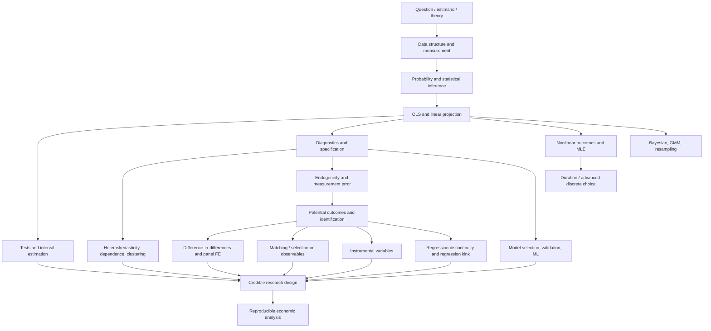

# ECON 216 — Applied Econometric Analysis I

**Graduate econometrics · 12-week independent-study quarter · Core linear models, inference, and empirical identification**

> **What this guide is.** A source-grounded self-study curriculum built from the materials in this archive and the [UC Santa Cruz ECON 216 catalog description](https://catalog.ucsc.edu/en/current/general-catalog/courses/econ-economics/graduate/econ-216). It is **not** a claim that all of the files in this collected archive were delivered together in one official offering. The main `Econ 216 - Course Lecture Notes.pdf` is the primary teaching spine; the separate 2019 applied-econometrics lectures, ECON 294 Stata laboratory, and quasi-experimental readings are explicitly labeled **supplementary**. The 12-week calendar, assessments, and projects are a *proposed learning design*, not an official historical syllabus.
>
> **Math formatting.** Standalone mathematical expressions use `$$ ... $$`, inline notation uses `$ ... $`. Render this file in a Markdown viewer that supports LaTeX and Mermaid, such as GitHub.

## Contents

1. [Purpose and learning outcomes](#1-purpose-and-learning-outcomes)
2. [What is actually in this folder](#2-what-is-actually-in-this-folder)
3. [Prerequisites and study method](#3-prerequisites-and-study-method)
4. [Conceptual knowledge map](#4-conceptual-knowledge-map)
5. [12-week learning sequence](#5-12-week-learning-sequence)
6. [Mathematical and methodological reference](#6-mathematical-and-methodological-reference)
7. [Identification and estimator selection guide](#7-identification-and-estimator-selection-guide)
8. [Research laboratory and reproducibility](#8-research-laboratory-and-reproducibility)
9. [Integrated research capstone](#9-integrated-research-capstone)
10. [Mastery checklist and examinations](#10-mastery-checklist-and-examinations)
11. [Reading and file index](#11-reading-and-file-index)
12. [How this course connects to the wider econometrics curriculum](#12-how-this-course-connects-to-the-wider-econometrics-curriculum)

---

## 1. Purpose and learning outcomes

The official catalog identifies **ECON 216 as “Applied Econometric Analysis I”**, a five-credit graduate course concerned with statistical tests of economic hypotheses and parameter estimation, emphasizing regression and issues such as serial correlation, errors in variables, multicollinearity, and heteroskedasticity, with hands-on use of statistical software. The catalog lists it as a Fall course restricted to students in the graduate quantitative economics and finance program. This README retains that core emphasis while using the unusually broad accompanying archive to support an extended introduction to applied identification, non-linear outcomes, and model assessment.

### The central problem

Economic data are not generated by controlled laboratory mechanisms alone. An observed association may combine a genuine behavioral effect, confounding factors, measurement error, selection, equilibrium feedback, and sampling noise. Econometrics asks **what parameters are estimable from the data, by which procedures, under what assumptions, and with what uncertainty**.

The full learning loop is:

**Economic question → causal or predictive estimand → assumptions and data → estimator → uncertainty → diagnostics and robustness → interpretation and decision.**

By the end of a successful quarter, a learner should be able to:

1. Translate an economic question into a testable regression specification and distinguish association, prediction, and causation.
2. Derive OLS, explain its geometric interpretation, and state conditions for consistency and valid inference.
3. Diagnose heteroskedasticity, clustered dependence, serial correlation, multicollinearity, functional-form error, endogeneity, and influential observations.
4. Select appropriate standard errors and communicate what is—and is not—identified by a regression coefficient.
5. Estimate and interpret binary and limited dependent variable models using maximum likelihood.
6. Formulate potential outcomes and explain experimental and observational identification assumptions.
7. Implement difference-in-differences, matching, fixed effects, instrumental variables, regression discontinuity, and regression kink designs at an introductory-to-intermediate applied level.
8. Contrast classical regression/inference with supplementary methods from panel data, GMM, Bayesian inference, nonparametrics, resampling, model selection, and machine learning.
9. Write a reproducible empirical paper or technical memo with defensible limitations and robustness checks.

**Scope caution:** The numbered ECON 216 lecture deck extends further into causal designs than the catalog's abbreviated description. This guide uses that evidence. Advanced 2019 lecture files in the same archive were prepared under other course/institution labels and should not be mistaken for official ECON 216 requirements.

---

## 2. What is actually in this folder

### A. Primary course lecture packet

[`Econ 216 - Course Lecture Notes.pdf`](<Econ 216 - Course Lecture Notes.pdf>) is a concatenated packet covering **Lessons 1–20**, plus some additional examples and scanned midterm answers. The packet index also names `Lesson21.pdf`, but no separate Lesson 21 section is identifiable in the text-extractable lecture sequence; it has therefore not been assigned. Its internal PDF pages are combined in *lexicographic filename order*, not numerical lesson order: e.g., Lessons 10–19 appear before Lesson 2. **Follow the lesson numbers below, not the physical PDF order.** Page ranges refer to **PDF viewer pages**, not original slide numbers.

| Logical sequence | Original subject | Packet pages |
|---|---|---:|
| Lessons 1–3 | Introduction; fundamentals of estimators and inference; data structure | 2–16; 266–301; 329–341 |
| Lessons 4–5 | Simple and multiple OLS regression | 342–379; 380–416 |
| Lessons 6–7 | Hypothesis testing; multicollinearity; indicator variables | 417–447; 448–477 |
| Lessons 8–9 | Heteroskedasticity; autocorrelation | 478–509; 510–530 |
| Lessons 10–11 | Omitted variables, measurement error, reverse causality; functional forms | 17–45; 46–65 |
| Lessons 12–13 | MLE, linear probability, logit, probit; ordered probit and Tobit | 66–94; 95–122 |
| Lessons 14–15 | Potential outcomes and ideal experiments; differences and DiD | 123–137; 138–164 |
| Lessons 16–17 | Matching and synthetic controls; fixed-effects variation | 165–190; 191–208 |
| Lessons 18–20 | Instrumental variables; regression discontinuity; regression kink | 209–233; 234–265; 302–328 |
| Additional | Scanned midterm solutions | 531–538 |

These page ranges are a navigation aid, not a replacement for reading the relevant slides.

### B. Companion Stata laboratory (separate course label)

[`Econ 294 - Course Lecture Notes.pdf`](<Econ 294 - Course Lecture Notes.pdf>) is an **ECON 294 applied economics / Stata lab** packet. It starts with data management, syntax, plotting, and programming, then turns to applied estimation. Its introductory slide recommends **Cameron and Trivedi, *Microeconometrics Using Stata***, but says there was no required textbook for that lab. Use it as a **coding practicum**, not as evidence about the ECON 216 instructor's assigned readings.

### C. Supplementary applied-econometrics lecture sequence

Folders `Lecture 1- Time Series/` through `Lecture 11- ML and Econometrics/` contain applied-econometrics presentations (largely by Chris Conlon, labeled NYU Stern / Applied Econometrics II / related courses). They cover:

- Time-series dynamics and R programming; panel data and robust standard errors.
- Maximum likelihood, duration models, Bayesian inference, advanced panel methods, GMM and EM.
- Discrete and advanced binary choice; treatment effects; nonparametrics; bootstrap.
- Model selection, regularization, and machine learning.

They are valuable **extensions and technical laboratories**. Each week below identifies where to use them without implying that everything must be completed during the core 12-week quarter.

### D. Quasi-experimental design research library

`Quasi-Experimental Design/` contains 17 numbered research articles or teaching notes on policy evaluation, matching/selection, difference-in-differences, instrumental variables, regression discontinuity, and machine learning. These are **readings**, not a consecutively numbered ECON 216 lecture sequence. See the [file index](#11-reading-and-file-index).

---

## 3. Prerequisites and study method

### Entry skills

| Area | Minimum working knowledge | Where it is used |
|---|---|---|
| Linear algebra | Matrix multiplication, rank, inverses, projections, eigenvalues | OLS, fixed effects, 2SLS, regularization |
| Calculus | Partial derivatives, Taylor expansion, optimization | OLS first-order conditions, MLE, marginal effects, delta method |
| Probability | Conditional expectation, variance/covariance, LLN, CLT | Sampling theory, identification, asymptotics |
| Statistics | Confidence intervals, hypothesis testing, likelihood basics | Inference, diagnostics, model comparison |
| Economics | Utility and demand, supply, equilibrium, endogeneity, policy evaluation | Economic interpretation of coefficients and identifying assumptions |
| Programming | Basic tabular data operations and script execution | Stata and R labs |

If these are unfamiliar, allow **1–2 preparatory weeks**. The ECON 216 packet begins with estimator properties and data structures, but moves quickly into applied models.

### Weekly rhythm (suggested 12–15 hours)

1. **Theory (3 h):** Read the assigned primary ECON 216 lessons. Write out the assumptions independently.
2. **Mathematics (2–3 h):** Derive at least one key result without looking at the answer.
3. **Implementation (3–4 h):** Reproduce an example or build a small simulation in Stata or R.
4. **Diagnostic and interpretation lab (2 h):** Change assumptions; observe where the estimator or inference fails.
5. **Research memo (2–3 h):** Submit a graph or table, a short explanation, and a limitations section.

Every deliverable should answer: **What is the estimand? What assumptions identify it? What is the estimator? How is uncertainty quantified? What alternative explanation remains?**

### Software conventions

- **Primary historical practice:** Stata, supported by the ECON 294 companion packet and output shown in the ECON 216 slides.
- **Supplemental language:** R, used by the separate Chris Conlon lectures and accompanying `.R`/`.Rmd` examples.
- Use either language for the core 12-week exercises, but attempt **at least one cross-software replication**.
- Archived scripts and software commands may depend on package versions or data access from their time; update the environment deliberately and log changes.
- Start a reproducible directory with `data_raw/`, `data_processed/`, `code/`, `results/`, and `paper/`. Never silently overwrite raw files.

---

## 4. Conceptual knowledge map

This diagram shows **prerequisite logic**, not the original packet's shuffled page order. An editable standalone version is in [`knowledge-map.mmd`](knowledge-map.mmd).



### Distinguish four questions

| Question | Typical object | Example | Essential limitation |
|---|---|---|---|
| **Description** | Means, conditional associations, distributions | Do higher-education workers earn more? | Does not establish why |
| **Prediction** | $\widehat{E[Y\mid X]}$ or a predictive distribution | Forecast next-quarter demand | High accuracy does not imply a causal effect |
| **Statistical inference** | Sampling uncertainty for a defined parameter | Is the estimated slope distinguishable from zero? | Correct uncertainty still does not fix identification |
| **Causal inference** | A contrast of potential outcomes under treatment versus no treatment | What did a policy change cause? | Relies on design-specific counterfactual assumptions |

Do not use a high $R^2$, a small $p$-value, or an elaborate estimator as proof of causation.

---

## 5. 12-week learning sequence

**Scheduling:** The sequence is ordered for intellectual dependencies. References labeled **Core** point into the main ECON 216 packet. References labeled **Supplement** come from distinct courses or research papers in the archive. Six topic clusters are deliberately revisited, because skill at diagnostics and identification compounds over the quarter.

### Week 1 — The econometric research process, data, estimators

**Core:** Lessons 1–3. **Lab:** ECON 294 introductory Stata sections.

**Questions.** What is the difference between a population relationship and an estimated regression? What is a parameter, estimator, estimate, or estimand? How do cross-sectional, time-series, and panel data differ?

**Study:** Economic theory → hypotheses → data → model → estimate → specification check → prediction or causal interpretation. Define conditional expectation, sampling, bias, consistency, efficiency, sampling variance, and confidence intervals. Recognize units, nominal versus real values, logarithms, rates of change, sampling frames, missingness, and selection into the data.

**Mathematical focus:** For an estimator $\hat\theta$, write its bias, mean squared error, and large-sample target:

$$
\operatorname{Bias}(\hat\theta)=E[\hat\theta]-\theta_0,
\qquad
\operatorname{MSE}(\hat\theta)=\operatorname{Var}(\hat\theta)+\operatorname{Bias}(\hat\theta)^2.
$$

**Lab:** Create an analysis-ready dataset with an auditable dictionary. Simulate two unbiased estimators with different variances and a third biased estimator with small variance. Compare Monte Carlo bias and MSE. Reproduce a descriptive plot relevant to wages, housing, demand, or labor markets.

**Deliverable:** A two-page research plan identifying one economic question, outcome, proposed regressors, sampling unit, measurement threats, and whether the goal is descriptive, predictive, or causal.

**Mastery check:** Explain why “unbiased” and “best choice” are not synonyms; describe at least three sampling or measurement failures.

### Week 2 — OLS: projection, interpretation, and multivariate regression

**Core:** Lessons 4–5. **Lab:** Stata estimation sections in ECON 294.

**Questions.** Where does OLS come from? What does a coefficient represent after other regressors are included? Which assumptions concern unbiasedness, consistency, or precision?

**Study:** Minimize squared residuals; obtain normal equations, slopes, intercepts, fitted values, residuals, and $R^2$. Move from bivariate regression to multivariate conditional association. Understand the Frisch–Waugh–Lovell theorem, dummy-variable controls, partial relationships, the role of units and functional forms, and the distinction between population and sample residuals.

**Mathematical focus:** With full column rank,

$$
\widehat\beta_{OLS}=\arg\min_b(y-Xb)'(y-Xb)
=(X'X)^{-1}X'y.
$$

For the projection and residual maker matrices,

$$
P_X=X(X'X)^{-1}X',\qquad M_X=I-P_X,\qquad \hat u=M_Xy.
$$

**Lab:** Estimate a wage equation in levels, logs, and semi-logs. Compare simple and multiple regression when an omitted variable is correlated with schooling. Verify the Frisch–Waugh–Lovell result numerically by residualizing both variables against controls.

**Deliverable:** A reproducible regression table, scatterplots, a derivation of OLS normal equations, and a one-page interpretation emphasizing units and conditioning.

**Mastery check:** Derive OLS; explain why adding controls can move a coefficient in either direction; distinguish a residual from the unobservable disturbance.

### Week 3 — Sampling inference, joint tests, multicollinearity, and indicators

**Core:** Lessons 6–7; revisit Lesson 2 on sampling theory.

**Questions.** How are $t$ and $F$ tests constructed? When is conventional inference valid? Does multicollinearity create bias? What does a dummy variable mean in a log outcome model?

**Study:** Sampling distribution of OLS; Gaussian finite-sample inference versus asymptotic approximations; standard errors, confidence intervals, significance, economic significance, single and joint restrictions; adjusted $R^2$; variance inflation; categorical controls and interactions. Separate **large variance from biased estimation**.

**Mathematical focus:** Under homoskedastic uncorrelated errors conditional on $X$,

$$
\operatorname{Var}(\widehat\beta\mid X)=\sigma^2(X'X)^{-1}.
$$

For a single restriction,

$$
t=\frac{\widehat\beta_j-\beta_{j,0}}{\widehat{\operatorname{SE}}(\widehat\beta_j)}.
$$

**Lab:** Simulate near-collinear regressors; vary correlations and sample size; plot standard errors against collinearity. Estimate a model with a categorical group, reference level, interactions, and a multi-parameter Wald/F test.

**Deliverable:** Short methods memo: coefficient table plus joint test, interpretation of an interaction, and why insignificance may mean imprecision rather than no effect.

**Mastery check:** State the null hypothesis of an $F$ test; explain the dummy-variable trap; distinguish a conditional test from a hypothesis about causality.

### Week 4 — Heteroskedasticity, clustered dependence, and serial correlation

**Core:** Lessons 8–9. **Supplement:** [`Lecture 1- Time Series/lecture1_time_series.pdf`](<Lecture 1- Time Series/lecture1_time_series.pdf>), [`Lecture 2- Linear Panel Data/lecture2.pdf`](<Lecture 2- Linear Panel Data/lecture2.pdf>), associated `.R` scripts.

**Questions.** Why can coefficients look reasonable while uncertainty estimates are wrong? What is the sampling unit? When do errors correlate within firms, schools, or time periods?

**Study:** Homoskedastic versus heteroskedastic disturbances; Huber–White sandwich variance; residual plots; heteroskedasticity tests; autocorrelation functions, AR(1) intuition, serial dependence and long-run variance; cluster-robust and HAC standard errors; effective sample size and appropriate clustering level. Understand why robust standard errors do **not** cure endogeneity.

**Mathematical focus:** A heteroskedasticity-robust covariance estimator (simplified HC0) is:

$$
\widehat V_{HC0}=(X'X)^{-1}\left(\sum_{i=1}^n x_ix_i'\hat u_i^2\right)(X'X)^{-1}.
$$

For independent clusters $g=1,\dots,G$, a basic cluster sandwich uses:

$$
\widehat V_{CL}=(X'X)^{-1}
\left(\sum_{g=1}^{G}X_g'\hat u_g\hat u_g'X_g\right)(X'X)^{-1}.
$$

Finite-sample corrections and validity conditions depend on the estimator and design.

**Lab:** Generate heteroskedastic outcomes and AR(1) errors. Compare conventional, HC, cluster-robust, and HAC inference where each is appropriate. Explore how few clusters can invalidate familiar large-sample approximations. Reproduce a time-series autocorrelation plot with the R lecture script where feasible.

**Deliverable:** Diagnostic report with plots, an uncertainty-method decision tree, and a corrected regression table. Explain the presumed independence structure.

**Mastery check:** Give an example in which heteroskedasticity affects standard errors but not OLS consistency; explain why clustering at the wrong level is dangerous.

### Week 5 — Specification, omitted variables, measurement error, endogeneity

**Core:** Lessons 10–11. **Supplement:** relevant IV overview papers under `Quasi-Experimental Design/`.

**Questions.** Why can a statistically precise model answer the wrong question? When does adding a regressor solve—and when does it fail to solve—a causal problem?

**Study:** Omitted variable bias, selection, simultaneous equations/reverse causality, errors-in-variables, bad controls, functional-form misspecification, logarithms, polynomials, interactions, partial effects, RESET-style logic, outliers/leverage, sensitivity to controls. Distinguish bias originating in **selection on observables**, **selection on unobservables**, and **measurement**.

**Mathematical focus:** If the true model is $y=\beta x+\gamma z+u$ (after centering) but $z$ is omitted, the population short-regression slope is:

$$
\beta_{short}=\beta+\gamma\frac{\operatorname{Cov}(x,z)}{\operatorname{Var}(x)}
$$

under $\operatorname{Cov}(x,u)=0$. With classical additive measurement error $x=x^*+v$, independent of the true regressor and structural error, the simple-regression probability limit is:

$$
\operatorname{plim}\hat\beta=\beta\frac{\operatorname{Var}(x^*)}{\operatorname{Var}(x^*)+\operatorname{Var}(v)}.
$$

**Lab:** Simulate confounding, classical measurement error, and simultaneous causality separately. Diagnose differences in how naive regression behaves. Re-estimate a substantive model with three plausibly motivated specifications rather than stepwise significance filtering.

**Deliverable:** A directed conceptual explanation of the identification problem, competing specifications, and the assumptions needed for any causal claim.

**Mastery check:** Predict the sign of omitted-variable bias from the signs of both relevant relationships; explain why adding a post-treatment control can create bias.

### Week 6 — Maximum likelihood, binary response, and limited outcomes

**Core:** Lessons 12–13. **Supplement:** [`Lecture 3- MLE and Duration/lecture3.pdf`](<Lecture 3- MLE and Duration/lecture3.pdf>) and [`Lecture 6- Discrete Choice/discretechoice.pdf`](<Lecture 6- Discrete Choice/discretechoice.pdf>).

**Questions.** Why is linear probability regression sometimes useful but imperfect? How do logit and probit probabilities arise? Why can coefficients in nonlinear models not be interpreted as marginal probability effects without further calculation?

**Study:** Likelihood and log-likelihood, scores, Hessians, information, MLE intuition; LPM, logit, probit, average marginal effects; interpretation of index and odds; multinomial and ordered outcomes; Tobit and censoring versus truncation; sample selection caveats. Duration/hazard models appear in the supplementary lecture rather than the main numbered course packet.

**Mathematical focus:** For binary $y_i$ with success probability $p_i(\beta)$,

$$
\ell(\beta)=\sum_{i=1}^{n}\left[y_i\log p_i(\beta)+(1-y_i)\log\{1-p_i(\beta)\}\right].
$$

For logit, $p_i(\beta)=\Lambda(x_i'\beta)$, where $\Lambda(z)=1/(1+e^{-z})$, and

$$
\frac{\partial P(Y_i=1\mid x_i)}{\partial x_{ik}}
=\Lambda(x_i'\beta)\big[1-\Lambda(x_i'\beta)\big]\beta_k
$$

for a continuous regressor with no nonlinear transformations.

**Lab:** Estimate LPM, logit, and probit for a binary economic outcome. Compute average marginal effects and compare fitted probabilities, calibration, and uncertainty. Optionally estimate a Tobit only where the outcome is genuinely censored and that data-generating process is defensible.

**Deliverable:** Model-comparison brief distinguishing **statistical fit, probability prediction, and causal interpretation**.

**Mastery check:** Derive the Bernoulli log-likelihood; explain an average marginal effect; give examples of censoring, truncation, and a genuinely ordered outcome.

### Week 7 — Experiments, potential outcomes, and difference-in-differences

**Core:** Lessons 14–15. **Readings:** `Econometrics 1.pdf`, `Econometrics 5.pdf`, and `Econometrics 7.pdf` in `Quasi-Experimental Design/`.

**Questions.** What counterfactual is missing from observed data? What does randomization identify? What does parallel trends mean—and what evidence could undermine it?

**Study:** Potential outcomes, fundamental evaluation problem, ATE, ATT, treatment assignment, randomized trials, noncompliance, pre/post comparisons, group differences, two-period two-group DiD, event-study intuition, placebo comparisons, interference and spillovers. The separate fuzzy-DiD reading is an **advanced** extension. Two-way fixed-effects estimators with staggered adoption can have additional weighting/heterogeneity problems not addressed by the simple $2\times2$ DiD identification argument.

**Mathematical focus:**

$$
ATE=E[Y(1)-Y(0)],\qquad ATT=E[Y(1)-Y(0)\mid D=1].
$$

The canonical two-group, two-period DiD contrast is:

$$
\widehat\tau_{DiD}
=\big(\bar Y_{T,post}-\bar Y_{T,pre}\big)
-\big(\bar Y_{C,post}-\bar Y_{C,pre}\big).
$$

It requires a credible version of **parallel untreated trends**, along with relevant consistency, timing, composition, and noninterference conditions.

**Lab:** Construct an illustrative policy panel with treated and comparison groups. Estimate the two-group DiD both from cell means and a regression. Graph raw trends and pre-intervention differences; introduce anticipation or differential trends and show the resulting bias.

**Deliverable:** A short policy evaluation memo: treatment definition, counterfactual, graphical identification argument, DiD estimate with appropriate uncertainty, threats and placebo check.

**Mastery check:** Explain why simple before-after changes are not treatment effects; state which pre-treatment evidence would concern you without claiming pre-trends can prove parallel trends.

### Week 8 — Matching, synthetic controls, and fixed effects

**Core:** Lessons 16–17. **Supplement:** [`Lecture 2- Linear Panel Data/lecture2.pdf`](<Lecture 2- Linear Panel Data/lecture2.pdf>), [`Lecture 5- Advanced Panel Data/lecture5.pdf`](<Lecture 5- Advanced Panel Data/lecture5.pdf>), and `Econometrics 4.pdf` / `Econometrics 8.pdf`.

**Questions.** What can be learned when selection is only on observed characteristics? What is identified by within-unit variation? When are matching or synthetic controls useful compared with regression adjustments?

**Study:** Conditioning on observables, overlap/common support, propensity score and nearest-neighbor matching, covariate balance, propensity-score weighting, matching standard-error caveats; synthetic control as a donor-weighted counterfactual; FE within transformation, unit/time effects, persistent omitted heterogeneity, FE versus RE as different assumptions (not just different commands). Advanced supplementary panels also discuss non-linear FE and dynamic-model complications.

**Mathematical focus:** Under conditional exchangeability and overlap,

$$
(Y(1),Y(0))\perp D\mid X,
\qquad 0<P(D=1\mid X)<1.
$$

For a static panel,

$$
y_{it}=\alpha_i+\lambda_t+x_{it}'\beta+u_{it},
$$

and subtracting individual means removes $\alpha_i$ (with appropriate adjustment for time effects when included).

**Lab:** Estimate a pooled regression, unit-FE model, and two-way FE model. Build balance tables for a simple propensity-score matching design. If using synthetic control, plot treated-versus-synthetic preperiod fit and postperiod gaps; test donor sensitivity.

**Deliverable:** A design-comparison memo evaluating **matching vs FE vs DiD vs synthetic control**, explicitly tying method choice to assumed confounding and treatment assignment.

**Mastery check:** Explain why FE does not automatically solve time-varying confounding; show how poor overlap undermines matching; describe the role of donor-pool construction in synthetic controls.

### Week 9 — Instrumental variables, two-stage least squares, and GMM

**Core:** Lesson 18. **Readings:** `Econometrics 10.pdf`, `Econometrics 11.pdf`, `Econometrics 12.pdf`, `Econometrics 13.pdf`. **Supplement:** [`Lecture 5- Advanced Panel Data/lecture3a-gmm.pdf`](<Lecture 5- Advanced Panel Data/lecture3a-gmm.pdf>).

**Questions.** Can an instrument isolate exogenous variation in a problematic regressor? How does the identified parameter change with treatment heterogeneity? How are weak instruments detected and reported?

**Study:** Instrument relevance, exclusion, as-if random instrument variation, 2SLS mechanics, first-stage diagnostics, reduced form, weak-IV inference, overidentification caveats, LATE for binary IV under monotonicity and other assumptions. Extend moment-based reasoning to GMM; the GMM file is supplementary, not central to the main numbered packet.

**Mathematical focus:** In the just-identified scalar case,

$$
\beta_{IV}=\frac{\operatorname{Cov}(Z,Y)}{\operatorname{Cov}(Z,X)},
$$

and the matrix 2SLS estimator (when identified) is:

$$
\widehat\beta_{2SLS}=(X'P_ZX)^{-1}X'P_Zy,
\qquad P_Z=Z(Z'Z)^{-1}Z'.
$$

A general GMM estimator minimizes the squared weighted sample moments:

$$
\widehat\theta_{GMM}=\arg\min_\theta\ \bar g_n(\theta)'W_n\bar g_n(\theta).
$$

**Lab:** Simulate endogeneity and compare OLS, IV, and a weak-IV design. Report first-stage relationships, sensitivity to instruments, and what the proposed exclusion restriction would mean substantively. Optionally implement a simple GMM moment condition and compare to a corresponding IV estimate.

**Deliverable:** IV validity memo, first- and second-stage tables, and a transparent discussion of estimand, assumptions, and weak-identification risk.

**Mastery check:** Explain why a strong first stage alone does not justify an instrument; distinguish an endogenous regressor from an invalid instrument.

### Week 10 — Local quasi-experiments: regression discontinuity and regression kink

**Core:** Lessons 19–20. **Readings:** `Econometrics 6.pdf`, `Econometrics 14.pdf`, `Econometrics 16.pdf`, `Econometrics 17.pdf`; `Econometrics 15.pdf` is an advanced fuzzy-RD extension.

**Questions.** What is identified near a threshold? How is a sharp RD different from fuzzy RD? What extra assumptions are needed to interpret a kink rather than a discontinuity?

**Study:** Running variables, policy assignment cutoffs, sharp and fuzzy RD, continuity of potential-outcome conditional expectations, sorting/manipulation, bandwidth and polynomial choice, local linear estimation, density/covariate continuity, placebo cutoffs, inference sensitivity. Introduce regression kink designs where the **slope** of the policy treatment changes at a threshold. Do not treat global high-order polynomial fits as a default substitute for local design checks.

**Mathematical focus:** At a sharp RD cutoff $c$,

$$
\tau_{RD}
=\lim_{x\downarrow c}E[Y\mid X=x]
-\lim_{x\uparrow c}E[Y\mid X=x].
$$

For a fuzzy RD, the local Wald ratio is the **jump in outcome divided by the jump in treatment probability**, under the relevant IV-type assumptions. For a kink design, the corresponding comparison involves **changes in slopes** rather than jumps in levels.

**Lab:** Simulate a score-based eligibility cutoff; estimate with multiple bandwidths and local linear fits. Plot binned outcomes and fitted functions; inspect score density and covariate continuity. Create a second example with a change in the slope of a benefit schedule rather than eligibility itself.

**Deliverable:** Design appendix with precise cutoff rules, validity checks, bandwidth sensitivity, and a statement about local rather than universal generalization.

**Mastery check:** Contrast identification at a threshold with a global average treatment effect; explain why sorting precisely at a threshold threatens RD.

### Week 11 — Flexible estimation, resampling, and validation (supplement-led)

**Core:** Synthesize diagnostics from Lessons 6–11 and the causal designs above. **Supplement:** [`Lecture 9-Nonparametrics/nonparametrics.pdf`](<Lecture 9-Nonparametrics/nonparametrics.pdf>), [`bootstrap.pdf`](<Lecture 9-Nonparametrics/bootstrap.pdf>), [`Lecture 10- Model Selection Validation/model-selection.pdf`](<Lecture 10- Model Selection Validation/model-selection.pdf>).

**Questions.** What is the cost of imposing an incorrect functional form? When do resampling or regularization help? What changes when the objective is prediction instead of parameter interpretation?

**Study:** Nonparametric conditional means, kernel and local-polynomial intuition, bias–variance tradeoff, curse of dimensionality, bootstrap and delta method; train/validation/test splits and cross-validation; subset selection, ridge, lasso, principal-components regression. For causal settings, remember that tuning predictive fit does **not** by itself remove endogeneity or guarantee valid post-selection inference.

**Mathematical focus:** A lasso regression solves:

$$
\widehat\beta_\lambda=\arg\min_\beta
\left\{\frac{1}{2n}\lVert y-X\beta\rVert_2^2+\lambda\lVert\beta\rVert_1\right\}.
$$

The first-order delta-method approximation for $g(\widehat\theta)$ is:

$$
\operatorname{Var}\big(g(\widehat\theta)\big)
\approx \nabla g(\theta_0)'\operatorname{Var}(\widehat\theta)\nabla g(\theta_0).
$$

**Lab:** Use a held-out set to compare a linear model, flexible spline/nonparametric model, ridge, and lasso for a predictive question. Estimate uncertainty for a nonlinear function using the delta method and bootstrap; resample at the **cluster** rather than individual level if clusters are the sampling units.

**Deliverable:** Validation report including design of cross-validation, predictive loss, coefficient stability, interpretability, and warnings about in-sample tuning or leakage.

**Mastery check:** Define overfitting; differentiate a confidence interval for a causal parameter from a prediction interval; explain why a naive iid bootstrap can fail for clustered data.

### Week 12 — Integration, applied research defense, and frontier preview

**Core:** Review Lessons 1–20 by logical order. **Supplement:** [`Lecture 11- ML and Econometrics/ml-econometrics.pdf`](<Lecture 11- ML and Econometrics/ml-econometrics.pdf>), [`Lecture 4- Bayesian Estimation/lecture4.pdf`](<Lecture 4- Bayesian Estimation/lecture4.pdf>), and `Econometrics 1–3.pdf`.

**Questions.** Can you defend your research design to a skeptical reader? Which results depend on functional form, dependent-variable definition, treatment timing, measurement, instruments, or bandwidth? Which questions are still unanswerable from available data?

**Study:** Trees, random forests/boosting as predictive complements; Bayesian updating as a different inferential language; high-dimensional treatment-effect research as a gateway to later courses. These are **survey/frontier extensions**, not items necessary to claim mastery of the main ECON 216 regression sequence.

**Lab:** Complete the capstone below. Submit an analysis script from raw data to final table/figure with no manual operations. Conduct a reproducibility test by running from a clean working directory. Present your preferred estimate *alongside* the strongest alternative interpretation.

**Deliverable:** 10–15 page technical research paper or ~8-page decision memo with appendices, code, and a five-minute research defense.

**Mastery check:** Defend identification independently of statistical significance, demonstrate all code runs, and explain the limits of external validity.

### Suggested assessment weighting (self-study design, not UCSC grading)

| Component | Weight | Suggested checkpoint |
|---|---:|---|
| Ten weekly analytical labs | 35% | Weeks 1–10 |
| Mathematical derivation notebook | 15% | Cumulative, reviewed weeks 4 and 8 |
| Midterm foundations examination | 20% | End of Week 6 |
| Research capstone and replication package | 25% | Week 12 |
| Oral-style methodological defense | 5% | Week 12 |

---
## 6. Mathematical and methodological reference

This section is a **compact reference**, not a substitute for deriving and discussing the assumptions within the weekly lessons. Learn to recognize the estimand and the role of each assumption before memorizing formulas.

### 6.1 A taxonomy of assumptions

**Data-generating process:** A useful linear conditional-mean specification begins with

$$
y_i=x_i'\beta_0+u_i,\qquad E[u_i\mid x_i]=0.
$$

The equation is not a claim that the world is literally linear. It is a working model for some conditional relationship. If the conditional mean is not linear, OLS may still estimate a **best linear projection**, but the meaning of the coefficients changes.

**Sample variation:** Repeated observations must contain enough independent variation to distinguish the parameters. Perfectly collinear regressors make $X'X$ singular.

**Exogeneity:** $E[u\mid X]=0$ is stronger than unconditional orthogonality $E[x_i u_i]=0$. The relevant assumption should be stated for the estimator and target parameter. Conditional zero mean supports finite-sample unbiasedness of OLS under standard sampling conditions; orthogonality and regularity may suffice for consistency.

**Homoskedasticity:** $\operatorname{Var}(u_i\mid X)=\sigma^2$ is not needed for the OLS coefficient formula and generally not needed for consistency. It underlies the familiar homoskedastic OLS variance formula and OLS efficiency claims under Gauss–Markov conditions.

**Dependence:** Cross-sectional observations, observations within panels or clusters, and successive time-series outcomes have different dependence structures. A standard-error formula that treats correlated observations as independent may be misleading.

**Distribution:** Normal disturbances can justify exact finite-sample results under the classical normal linear model; many large-sample results instead rely on LLN, CLT, moment, and dependence conditions rather than conditional Gaussian errors.

### 6.2 Derivation library

**OLS normal equations.** Differentiate the squared-error objective:

$$
S(b)=(y-Xb)'(y-Xb),\qquad
\frac{\partial S(b)}{\partial b}=-2X'(y-Xb).
$$

Setting the gradient to zero gives $X'X\widehat\beta=X'y$. Note that OLS residuals are orthogonal **in sample** to all included regressors; this algebraic property does not imply that the structural errors are exogenous.

**Coefficient uncertainty.** Conditional on $X$, if $\operatorname{Var}(u\mid X)=\Omega$,

$$
\operatorname{Var}(\widehat\beta\mid X)
=(X'X)^{-1}X'\Omega X(X'X)^{-1}.
$$

The homoskedastic formula is the special case $\Omega=\sigma^2I$. Robust and cluster covariance estimators estimate different structures of $\Omega$; none eliminates bias from correlation between $X$ and $u$.

**Partial regression / Frisch–Waugh–Lovell.** Partition $X=[X_1\;X_2]$. Residualize $y$ and $X_2$ against $X_1$:

$$
\widehat\beta_2=(X_2'M_{X_1}X_2)^{-1}X_2'M_{X_1}y.
$$

This explains how fixed effects absorb systematic mean differences and why the remaining within-group variation identifies the common slope.

**Confidence intervals.** A conventional large-sample two-sided interval for a scalar parameter is:

$$
\widehat\theta\ \pm\ z_{1-\alpha/2}\widehat{\operatorname{SE}}(\widehat\theta).
$$

Use the appropriate finite-sample reference distribution or improved methods when asymptotic approximations are unreliable (e.g., very few clusters, weak instruments, selected models).

**Conditional logit.** The derivative of the logistic link is $\Lambda(z)[1-\Lambda(z)]$. For a dummy regressor, compute the discrete change in predicted probability rather than applying a derivative mechanically.

**Fixed effects.** For $y_{it}=\alpha_i+x_{it}'\beta+u_{it}$, the within equation is:

$$
y_{it}-\bar y_i=(x_{it}-\bar x_i)'\beta+(u_{it}-\bar u_i).
$$

Time-invariant regressors disappear under individual demeaning. A causal FE interpretation still requires that relevant time-varying omitted factors and feedback do not invalidate identifying exogeneity conditions.

**Instrumental-variable moments.** Under suitable validity assumptions,

$$
E\big[Z_i(Y_i-X_i'\beta_0)\big]=0.
$$

Overidentifying restrictions permit some specification checks when there are multiple instruments, but a test cannot prove that every instrument meets its exclusion restriction.

**Potential outcomes and realized data.** For a binary treatment $D_i$:

$$
Y_i=D_iY_i(1)+(1-D_i)Y_i(0).
$$

Only one potential outcome is observed for each unit. Identification is therefore a claim about what assumptions or assignment mechanism make the missing counterfactual learnable from other observations.

**Local RD versus global regression.** At a treatment threshold $c$, the RD contrast is local to individuals whose running variable is near $c$. Extrapolation to distant individuals or other policy levels needs additional structure.

### 6.3 Common estimator failure modes

| Observation | Possible issue | What to investigate | What **not** to conclude |
|---|---|---|---|
| OLS coefficient changes after adding controls | Confounding, changed estimand, collinearity, bad controls | Economic role and timing of each control; sensitivity | “The larger regression must be causal” |
| Large standard errors | Small sample, multicollinearity, weak variation, dependence | Rank, variance, design, power | “True effect equals zero” |
| Predictive probabilities outside $[0,1]$ in LPM | Linear link misspecification | Logit/probit; marginal effects; calibration | “OLS coefficients have no use” |
| Significant OLS effect on observational policy data | Selection, reverse causality, shocks | Design, parallel trends, IV/RD assumptions | “Statistical significance is causal proof” |
| Very strong first stage | Instrument relevance | Exclusion, independence, weak-IV robustness, monotonicity for LATE | “The instrument is therefore valid” |
| FE estimates differ from pooled OLS | Between-unit heterogeneity, within-unit variation | Source of identification and time-varying confounding | “Fixed effects remove all bias” |
| Strong prediction on training data | Overfitting or leakage | Out-of-sample error, time-aware splits, regularization | “The model generalizes” |
| RD estimate varies by bandwidth | Local specification sensitivity | Bandwidth, density, covariates, local functional form | “Choose the largest significant estimate” |
| Classical standard errors shrink sharply with repeated observations | Within-unit or within-time dependence | Correct clustering or long-run variance | “Extra dependent rows give independent information” |

---

## 7. Identification and estimator selection guide

Methods cannot be chosen only from the shape of the dataset or by which software command is easiest. Begin with the **scientific contrast** and the **assignment process**.

| Problem and estimand | Candidate approach | Essential assumption | Primary diagnostic | Material |
|---|---|---|---|---|
| Linear conditional association | OLS and partial regression | Interpretable linear projection; rank | Functional form, residuals, leverage | Lessons 4–7 |
| Heteroskedastic disturbances | OLS + HC inference | Exogeneity for slopes; independent observations for basic HC | Variance patterns, leverage | Lesson 8 |
| Panel/clustered disturbances | OLS/FE + cluster inference | Sufficient independent clusters; suitable model assumptions | Clustering unit and cluster count | Lessons 8, 17; panel supplement |
| Time-indexed dependence | Dynamic regression / HAC or modeled error process | Correct stationarity/dependence regularity as needed | ACF, lags, residual tests | Lesson 9; time-series supplement |
| Binary, ordinal, censored outcome | LPM, logit, probit, ordered model, Tobit | Proper outcome generation / conditional likelihood | Calibration, marginal effects, censoring definition | Lessons 12–13 |
| Randomized intervention | Difference in means / regression | Genuine assignment, compliance/attrition conditions, interference addressed | Randomization and balance/attrition | Lesson 14 |
| Nonrandom pre/post group policy | DiD | Parallel untreated trends, relevant timing and composition | Pretrends, placebo groups, treatment heterogeneity | Lesson 15 |
| Selection conditional on observables | Matching / weighting | Conditional exchangeability, overlap | Standardized balance, support, extreme weights | Lesson 16 |
| Time-invariant unobserved unit differences | Unit/time fixed effects | Strict or appropriate sequential exogeneity; enough within variation | Within variation and dynamics | Lesson 17 |
| Endogenous explanatory variable | IV/2SLS/GMM | Relevance plus exogeneity/exclusion (and other interpretation assumptions) | First stage, weak-IV robust inference, design argument | Lesson 18 |
| Threshold discontinuity | Sharp/fuzzy RD | Potential-outcome continuity, no sorting undermining design | Density, covariates, bandwidths | Lesson 19 |
| Threshold slope change | RKD | Smooth counterfactual slopes and exogenous policy kink | Slope fit, bandwidth, other kinks | Lesson 20 |
| Flexible conditional relation | Kernel/local methods | Smoothness, effective support, bandwidth choice | Bias/variance and boundary effects | Nonparametrics supplement |
| Prediction with many inputs | Ridge/lasso/trees/boosting | Appropriate evaluation-sample exchangeability or temporal transfer | Holdout error, leakage, stability | Model selection and ML supplements |

### The identification-first checklist

Before writing any regression, record:

1. **Unit and treatment:** Who or what is observed? At what temporal frequency? What event, dose, or policy changes?
2. **Outcome:** What is measured, in which units, and at what horizon?
3. **Target:** Association, conditional prediction, ATE, ATT, LATE, or a local threshold effect?
4. **Assignment:** What determines exposure or policy adoption? Why is its variation plausible for identification?
5. **Backdoors:** Which confounders, simultaneous feedbacks, measurement errors, or selection processes could alter the contrast?
6. **Estimator:** Which estimator corresponds to the assumptions? What does it weigh or condition on?
7. **Uncertainty:** What is the dependence structure? How many independent units or clusters remain?
8. **Failure tests:** What placebo, balance, pretrend, bandwidth, or falsification check would have a chance to detect the chief threat?
9. **Scope:** What population and setting does the finding genuinely describe?

### Causal interpretation is not granted by software

- **Randomization** supports causal comparisons because of assignment, not because it has a special regression syntax.
- **DiD** is credible when the counterfactual trend assumption is defensible, not merely because a treatment-by-post interaction is significant.
- **Fixed effects** control for certain persistent unit-specific heterogeneity but not changing unobservables correlated with treatment.
- **Matching** adjusts only for variables used (or effectively summarized) in the identification strategy; it does not create random assignment.
- **IV** can identify a local or otherwise instrument-specific estimand, not necessarily the population ATE.
- **RD/RKD** identify behavior around a threshold or kink; local identification is both a strength and a limit.
- **Machine learning** can aid prediction and nuisance estimation but requires separate identification and inference arguments for causal questions.

---

## 8. Research laboratory and reproducibility

### 8.1 Proposed student workspace

```text
ECON216-study/
├── README.md
├── data_raw/                # Original downloaded or provided inputs (never edited)
├── data_processed/          # Deterministic outputs from scripts
├── code/
│   ├── 01_clean_data.*
│   ├── 02_descriptive.*
│   ├── 03_estimation.*
│   └── 04_robustness.*
├── results/
│   ├── figures/
│   └── tables/
├── paper/
│   ├── proposal.md
│   ├── report.md
│   └── technical_appendix.md
└── environment/            # Session info, package versions, run instructions
```

The folders and example commands below are an **implementation template**. They are not purported to be files already supplied inside the archive.

### 8.2 Minimal reproducible Stata commands

```stata
* Illustrative variables: outcome y, regressor x, control z, unit id, period year
* Replace names and supplied data paths with real ones; inspect missingness first.
use "data_processed/analysis.dta", clear
summarize y x z
regress y x z
regress y x z, vce(robust)
regress y x z, vce(cluster id)

* Panel specification (only when id-year panel assumptions make sense):
xtset id year
xtreg y x z i.year, fe vce(cluster id)

* Instrumental variable specification (must defend z_iv validity):
ivregress 2sls y z (x = z_iv), vce(robust)
estat firststage

* Binary outcomes (if y is coded 0/1):
logit y x z
margins, dydx(x z)
```

`vce(cluster id)` is not interchangeable with `vce(robust)`. Do not cluster merely because there is an `id` column: justify the residual dependence and assignment structure. For instrumental variables, `z_iv` is a placeholder, not a recommended instrument.

### 8.3 Minimal illustrative R commands

```r
# Replace df with an explicitly loaded, validated dataset.
fit <- lm(y ~ x + z, data = df)
summary(fit)

# Heteroskedasticity-robust inference (requires these packages):
# install.packages(c("sandwich", "lmtest"))
lmtest::coeftest(fit, vcov. = sandwich::vcovHC(fit, type = "HC1"))

# Cluster-robust inference for independent groups (justify cluster id):
lmtest::coeftest(fit, vcov. = sandwich::vcovCL(fit, cluster = df$id))

# Binary outcome:
fit_binary <- glm(y_binary ~ x + z, family = binomial(), data = df)
predict(fit_binary, type = "response")
```

The supplementary R materials may import older package ecosystems. Document any substitutions rather than claiming to replicate historical code exactly. Avoid using future observations to train models evaluated on past periods; for time series, splits should respect chronology where applicable.

### 8.4 Computing standards

- Use a fixed random seed for simulation and resampling and report it; do not confuse replicable pseudo-randomness with proof of robustness.
- Report software versions and key packages. Preserve a script that regenerates every published table and figure.
- Record missing-value and outlier handling explicitly; show sample sizes at each step.
- Label clustered, heteroskedastic-robust, bootstrap, and model-based uncertainty distinctly.
- Use economically meaningful scales: percentage points vs percent, logs vs levels, annual vs quarterly rates.
- Separate exploratory model development from confirmatory research claims when possible.
- Be explicit about data limitations, ethical access, confidentiality, and provenance.

### 8.5 Suggested rotating data applications

The primary ECON 216 lessons themselves contain examples involving prices/demand, wages and education, production, housing prices/hedonic characteristics, and macroeconomic relationships. The labs can use analogous public or synthetic data if the original files are not present. For practice, select **one** topic to carry through several methods (rather than switching data every week):

| Theme | Descriptive model | Main identification challenge | Possible design if supported by actual institutions/data |
|---|---|---|---|
| Education and wages | Log wages on schooling and experience | Ability, selection, family background | Exogenous schooling reform / defensible instrument |
| Housing and amenities | Log house price on attributes and location | Neighborhood quality and sorting | Policy cutoff, matched panel, location FE |
| Energy consumption | Consumption on tariffs, income, weather | Simultaneity, weather shocks, customer sorting | Rate change DiD with credible comparison |
| Labor policy | Employment on policy exposure | Trends and endogenous adoption | DiD or event-study design |
| Credit choice | Default or take-up on applicant attributes | Selection and limited outcomes | Binary response; causal design only with identified assignment |
| Environmental policy | Pollution on regulation | Endogenous siting and response | RD at rule threshold or matched comparisons |

Not every dataset supports every estimator. A key skill is identifying when the necessary assignment mechanism **does not exist**.

---

## 9. Integrated research capstone

### Objective

Deliver an empirically defensible evaluation of a **specific economic hypothesis or policy question** using at least two methods whose identifying assumptions can be compared. The most important mark of quality is not a positive or statistically significant result but a clear statement of what the research can identify.

**Suggested example:** *Did the introduction of an energy-efficiency incentive reduce household electricity consumption?* The research design should evaluate whether suitable pre-policy data, comparison groups, treatment dates, and covariates are available before selecting DiD or an alternative. This is an **illustrative proposal**, not an empirical claim about a particular program.

### Required components

**A. Question and estimand.** Define the treated population, counterfactual, outcome horizon, and whether the parameter is an ATT, ATE, local treatment effect, or an associational slope. Write the estimand mathematically.

**B. Data and audit.** Data dictionary; source provenance; missingness; variable units; timeline; distribution and balance; sample inclusion flowchart.

**C. Baseline.** A simple OLS or descriptive model. Discuss why its coefficient may not be causal.

**D. Identification.** Choose **one primary design** that can plausibly be defended using the available assignment mechanism (experiment, DiD, matching, FE, IV, RD, RKD). Contrast it with a weaker or differently-assuming design.

**E. Inference.** Choose the uncertainty estimator based on observation and treatment dependence. Include uncertainty intervals and sample/cluster counts, not just significance stars.

**F. Robustness.** At least **three design-appropriate** checks, for example alternate outcome construction, placebo threshold or time, alternate bandwidth, covariate balance, pretrends, instrument sensitivity, alternate comparison group, or clustered inference. Do not present mechanically unrelated tests as evidence of validity.

**G. Interpretation.** Translate parameters into meaningful economic units and, where possible, a policy-relevant magnitude. State heterogeneity and external-validity limits.

**H. Reproducibility.** Scripts, run order, environment information, any synthetic data generation, and a clean-run confirmation.

### Evaluation rubric

| Dimension | Weight | Standard |
|---|---:|---|
| Economic question and estimand | 15% | Precise and decision-relevant |
| Data quality and provenance | 15% | Reproducible and transparent |
| Identification assumptions | 25% | Supported rather than asserted |
| Estimation and uncertainty | 15% | Appropriate to unit, outcome, and design |
| Diagnostics and robustness | 15% | Tests relevant threats |
| Economic interpretation and limitations | 10% | Clear and not overstated |
| Replication package | 5% | Runs from start to finish |

### Research presentation: six defensible slides

1. **Question / context:** One sentence, plus why this matters economically.
2. **Data and assignment:** Explain who is compared, when, and why.
3. **Estimand and design:** Equation, counterfactual, and assumptions.
4. **Result:** Coefficient, units, uncertainty, and identifying variation.
5. **Threats:** Strongest alternative explanation and the best check.
6. **Conclusion:** What is learned, what remains uncertain, and next research step.

---

## 10. Mastery checklist and examinations

### Derivation checks

- [ ] Derive OLS from least squares and explain the projection geometry.
- [ ] Derive OLS variance under general $\Omega$ and show the homoskedastic special case.
- [ ] Demonstrate Frisch–Waugh–Lovell with an algebraic or simulated example.
- [ ] Derive omitted-variable bias in the two-regressor model.
- [ ] Explain classical attenuation bias and its assumptions.
- [ ] Specify the Bernoulli log-likelihood and compute a logit average marginal effect.
- [ ] Show equivalence of the $2\times2$ DiD cell-means contrast and the saturated regression coefficient.
- [ ] Apply the within transformation and explain which regressors are lost.
- [ ] Express IV as a moment restriction and as a just-identified covariance ratio.
- [ ] Distinguish a jump in conditional means (RD) from a discontinuity in slopes (RKD).

### Applied and reasoning checks

- [ ] Choose standard errors from the residual-dependence structure; identify when none of the defaults is reliable.
- [ ] Explain why a small $p$-value does not justify a causal claim.
- [ ] State overlap and exchangeability for matching and evaluate balance.
- [ ] State parallel trends in potential-outcome language and propose a relevant placebo.
- [ ] Defend or reject a proposed instrument using institutional context, not correlations alone.
- [ ] Explain RD's local estimand and assess sorting/bandwidth sensitivity.
- [ ] Identify leakage or overfitting in a model-selection exercise.
- [ ] Produce a table and figure exclusively from reproducible code.
- [ ] Describe one scenario where a simpler estimator is better justified than a sophisticated one.
- [ ] Present the largest unresolved identification threat to your own final project.

### Suggested midterm structure (after Week 6)

The uploaded main packet includes a scanned historical **midterm solution set** at the end. Use it as additional practice, without assuming it perfectly matches the proposed 12-week plan. A self-study midterm can include:

- **Part A (35%):** Hand derivations—OLS, covariance, estimator bias/variance, and test statistics.
- **Part B (35%):** Diagnose a regression table—incorrect standard errors, collinearity, omitted regressors, functional-form error.
- **Part C (30%):** Brief computation—LPM vs logit/probit; give correct coefficient and marginal-effect interpretation.

### Final oral examination prompts

1. An education regression controls for occupation and wage. Which variable is the outcome? What makes the proposed controls appropriate or problematic?
2. A policy and a rise in outcomes occur in the same year. What would make DiD more informative than an interrupted time-series fit?
3. An IV coefficient is much larger than OLS. Is this proof of attenuation bias? What other explanations are plausible?
4. A local RD model is significant only at one bandwidth. How would you report this?
5. A lasso model predicts well, but treatment is endogenous. What can you responsibly claim?
6. A panel regression has thousands of rows but only eight independently treated regions. How might inference need to change?

---

## 11. Reading and file index

### Core, in logical numeric order

All links below reference content **inside** [`Econ 216 - Course Lecture Notes.pdf`](<Econ 216 - Course Lecture Notes.pdf>). It is a consolidated file, rather than separate lesson PDFs in the extracted archive.

| Course segment | Main packet lessons | Primary emphasis |
|---|---|---|
| Foundations | 1–3 | Questions, estimators, sample data |
| Linear models | 4–5 | Simple and multiple regression |
| Inference | 6–7 | Hypotheses, tests, interactions, collinearity |
| Robustness | 8–11 | Heteroskedasticity, autocorrelation, endogeneity, functional forms |
| Nonlinear outcomes | 12–13 | MLE, logit/probit, ordered and censored models |
| Counterfactuals | 14–15 | Experiments, differences and DiD |
| Selection and panels | 16–17 | Matching, synthetic control, fixed effects |
| Quasi-experiments | 18–20 | IV, RD, RKD |

### Secondary lab and lectures

| Supplementary source | Where to use it |
|---|---|
| [`Econ 294 - Course Lecture Notes.pdf`](<Econ 294 - Course Lecture Notes.pdf>) | Stata syntax, data management, graphs, model implementation |
| [`Lecture 1- Time Series/lecture1_time_series.pdf`](<Lecture 1- Time Series/lecture1_time_series.pdf>) · [`lecture_1.R`](<Lecture 1- Time Series/lecture_1.R>) | Week 4: dependence, time-series plotting and code |
| [`Lecture 2- Linear Panel Data/lecture2.pdf`](<Lecture 2- Linear Panel Data/lecture2.pdf>) · [`lecture_2.R`](<Lecture 2- Linear Panel Data/lecture_2.R>) | Weeks 4, 8: panels, variance estimators, implementation |
| [`Lecture 3- MLE and Duration/lecture3.pdf`](<Lecture 3- MLE and Duration/lecture3.pdf>) | Week 6: likelihood and duration-model extension |
| [`Lecture 4- Bayesian Estimation/lecture4.pdf`](<Lecture 4- Bayesian Estimation/lecture4.pdf>) | Week 12: optional Bayesian inference |
| [`Lecture 5- Advanced Panel Data/lecture5.pdf`](<Lecture 5- Advanced Panel Data/lecture5.pdf>) · [`lecture3a-gmm.pdf`](<Lecture 5- Advanced Panel Data/lecture3a-gmm.pdf>) | Weeks 8–9: advanced panel issues; GMM and mixture-model/EM extension |
| [`Lecture 6- Discrete Choice/discretechoice.pdf`](<Lecture 6- Discrete Choice/discretechoice.pdf>) | Week 6: multinomial choice |
| [`Lecture 7- Advanced Binary Choice/binary-choice.pdf`](<Lecture 7- Advanced Binary Choice/binary-choice.pdf>) · [`code/bife_introduction.Rmd`](<Lecture 7- Advanced Binary Choice/code/bife_introduction.Rmd>) | After Week 6/8: panel binary choice, incidental-parameter bias |
| [`Lecture 8- Treatment Effects/treatment-effects.pdf`](<Lecture 8- Treatment Effects/treatment-effects.pdf>) | Weeks 7–10: advanced potential-outcomes interpretation |
| [`Lecture 9-Nonparametrics/nonparametrics.pdf`](<Lecture 9-Nonparametrics/nonparametrics.pdf>) · [`bootstrap.pdf`](<Lecture 9-Nonparametrics/bootstrap.pdf>) | Week 11: flexible estimation and resampling |
| [`Lecture 9-Nonparametrics/auctions1.pdf`](<Lecture 9-Nonparametrics/auctions1.pdf>) | Optional later course: structural auction identification |
| [`Lecture 10- Model Selection Validation/model-selection.pdf`](<Lecture 10- Model Selection Validation/model-selection.pdf>) | Week 11: model complexity, validation, regularization |
| [`Lecture 11- ML and Econometrics/ml-econometrics.pdf`](<Lecture 11- ML and Econometrics/ml-econometrics.pdf>) | Week 12: trees, bagging, boosting; predictive methods |

The `resources/` subdirectories contain readings, figures, and method-specific aids used by the adjacent lectures. They are preserved in the archive; follow references inside the lecture slides when studying particular details.

### Quasi-Experimental Design/ reading library

The following descriptions are based on the actual title pages of the 17 numbered PDFs. These files were assembled as background reading, and their numerical filenames are **not** a learning order.

| File | Identified material | Best use |
|---|---|---|
| [`Econometrics 1.pdf`](<Quasi-Experimental Design/Econometrics 1.pdf>) | Athey & Imbens, *The State of Applied Econometrics: Causality and Policy Evaluation* | Broad research-design overview (Week 7/12) |
| [`Econometrics 2.pdf`](<Quasi-Experimental Design/Econometrics 2.pdf>) | Mullainathan & Spiess, *Machine Learning: An Applied Econometric Approach* | Prediction and econometrics (Week 12) |
| [`Econometrics 3.pdf`](<Quasi-Experimental Design/Econometrics 3.pdf>) | Belloni, Chernozhukov & Hansen, *High-Dimensional Methods and Inference on Structural and Treatment Effects* | High-dimensional causal extension (Week 12) |
| [`Econometrics 4.pdf`](<Quasi-Experimental Design/Econometrics 4.pdf>) | Heckman, Ichimura, Smith & Todd, *Characterizing Selection Bias Using Experimental Data* | Matching/selection assumptions (Week 8) |
| [`Econometrics 5.pdf`](<Quasi-Experimental Design/Econometrics 5.pdf>) | de Chaisemartin & D'Haultfoeuille, *Fuzzy Differences-in-Differences* | Advanced DiD (Week 7) |
| [`Econometrics 6.pdf`](<Quasi-Experimental Design/Econometrics 6.pdf>) | Lee & Lemieux, NBER working paper on RD designs | RD introduction (Week 10) |
| [`Econometrics 7.pdf`](<Quasi-Experimental Design/Econometrics 7.pdf>) | Imbens & Wooldridge, lecture on difference-in-differences | DiD detail (Week 7) |
| [`Econometrics 8.pdf`](<Quasi-Experimental Design/Econometrics 8.pdf>) | Michael Best, panel FE and difference-in-differences lecture | FE/DiD bridge (Week 8) |
| [`Econometrics 9.pdf`](<Quasi-Experimental Design/Econometrics 9.pdf>) | MIT/Harvard empirical methods handout | Research strategy reference |
| [`Econometrics 10.pdf`](<Quasi-Experimental Design/Econometrics 10.pdf>) | Fabian Waldinger, instrumental-variables lecture | IV applications (Week 9) |
| [`Econometrics 11.pdf`](<Quasi-Experimental Design/Econometrics 11.pdf>) | Kurt Schmidheiny, short guide to instrumental variables | IV reference (Week 9) |
| [`Econometrics 12.pdf`](<Quasi-Experimental Design/Econometrics 12.pdf>) | *Instrumental Variables Regression* teaching notes | IV diagnostics (Week 9) |
| [`Econometrics 13.pdf`](<Quasi-Experimental Design/Econometrics 13.pdf>) | Christopher Baum, IV and panel methods | Panel/IV bridge (Week 9) |
| [`Econometrics 14.pdf`](<Quasi-Experimental Design/Econometrics 14.pdf>) | Regression discontinuity presentation | Threshold-design workshop (Week 10) |
| [`Econometrics 15.pdf`](<Quasi-Experimental Design/Econometrics 15.pdf>) | Ma, Sun & Zhan, fuzzy RD with multiple forcing variables | Advanced RD extension |
| [`Econometrics 16.pdf`](<Quasi-Experimental Design/Econometrics 16.pdf>) | Lee & Lemieux, *Regression Discontinuity Designs in Economics* (JEL review) | Comprehensive RD reading (Week 10) |
| [`Econometrics 17.pdf`](<Quasi-Experimental Design/Econometrics 17.pdf>) | Imbens & Lemieux, *Regression Discontinuity Designs: A Guide to Practice* | Applied RD design and reporting (Week 10) |

**Historical references versus new editions.** These archived sources span different years and teaching contexts. Do not assume that page numbers or code examples align with current editions of books. As additional econometrics courses are incorporated into the larger curriculum, refer to these advanced topics rather than duplicating them without explanation.

### Optional external reference books (not established required ECON 216 books)

- Wooldridge, *Introductory Econometrics: A Modern Approach* — approachable cross-reference for OLS, standard errors, panels, and IV.
- Angrist & Pischke, *Mostly Harmless Econometrics* — intuition for observational causal research designs.
- Cameron & Trivedi, *Microeconometrics Using Stata* — specifically recommended by the archived **ECON 294 laboratory**.
- James, Witten, Hastie & Tibshirani, *An Introduction to Statistical Learning* — accessible entry to predictive validation and regularization.

These suggestions supplement the supplied archive; no chapters are asserted as official ECON 216 assignments.

---

## 12. How this course connects to the wider econometrics curriculum

**ECON 216 is the foundation for everything that comes after it.** It provides a shared language for estimating relationships, quantifying uncertainty, auditing regression assumptions, and understanding why causal designs must identify counterfactuals.

The next layers of graduate econometrics can be organized by the *problem they solve*:

| Further field | Depends most directly on | Extension question |
|---|---|---|
| Advanced regression theory and asymptotics | OLS, LLN/CLT, variance estimation | What can be proven under general dependence or misspecification? |
| Panel econometrics | Fixed effects, clustering, endogeneity | What changes with dynamic outcomes or short panels? |
| Causal inference and policy evaluation | Potential outcomes, DiD, matching, IV, RD | Which natural or quasi-experimental variation identifies which estimand? |
| Microeconometrics and structural modeling | MLE, discrete choice, economic theory | Can individual behavior and policy counterfactuals be modeled jointly? |
| Time-series econometrics | Serial correlation, lags, stationarity | How do persistence, nonstationarity, and shocks affect inference and forecasting? |
| Bayesian econometrics | Likelihood and conditional probability | How do priors and posterior uncertainty inform estimation and decisions? |
| Nonparametrics and semiparametrics | Conditional expectations, asymptotics, local estimation | What can be identified with fewer functional-form assumptions? |
| Machine learning for economics | Validation, regularization, high-dimensional modeling | How can prediction and flexible nuisance estimation complement identification? |

### Connections to the previously developed subject areas

- **Microeconomics:** structural demand, labor supply, choice models, welfare analysis, and revealed preference provide hypotheses and economic meanings for estimated coefficients.
- **Macroeconomics:** output gaps, inflation, interest rates, and policy transmission create time-series questions requiring attention to serial dependence and identification of shocks.
- **Finance:** asset pricing, event studies, default forecasting, firm valuation, and risk modeling use regression, panel inference, nonlinear outcomes, and model validation; accurate prediction and causal policy inference remain distinct tasks.
- **Operations research / decision analytics:** optimization and simulation are important computational tools, but econometrics adds sampling uncertainty, observational identification, and evidence evaluation.

### Final principle

A trustworthy econometric result is not defined by how complicated its estimator is. It is defined by **a clearly stated parameter, credible identifying assumptions, transparent data handling, appropriate uncertainty, meaningful robustness checks, and a conclusion no stronger than the evidence supports**.

---

*Guide status: source-grounded, expanded 12-week self-study curriculum. Official course description: UCSC ECON 216; primary packet: ECON 216 Lessons 1–20; separate ECON 294 and 2019 Applied Econometrics materials explicitly treated as supporting resources. All added scheduling, examples, and assessment rubrics are authored study guidance.*
