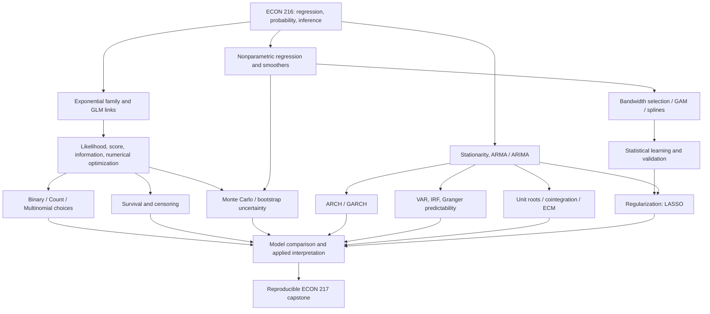

# ECON 217 — Applied Econometric Analysis II

**Generalized Linear Models, Flexible Estimation, Resampling, Statistical Learning, and Time Series**  
**Graduate econometrics | 12-week self-study quarter | R-first | 12–16 hours/week**

> **What this guide is.** A source-based, expanded self-study pathway through the material in this folder, designed for someone familiar with linear regression, probability, and matrix algebra. It is **not** an assertion that every extension below was required in a particular offering of the UCSC course. The original lectures and supplied assignments determine the core; broader readings and carefully labeled exercises deepen it.
>
> **Official UCSC catalog:** [ECON 217 — Applied Econometric Analysis II](https://catalog.ucsc.edu/en/current/general-catalog/courses/econ-economics/graduate/econ-217). The catalog describes **discrete and limited dependent variable models, nonparametric methods, resampling, and statistical/machine learning**, combining theoretical foundations with practice. This archive also contains a substantial **time-series and financial-volatility sequence**, so that material is retained as a major strand.

## 0. How to use this curriculum

### Learning outcomes

At the end of twelve weeks, a learner should be able to:

1. Choose a statistical model based on the **support and data-generating structure** of an outcome—not merely on convenience: continuous, binary, count, multinomial, duration, nonlinear mean, or dependent time series.
2. Derive and implement exponential-family **log likelihoods, scores, information matrices**, likelihood-ratio tests, and numerical maximization routines.
3. Explain the **mean, link, variance, and likelihood** of a GLM; distinguish fitted linear predictors from response-scale expectations; and calculate interpretable effects.
4. Fit and interrogate **binary, count, multinomial, and survival models**, including constraints, censoring, substitution assumptions, and overdispersion.
5. Estimate flexible conditional relationships using **kernel/local linear methods, splines, generalized additive models**, and principled smoothing selection.
6. Design **Monte Carlo and bootstrap experiments**, select an appropriate resampling unit, and recognize when a naive iid bootstrap is inappropriate.
7. Compare **k-nearest neighbors, trees, and penalized models** against parametric benchmarks using appropriate holdouts, diagnostics, and loss functions.
8. Model dynamic dependence using **AR, MA, ARMA/ARIMA, ARCH/GARCH, VAR, unit-root tests, cointegration, and error correction**; critically interpret Granger predictability.
9. Produce a **reproducible research artifact** combining model justification, code, tables, visual diagnostics, uncertainty, out-of-sample performance, and substantive interpretation.
10. Keep **conditional association, predictive performance, and causal identification** conceptually distinct.

### Prerequisites and diagnostics

- **Econometrics:** ECON 216-type competence in OLS, bias/consistency, conditional expectations, hypothesis tests, heteroskedasticity, endogeneity, and basic panel/IV concepts.
- **Mathematics:** single/multivariable calculus, matrix operations, logarithms, constrained/unconstrained optimization, probability distributions, expectations, conditional distributions, and elementary asymptotic reasoning.
- **Computing:** basic R (`data.frame`, vectorization, functions, packages, plotting, `lm`, file paths); familiarity with git or another reproducibility workflow is helpful.
- **Time-series prerequisites:** lags, covariance, weak stationarity, and transformations such as log returns/differences.

**Pre-course diagnostic:** derive the OLS normal equations; write the normal linear-regression log likelihood; compute an expected value and variance from a density; interpret log-odds; generate a reproducible simulation with `set.seed()`; and explain why a coefficient need not be a causal effect. Review ECON 216 first if these are uncomfortable.

### Quarter logistics and assessment

A realistic weekly cadence is 3–4 hours of lecture/reading, 3–4 hours of derivations, 4–6 hours of R work, and 1–2 hours of written interpretation. Recommended assessment: **40% weekly labs, 20% derivation/problem checks, 10% mid-quarter synthesis, 30% capstone**. This is a proposed self-study grading framework, not the original class grading policy.

Every week has the same output standard: (1) one derivation, (2) one executable analysis with a fixed seed and saved package information, (3) one diagnostic figure/table, and (4) one concise interpretation that names assumptions and limitations. Prefer **R** because the provided assignments and lecture demonstrations are R-based; Python is an optional implementation comparison using `Python for Econometrics.pdf`.

**Materials are not all data-complete.** The R scripts reference external or local resources, notably the course's CPS/`org_example.dta` data and historical financial data services. They are not provided as standalone data files in this ZIP. Treat historical script paths/URLs and package APIs as examples requiring adaptation. If data are no longer obtainable, generate a documented synthetic dataset and explicitly mark the exercise as a simulation, not a reproduction of the original empirical results.

### Document and navigation conventions

- Primary lecture reference: [`Econ 217 - Course Lecture Notes.pdf`](Econ%20217%20-%20Course%20Lecture%20Notes.pdf). **PDF page numbers** below mean pages in this *merged file*, not slide numbers printed on individual lecture decks.
- Core supplementary reader: [`Assigned Readings.pdf`](Assigned%20Readings.pdf) — a concatenation including Rodríguez's chapters on linear/logit/count/multinomial/survival/longitudinal/nonparametric models, likelihood review, and bootstrap.
- Broader materials: [`Additional Readings.pdf`](Additional%20Readings.pdf); [`GLM.pdf`](GLM.pdf) (Lang Wu), [`GLM in R.pdf`](GLM%20in%20R.pdf), [`resampling.pdf`](resampling.pdf), [`Panel Data.pdf`](Panel%20Data.pdf), [`hierarchical-models.pdf`](hierarchical-models.pdf), [`mixture-models.pdf`](mixture-models.pdf), [`wild bootstrap.pdf`](wild%20bootstrap.pdf), [`Python for Econometrics.pdf`](Python%20for%20Econometrics.pdf).
- Practice and sample code: [`Homework/`](Homework/) contains answer PDFs, R scripts, an exam and a final-exam answer set. Some `.R` files are student work, while explicitly named answer/code files are supplied solutions; **verify algorithms rather than treating every script as an authoritative implementation**.
- **Equation syntax:** inline math uses `$...$`; every standalone mathematical expression is enclosed in `$$...$$` blocks.

---

## 1. Course-wide dependency map



The graph is also available as [`knowledge-map.mmd`](knowledge-map.mmd). **Interpret arrows as learning prerequisites, not causal claims.** Time-series models branch from regression and probability; they do not depend on completing all the generalized-linear-model chapters.

### How this course advances ECON 216

| ECON 216 foundation | ECON 217 extension | Why the extension exists |
|---|---|---|
| OLS models a conditional mean as linear in regressors | GLMs specify a link and response distribution | Respect bounded probabilities, nonnegative counts, and nonconstant conditional variances |
| Linear-model inference | Likelihood scores, Fisher information, numerical ML | Estimate and test nonlinear probability models |
| Functional-form diagnostics | Kernels, splines, GAMs | Learn smooth relationships without imposing a restrictive polynomial |
| Asymptotic standard errors | Bootstrap, Monte Carlo, wild bootstrap | Study finite-sample uncertainty and robustness |
| Parametric forecasting benchmarks | kNN, trees, LASSO, cross-validation | Evaluate predictive performance and complexity |
| IID/cross-sectional structures | ARIMA, GARCH, VAR, integration and cointegration | Model serial dependence, volatility and nonstationarity |

**Research logic:** choose the estimand/forecast target → check the outcome's support and data structure → choose model and assumptions → estimate and validate → quantify uncertainty → evaluate interpretation/identification → communicate limitations. A well-predicted outcome is not automatically a causally identified effect.

---

## 2. Twelve-week study plan at a glance

| Week | Core topic | Primary course-note pages | Assignment / checkpoint | Practical deliverable |
|---:|---|---|---|---|
| 1 | From OLS to exponential families and GLM architecture | 7–34 | HW 1 | Distribution-and-link notebook |
| 2 | Likelihood inference, scores, information, Newton–Raphson | 35–65 | HW 2; Exam 1 answer themes | Build and verify an optimizer |
| 3 | Binary and count regression, effects, dispersion | 17–34; 35–65 | HW 1–2 | Outcome-specific GLM comparison |
| 4 | Multinomial choice and identification | 66–81 | Main lecture + assigned multinomial chapter | Choice-probability report |
| 5 | Duration, survival, censoring, hazards | 82–95 | HW 3 code | Survival model and risk-set audit |
| 6 | Kernels, local linear regression, nonparametrics | 96–110 | HW 3; Exam 2 | Bandwidth-CV experiment |
| 7 | Series/splines/GAMs and model complexity | 111–120 | Exam 2 | Smoother comparison and midterm memo |
| 8 | Monte Carlo, resampling and reliable intervals | 121–133, plus bootstrap-code appendix pp. 2–6 | HW 3; Exam 2; wild-bootstrap paper | Coverage simulation and CI comparison |
| 9 | Prediction: kNN, trees, regularization | 134–147; 209–212 | Lecture R examples; supplementary reading | Holdout-based predictive benchmark |
| 10 | Time-series I: AR, MA, ARIMA, volatility | 148–179 | HW 4; final-exam answer themes | Forecast and GARCH report |
| 11 | Time-series II: VAR, IRFs, unit roots, cointegration | 180–208 | HW 5 and answer code | VAR/ECM diagnostic notebook |
| 12 | Integration, estimator selection, capstone | All; especially 96–212 | Final exam and research capstone | Reproducible research package |

**Reading allocation.** For weeks 1–5, prioritize the main notes and the matching chapters in `Assigned Readings.pdf`. For weeks 6–12, read the primary lectures first and use `Additional Readings.pdf`, `resampling.pdf`, `GLM.pdf`, and the specialized articles as topical deep dives. The sequence reorganizes the material pedagogically, rather than claiming each original lecture was delivered in precisely one week.

---

## 3. Week-by-week modules

### Week 1 — From linear regression to generalized linear models

**Driving question:** Why should the distribution and range of $Y$ affect how we model $E[Y\mid X]$?

**Primary source:** course notes pp. 7–34; assigned `Chapter 2 Linear Continuous Models`, `Chapter 3 Logit Models for Binary Data`, `Chapter 4 Poisson Models for Count Data`, and `Generalized Linear Models` sections.

**Concepts.** Review $E[Y\mid X]$, linear predictors, least squares as a Gaussian special case, maximum likelihood, Bernoulli/binomial and Poisson data, canonical link vs noncanonical link, fitted values on link and response scales, and the conditions under which a Gaussian identity-link model is a poor approximation. Use the lecture's Current Population Survey examples as motivation, not as required external data.

The modern exponential-family representation is

$$
f(y_i;\theta_i,\phi)=\exp\left\lbrace\frac{y_i\theta_i-b(\theta_i)}{a(\phi)}+c(y_i,\phi)\right\rbrace.
$$

Its principal moment relationships, under the usual regularity conditions, are

$$
E[Y_i\mid X_i]=b'(\theta_i)=\mu_i,\qquad
\mathrm{Var}(Y_i\mid X_i)=a(\phi)b''(\theta_i).
$$

A generalized linear model separates the **random component**, the **systematic predictor**, and the **link**:

$$
\eta_i=X_i^\top\beta,\qquad g(\mu_i)=\eta_i.
$$

**Mastery exercises.** (1) Express Gaussian, binomial and Poisson models as exponential families and derive their means and variances. (2) Explain why an identity-link Gaussian fit to binary data may produce infeasible predicted probabilities. (3) Fit `lm()` and `glm(..., family=gaussian())` to the same data; explain when their coefficient results coincide. (4) Fit binomial and Poisson models to simulated data and compare prediction support.

**R laboratory.** Write a script using `set.seed()`, `rbinom()`, `rpois()`, `glm()`, and `predict(type="response")`; produce plots of true and fitted conditional means. Include a short data dictionary.

**Week 1 deliverable:** a 4–6 page notebook with derivations, three response-distribution examples, and a decision table answering *which family and why?*.

**Failure modes:** treating the link as a probability; confusing the linear predictor with $\mu$; assuming all GLMs have constant variance; interpreting a nonlinear coefficient as an invariant marginal effect.

### Week 2 — Likelihood theory and numerical estimation

**Driving question:** How do statistical assumptions become a computable estimator, uncertainty statement, and test?

**Primary source:** course notes pp. 35–65; assigned `Review of Likelihood Theory`; `GLM.pdf` likelihood and optimization sections; `Homework 2 Answers.pdf` and `ECON217Exam1Answers.pdf`.

**Concepts.** Joint likelihood under an appropriate sampling scheme, log likelihood, score, Hessian, expected information, MLE consistency/asymptotic normality (subject to regularity/identification), Newton–Raphson, Fisher scoring, iteratively reweighted least squares (IRLS), Wald tests, score tests, likelihood-ratio tests, and convergence/curvature diagnostics.

$$
\ell(\beta)=\sum_{i=1}^n\log f(y_i\mid X_i;\beta),\qquad
U(\beta)=\frac{\partial\ell}{\partial\beta},\qquad
H(\beta)=\frac{\partial^2\ell}{\partial\beta\partial\beta^\top}.
$$

For a maximization root-finding iteration,

$$
\beta^{(k+1)}=\beta^{(k)}-H\big(\beta^{(k)}\big)^{-1}U\big(\beta^{(k)}\big).
$$

When regularity conditions hold, the information identity links the expected negative Hessian and score covariance; asymptotic standard errors arise from the inverse information. A nested-model likelihood-ratio statistic is

$$
LR=2\big[\ell(\widehat\beta_{\mathrm{unrestricted}})-\ell(\widehat\beta_{\mathrm{restricted}})\big]\ \overset{a}{\sim}\ \chi^2_{q},
$$

where $q$ is the number of independent restrictions and the usual regularity conditions apply (boundary cases require special care).

**Mastery exercises.** (1) Derive Bernoulli-logit score and Hessian. (2) Derive the Poisson log-likelihood gradient for a log-link model. (3) Implement Newton–Raphson using base R matrices, inspect eigenvalues of the observed curvature, and compare estimates to `glm()`. (4) Compare Wald and LR results for nested regressions; discuss finite-sample disagreement. (5) Explain separation or nonidentification as an optimization/likelihood problem.

**R laboratory.** Write `loglik()`, `score()`, `hessian()` (analytic or finite-difference verification), a step-limited optimizer, convergence checks, and a summary table versus `glm()`. `optim()` may be used as a benchmark, not as a substitute for understanding the algorithm.

**Week 2 deliverable:** derivation notes plus a robust optimizer with unit tests on simulated data.

**Failure modes:** reversing the sign of the Hessian; comparing log likelihoods on different observations; equating numerical convergence with correct specification; treating Hessian inversion as infallible when estimates are on boundaries or regressors are collinear.

### Week 3 — Binary and count outcomes in practice

**Driving question:** What is a meaningful change in probability or expected event count?

**Primary source:** pp. 17–34 and 35–65; assigned binary/count chapters; supplementary `Additional Readings.pdf` selections on logit/probit, Poisson, Gamma and beta regression; `Homework 1.R`, `Homework 2.R` and corresponding answers.

**Concepts.** Logit/probit contrasts, odds and probability ratios, average marginal effects (AMEs), finite changes for indicators, predictive calibration, confusion matrices when classification is the objective, Poisson incidence-rate ratios, offsets and exposure, equidispersion assumptions, overdispersion diagnostics, quasi-Poisson and negative-binomial alternatives (the latter as an extension), and avoiding transformed-OLS shortcuts when an appropriate response model exists.

For binary logit,

$$
P(Y_i=1\mid X_i)=\Lambda(X_i^\top\beta)=\frac{e^{X_i^\top\beta}}{1+e^{X_i^\top\beta}},
\qquad \frac{\partial P_i}{\partial x_{ij}}=\beta_j P_i(1-P_i).
$$

For a Poisson regression with exposure $e_i$,

$$
Y_i\mid X_i\sim\mathrm{Poisson}(\mu_i),\quad
\log\mu_i=\log e_i+X_i^\top\beta,\quad
E[Y_i\mid X_i]=\mathrm{Var}(Y_i\mid X_i)=\mu_i.
$$

**Mastery exercises.** (1) Fit logit/probit/linear-probability models on identical simulated binary outcomes; compare AMEs and feasible predictions. (2) For counts, fit Poisson with and without an offset; interpret rate ratios; inspect residual deviance and variance-to-mean patterns. (3) Simulate overdispersed counts, determine which inferential and predictive claims become unreliable under a plain Poisson specification. (4) Explain why a large odds ratio does not itself imply a large probability effect.

**Week 3 deliverable:** a side-by-side binary/count model brief, coefficient-to-effect translation, calibration diagnostics, and a model-choice rationale.

**Failure modes:** interpreting $\beta$ as a probability change; exponentiating a probit coefficient; forgetting exposure; treating a significant coefficient as evidence of causal identification.

### Week 4 — Multinomial and discrete alternative choice

**Driving question:** How do models change when agents choose one of several mutually exclusive alternatives?

**Primary source:** pp. 66–81; assigned `Chapter 6 Multinominal Response Models` (source filename spelling); lecture's `mlogit` examples. For deeper random-utility interpretation, connect to the discrete-choice reading from the Microeconomics curriculum, rather than assuming it is part of this ZIP.

**Concepts.** Multinomial response probabilities, baseline-category normalization, multinomial logit, covariate-specific log relative odds, alternative-specific regressors, random utility, independence of irrelevant alternatives (IIA), conditional vs multinomial logit, likelihood estimation, and counterfactual choice-share calculations. The source contains a derivation of the multinomial-logit formula from independent extreme-value errors; treat this as a meaningful theory exercise.

$$
P(Y_i=j\mid X_i)=\frac{\exp(X_i^\top\beta_j)}{\sum_{k=1}^J\exp(X_i^\top\beta_k)},\qquad
\beta_{J}=0\ \text{(baseline normalization)}.
$$

**Mastery exercises.** (1) Derive choice probabilities from multinomial log odds relative to a base category. (2) Describe scale/location normalizations. (3) Simulate choices among three alternatives; estimate and visualize shares under a price or attribute change. (4) Construct an IIA counterexample (e.g. highly similar alternatives) and explain why a nested specification might help. (5) Distinguish predictive choice shares from consumer welfare or causal treatment effects.

**Week 4 deliverable:** an alternative-choice report with model specification, readable data arrangement, fit/held-out checks, and one counterfactual. Add a note about where extrapolation is hazardous.

### Week 5 — Survival, event times, and censoring

**Driving question:** What can be learned from duration data when some spells have not yet ended?

**Primary source:** pp. 82–95; assigned survival chapters 7 and 7.1–7.6, with competing risks/unobserved heterogeneity as extensions; `Homework 3.R` and `Homework 3 Answer Code.R` (which use the R `survival` library).

**Concepts.** Duration $T$, survival function $S(t)$, density $f(t)$, hazard $h(t)$, right-censoring, risk sets, Kaplan–Meier, exponential survival, parametric hazards, proportional hazards, sample selection of observed events, and why observed duration averages are biased under naive removal of censored observations.

$$
S(t)=P(T>t),\qquad h(t)=\frac{f(t)}{S(t)},\qquad S(t)=\exp\left(-\int_0^t h(u)\,du\right).
$$

For independent, non-informative right censoring with observed $t_i$ and event indicator $\delta_i$,

$$
L(\vartheta)=\prod_{i=1}^n f(t_i;\vartheta)^{\delta_i}S(t_i;\vartheta)^{1-\delta_i}.
$$

The Kaplan–Meier product-limit estimator is

$$
\widehat S(t)=\prod_{t_j\le t}\left(1-\frac{d_j}{n_j}\right),
$$

where $n_j$ is the risk set just before event time $t_j$ and $d_j$ is the number of events then.

**Mastery exercises.** (1) Derive the survival likelihood and the exponential hazard/survival relationship. (2) Simulate right-censored durations and compare Kaplan–Meier against the naive uncensored empirical survivor curve. (3) Estimate a proportional hazards model and interpret a hazard ratio. (4) Diagnose whether proportional hazards and non-informative censoring are plausible; optionally explore competing risks or shared frailty from the assigned readings.

**R laboratory:** `Surv()`, `survfit()`, `coxph()` and suitable residual/diagnostic tools. Include plots of risk sets and cumulative survival.

**Week 5 deliverable:** an event-time analysis with a censoring audit and interpretive caveats.

---
### Week 6 — Nonparametric regression and bandwidth choice

**Driving question:** Can we estimate an unknown regression curve without deciding its global functional form in advance?

**Primary source:** pp. 96–110; assigned `Chapter 9 Non Parametric Regression`; `Additional Readings.pdf` cross-validation reading; `Homework 3` materials and `ECON217Exam2-2017.pdf`.

**Concepts.** Estimation of $m(x)=E[Y\mid X=x]$, binning, local constant/Nadaraya–Watson regression, kernel choice, bandwidth and bias–variance tradeoffs, local linear estimation and boundary behavior, leave-one-out cross-validation, nonparametric estimation with multiple covariates, and the curse of dimensionality. Link these to the estimation of substantive effects without assuming a causal interpretation.

$$
\widehat m_h(x)=\frac{\sum_{i=1}^n K\!\left(\frac{x-X_i}{h}\right)Y_i}
{\sum_{i=1}^n K\!\left(\frac{x-X_i}{h}\right)}.
$$

A leave-one-out predictive choice of bandwidth is

$$
\widehat h=\arg\min_{h\in\mathcal H}\frac{1}{n}\sum_{i=1}^n\left[Y_i-\widehat m_{h,-i}(X_i)\right]^2.
$$

**Mastery exercises.** (1) Derive NW estimator as a locally weighted least-squares solution. (2) Implement Gaussian and uniform kernels; compare their behavior at equal bandwidth. (3) Compare NW to local linear regression on a known nonlinear function, emphasizing boundary bias. (4) Implement leave-one-out bandwidth selection manually and compare to a package. (5) Reproduce the *structure* of Exam 2's nonlinear-function smoothing exercise with synthetic observations if the original personalized file is unavailable.

**Week 6 deliverable:** a bandwidth-selection notebook with prediction curves, pointwise errors, and a sensitivity table for competing kernels and spans.

**Failure modes:** making the smoothest fit synonymous with the best prediction; choosing bandwidth by in-sample fit; using too many continuous predictors without addressing dimensionality; interpreting $m(x)$ as an intervention response.

### Week 7 — Series estimation, splines, and generalized additive models

**Driving question:** How much flexibility can we introduce before we overfit?

**Primary source:** pp. 111–120, including the Runge-phenomenon and GAM demonstrations; `ECON217Exam2-2017.pdf`, `ECON217Exam2-2017Answers.R`, and assigned nonparametric chapter.

**Concepts.** Global polynomial/series approximations, basis expansion, Runge's phenomenon, knot placement, piecewise-polynomial splines, smoothing penalties, generalized additive models (GAMs), effective degrees of freedom, interactions, prediction uncertainty, and the distinction between a smoother's **shape** and a regression coefficient's interpretation.

$$
m(x)\approx\sum_{k=1}^{K}\beta_k B_k(x),
$$

where $B_k$ may be polynomial, spline, or another chosen basis. Penalized smoothing trades off fit and wiggliness:

$$
\min_f\ \sum_{i=1}^n\big(Y_i-f(X_i)\big)^2+\lambda\int\big[f''(x)\big]^2\,dx.
$$

A common additive specification is

$$
g\!\big(E[Y_i\mid X_i]\big)=\beta_0+f_1(X_{i1})+f_2(X_{i2})+\cdots+f_p(X_{ip}).
$$

**Mastery exercises.** (1) Compare cubic splines with high-degree polynomial regression at fixed and variable $K$. (2) Evaluate sensitivity to spline knots or smoothing penalty. (3) Fit a GAM for labor outcomes on age plus categorical covariates, echoing the exam task, and explain estimated nonlinearities. (4) Compare smoothers by validation error rather than in-sample significance alone. (5) Give an example where an additive fit fails to capture an interaction.

**Week 7 deliverable and mid-quarter checkpoint:** a 5–7 page synthesis with comparisons among parametric GLM, local linear regression, splines and GAMs on the same outcome, including a concise explanation of why different methods answer different questions.

### Week 8 — Monte Carlo, bootstrap, and reliable uncertainty

**Driving question:** Can we assess sampling uncertainty when finite-sample behavior is complicated or analytic formulas are unreliable?

**Primary source:** pp. 121–133 plus bootstrapping code pages 2–6 at the front of the merged notes; `resampling.pdf`; `wild bootstrap.pdf` (Davidson and MacKinnon on wild bootstrap for IV); `Additional Readings.pdf` bootstrapping and cross-validation resources; HW 3 code and Exam 2's wild-bootstrap task.

**Concepts.** Difference between a **Monte Carlo study** (repeat a known synthetic DGP) and a **bootstrap** (resample observed data under an implicit empirical approximation), pairs/case resampling, residual bootstrap, wild bootstrap, percentile intervals, bootstrap standard errors, coverage, heteroskedasticity, dependence, clustered sampling, and the need to preserve the dependence structure in resampling.

For bootstrap replications $\widehat\theta^{*(1)},\ldots,\widehat\theta^{*(B)}$,

$$
\widehat{\mathrm{SE}}_{\mathrm{boot}}(\widehat\theta)
=\sqrt{\frac{1}{B-1}\sum_{b=1}^B\left(\widehat\theta^{*(b)}-\overline\theta^*\right)^2}.
$$

An elementary wild residual bootstrap for a fixed-design regression starts with

$$
Y_i^*=X_i^\top\widehat\beta+\widehat u_i v_i,
\qquad P(v_i=1)=P(v_i=-1)=\frac12.
$$

This is **one particular implementation**, not a universal guarantee of valid inference. Its appropriateness depends on the estimand, null restrictions, leverage, sampling scheme, and error structure. In particular, iid case bootstrap methods do not automatically work for clustered or dependent time series.

**Mastery exercises.** (1) Estimate true coverage of nominal 95% confidence intervals across repeated datasets. (2) Compare analytic normal, pairs-bootstrap, residual-bootstrap, and wild-bootstrap intervals under homoskedastic and heteroskedastic designs. (3) Implement a percentile interval and investigate finite-$B$ Monte Carlo variability. (4) Revisit the Week 6 LOESS curve: construct pointwise bootstrap bands and explain why these are **not** automatically simultaneous confidence bands. (5) Describe an appropriate block/bootstrap strategy for a time series as a reading extension.

**Week 8 deliverable:** a reproducible coverage experiment with at least two sample sizes, two noise processes, interval comparisons, and a sensitivity note about resampling design.

### Week 9 — Statistical learning and out-of-sample validation

**Driving question:** When should predictive flexibility take priority over interpretable parametric structure?

**Primary source:** pp. 134–147 on kNN and trees; pp. 209–212 on LASSO and dynamic-lag selection; supplementary cross-validation reading. The catalog's reference to statistical learning makes this a core objective; other modern ML methods are optional extensions rather than assumed source coverage.

**Concepts.** Supervised prediction versus econometric effect estimation, k-nearest neighbors, metric selection and feature scaling, classification and regression trees, tree depth/pruning, training/validation/test separation, random splits vs time-ordered splits, cross-validation, class imbalance, suitable losses (RMSE/log loss/Brier score), baseline comparison, LASSO, tuning penalty $\lambda$, feature standardization, and post-selection inference caveats.

For LASSO regression (intercept left unpenalized),

$$
\widehat\beta(\lambda)=\arg\min_{\beta}\left\lbrace
\frac{1}{2n}\sum_{i=1}^n\big(Y_i-\beta_0-X_i^\top\beta\big)^2
+\lambda\sum_{j=1}^p|\beta_j|\right\rbrace.
$$

**Mastery exercises.** (1) Build kNN classifier and regression tree benchmarks against logit/GLM and a flexible GAM; compare held-out losses. (2) Change $k$, tree complexity, and data scaling; quantify sensitivity. (3) Implement $k$-fold CV without leakage (including preprocessing inside folds). (4) Fit LASSO on a high-dimensional simulated design and contrast prediction error, variable selection, and coefficient interpretation. (5) For lagged predictors, replace random CV with rolling-origin or blocked validation and explain the difference.

**Week 9 deliverable:** a model-selection note with reproducible split logic, metric justification, and a compact forecast/performance table. Include one explicit example where high predictive accuracy is compatible with a biased causal interpretation.

**Scope distinction:** random forests, boosting, neural networks and double/debiased ML can be valuable further reading but are **not** documented primary topics in this folder. Do not treat them as assigned material unless later uploaded sources establish that coverage.

### Week 10 — Dynamic data I: ARIMA and conditional volatility

**Driving question:** How do persistence, serial correlation and volatility clustering affect forecasting and inference?

**Primary source:** pp. 148–179; `Homework 4.R`, `Homework 4 Answers.R`; `ECON217FinalExamAnswers.pdf`; supplement `Additional Readings.pdf` time-series topics.

**Concepts.** Stochastic processes; trend vs covariance stationarity; AR($p$), MA($q$), ARMA and ARIMA models; autocorrelation function (ACF), partial autocorrelation (PACF), lag selection, forecast errors, innovations, time-series validation; conditional heteroskedasticity, ARCH and GARCH volatility. Contrast return modeling against modeling price levels.

For a stationary AR(1) process,

$$
Y_t=\alpha+\phi Y_{t-1}+\varepsilon_t,\qquad |\phi|<1,\qquad
\mathrm{Var}(Y_t)=\frac{\sigma_\varepsilon^2}{1-\phi^2}
$$

when innovations are serially uncorrelated with constant variance $\sigma_\varepsilon^2$. A GARCH(1,1) specification is

$$
\varepsilon_t=\sqrt{h_t}z_t,\qquad
h_t=\omega+\alpha\varepsilon_{t-1}^2+\beta h_{t-1},
$$

where $E[z_t]=0$, $E[z_t^2]=1$ and standard positivity/stationarity conditions must be examined. The usual sufficient covariance-stationarity restriction for this basic model includes $\alpha+\beta<1$.

**Mastery exercises.** (1) Derive the AR(1) mean, variance, and ACF under stationarity. (2) Simulate stationary, nearly nonstationary, and explosive autoregressions; describe their sampling properties. (3) Fit ARIMA candidates and compare one-step/rolling forecasts to a naive benchmark. (4) Fit a GARCH model to simulated volatility clusters or a responsibly sourced return series; analyze residuals and standardized innovations. (5) Explain why a GARCH fit should not be taken as structural proof of market efficiency or a true conditional law.

**Week 10 deliverable:** a forecast-and-volatility notebook with ACF/PACF plots, rolling error metrics, forecast intervals and GARCH diagnostic plots. Reproduce the logic, not necessarily historic numerical answers, of the provided assignment.

### Week 11 — Dynamic data II: systems, unit roots, and cointegration

**Driving question:** How do multiple evolving series interact, and when do common trends create spurious regression?

**Primary source:** pp. 180–208; `Homework/HW5.pdf` and `Homework/HW5 Sols.R`; `Additional Readings.pdf` VARs, unit-root tests, and impulse-response resources; final-exam answer set.

**Concepts.** Reduced-form vector autoregression, lag-length choice, system forecasting, impulse-response functions (IRFs), residual covariance and innovation identification, Granger predictability, Dickey–Fuller/augmented Dickey–Fuller unit-root testing, integration order, spurious regression, cointegration, Engle–Granger logic, equilibrium corrections, ECM vs VAR-in-differences, and the difference between short- and long-run interpretation.

A reduced-form VAR(1) is

$$
Z_t=c+AZ_{t-1}+u_t,\qquad E[u_tu_t^\top]=\Sigma_u.
$$

The response to an isolated reduced-form innovation $u_t=s$ after $h$ steps is $A^h s$ in the linear stable system, **conditional on the chosen innovation interpretation**. This is not automatically a structural causal impulse response when contemporaneous errors are correlated.

An elementary error-correction representation is

$$
\Delta Y_t=\gamma\big(Y_{t-1}-\beta_0-\beta_1X_{t-1}\big)
+\delta\Delta X_t+e_t,
$$

with a stable adjustment often requiring $\gamma<0$ under this sign convention and the rest of the model suitably specified. Cointegration requires checking integration and the residual process; do not infer it simply from an impressive $R^2$ between trending levels.

**Mastery exercises.** (1) Estimate a two-variable reduced-form VAR; construct dynamic forecasts and IRFs manually through matrix recursion before using a package. (2) Explain the difference between Granger predictability and causal identification. (3) Test series' integration orders and discuss deterministic trends, lag choice and test power. (4) Investigate cointegration and fit an ECM only when warranted. (5) Use `HW5.pdf` as the formal template: it analyzes GOOG/AMZN prices, reduced-form VARs, Granger tests, manually computed IRFs and cointegration. **Caution:** price levels often behave like integrated processes; check their properties before fitting/interpreting level VARs.

**Week 11 deliverable:** a system-forecasting notebook with time-series diagnostics and a written explanation of whether the dynamic model's relationships are predictive, long-run equilibrium associations, or causally interpretable.

### Week 12 — Integrative applied project and communication

**Driving question:** Can you make a defensible choice among model families, check uncertainty, and communicate a research finding without overclaiming?

**Primary source:** revisit main notes pp. 7–212 and [`Homework/ECON217FinalExamAnswers.pdf`](Homework/ECON217FinalExamAnswers.pdf). Use the final as a **diagnostic** for AR(1) stationarity, model interpretation and dynamic questions, not as a replacement for research.

**Required integration.** The capstone must connect at least **three** of the following methodological categories: (1) GLM/discrete/count/survival, (2) semiparametric/nonparametric smoothing, (3) resampling/Monte Carlo, (4) machine learning/regularization, (5) time-series dynamics. Choose a coherent substantive question instead of forcing unrelated models onto one dataset. A two-part capstone (one cross-sectional problem and one time-series problem) is also acceptable.

**Week 12 deliverables:** complete executable code, reproducibility instructions, written technical report, appendix with assumptions/diagnostics, and a 5-minute research presentation outline. The final report must distinguish **estimation, prediction, and causal claims**, explaining the evidence supporting each.

---

## 4. Cross-topic technical reference

### 4.1 Choosing a model by the support and structure of the outcome

| Outcome / problem | Starting model | Key mean or dependence relationship | Diagnostic / alternative |
|---|---|---|---|
| Unbounded approximately symmetric continuous $Y$ | Gaussian linear regression | $E[Y\mid X]=X^\top\beta$ | Residuals, nonlinear shape, heteroskedasticity |
| Binary event $Y\in\lbrace0,1\rbrace$ | Binomial logit / probit | $P(Y=1\mid X)=F(X^\top\beta)$ | Calibration; AMEs; separation and rare events |
| Nonnegative count | Poisson log-link | $\log E[Y\mid X]=X^\top\beta$ | Exposure; overdispersion; excess zeros |
| One of $J$ categories | Multinomial logit | normalized category probabilities | IIA, availability, heterogeneous tastes |
| Right-censored event time | Kaplan–Meier and survival regression | $S(t),h(t)$ | Censoring mechanism, proportional hazards |
| Smooth nonlinear relationship | Local linear, splines or GAM | estimated $m(x)$ or $g(E[Y])$ | Cross-validated smoothing, boundary error |
| Predictive classification | logit vs kNN/tree | estimated class probabilities / labels | Calibration, class imbalance, test leakage |
| Serially correlated scalar process | ARMA/ARIMA | conditional mean from own history | Stationarity, innovation diagnostics, rolling forecasts |
| Conditional volatility clustering | ARCH/GARCH | conditional innovation variance $h_t$ | Standardized residuals, heavy tails, misspecification |
| Multivariate dynamics | VAR | conditional system response | Stability, identification, IRF uncertainty |
| Shared stochastic trends | Cointegration / ECM | stable long-run spread and adjustment | Integration-order tests, structural stability |
| High-dimensional or many lagged predictors | LASSO | sparse penalized prediction | Standardize, tune out of sample, selection bias |

**Note:** basic GLMs do not encompass every distribution or time-to-event model. Survival, mixtures, hierarchical random effects, and ARIMA/GARCH are related regression/stochastic-model extensions but should not all be conflated with ordinary canonical GLMs.

### 4.2 Interpretation and diagnostic checklist

1. **Target:** conditional mean, event probability, incidence rate, hazard, class prediction, dynamic forecast, or parameter with an identifiable causal interpretation?
2. **Support:** does the predicted response respect the feasible domain? Are zeros, censoring, counts, and exposures handled properly?
3. **Likelihood:** is distributional fit plausible? Check residual/deviance, dispersion, complete separation, censoring, and convergence where relevant.
4. **Dependence:** independent units, clustered observations, repeated measures, or time-series? This determines both standard errors and validation design.
5. **Specification:** link, nonlinearities, interactions, omitted variables, timing and missingness. Compare against a simpler credible baseline.
6. **Fit vs prediction:** do not select a model solely by in-sample likelihood, $R^2$, or visual smoothness. Evaluate relevant held-out loss and uncertainty.
7. **Sensitivity:** inspect alternative specifications, samples, smoothing parameters, lags, bootstrap schemes, and variance assumptions.
8. **Claims:** prediction implies neither causality nor policy effectiveness. If asking a causal question, specify a research design and identification assumptions beyond choosing an estimator.

### 4.3 Likelihood, probability effects, and numerical optimization

For a logistic GLM with $p_i=\Lambda(X_i^\top\beta)$, a useful hands-on identity is

$$
U(\beta)=\sum_{i=1}^n X_i(Y_i-p_i),\qquad
H(\beta)=-\sum_{i=1}^n X_iX_i^\top p_i(1-p_i).
$$

A weighted least-squares form of Fisher scoring (IRLS) uses working response and weights

$$
z_i=\eta_i+\frac{Y_i-\mu_i}{d\mu_i/d\eta_i},\qquad
w_i=\frac{\big(d\mu_i/d\eta_i\big)^2}{\phi V(\mu_i)}.
$$

These expressions make clear the relationship between the GLM implementation and familiar linear-algebra methods; they also reveal why extreme fitted probabilities and nearly singular designs cause difficulty.

When reporting marginal effects, state **what is held fixed** and whether the quantity is a derivative, discrete change, AME, or counterfactual difference. For outcomes with a nonlinear link, a coefficient's effect varies across observations.

### 4.4 Smoothing, uncertainty and prediction

The core tradeoff is not simply parametric versus nonparametric. Models live along multiple axes: structural assumptions, flexibility, computational burden, interpretability, data requirements, robustness and target (explanation vs forecasting).

- **GLM:** efficient and interpretable when mean/distribution assumptions are appropriate; sensitive to misspecification.
- **Local regression:** flexible and interpretable as a conditional mean; bandwidth- and dimension-sensitive.
- **Spline/GAM:** flexible smooth components, some interpretability, tuning and additive restrictions.
- **kNN/trees:** accessible nonlinear predictors; results depend strongly on scaling, complexity, sample size and validation.
- **LASSO:** attractive for large predictor sets, but coefficient shrinkage and data-driven selection complicate conventional inference.
- **Bootstrap:** a resampling *strategy*, not a guarantee of valid coverage; must match sampling/dependence assumptions.

### 4.5 Time-series essentials

Keep **levels**, **differences**, **log differences**, **returns**, and **growth rates** distinct. If the series is integrated, blindly applying stationary-time-series regression to levels can create misleading statistics. Select transformations with an economic and statistical justification, and explain whether the goal is a short-run forecast, long-run relation, volatility estimate or impulse response. Model validation must respect temporal ordering; random train/test splitting is often inappropriate.

Remember that common trends, predictive precedence, and structural causation are distinct. Granger causality refers to incremental predictive content conditional on an information set; it does **not**, by itself, identify a structural intervention effect.

---
## 5. Applied research labs and synthesis projects

These labs are **proposed adaptations** of the provided course themes, not claimed original assignment text. They provide a coherent path for learners who do not have access to the course's historical external datasets.

### Lab A — Labor-market participation and work intensity (Weeks 1–4)

**Economic question.** How do observable worker characteristics predict whether someone participates in the labor force, the hours worked, and the categorical labor-market state?

**Design.** Start with a dataset containing participation, hours, age, education, demographic indicators and observation date, or generate a simulated analogue. Model binary participation using logit/probit; counts of work-related events using Poisson only if the outcome truly is a count; a multi-state labor-force outcome with multinomial logit; compare marginal effects and predictive accuracy.

**Methods:** outcome support → GLM link choice → MLE and inference → AMEs / discrete changes → holdout checks. **Key risk:** labor-market associations may reflect selection, omitted variables, endogenous schooling or policy differences, so do not label them causal without design.

**Deliverable:** labeled figures of fitted participation probabilities by age, a multinomial predicted-share plot, calibration table and 2-page economic interpretation.

### Lab B — Duration and flexible age profiles (Weeks 5–8)

**Economic question.** How does a policy, firm or household characteristic associate with time until an event, and how nonlinear is its effect?

**Design.** Generate observed duration with right censoring or use defensibly sourced data with a documented event definition and risk set. Compare Kaplan–Meier and proportional hazards specifications. On a separate continuous response such as hours or log earnings, compare a parametric age polynomial, local linear fit and GAM; evaluate bandwidth by leave-one-out CV and interval behavior by Monte Carlo/wild-bootstrap designs.

**Methods:** censoring-aware likelihood, smooth functional-form comparison, bootstrap coverage. **Key risks:** informative censoring, unobserved heterogeneity, inappropriate resampling, and pointwise-vs-simultaneous inference.

**Deliverable:** event-time report; smooth age-profile chart with uncertainty; empirical coverage table.

### Lab C — Economic forecasting and volatility (Weeks 9–11)

**Economic question.** Does a univariate dynamic model or multivariate predictor system improve forecast accuracy? Do financial returns show conditional volatility persistence?

**Design.** Pick an observable, non-proprietary time series (e.g., an economic activity index or publicly available price/return series) and record source/access date. Establish variable definitions and frequencies; distinguish changes, returns and levels. Compare autoregression/ARIMA with naive forecasts, inspect residual autocorrelation, fit ARCH/GARCH when justified, and construct a two-variable VAR. Test for Granger predictability and unit roots; estimate an ECM only if cointegration evidence and substantive rationale warrant it.

**Methods:** rolling validation, ACF/PACF, ARMA, conditional variance, VAR dynamics, integration and cointegration. **Key risks:** look-ahead bias, fitting regressions of stochastic trends in levels, unexamined structural change, mistaken causal interpretation of impulse responses.

**Deliverable:** reproducible forecast scoreboard, diagnostic plots, selected IRFs with uncertainty, and a limitations memo.

### Lab D — Full ECON 217 capstone (Week 12)

**Choose one route:**

- **Route 1 — Nonlinear outcome research.** A labor, health, policy, consumer or firm dataset with binary/count/multinomial/duration outcome. Fit a GLM benchmark; test at least one flexible alternative, one resampling method, and one independent validation strategy. Interpret coefficients on the relevant response scale.
- **Route 2 — Applied time-series research.** An economic or financial forecasting question using appropriate ARIMA/VAR/GARCH methods, plus diagnostic and unit-root/cointegration work where relevant. Compare a baseline to a more flexible or penalized alternative and evaluate forecast uncertainty.
- **Route 3 — Two mini-papers.** A shorter nonlinear/cross-sectional study and a shorter dynamic-data study, sharing one methodology discussion about loss functions, validation and causality.

**Required research package** (suggested files):

```text
capstone/
  README.md                 # question, instructions, data provenance
  data/README.md            # where data came from, access/licensing notes
  scripts/01_prepare.R      # import/generate, cleaning, unit tests
  scripts/02_estimate.R     # benchmark + alternatives
  scripts/03_validate.R     # holdout/rolling validation, diagnostics
  scripts/04_uncertainty.R  # intervals, bootstrap/Monte Carlo as appropriate
  output/                  # plots and tables, created by scripts
  report.md                 # interpretation and limitations
  renv.lock                 # optional package reproducibility
```

**Report structure:** (1) economic question and estimand/forecast target; (2) identification/data-generating assumptions; (3) data and support; (4) model comparison and estimation; (5) interpretation; (6) residual/specification checks; (7) uncertainty and validation; (8) sensitivity/limitations; (9) reproducibility appendix. A strong report could explicitly reject a more elaborate model when a simple baseline performs equally well.

**Evaluation rubric:** model appropriateness (25%), mathematical/statistical reasoning (20%), validation and uncertainty (20%), reproducibility (15%), economic interpretation and limitations (20%).

---

## 6. Practical R workflow and package reference

This is a **minimal modern template**, not a reproduction of the historical R code in the archive. Use the package documentation corresponding to the version you install. Keep training and test sets distinct and seed simulations before running them.

```r
# Step 0. A fully reproducible binary GLM illustration
set.seed(217)
n <- 1200
x <- rnorm(n)
z <- rbinom(n, 1, 0.4)
p <- plogis(-0.6 + 1.2 * x - 0.8 * z)
y <- rbinom(n, size = 1, prob = p)
d <- data.frame(y, x, z)

# Separate fitting from evaluation
train_id <- sample.int(n, size = floor(0.7 * n))
train <- d[train_id, ]
test  <- d[-train_id, ]
fit <- glm(y ~ x + z, data = train, family = binomial(link = "logit"))
pp <- predict(fit, newdata = test, type = "response")

# Brier score and probability diagnostic
brier <- mean((test$y - pp)^2)
summary(fit)
print(brier)
stopifnot(all(pp >= 0 & pp <= 1), is.finite(brier))

# Inspect versions for later reproduction
sessionInfo()
```

**Suggested R library map** (install only what you need):

| Task | Functions / libraries to explore | Check before using |
|---|---|---|
| Baseline GLM | `glm`, `family`, `predict`, `anova` | correct family/link; nested-model restrictions |
| Multinomial response | `mlogit`, `nnet::multinom` | required choice-data shape; alternative/base normalization |
| Survival analysis | `survival::Surv`, `survfit`, `coxph` | event coding, censoring, risk sets |
| Nonparametric smoothers | `loess`, `splines`, `mgcv::gam` (historical examples use `gam`) | smoothing selection; out-of-sample performance |
| Bootstrap | base R resampling, `boot` | iid vs clustered/dependent sampling |
| Statistical learning | `class`, `rpart`, `glmnet`; historical `caret` code | scaling, leakage, folds, test-set separation |
| Forecasts / volatility | `stats::arima`, `forecast`, `tseries` or newer GARCH packages | stationarity, volatility restrictions, versions |
| VAR / unit root | `vars`, `urca`, or packages named in the historic scripts | ordering/orthogonalization; DF specification |
| Data handling | base R, `read.csv`, `foreign::read.dta` | file provenance, missing values, encodings |

**Version warning:** some supplied `.R` scripts use course-site URLs, packages and financial-data APIs from approximately 2016–17; these may no longer work without updates. Record all modifications to reproduce an original task. Avoid copying installation commands (`install.packages`) into every research run; document package setup separately.

### A reproducibility checklist

- Fix simulation seeds; do not overwrite raw data; state sample filters and dropped observations.
- Include units, dates, transformations and outcome support; save a descriptive data dictionary.
- Use relative paths and execute the project from a well-defined working directory.
- Separate original course exercises, your own extensions and alternative datasets in filenames and reporting.
- Save both estimation diagnostics and predictive metrics; state whether standard errors are model-based, robust, bootstrapped, or clustered.
- Use split schemes suitable for the data: IID folds for roughly independent units; group splits for groups; rolling/blocked evaluation for time series.
- Preserve all assumptions and warnings that affect identification and inference, not just the final result.

---

## 7. Exact archive source index

### 7.1 Primary combined lecture notes

These page ranges refer to the **212-page merged** [`Econ 217 - Course Lecture Notes.pdf`](Econ%20217%20-%20Course%20Lecture%20Notes.pdf). Page 1 contains an index of merged original files; pages 2–6 contain bootstrap-code examples. The following ranges are based on the actual page-title transitions.

| PDF pages | Original lesson / major topic | Core ideas | Corresponding self-study week |
|---|---|---|---|
| 2–6 | Bootstrap code appendix | case/residual/wild resampling examples | 8 |
| 7–34 | Lecture 1 | linear-to-GLM transition; exponential family; Gaussian, binomial, Poisson; logit/probit; count models; R GLMs and predictions | 1, 3 |
| 35–65 | Lecture 2 | first/second exponential-family moments; scores, MLE, Newton–Raphson, information, LR tests | 2, 3 |
| 66–81 | Multinomial choice lecture | multinomial logit, random utility, IIA, `mlogit`, extreme-value derivation | 4 |
| 82–95 | Survival lecture | hazards, survivor functions, Kaplan–Meier, censoring and likelihood | 5 |
| 96–120 | Nonparametric lecture | kernel/NW, LOESS, bandwidth CV, series, splines, GAMs | 6–7 |
| 121–133 | Resampling lecture | Monte Carlo, case bootstrap, residual bootstrap, wild bootstrap | 8 |
| 134–147 | Data science lecture | kNN classification/regression and decision trees | 9 |
| 148–179 | Time-series lecture (first sequence) | stationarity, AR/MA/ARIMA, ARCH/GARCH and forecasting | 10 |
| 180–189 | VAR/Granger section | VAR representation, forecasting, Granger tests and Sims test | 11 |
| 190–208 | Time-series lecture (second sequence) | unit roots, spurious regression, cointegration, ECM, Engle–Granger | 11 |
| 209–212 | LASSO extension | penalized lag selection in time-series regression | 9, 12 |

### 7.2 Assigned and additional readings

**[`Assigned Readings.pdf`](Assigned%20Readings.pdf)** is a large compilation rather than a single monograph. Its opening index lists: linear continuous models; binary logit; Poisson/count; log-linear contingency tables; multinomial responses; survival including parametric/nonparametric, competing-risks, frailty and multivariate variants; longitudinal/clustered models; nonparametric regression; generalized linear models; likelihood review; and bootstrap. **Not all are equally emphasized in the merged lectures.** The assigned longitudinal/clustered and competing-risk chapters form natural deep-reading options for students with extra time.

**[`Additional Readings.pdf`](Additional%20Readings.pdf)** contains items on quantile regression in R, Poisson/beta/Gamma regression, logit/probit, VARs, unit roots, panel econometrics, bootstrap, cross-validation, difference-in-differences, fixed effects, impulse responses and marginal effects. The DiD and fixed-effects selections reconnect to ECON 216, whereas VAR/unit-root/marginal-effect selections directly reinforce this course. Treat these as a resource bank, not an implied separate 12-week sequence.

**Individual supplementary files** provide deeper treatment of specific directions:

| File | Best use | Core or extension? |
|---|---|---|
| [`GLM.pdf`](GLM.pdf) | GLM derivations, overdispersion, mixed models, GEE, likelihood and numerical methods | Core GLMs; mixed/GEE extensions |
| [`GLM in R.pdf`](GLM%20in%20R.pdf) | More theoretical worked GLM and R implementation discussion | Supplemental |
| [`resampling.pdf`](resampling.pdf) | Broader resampling theory | Week 8 supplement |
| [`wild bootstrap.pdf`](wild%20bootstrap.pdf) | Research-level wild bootstrap for IV inference | Advanced extension, not general-purpose proof of validity |
| [`Panel Data.pdf`](Panel%20Data.pdf) | Longitudinal/panel models and links to earlier econometrics | Cross-course extension |
| [`hierarchical-models.pdf`](hierarchical-models.pdf) | Hierarchical models and Bayesian modeling | Advanced optional extension |
| [`mixture-models.pdf`](mixture-models.pdf) | Latent-class and mixture distributions | Advanced optional extension |
| [`Python for Econometrics.pdf`](Python%20for%20Econometrics.pdf) | Parallel Python programming route | Optional computing companion |

### 7.3 Homework, R scripts, exams and their intended uses

All items below are within [`Homework/`](Homework/). These are **existing learning materials**; weekly exercises elsewhere in this guide are independently proposed.

| Original file(s) | Observable focus | Study placement |
|---|---|---|
| `Homework 1.R`; `Homework 1 Answers.pdf` | exponential-family derivations, density functions and GLM-related analysis | Weeks 1–3 |
| `Homework 2.R`; `Homework 2 Answers.pdf`; `ECON217Exam1Answers.pdf` | likelihood/score, numerical optimization, GLM analysis and inference | Weeks 2–3 |
| `Homework 3.R`; `Homework 3 Answer Code.R` | survival methods and nonlinear/nonparametric analyses in R | Weeks 5–8 |
| `ECON217Exam2-2017.pdf`; `ECON217Exam2-2017.R`; `ECON217Exam2-2017Answers.R`; `ECON217Exam2-2016Answers.R` | GAM smooths, LOESS leave-one-out CV, wild-bootstrap uncertainty; personalized nonlinear-function exercise | Weeks 6–8 |
| `Homework 4.R`; `Homework 4 Answers.R` | simulation and analysis of ARMA-type dynamics | Week 10 |
| `HW5.pdf`; `HW5 Sols.R` | VAR for two stock-price series, Granger testing, manual IRFs, integration and cointegration | Week 11 |
| `ECON217FinalExamAnswers.pdf` | mainly time-series interpretation/derivations; stationarity among the questions | Weeks 10–12 |

**Exam integrity note:** historical exams are included as archived learning resources with solutions in the same collection. For a genuine self-test, attempt the questions without viewing answers or example code first; then compare derivations and implementations critically. Some historical datasets are individual-specific and not archived here.

---

## 8. Optional advanced pathways after the core quarter

These are **evidenced by the included supplementary readings but are not all major themes of the primary lecture notes**. They can become later econometrics electives or mini-projects.

1. **Limited/bounded responses beyond binomial:** beta regression for continuous fractional responses, Gamma regression for positive skewed outcomes, censoring and selection models where the observation rule matters. Compare the support, link, and interpretation before choosing a model.
2. **Longitudinal and multilevel nonlinear outcomes:** random-intercept/slope GLMMs, generalized estimating equations, within-group dependence, clustered uncertainty and hierarchical models. Connect the attached panel data and mixed-model material to ECON 216 fixed-effects methods while distinguishing marginal vs conditional interpretations.
3. **Unobserved heterogeneity:** latent-class/mixture models, EM-based estimation, and the difference between heterogeneity and flexible heavy-tailed noise; model identification is an explicit concern.
4. **Distributional methods:** quantile regression, conditional distributions beyond the mean, and distribution-sensitive inequality or risk analysis.
5. **Advanced survival:** competing risks, frailty, multivariate survival and left truncation; clarify when cumulative incidence, cause-specific hazard, and overall survival answer different questions.
6. **Improved inference:** bootstrap schemes respecting clusters/serial dependence, multiple-testing caution, robust calibration, simulation-based checks, and more rigorous treatment of nonregular problems.
7. **Modern extensions not established by this archive:** double/debiased machine learning, causal forests, transformers and neural networks. These can be studied separately but should not be silently attributed to the 2016–17 course materials.

---

## 9. End-of-quarter proficiency checklist

A learner can consider the course complete when they can independently demonstrate:

- [ ] Derive a GLM from an appropriate outcome distribution and link, and explain canonical vs noncanonical links.
- [ ] Derive and code a log-likelihood, score, Hessian and numerical MLE; distinguish standard errors from mere optimizer convergence.
- [ ] Translate logit, Poisson and multinomial estimates into effects, rates or predicted shares on the proper scale.
- [ ] Fit duration models using censoring-aware likelihood and show the risk-set logic.
- [ ] Construct a kernel estimator and compare it with local linear fits, splines and GAMs under cross-validation.
- [ ] Use simulation to test estimator properties and design a bootstrap suited to the sampling/dependence structure.
- [ ] Compare a parametric benchmark, kNN/tree and a penalized model on held-out observations.
- [ ] Diagnose stationarity and conditional serial correlation; estimate ARMA/ARIMA/GARCH where appropriate.
- [ ] Fit and interpret a VAR, describe reduced-form vs structural IRFs, and explain why Granger prediction is not automatically causal.
- [ ] Identify when unit-root tests, cointegration and error-correction modeling are warranted.
- [ ] Build a reproducible R project and write a candid limitations section without overstating causal conclusions.

### Forward connection to the larger Core Econometrics curriculum

**ECON 216** supplies linear-model foundations, identification concepts, and basic applied inference. **ECON 217** substantially broadens the response distributions, semiparametric tools, finite-sample uncertainty, predictive methods and dynamic stochastic processes available to an analyst. Later advanced econometrics courses can build on these capabilities—especially likelihood, dependent observations, model validation and computational optimization—but their actual topics and prerequisites should be determined from the next course's uploaded materials rather than guessed here.

---

*Curriculum notes:* Built from the uploaded ECON 217 archive and its course-era assignments and supplementary readings, supplemented by the official UCSC catalog description. Proposed exercises and week allocations are pedagogical adaptations. No archived external datasets or textbook chapters not present in this folder have been assumed. This README is intended to live **beside the original files** so its relative links resolve without internet access; the official catalog and externally hosted datasets require an internet connection.
