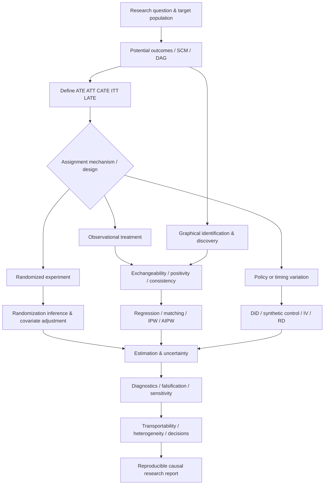

# Causal Inference — Graduate Self-Study and Research Guide

> **A research-centered learning collection, not a single UCSC course.** This guide organizes the archived books, university lectures, papers, Jupyter notebooks, datasets, and external resource directory into a coherent **12-week (extendable) graduate-level self-study program**. It is intentionally distinct from ECON 216 (linear/applied econometrics), ECON 217 (nonlinear and flexible models), ECON 211C (time series), and AMS 206 (Bayesian statistics), while drawing on their tools.
>
> **Guiding question:** *Under what assumptions, and using what research design, can an observed difference be interpreted as a causal effect?*

**Start here:** [Study map](#2-conceptual-knowledge-map) · [12-week program](#5-the-12-week-learning-sequence) · [Estimator/design selection](#7-design-selection-and-assumption-matrix) · [Research-design template](research-design-template.md) · [Original online resource collection](resources.md) · [Standalone knowledge map](knowledge-map.mmd)

## 1. Learning goals, scope, and conventions

A successful learner can formulate a manipulable treatment and a clear **target estimand**; reason from potential outcomes and/or a structural causal model; distinguish *identification* from *estimation*; design and analyze randomized and observational studies; explain selection mechanisms; defend assumptions for matching, weighting, difference-in-differences, instrumental variables, discontinuity, and synthetic controls; evaluate effect heterogeneity and dynamic treatments; diagnose threats; and report uncertainty without overstating causality.

The folder offers four complementary perspectives:

1. **Potential outcomes and research design.** Randomization inference, finite-population reasoning, exchangeability, propensity scores, matching, weighting, heterogeneous effects, observational sensitivity. Principal anchors: [Peng Ding, *A First Course in Causal Inference*](<STA640 Causal Inference - Duke University/A First Course in Causal Inference.pdf>), [Duke STA640 lectures](<STA640 Causal Inference - Duke University/README.md>), and [Hernán–Robins, *Causal Inference: What If*](<books/Causal Inference - What If.pdf>).
2. **Structural and graphical causality.** DAGs, back-door and front-door adjustment, colliders, interventions, structural causal models, counterfactual reasoning, causal identification and discovery. Anchors: [Pearl, *Causality*](<books/Causality Models, Reasoning and Inference.pdf>), [*Elements of Causal Inference*](<books/Elements of Causal Inference Foundations and Learning Algorithms.pdf>), the [graphical notebooks](<lessons/causal-inference-2-causal-graphical-models.ipynb>), and [Molak's Python repository](<Causal-Inference-and-Discovery-in-Python/README.md>).
3. **Econometric program evaluation.** Natural experiments, regression adjustment, DiD, IV, RD, synthetic control, policy evaluation, long-run outcomes, and staggered/longitudinal treatment. Anchors: [econometric program-evaluation readings](<papers/Recent Developments in the Econometrics of Program Evaluation.pdf>), [design notebooks](<lessons/Differences_in_Differences.ipynb>), and [applied Python repository](<causal-inference-in-python-code/README.md>).
4. **Computational and modern causal learning.** Simulation, replication, double robustness, CATE estimation, meta-learners, longitudinal treatment, Bayesian and ML extensions, causal discovery. Anchors: [Python applied notebooks](<causal-inference-in-python-code/causal-inference-in-python/>), [Ding Python and R exercises](<ding_causalInference/python/README.md>), [Duke course notes](<STA640 Causal Inference - Duke University/README.md>), and [your curated links and libraries](resources.md).

**Provenance convention:** **Archive** means a supplied document or notebook. **Guided synthesis** means a learning sequence, derivation, checkpoint, or project created for this README. **External resource** means a link preserved from `resources.md`, **not** independently checked for currency. Not all books or papers were assigned together; the archive deliberately combines competing and complementary traditions. Suggested assessments and deadlines are new instructional scaffolding, not an official syllabus.

**Expected effort:** 10–15 hours/week for 12 weeks; extra time for advanced causal discovery or longitudinal inference. Use Python for the bundled notebooks, R where supplied in Ding materials, and either language for original replications. Mathematical background: conditional probability, linear algebra, regression, probability distributions, confidence intervals, programming, and basic asymptotics. Prior exposure to potential outcomes is *not* assumed.

### 1.1 Recommended reading hierarchy

| Role | Use these archived resources | Why |
|---|---|---|
| Primary theory spine | [Ding / Duke *A First Course*](<STA640 Causal Inference - Duke University/A First Course in Causal Inference.pdf>) and [Hernán–Robins *What If*](<books/Causal Inference - What If.pdf>) | Explicit estimands, treatment assignment, potential outcomes, observational assumptions, longitudinal settings |
| Graphical spine | [Pearl *Causality*](<books/Causality Models, Reasoning and Inference.pdf>) and [*Elements of Causal Inference*](<books/Elements of Causal Inference Foundations and Learning Algorithms.pdf>) | Interventions, DAGs, adjustment, identification, structure and discovery |
| Applied design spine | [Duke STA640 chapter handouts](<STA640 Causal Inference - Duke University/README.md>) and [research design notebooks](lessons/) | Translate assumptions into actual designs |
| Replication spine | [*Causal Inference in Python* code](<causal-inference-in-python-code/causal-inference-in-python/>) and [Ding's Python notebooks](<ding_causalInference/python/>) | Work with data rather than only memorizing estimators |
| Specialist and complementary texts | [Imbens–Rubin book](<books/Causal Inference for Statistics, Social, and Biomedical Sciences An Introduction.pdf>), [Rosenbaum](<books/Design of observational studies.pdf>), [Shadish–Cook–Campbell](<books/Experimental and Quasi-Experimental Designs for Generalized Causal Inference.pdf>), [*Counterfactuals and Causal Inference*](<books/Counterfactuals and Causal Inference Models and Principles for Social Research.pdf>) | Deeper treatment of design, generalization, and observational biases |

### 1.2 Distinguish these questions before estimating anything

- **Descriptive:** What differences or associations are in the observed data?
- **Predictive:** How accurately can we predict an unseen outcome? Predictive accuracy alone does not identify an intervention effect.
- **Causal identification:** Can a causal quantity be written as a functional of the observed data distribution under explicit assumptions?
- **Causal estimation:** Given identification, how do we estimate that quantity and its uncertainty with finite data?
- **Policy decision:** Which intervention should be selected, for whom, at what cost, with what uncertainty and unintended effects?
- **Causal discovery:** Can candidate causal structure be learned from observed or experimental patterns, given additional assumptions? Learned arrows do not automatically establish intervention effects.

## 2. Conceptual knowledge map

See [knowledge-map.mmd](knowledge-map.mmd) for an editable Mermaid graph.



**Connections to your other econometrics guides:** ECON 216 provides regression, robust and clustered SEs, IV and design basics. ECON 217 provides GLMs, resampling and ML. ECON 211C supports dynamic data and time-series modeling, but **Granger causality is not a substitute for intervention identification**. AMS 206 supports Bayesian modeling and uncertainty, which do not by themselves eliminate selection bias. This archive connects those tools to research design.

## 3. Core causal vocabulary and mathematical foundations

### 3.1 Units, treatments, potential outcomes, estimands

Let $W_i\in\{0,1\}$ denote treatment assignment, $Y_i(1)$ and $Y_i(0)$ potential outcomes, and $Y_i$ the observed outcome. With consistency under the specified intervention and no interference between units in the simplest setup:

$$
Y_i=W_iY_i(1)+(1-W_i)Y_i(0).
$$

The unobserved counterfactual is the **fundamental problem of causal inference**. Distinguish:

$$
\begin{aligned}
\mathrm{ATE}&=\mathbb E[Y(1)-Y(0)],\\
\mathrm{ATT}&=\mathbb E[Y(1)-Y(0)\mid W=1],\\
\mathrm{CATE}(x)&=\mathbb E[Y(1)-Y(0)\mid X=x].
\end{aligned}
$$

Define the population, treatment versions, time horizon, and outcome scale before choosing ATE versus ATT. Binary-outcome risk difference, risk ratio, and odds ratio are different estimands; nonlinear contrasts require care.

### 3.2 Exchangeability, positivity, and consistency

Conditional identification by adjustment requires, among other things, **conditional exchangeability** and **positivity** on the target population:

$$
\{Y(0),Y(1)\}\perp W\mid X,\qquad 0<P(W=1\mid X=x)<1.
$$

Then the standardization (g-formula) for binary treatment identifies:

$$
\mathrm{ATE}=\mathbb E_X\left[\mathbb E(Y\mid W=1,X)-\mathbb E(Y\mid W=0,X)\right].
$$

No amount of precision from a flexible prediction model repairs failed exchangeability, positivity, an ill-defined intervention, or incorrect treatment timing. **SUTVA** is frequently used as shorthand for consistency/well-defined treatment versions plus no interference; treat these components separately when interference is plausible.

### 3.3 Causal graphs versus observed association

DAGs encode assumptions about processes: confounders, mediators, colliders, instruments, and selection variables. Adjustment is not simply “control for everything.” Conditioning on a collider can create bias; conditioning on a mediator can change the target from a total to a direct-effect question. Back-door logic supplies criteria for valid adjustment sets under a causal graph. Front-door identification requires specific graph conditions; it is not universally available merely because a mediator is measured.

A structural model may be expressed as:

$$
X_j=f_j(\mathrm{Pa}_j,U_j), \qquad j=1,\ldots,p.
$$

Intervening with $\operatorname{do}(W=w)$ replaces the structural assignment for $W$. Read the [DAG exercises](lessons/Directed_Acyclical_Graphs.ipynb), [graphical modeling notebook](lessons/causal-inference-2-causal-graphical-models.ipynb), and [front-door adjustment notebook](lessons/causal-inference-3-frontdoor-adjustment.ipynb) together; reproduce each graph and defend every arrow.

### 3.4 Identification versus an estimator

A causal effect may be **identified** in principle and still be badly **estimated** due to poor overlap, limited sample size, specification error, interference, measurement error, or incorrect uncertainty calculations. Conversely, an estimator can converge beautifully to an **associational** quantity that does not equal the desired causal effect. A research report must state both the identification argument and the estimation method.

## 4. Reusable workflow for causal research

Every weekly assignment and capstone should follow the same workflow:

1. **Decision context:** Write the substantive question in one sentence; state why a counterfactual comparison matters.
2. **Treatment and counterfactual:** Specify unit, intervention, treatment timing, comparison, outcome, follow-up, and interference possibilities.
3. **Target:** State the ATE, ATT, ITT, LATE, CATE, dynamic effect, or other precisely defined estimand and population.
4. **Causal model:** Draw a DAG or write a potential-outcomes/assignment mechanism narrative; record pre-treatment covariates and competing explanations.
5. **Design / identification:** Give the assumptions that identify your estimand, what is testable, and what depends on institutional knowledge.
6. **Data and measurements:** Record units, treatment dates, variable construction, missingness, selection, and data provenance.
7. **Estimation:** Write the statistical estimating equation or estimating algorithm; show how it follows from identification.
8. **Uncertainty:** Use assignment-appropriate randomization, robust/clustered, bootstrap, asymptotic, or Bayesian uncertainty methods. Adjust for design and treatment assignment unit.
9. **Stress tests:** Check overlap, balance, pre-trends, manipulation, placebo outcomes, weak first stages, spillovers, model sensitivity, and alternatives as applicable.
10. **Interpretation and decisions:** Report magnitude, uncertainty, external validity, heterogeneity, practical importance, and limitations; archive reproducible code and a transparent memo.

The separate [research-design-template.md](research-design-template.md) can be copied into each project repository.

## 5. The 12-week learning sequence

The timetable below is a **proposed synthesis of this repository**, not a reconstructed institutional syllabus. Recommended weekly rhythm: 3–4 hours theory; 3–5 hours notebook/derivation; 2–4 hours original experiment or replication; 1–2 hours interpretation and design memo.

| Week | Core design / theme | Main submitted artifact |
|---|---|---|
| 1 | Causal questions, estimands, potential outcomes | Counterfactual specification and simulation |
| 2 | Randomized experiments, Fisher/Neyman inference | RCT analysis and randomization test |
| 3 | DAGs, confounding, adjustment, identification | DAG portfolio and adjustment report |
| 4 | Observational adjustment, matching, weighting | Overlap, balance, and adjusted ATE |
| 5 | Doubly robust estimation, sensitivity, causal ML basics | AIPW versus regression/IPW comparison |
| 6 | DiD, panel designs, event studies | Policy-timing research memo |
| 7 | Synthetic control, placebo and spillover tests | Comparative case-study report |
| 8 | IV, encouragement and noncompliance | First-stage/ITT/LATE analysis |
| 9 | RD, threshold designs and local effects | RD validity and bandwidth report |
| 10 | Heterogeneity, CATE, meta-learners, DML | Policy targeting experiment |
| 11 | Longitudinal treatment, mediation, generalization, discovery | Advanced-method choice and sensitivity memo |
| 12 | Full replication or original research project | End-to-end causal inference report |


### Week 1 — Counterfactuals, causal effects, and the assignment problem

**Read (archive):** [Ding *A First Course*, introduction / potential outcomes](<STA640 Causal Inference - Duke University/A First Course in Causal Inference.pdf>); [*What If*, opening chapters](<books/Causal Inference - What If.pdf>); [Duke introduction](<STA640 Causal Inference - Duke University/Chap1_introduction.pdf>); [Python introduction](<causal-inference-in-python-code/causal-inference-in-python/01-Introduction-To-Causal-Inference.ipynb>); [Potential Outcomes exercise](lessons/Potential_Outcomes.ipynb); [Simulating Treatment Effects](lessons/SimulatingTreatmentEffects.ipynb).

**Concepts:** Neyman–Rubin potential outcomes; assignment versus receipt; ATE versus ATT and CATE; observed data versus missing counterfactual; individual versus population effect; fundamental problem; Simpson's paradox; effect modification; well-defined treatment; consistency and interference. Contrast association under $P(Y\mid W)$ with intervention effects, and explain why selection into treatment matters even in very large data.

**Derive:** Start with $Y_i=W_iY_i(1)+(1-W_i)Y_i(0)$. Compute an unadjusted mean difference and express its potential-outcome selection term. Show how different assignment mechanisms change bias. Derive standard errors of differences of means under independent samples, then discuss why randomization-based variance formulas can differ.

**Lab:** Use the supplied `SimulatingTreatmentEffects.ipynb` or `causal-inference-1-potential-outcomes.ipynb`. Simulate a finite population with known potential outcomes, compare randomized and confounded assignment, vary sample size while keeping bias fixed, and report why precision cannot rescue identification. State whether each result estimates ATE, ATT, or something else.

**Submit:** A two-page causal-question brief, a generated dataset/notebook, and a table showing true effect, unadjusted effect, standard error, and bias over repeated samples.

**Mastery:** Can you explain exactly which unobserved quantity is missing for each unit and why counterfactual outcomes cannot be recovered merely by optimizing predictive accuracy?

### Week 2 — Designed experiments and randomization-based inference

**Read (archive):** [Ding's randomized-experiments material](<STA640 Causal Inference - Duke University/A First Course in Causal Inference.pdf>); [Duke Fisher–Neyman lecture](<STA640 Causal Inference - Duke University/Chap2.1_randomizedtrial_FisherNeyman.pdf>); [Duke covariate-adjustment lecture](<STA640 Causal Inference - Duke University/Chap2.2_randomizedtrial_CovariateAdj.pdf>); [randomized experiments Python notebook](<causal-inference-in-python-code/causal-inference-in-python/02-Randomised-Experiments-and-Stats-Review.ipynb>); [Ding's Python randomization notebook](<ding_causalInference/python/Chapter03CREandFRT.ipynb>).

**Concepts:** Complete randomization, stratification, blocked designs, matched pairs, intention-to-treat (ITT), sample average treatment effect, Fisher's sharp null versus Neyman's average null, potential-outcome variance, design-based covariate adjustment, compliance, spillovers, statistical power, treatment unit versus analysis unit.

**Core result for a completely randomized two-arm trial:**

$$
\widehat\tau_{\mathrm{diff}}=\overline Y_1-\overline Y_0.
$$

**Theory exercise:** Enumerate the randomization distribution for a tiny experiment. Distinguish a Fisher permutation/randomization test of the sharp null from a Neyman confidence interval for an average effect. Explain why the counterfactual covariance term makes the exact finite-population variance generally unidentified, and why conservative variance estimators are used.

**Lab:** Analyze the supplied A/B-style [Python randomized experiment notebook](<causal-inference-in-python-code/causal-inference-in-python/02-Randomised-Experiments-and-Stats-Review.ipynb>) and/or [Fisher–Neyman notebook](<ding_causalInference/python/Chapter04CREandNeyman.ipynb>). Compare simple differences, stratification, pre-specified covariate adjustment, and randomization inference under the same assignment design. Record the actual randomization unit.

**Submit:** A preregistration-style one-page experiment plan plus code, randomization diagnostic, effect estimates with intervals, and a paragraph on external validity. Do not treat observed covariate imbalance alone as proof that randomization failed.

### Week 3 — Causal DAGs and identification by adjustment

**Read (archive):** [Pearl *Causality*](<books/Causality Models, Reasoning and Inference.pdf>); [*Elements of Causal Inference*](<books/Elements of Causal Inference Foundations and Learning Algorithms.pdf>); [DAG exercises](lessons/Directed_Acyclical_Graphs.ipynb); [graphical models](lessons/causal-inference-2-causal-graphical-models.ipynb); [front-door notebook](lessons/causal-inference-3-frontdoor-adjustment.ipynb); [Python graphical models](<causal-inference-in-python-code/causal-inference-in-python/03-Graphical-Models.ipynb>).

**Concepts:** Causal sufficiency versus latent variables, DAGs, d-separation, back-door paths, adjustment sets, post-treatment bias, collider stratification, mediators, selection into samples, measurement timing, structural equations, $\operatorname{do}$ operator, transportability assumptions. Distinguish a hypothesized causal graph from a dependency graph fitted to observational data.

**Theory exercise:** For each of at least six DAGs (fork, chain, collider, confounding with selection, mediated path, unmeasured confounder), enumerate open paths and valid/invalid adjustment sets. Under a simple assumed front-door graph, write the identifying functional and list its assumptions. Compare its answer to a regression conditioning directly on the mediator.

**Front-door functional in a standard discrete-variable setting, when its identifying conditions hold:**

$$
P(y\mid \operatorname{do}(x))=\sum_m P(m\mid x)\sum_{x'}P(y\mid m,x')P(x').
$$

**Lab:** Reproduce and vary the graphs in the supplied exercises. Simulate collider bias, showing that conditioning on a common effect of two independent causes can introduce association. Build one DAG for a substantive example: education and earnings, marketing exposure and purchases, or health intervention and outcome.

**Submit:** A six-graph identification portfolio, a short back-door/front-door comparison, and a table labeling each proposed adjustment variable as pre-treatment confounder, mediator, collider, instrument, or ambiguous—with reasoning.

### Week 4 — Observational studies: propensity scores, matching, weighting

**Read (archive):** [*What If*, observational identification chapters](<books/Causal Inference - What If.pdf>); [Duke regression](<STA640 Causal Inference - Duke University/Chap3.1_observational_regression.pdf>), [matching](<STA640 Causal Inference - Duke University/Chap3.2_observational_matching.pdf>), [propensity scores](<STA640 Causal Inference - Duke University/Chap3.3_observational_PS.pdf>), and [weighting](<STA640 Causal Inference - Duke University/Chap3.4_observational_weighting.pdf>); [observational matching lesson](lessons/Matching_and_Subclassification.ipynb); [applied propensity notebook](<causal-inference-in-python-code/causal-inference-in-python/05-Propensity-Score.ipynb>).

**Concepts:** Conditional ignorability, treatment assignment modeling, $e(X)=P(W=1\mid X)$, subclassification, nearest-neighbor matching, common support, propensity weighting, ATE versus ATT weighting, extreme propensity scores, overlap and effective sample size. Balance is evaluated on pre-treatment covariates after design, not by maximizing treatment prediction accuracy.

**ATE inverse-probability weighting identification / sample analogue:**

$$
\widehat\tau_{\mathrm{IPW}}=\frac1n\sum_{i=1}^n\left[\frac{W_iY_i}{\widehat e(X_i)}-\frac{(1-W_i)Y_i}{1-\widehat e(X_i)}\right].
$$

**Theory exercise:** Derive the IPW identity using iterated expectations under exchangeability and positivity. Show by simulation how poor overlap increases variance and how outcome-model extrapolation can conceal poor support. Explain why trimming changes the target population unless the estimand is redefined.

**Lab:** Use the [management-training / propensity-score example](<causal-inference-in-python-code/causal-inference-in-python/05-Propensity-Score.ipynb>) or the [matching and subclassification lesson](lessons/Matching_and_Subclassification.ipynb). Compare raw means, regression, matching, IPW, and standardized mean differences. Plot propensity distributions before and after design.

**Submit:** A balance/overlap dashboard, estimator comparison, and an identification memo listing suspected unmeasured confounders.

### Week 5 — Doubly robust inference, sensitivity, and the role of flexible models

**Read (archive):** [Duke doubly robust lecture](<STA640 Causal Inference - Duke University/Chap3.5_Doubly Robust Estimation.pdf>); [Ding double-robust ATE notebook](<ding_causalInference/python/Chapter12DoubleRobustATE.ipynb>); [Ding double-robust ATT notebook](<ding_causalInference/python/Chapter13DoubleRobustATT.ipynb>); [Duke sensitivity lecture](<STA640 Causal Inference - Duke University/Chapter5_SensitivityAnalysis.pdf>); [Ding sensitivity notebook](<ding_causalInference/python/Chapter18SensitivityAnalysis.ipynb>); [*What If*](<books/Causal Inference - What If.pdf>).

**Concepts:** Outcome regression, inverse weighting, augmented IPW (AIPW), influence functions, nuisance models, sample splitting and cross-fitting, orthogonality, robust inference, sensitivity to hidden bias, E-values and Rosenbaum-style analyses (where assumptions fit). *Double robustness* describes consistency under one of two working-model conditions **given identification**; it does not make hidden confounding harmless.

**AIPW estimator (binary treatment, iid units):**

$$
\widehat\tau_{\mathrm{AIPW}}=\frac{1}{n}\sum_{i=1}^{n}\left[\widehat m_1(X_i)-\widehat m_0(X_i)+\frac{W_i\{Y_i-\widehat m_1(X_i)\}}{\widehat e(X_i)}-\frac{(1-W_i)\{Y_i-\widehat m_0(X_i)\}}{1-\widehat e(X_i)}\right].
$$

**Theory exercise:** Derive why, under the identification assumptions, the mean of the augmentation term is zero when its corresponding nuisance model is correct. Explain conditions needed for valid cross-fitted asymptotic inference. Compare three scenarios: correct outcome model only, correct propensity model only, both misspecified.

**Lab:** Implement the same observational effect using g-computation, IPW, AIPW and a cross-fitted variant. Perturb a simulated hidden confounder and vary propensity overlap. Show both sampling variability and sensitivity to identifying assumptions.

**Submit:** A methodological comparison report with a falsification/sensitivity section. **Midpoint check:** prepare a draft identification plan for the final project; get the estimand and design settled before further analysis.

### Week 6 — Difference-in-differences, panels, and policy timing

**Read (archive):** [DiD notebook](lessons/Differences_in_Differences.ipynb); [panel data notebook](lessons/Panel_Data.ipynb); [Duke DiD lecture](<STA640 Causal Inference - Duke University/Chap8_DID.pdf>); [applied Python DiD](<causal-inference-in-python-code/causal-inference-in-python/08-Difference-in-Differences.ipynb>); [recent program-evaluation paper](<papers/Recent Developments in the Econometrics of Program Evaluation.pdf>); [sequential synthetic DiD reading](<papers/sequential synthetic DnD.pdf>).

**Concepts:** Two-by-two DiD, common trends in untreated potential outcomes, anticipation, differential shocks, time-varying confounding, unit and time fixed effects, event-study logic, staggered adoption, group-time ATT, inference with clustered/persistent shocks. Be explicit that pre-trend *checks* can reveal problems but cannot prove parallel trends.

$$
\widehat\tau_{\mathrm{DiD}}=\left(\overline Y_{\mathrm{treated,post}}-\overline Y_{\mathrm{treated,pre}}\right)-\left(\overline Y_{\mathrm{control,post}}-\overline Y_{\mathrm{control,pre}}\right).
$$

**Theory exercise:** Derive the 2x2 expression from a treated-versus-control potential-outcome model. Explain why a conventional two-way fixed-effects coefficient can combine different comparisons problematically under staggered treatment timing and heterogeneous treatment effects. Distinguish contemporaneous treatment from post-treatment dynamic effects.

**Lab:** Recreate a DiD exercise using [the archived lesson](lessons/Differences_in_Differences.ipynb), which includes a Cheng–Hoekstra policy example, or [offline marketing timing data](<causal-inference-in-python-code/causal-inference-in-python/data/offline_mkt_staggered.csv>). Plot outcomes and event time; compare a 2x2 benchmark to a cohort-aware analysis where treatment timing varies. Cluster at the level of shared shocks/treatment assignment as justified by design.

**Submit:** A policy-evaluation memo with timelines, parallel-trends narrative, event-time graph, inference choice, spillover checks, and alternative comparison groups.


### Week 7 — Synthetic control, comparative case studies, and policy counterfactuals

**Read (archive):** [Synthetic control notebook](lessons/Synthetic_Control.ipynb); [applied Python synthetic control](<causal-inference-in-python-code/causal-inference-in-python/09-Synthetic-Control.ipynb>); [synthetic DiD article](<papers/synthetic differences in differences.pdf>); [synthetic DiD slides](<papers/synth-did-slides.pdf>); [Duke DiD lecture](<STA640 Causal Inference - Duke University/Chap8_DID.pdf>).

**Concepts:** Treated unit and donor pool, covariate/outcome pre-treatment fitting, convex donor weights, unobserved time-varying factors, imperfect pre-fit, spillovers and anticipation, placebo-in-space and placebo-in-time tests, differences between synthetic controls, DiD, and synthetic DiD, cross-validation of preperiod choices. Do not choose the donor pool solely by what makes the desired treatment effect largest.

**Standard constrained synthetic control weights:**

$$
\widehat{\boldsymbol\omega}=\arg\min_{\boldsymbol\omega}\;\|\mathbf Y_{1,\mathrm{pre}}-\mathbf Y_{0,\mathrm{pre}}\boldsymbol\omega\|^2_V
\quad\text{s.t.}\quad \omega_j\ge0,\; \sum_j\omega_j=1.
$$

**Lab:** Work through the [prison construction / incarceration synthetic control case](lessons/Synthetic_Control.ipynb), or use the applied marketing notebook. Specify treatment date, donor exclusions, preperiod length and fit metric in advance; plot treated and synthetic outcomes and the difference series; run leave-one-donor-out and placebo analyses. Compare to a credible DiD estimate where appropriate.

**Submit:** A comparative case-study memo stating why synthetic control is plausible, where the donor pool might fail, and how effects would change under alternative placebo/weight specifications. Discuss the inferential limitations with one treated unit and few donors.

### Week 8 — Instruments, noncompliance, and local effects

**Read (archive):** [Instrumental variables notebook](lessons/Instrumental_Variables.ipynb); [Duke IV lecture](<STA640 Causal Inference - Duke University/Chapter6.1_InstrumentalVariables.pdf>); [Ding IV experiments notebook](<ding_causalInference/python/Chapter21IVexperiments.ipynb>); [Ding IV econometrics notebook](<ding_causalInference/python/Chapter23IVeconometrics.ipynb>); [Python noncompliance/IV notebook](<causal-inference-in-python-code/causal-inference-in-python/11-Non-Compliance-and-Instruments.ipynb>); [Duke principal-stratification notes](<STA640 Causal Inference - Duke University/Chapter6.2_principal stratification.pdf>).

**Concepts:** Instruments and exclusion restriction, relevance, assignment versus take-up, monotonicity and compliers, first stage, reduced form, Wald ratio, local average treatment effect (LATE), intention-to-treat versus treatment-on-the-treated, 2SLS, weak instruments, effect heterogeneity, instrument validity. An IV can be strongly correlated with treatment while still failing exclusion.

$$
\mathrm{LATE}=\frac{\mathbb E[Y\mid Z=1]-\mathbb E[Y\mid Z=0]}{\mathbb E[W\mid Z=1]-\mathbb E[W\mid Z=0]}
$$

The ratio identifies a complier average effect under a suitable binary-instrument setting with independence, exclusion, relevance, monotonicity, and consistency. It is not generally a population ATE.

**Theory exercise:** Derive the Wald estimand with compliance types. Draw DAGs for valid instruments, confounded instruments, and instruments affecting $Y$ through a direct path. Work through a weak-first-stage simulation to show biased/noisy conventional 2SLS inference in small samples.

**Lab:** Replicate the archived [Card / JIVE IV exercise](lessons/Instrumental_Variables.ipynb) or the [noncompliance notebook](<causal-inference-in-python-code/causal-inference-in-python/11-Non-Compliance-and-Instruments.ipynb>). Report first stage, reduced form, IV estimate, inference, and a substantive exclusion argument. Check whether instrument effects might violate monotonicity or exclusion.

**Submit:** An IV validity dossier; include why the estimated group is *compliers* under the model and which population conclusions cannot be drawn.

### Week 9 — Threshold-based identification: regression discontinuity

**Read (archive):** [RD design notebook](lessons/Regression_Discontinuity.ipynb); [Duke RDD lecture](<STA640 Causal Inference - Duke University/Chap7_RDD.pdf>); [Ding overlap/RD notebook](<ding_causalInference/python/Chapter20OverlapRD.ipynb>); [Ding fuzzy RD notebook](<ding_causalInference/python/Chapter24IVfuzzyRD.ipynb>); [quasi-experimental design book](<books/Experimental and Quasi-Experimental Designs for Generalized Causal Inference.pdf>).

**Concepts:** Sharp versus fuzzy RD, running variable, cutoff, local randomization versus continuity approaches, kernel and local-polynomial fits, bias and variance of bandwidth choice, cutoff manipulation, bunching/density tests, sorting, covariate continuity, donut RD, placebo cutoffs, local external validity.

**Sharp RD estimand at cutoff $c$:**

$$
\tau_{\mathrm{RD}}=\lim_{x\downarrow c}\mathbb E[Y\mid X=x]-\lim_{x\uparrow c}\mathbb E[Y\mid X=x].
$$

**Fuzzy RD:** Divide the outcome jump by the treatment take-up jump, under analogous continuity and IV-style assumptions; explain the local complier interpretation.

**Lab:** Use the archived [close-election / RD simulation exercise](lessons/Regression_Discontinuity.ipynb) and/or [prime card threshold data](<causal-inference-in-python-code/causal-inference-in-python/data/prime_card_discontinuity.csv>). Produce binned scatter plots, local-linear fits, multiple bandwidths, density/bunching diagnostics, covariate placebo checks, and treatment-probability discontinuity where relevant.

**Submit:** A local effect and validity report that clearly states who near the cutoff is represented. Explain why global polynomial extrapolation can mislead.

### Week 10 — Heterogeneous effects, causal machine learning, and policy targeting

**Read (archive):** [effect heterogeneity notebook](<causal-inference-in-python-code/causal-inference-in-python/06-Effect-Heterogeneity.ipynb>); [meta-learners notebook](<causal-inference-in-python-code/causal-inference-in-python/07-Meta-Learners.ipynb>); [Duke heterogeneity lecture](<STA640 Causal Inference - Duke University/Chapter4_HTE.pdf>); [*Elements of Causal Inference*](<books/Elements of Causal Inference Foundations and Learning Algorithms.pdf>); [Molak Python chapters](<Causal-Inference-and-Discovery-in-Python/README.md>).

**Concepts:** CATE, subgroup versus post-hoc discovery, potential-outcome prediction, treatment-effect versus outcome-risk heterogeneity, S/T/X learners, orthogonalization, double/debiased ML, cross-fitting, causal forests as an optional extension, individual treatment rules, policy value/regret, validation with randomized holdouts. Better outcome prediction is not automatically better treatment-effect estimation.

**CATE and value of a policy $\pi(X)\in\{0,1\}$:**

$$
\tau(x)=\mathbb E[Y(1)-Y(0)\mid X=x],\qquad V(\pi)=\mathbb E[Y(\pi(X))].
$$

**Lab:** Use [the Hillstrom marketing dataset](<Causal-Inference-and-Discovery-in-Python/data/hillstrom_clean.csv>) (from the Molak repository) or the [effect heterogeneity notebooks](<causal-inference-in-python-code/causal-inference-in-python/06-Effect-Heterogeneity.ipynb>). Fit an interpretable regression with interactions and a meta-learner. Evaluate out-of-sample policy uplift with a randomized test set or a justified policy-value estimator, not individual-level ground truth effects that were never observed.

**Submit:** A targeting policy report with overlap plots, heterogeneity uncertainty, subgroup sample sizes, multiplicity caveats, and an ethical/distributional trade-off analysis.

### Week 11 — Dynamic treatments, mediation, transportability, and causal discovery

**Read (archive):** [Duke longitudinal treatment lecture](<STA640 Causal Inference - Duke University/Chapter9_LongitudinalTreatment.pdf>); [*What If* longitudinal sections](<books/Causal Inference - What If.pdf>); [Ding mediation notebook](<ding_causalInference/python/Chapter27mediationAnalysis.ipynb>); [Ding principal-stratification notebook](<ding_causalInference/python/Chapter26principalStratification.ipynb>); [Duke Bayesian and sensitivity extensions](<STA640 Causal Inference - Duke University/Bayes_Chap5_SA.pdf>); [Molak causal discovery notebooks](<Causal-Inference-and-Discovery-in-Python/README.md>); [paper on time-varying treatments](<papers/Time Varying Treatments.pdf>).

**Concepts:** Treatment histories and dynamic regimes, sequential exchangeability and positivity, time-varying confounders affected by previous treatment, marginal structural models (MSMs), longitudinal g-formula, IP weights, selective attrition and censoring, mediation/direct effects, principal strata, selection into target populations, transportability; constraint-based / functional / score-based causal discovery.

**Longitudinal inverse-weight schematic for observed treatment history $\overline W_t$:**

$$
\mathrm{Weight}_i=\prod_{t=0}^{T}\frac{1}{P(W_{it}\mid\overline W_{i,t-1},\overline L_{it})},
$$

with modeling/normalization refinements often required in practical stabilized weights; include censoring weights if the design warrants. Explain why ordinary regression adjustment for a post-treatment covariate can create bias under treatment-confounder feedback.

**Choose one advanced lab:** (A) simulate treatment-confounder feedback and compare naive adjustment to an appropriately specified IP-weighted longitudinal estimator; (B) reproduce a mediation or principal-stratification notebook and state its extra assumptions; (C) use Molak's discovery notebook with synthetic data where the true graph is known, then show why Markov equivalence, latent confounding, and violations of algorithm assumptions limit orientation and causal claims.

**Submit:** A short *method-boundary memo*: what is identified, by which assumptions, and what remains ambiguous. Include a discussion of generalization to a new population.

### Week 12 — Research capstone and reproducibility audit

**Read (archive):** Revisit the method-specific original resource(s) selected for the project and their limitations. For a research-design critique, the [credibility revolution paper](<papers/the-credibility-revolution-in-empirical-economics-how-better-research-design-is-taking-the-con-out.pdf>), ["Let's Take the Con Out of Econometrics"](<papers/lets-take-the-con-out-of-econometrics.pdf>), and [program evaluation survey](<papers/Recent Developments in the Econometrics of Program Evaluation.pdf>) provide useful context.

**Capstone options:**

1. **Replication-plus-stress-test.** Pick an archival study or notebook with data and reproduce a main estimate, then redo treatment/outcome definitions, standard errors, and identification sensitivity.
2. **Comparative design study.** For a common policy question, compare a naive regression, a credible identification design, and a design that *fails*. Explain what changes in estimand and assumptions rather than ranking estimates by p-value.
3. **Simulation study.** Construct a DGP with known effects and failures of overlap, hidden confounding, measurement error, weak instruments or staggered timing. Evaluate bias, coverage, and inference across methods.
4. **Applied research proposal.** When useful data are unavailable, write a serious identification and data-collection plan instead of fabricating results.

**Required package:** [research-design-template.md](research-design-template.md) completed, a causal diagram/assignment mechanism, a reproducible environment, a clearly defined estimator, plots of diagnostics, uncertainty intervals, falsification/sensitivity results, a 6–10 page research memo, and a short limitations statement. Include a plain-language decision summary that separates evidence from assumptions.

**Final defense (questions to answer without notes):** What counterfactual is being estimated? What makes it observable *in expectation*? What could falsify the design? What cannot be tested? Does the method estimate ATE, ATT, LATE, a local cutoff effect, or another target? What changes under alternate data-generating assumptions? Would your answer transfer to another setting or population?

## 6. Compact estimator and identification reference

This section is a **guided synthesis**, not a substitute for the assumptions and proof details in the books.

### 6.1 Outcome modeling (g-computation)

For binary treatment and pre-treatment covariates $X$, set $m_w(x)=\mathbb E[Y\mid W=w,X=x]$. Under exchangeability, positivity and consistency:

$$
\widehat\tau_g=\frac1n\sum_{i=1}^n\left[\widehat m_1(X_i)-\widehat m_0(X_i)\right].
$$

Model misspecification and extrapolation under limited overlap are major risks. For ATT, averaging and weighting differ from the ATE version.

### 6.2 Randomization-based inference

Random assignment identifies average effects within the experiment without needing a parametric outcome model; randomization tests derive their reference distribution from the assignment procedure. Permuting labels arbitrarily is not justified when the actual design clustered, stratified, blocked, or otherwise constrained randomization.

### 6.3 Regression and fixed effects

Regression is a functional estimator and covariate-adjustment tool; without an assignment/design argument its coefficient is not automatically causal. Individual fixed effects remove time-constant unit heterogeneity under the maintained specification. They do not automatically handle time-varying unobserved confounding, reverse causality, bad controls, or spillovers.

### 6.4 Selection adjustment

Matching, subclassification, standardization, IPW, and AIPW address measured confounding under exchangeability. Balance diagnostics probe achieved comparability of **measured** pre-treatment variables; they cannot prove exchangeability. Extreme weights and sparse support can invalidate stable conclusions.

### 6.5 Natural experiments and discontinuities

- **DiD**: identifies a relative treated-group trend effect under parallel trends for untreated potential outcomes and additional restrictions (e.g. anticipation/spillovers); staggered timing requires careful estimand aggregation.
- **Synthetic control**: uses weighted donor trajectories as a counterfactual under restrictions about untreated trends, donor appropriateness and pre-fit; placebo inference is design-specific.
- **IV**: can identify a local causal parameter when exclusion, relevance, exogeneity and monotonicity (for conventional binary LATE) hold; weak instruments undermine standard approximations.
- **RD**: identifies a local effect at a cutoff under continuity or local-randomization assumptions and absence of strategically manipulated treatment assignment around that threshold.

### 6.6 Sensitivity, uncertainty, and generalization

Every causal result has at least three distinct uncertainty sources: **sampling/estimation error**, **model/nuisance approximation**, and **uncertainty about the identifying assumptions**. A narrow frequentist CI or Bayesian credible interval typically addresses only some of these unless the model explicitly represents the rest. Discuss interference, exposure measurement, attrition, sample selection, treatment heterogeneity, and transfer to a target setting.


## 7. Design-selection and assumption matrix

**Start with the assignment process and estimand, not the method's name.** The following table is a routing aid, not a guarantee of validity.

| Research setting / source of variation | Candidate design | Identification must justify | Diagnostic / failure mode | Target is often |
|---|---|---|---|---|
| Random assignment of offer or treatment | RCT; ITT; blocked/clustered experiment | Correct assignment implementation, consistency, interference structure | Attrition, treatment spillover, noncompliance, assignment-unit mismatch | Experimental ATE or ITT |
| Observational treatment with rich pre-treatment data | Matching, g-computation, IPW, AIPW | Conditional exchangeability, positivity, measurement quality | Poor overlap; unmeasured confounding; extreme weights | ATE / ATT for specified population |
| Treatment adopted by some units after a date | DiD; event study; cohort-based DiD | Counterfactual parallel trends, absence of anticipation/spillovers | Confounding time shocks; staggered TWFE mixing; few clusters | ATT by group/time |
| One/few treated units and good untreated donor trajectories | Synthetic control; synthetic DiD | Appropriate donors, stable untreated representation, no spillovers | Poor pre-fit; donor sensitivity; post-treatment donor contamination | Treated-unit time-varying effect |
| Exogenous encouragement / instrument changes take-up | IV, encouragement design, 2SLS | Instrument relevance, independence, exclusion; monotonicity for LATE | Weak first stage; direct effects; heterogeneous compliance | LATE / complier effect |
| Eligibility or assignment jumps at a threshold | Sharp or fuzzy RD | Continuity/local randomization, no precise manipulation | Sorting around cutoff, bandwidth sensitivity, discontinuous covariates | Local cutoff effect |
| Need different effects by observed subgroup | CATE, interaction regression, meta-learners, DML | Identifying assumptions for treatment and stable nuisance estimation | Overfit CATE, adaptive subgroup selection, sparse support | Conditional effect / policy value |
| Repeated treatment and evolving confounders | Longitudinal g-methods, MSM, IPW | Sequential exchangeability, longitudinal positivity, consistency | Treatment-confounder feedback, informative loss to follow-up | Regime-specific effect |
| Explicit mediator path question | Mediation, principal stratification | Well-defined direct/indirect estimands and extra identifying assumptions | Post-treatment confounding, cross-world assumptions, selection | Path-specific or stratum effect |
| Unknown causal structure from data | Discovery algorithms / domain-led SCM | Markov/faithfulness or functional assumptions, causal sufficiency or modeled hidden causes, design knowledge | Markov-equivalent DAGs, latent confounding, selection bias | Candidate graph, not automatically an effect |

### 7.1 What to *avoid* when moving from regression to causality

- Re-labeling an OLS slope as causal solely because it is statistically significant.
- Adding all available controls without checking for mediators or colliders.
- Interpreting a propensity score balance plot as evidence that unobserved confounders do not exist.
- Applying one-line DiD or TWFE to staggered heterogeneous effects without defining the weighted estimand.
- Treating pre-trend tests or RD covariate tests as proof of valid design.
- Applying an instrument without defending exclusion and the compliers target.
- Reporting a synthetic-control gap as causal without donor/pre-fit/spillover and placebo checks.
- Using predictive validation alone to select a treatment-effect learner.
- Confusing temporal precedence, **Granger prediction**, discovery arrows, or mediation correlations with established interventions.
- Claiming a sensitivity analysis **proves** robustness to every unobserved violation.

## 8. Applied notebook and research-lab index

All paths below refer to **included files**. Notebooks and code were gathered from different sources and may use different package versions. They should be run as separate environments rather than treated as one standardized codebase.

| Lab | Archive entry point | Suggested empirical objective |
|---|---|---|
| L1: Simulated potential outcomes | [Treatment simulation](lessons/SimulatingTreatmentEffects.ipynb), [intro notebooks](lessons/causal-inference-1-potential-outcomes.ipynb) | Establish ground-truth causal effect, introduce selective assignment, measure bias |
| L2: Randomized experiment | [Ding Chapter 3](<ding_causalInference/python/Chapter03CREandFRT.ipynb>), [A/B experiments](<causal-inference-in-python-code/causal-inference-in-python/02-Randomised-Experiments-and-Stats-Review.ipynb>) | Compare Fisher randomization and Neyman inference; ITT and precision |
| L3: Graphical identification | [Causal graphs](lessons/causal-inference-2-causal-graphical-models.ipynb), [front door](lessons/causal-inference-3-frontdoor-adjustment.ipynb) | Distinguish valid adjustment, collider bias, mediation and SCM identification |
| L4: Observational training evaluation | [Matching exercise](lessons/Matching_and_Subclassification.ipynb), [propensity notebook](<causal-inference-in-python-code/causal-inference-in-python/05-Propensity-Score.ipynb>) | Compare matching, regression, weighting, AIPW with balance and overlap |
| L5: Policy timing | [DiD notebook](lessons/Differences_in_Differences.ipynb), [online/offline marketing](<causal-inference-in-python-code/causal-inference-in-python/08-Difference-in-Differences.ipynb>) | Estimate time-varying policy effects under parallel-trends considerations |
| L6: Case study with donor units | [Synthetic control](lessons/Synthetic_Control.ipynb), [applied synthetic controls](<causal-inference-in-python-code/causal-inference-in-python/09-Synthetic-Control.ipynb>) | Construct a synthetic counterfactual and placebos |
| L7: Noncompliance | [IV lesson](lessons/Instrumental_Variables.ipynb), [noncompliance](<causal-inference-in-python-code/causal-inference-in-python/11-Non-Compliance-and-Instruments.ipynb>) | First-stage, reduced form, IV, LATE interpretation |
| L8: Threshold policy | [RD lesson](lessons/Regression_Discontinuity.ipynb), [Ding fuzzy RD](<ding_causalInference/python/Chapter24IVfuzzyRD.ipynb>) | Estimate local effects and test manipulation/bandwidth sensitivity |
| L9: Treatment heterogeneity | [HTE notebook](<causal-inference-in-python-code/causal-inference-in-python/06-Effect-Heterogeneity.ipynb>), [meta-learners](<causal-inference-in-python-code/causal-inference-in-python/07-Meta-Learners.ipynb>) | CATE and holdout policy evaluation |
| L10: Advanced design / learning | [Duke lecture directory](<STA640 Causal Inference - Duke University/README.md>), [Molak's repository](<Causal-Inference-and-Discovery-in-Python/README.md>) | Longitudinal effects, mediation, discovery, or Bayesian alternative |

**Implementation checklist:** For each lab, save the environment, source notebook, date, random seed, data dictionary, original computation, any deviations/corrections, and a one-page interpretation. Do not silently modify a source notebook's analytic sample or treatment variable. Prefer a derived copy with a short changelog.

### 8.1 Practical setup guidance

- Run with Python/Jupyter; install only the packages actually required for the chosen notebook. Use isolated environments for the three main repos. The Molak repository describes a historical Python 3.9 environment, legacy DoWhy/EconML versions, and optional CUDA 11.7; these dependencies should be treated as **archived requirements**, not presumed current recommendations.
- Use R for the corresponding [Ding R examples](<ding_causalInference/R/>) if preferred. Do not assume the Python translations include every supporting dataset—the Ding repository notes its upstream data dependency.
- Keep *raw* files immutable. Make `data-derived/` and `outputs/` for your own work; do not overwrite archived datasets or results.
- Learn to distinguish simulation-based **ground truth** (available because the DGP is constructed) from real-world estimates where both potential outcomes cannot be observed.
- Be cautious with real personal or sensitive data. The provided datasets can be useful for practice, but a real study requires appropriate access and privacy precautions.

## 9. Source library map and recommended specialization

### 9.1 Books: choose by theoretical emphasis

**Potential outcomes, experiments, and design**

- [Hernán & Robins — *Causal Inference: What If*](<books/Causal Inference - What If.pdf>) — formal identification, observational studies, longitudinal treatment, target-trial thinking.
- [Imbens & Rubin — *Causal Inference for Statistics, Social, and Biomedical Sciences*](<books/Causal Inference for Statistics, Social, and Biomedical Sciences An Introduction.pdf>) — design-based experimental and observational potential outcomes.
- [Ding — *A First Course in Causal Inference*](<STA640 Causal Inference - Duke University/A First Course in Causal Inference.pdf>) — randomization inference, propensity scores, IV and related inference; corresponding [Python](<ding_causalInference/python/>) and [R](<ding_causalInference/R/>) archives.
- [Rosenbaum — *Design of Observational Studies*](<books/Design of observational studies.pdf>) — observational study design and sensitivity.
- [*Design and Analysis of Experiments with R*](<books/Design and Analysis of Experiments with R.pdf>) and [*Field Experiments*](<books/Field Experiments_ Design, Analysis, and Interpretation.pdf>) — experimental planning and field applications.
- [*Experimental and Quasi-Experimental Designs for Generalized Causal Inference*](<books/Experimental and Quasi-Experimental Designs for Generalized Causal Inference.pdf>) — research design and validity.
- [*Counterfactuals and Causal Inference*](<books/Counterfactuals and Causal Inference Models and Principles for Social Research.pdf>) — social science counterfactual research design.

**Structural causality, graphics, and learning algorithms**

- [Pearl — *Causality: Models, Reasoning, and Inference*](<books/Causality Models, Reasoning and Inference.pdf>) — SCMs, identification, graphs and interventions.
- [*Elements of Causal Inference: Foundations and Learning Algorithms*](<books/Elements of Causal Inference Foundations and Learning Algorithms.pdf>) — links from SCMs to machine learning and causal discovery.
- [*Causation, Prediction, and Search*](<books/Causation, Prediction, and Search.pdf>) — causal structure learning and assumptions.
- [*Probabilistic Reasoning in Intelligent Systems*](<books/Probabilistic Reasoning in Intelligent Systems Networks of Plausible Inference by Judea Pearl (z-lib.org).pdf>) — Bayesian graphical model foundations rather than a stand-alone treatment-effect handbook.
- [*Mechanism and Causality in Biology and Economics*](<books/Mechanism and Causality in Biology and Economics.pdf>) — methodological perspective.

**Applied and accessible supplements**

- [*Fundamentals of Causal Inference with R*](<books/Fundamentals of Causal Inference with R.pdf>), [*Introduction to Causal Inference*](books/Introduction_to_Causal_Inference.pdf) — supporting exposition/computation.
- [Duke STA640: notes and chapter files](<STA640 Causal Inference - Duke University/README.md>) — randomized experiments, regression/matching/weighting, doubly robust inference, effect heterogeneity, sensitivity, IV, RD, DiD, longitudinal methods, Bayesian supplements.

### 9.2 Archived repositories: choose by implementation style

| Repository | Focus | Suggested use |
|---|---|---|
| [Applied Python causal inference code](<causal-inference-in-python-code/README.md>) | A/B tests, graphs, observational adjustment, heterogeneity, DiD, synthetic controls, switchback/geo experiments, IV | Main applied weekly spine; extensive datasets |
| [Ding causal inference code](<ding_causalInference/python/README.md>) | Randomization inference, Neyman estimators, AIPW, IV, RD, sensitivity, principal strata, mediation | Design-based and formal inference replications |
| [Molak causal inference and discovery](<Causal-Inference-and-Discovery-in-Python/README.md>) | DoWhy, EconML, SCMs, uplift, discovery, graphical model code | Python/causal ML and optional graph-discovery track |
| [Duke STA640 handouts](<STA640 Causal Inference - Duke University/README.md>) | Graduate statistical causality from experiments to longitudinal exposures | Conceptual proofs and alternate presentation |
| [Individual guided lessons](lessons/) | Interactive exercises for regression, simulation, matching, RD, IV, DiD and synthetic control | Weekly checkpoints and short empirical assignments |

### 9.3 Papers and current-method extensions in the archive

The `papers/` directory is a **reading portfolio**, not a single sequential syllabus. Useful clusters are:

- **Method and identification:** [*Recent Developments in the Econometrics of Program Evaluation*](<papers/Recent Developments in the Econometrics of Program Evaluation.pdf>), [*Let's Take the Con Out of Econometrics*](<papers/lets-take-the-con-out-of-econometrics.pdf>), [*The Credibility Revolution in Empirical Economics*](<papers/the-credibility-revolution-in-empirical-economics-how-better-research-design-is-taking-the-con-out.pdf>).
- **Synthetic and panel counterfactuals:** [*Synthetic Differences in Differences*](<papers/synthetic differences in differences.pdf>), [sequential synthetic DiD](<papers/sequential synthetic DnD.pdf>), [synthetic DiD slides](<papers/synth-did-slides.pdf>).
- **Dynamic and long-horizon effects:** [Time Varying Treatments](<papers/Time Varying Treatments.pdf>), [Surrogate Index](<papers/Surrogate Index.pdf>), [Long-term Treatment Effects Without Long-term Outcome Data](<papers/David-Rhys-Bernard_Estimating-long-term-treatment-effects-without-long-term-outcome-data.pdf>), [Long-Term Effects of Novel Treatments](<papers/Estimating the Long-Term Effects of Novel Treatments.pdf>).
- **Graphical and philosophical alternatives:** [Pearl paper 1](papers/pearl.pdf), [Pearl paper 2](papers/pearl1.pdf); full books above.

The remaining papers in `papers/` should be consulted by **topic and method**, not assumed interchangeable from filenames alone. For a literature review, open and confirm a paper's title, author, date, and estimand before citing it.

### 9.4 Preserved online learning hub

The original [resources.md](resources.md) is an extensive curated directory of conceptual introductions, lectures, courses, blogs, tools, GitHub repositories and statistical packages. Useful learning paths *listed in that file* include [*The Effect*](https://theeffectbook.net/index.html), [*Causal Inference: The Mixtape*](https://mixtape.scunning.com/), [*Causal Inference for the Brave and True*](https://matheusfacure.github.io/python-causality-handbook/landing-page.html), [Brady Neal's course](https://www.bradyneal.com/causal-inference-course), and [Causal Inference in R](https://www.r-causal.org/). Select one as a **second explanation** when the corresponding archived material is difficult; avoid reading all alternatives linearly. External URLs have not been individually verified for continued availability.

The original directory also links to libraries such as [DoWhy](https://github.com/microsoft/dowhy), [EconML](https://github.com/py-why/EconML), [DoubleML](https://github.com/DoubleML/doubleml-for-py), [MatchIt](https://kosukeimai.github.io/MatchIt/), [dagitty](https://github.com/jtextor/dagitty), [Causal-learn](https://causal-learn.readthedocs.io/en/latest/), and [PyWhy](https://www.pywhy.org/). **Tool selection follows the estimand and design**; software cannot establish valid identification assumptions for you.

## 10. Alternative learning tracks after the common foundation

After Weeks 1–5, deeper specialization is reasonable. Spend an optional additional **4–8 weeks** on one path:

| Track | Topics to emphasize | Primary archive anchors | Example end state |
|---|---|---|---|
| Policy evaluation and econometrics | DiD, staggered timing, synthetic control, IV, RD, sensitivity | `lessons/`, `papers/`, Duke designs | Defensible quasi-experimental policy report |
| Statistics and biomedicine | Randomization inference, observational design, weighting, sensitivity, sequential treatments | Ding, Duke, *What If*, Rosenbaum | Longitudinal target-trial analysis and validity audit |
| Causal machine learning | Orthogonal / doubly robust learners, CATE, policy value, uplift, transport | Molak and applied Python repo; *Elements* | Out-of-sample targeting study with causal validation |
| Graphical and structural causality | DAGs, do-calculus, front door, latent confounding, discovery | Pearl, *Elements*, discovery notebooks | Identification proof plus graph equivalence limitations |
| Field experiments and program design | Blocking, noncompliance, spillovers, geo / switchbacks, cost-effectiveness | Ding, field experiments books, applied geo/switchback notebooks | Preregistered intervention proposal |

### Where Bayesian methods enter

Use AMS 206 concepts for Bayesian outcome models, Bayesian hierarchical treatment-effect models, posterior uncertainty and Bayesian decision analysis. Causal identification still requires substantive assumptions about assignment, interventions and selection. The Duke archive includes a separate set of Bayesian causal chapters—an optional bridge, not a replacement for identification analysis.

### Where econometric time-series models enter

If treatments and outcomes vary over time, use ECON 211C tools for serial correlation, prediction and dynamic response models. In causal work, carefully specify intervention timing, serial dependence, interference and counterfactual trends. An impulse-response function in a reduced-form VAR generally requires additional identifying assumptions before it can be interpreted as an intervention effect.

## 11. Capstone evaluation rubric and completion standard

A completed study should be evaluated on a reproducible **100-point rubric**:

| Dimension | Points | Evidence |
|---|---:|---|
| Research question, intervention, estimand and population | 15 | Explicit counterfactual, treatment versions and time horizon |
| Identification argument | 25 | Assumptions defended with design/DAG/assignment mechanism; competing explanations |
| Correct estimator and inference | 15 | Code, equations, standard errors, uncertainty appropriate to data-generating design |
| Diagnostics and robustness | 20 | Pre-specified substantive falsification/sensitivity checks and honest interpretation |
| Replicability and data handling | 15 | Data dictionary, readme, stable environment, reproducible run, documented decisions |
| Interpretation and communication | 10 | Effect size, meaningful population, limitations, external validity, decision implications |

**Passing is not just a high numerical score.** A capstone that cannot state and defend an identification strategy is incomplete even if the code runs and the confidence interval is narrow. With an unidentifiable question, the appropriate output is a well-founded design critique, partial-identification exercise, or a proposal for better data—not a falsely precise effect estimate.

### Minimal recommended project structure

```text
my-causal-project/
├── README.md                  # question, reproducible steps, limitations
├── design.md                  # copied from research-design-template.md
├── environment.yml            # or requirements.txt / renv.lock
├── data-raw/                  # unchanged source data, if shareable
├── data-derived/              # created by scripts
├── src/                       # analysis / functions
├── outputs/                   # charts, tables, sensitivity results
└── report.md                  # results and interpretation
```

### Final competency checklist

- [ ] I can distinguish an estimand, identifying functional, estimator, and confidence/credible interval.
- [ ] I can explain consistency, exchangeability, positivity and interference using concrete examples.
- [ ] I can draw a DAG and avoid conditioning on obvious mediators or colliders for a total effect.
- [ ] I can simulate a randomized experiment and reproduce Fisher- and Neyman-style reasoning.
- [ ] I can compare g-computation, matching, weighting and doubly robust methods with balance and overlap diagnostics.
- [ ] I can defend the design-specific assumptions for DiD, IV, RD, and synthetic control and state their target populations.
- [ ] I can explain how staggered adoption, weak instruments, threshold manipulation and treatment spillovers can distort inferences.
- [ ] I can separate treatment-effect heterogeneity from outcome prediction and evaluate a treatment policy with appropriate data.
- [ ] I can identify extra assumptions needed for longitudinal exposures, mediation, transport and discovery.
- [ ] I can write a reproducible causal study that clearly distinguishes evidence, assumptions, and uncertainty.

---

**Reading strategy:** The most efficient route is to select **one primary theoretical account + one alternate viewpoint + one executable notebook for each design**. Use the complete archive as a reference library, not as a reading list to finish in its entirety. The enduring skill is learning to justify *why* an estimate is causally interpretable and *when* that argument is likely to fail.
