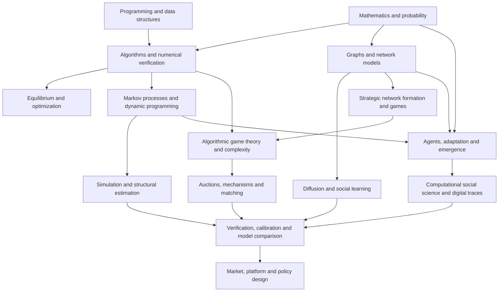

# Computational Economics, Algorithms, Networks & Complex Adaptive Systems

> **A two-quarter, 24-week graduate self-study curriculum** at the intersection of economics, computer science, numerical analysis, game theory, network science, computational social science, and complex adaptive systems. This is a proposed learning path through a *resource collection*, not a reconstruction of a single university course.
>
> **Companion documents:** [Source index](source-index.md) · [Mathematical reference](mathematical-reference.md) · [Original resource links](resources.md)

## 1. Intellectual scope and learning outcomes

**Computational economics is not synonymous with numerically solving differential equations.** Computers can solve a conventional economic model, but they also change *which questions can be posed*: What happens when many heterogeneous agents interact locally? Can self-interested participants be induced to implement a good allocation? How does network topology affect diffusion, systemic risk, information, and equilibrium? Can decentralized adaptation generate order without a planner? When do computational limits change the economic prediction itself?

This program treats computation in four roles:

1. **A numerical instrument:** approximate an economic object for which no closed-form solution exists; establish accuracy, conditioning, and convergence.
2. **An economic constraint:** algorithms take time and memory; computational complexity, bounded rationality, and information constraints affect feasible allocations and institutions.
3. **A modeling language:** agents, rules, graphs, stochastic transitions, and simulations express mechanisms that are difficult to capture in representative-agent equations.
4. **An empirical and design toolkit:** simulate markets and networks, estimate structural models, investigate digital traces, test policy interventions, and design platforms, auctions, and matching mechanisms.

A successful learner will be able to (i) implement and validate numerical and dynamic economic models; (ii) distinguish equilibrium, simulation, inference, and prediction; (iii) analyze and simulate economic networks; (iv) build agent-based and complex adaptive systems; (v) analyze strategic interaction using computational game theory; (vi) design and assess incentive-compatible algorithms; and (vii) communicate the scope and limits of computational findings.

### The source collections and their roles

| Collection | Main contribution | Place in the program |
|---|---|---|
| [`CompEcon/`](CompEcon/) | Fedor Iskhakov's programming, algorithms, Markov chains, dynamic programming, Rust bus-replacement model, simulation, structural estimation | Core in Quarter I |
| [`intro-numerical-methods/`](intro-numerical-methods/) | Root finding, interpolation, quadrature, linear algebra, numerical accuracy, ODEs | Selective numerical foundations |
| [`Linear-Algebra-With-Python/`](Linear-Algebra-With-Python/) | Practical eigenvectors, matrix factorizations, PCA, linear transformations | Supporting mathematical computing |
| [`Numerical-Analysis-Python/`](Numerical-Analysis-Python/) | Euler, Runge–Kutta, consistency, stability, BVP and PDE methods | Optional depth, not the curriculum's center |
| [`networks/`](networks/) | Matthew O. Jackson's social and economic networks: random networks, formation, diffusion, learning, games | Core in Quarter II |
| [`Complex Adaptive Systems...pdf`](Complex%20Adaptive%20Systems%20An%20Introduction%20to%20Computational%20Models%20of%20Social%20Life.pdf) | John H. Miller and Scott E. Page: emergence, agent-based models, segregation, cellular automata, adaptation | Bridge across both quarters |
| [`PythonNumericalDemos/`](PythonNumericalDemos/) | Reproducible demonstrations of simulation, uncertainty, optimization, machine learning and spatial methods | Targeted labs, not a required linear sequence |
| [`resources.md`](resources.md) | QuantEcon, computational social science, mechanism design, Roughgarden-style algorithmic game theory and related courses | Externally hosted advanced reading paths |

**Source distinction:** The ZIP supplies detailed local instruction for numerical/dynamic economics, networks, and complex adaptive systems. Mechanism design, algorithmic game theory, and computational social science are principally represented by the *external links* in `resources.md`; those modules are intentional guided extensions, not claims that the archive includes complete local lecture notes for them. See [source-index.md](source-index.md) for precise links and reading priorities.

## 2. Prerequisites and study method

**Recommended:** multivariable calculus; linear algebra (eigenvalues, least squares); probability and conditional expectation; basic optimization and game theory; intermediate microeconomics; and ability to write functions, arrays, loops, and plots in Python. Prior experience with R is useful for computational social science, not essential for the entire course. The companion **Core Math** and **Graduate Microeconomics** collections can fill gaps.

**Estimated workload:** 12–16 hours/week. Allocate approximately 25% to reading and hand derivation, 45% to code and experiments, 20% to interpretation and written analysis, and 10% to testing and reproducibility. For a slower pace, take two weeks per syllabus week.

**Every completed lab must contain:** (1) a concise economic question; (2) assumptions and equations or agent rules; (3) a baseline implementation; (4) at least one analytic or limiting-case validation; (5) parameter sensitivity and stochastic replication where relevant; (6) a figure/table; and (7) an interpretation distinguishing computed facts from causal or normative claims. Fix random seeds for reproducibility, but examine multiple seeds before claiming robustness.

Use a Python environment with NumPy, SciPy, pandas, Matplotlib, NetworkX, Jupyter, and optionally Numba; use `statsmodels`, `scikit-learn`, `Mesa`, `cvxpy`, or R only where a lab requires them. Some archived notebooks target older package versions: record environment changes and port code carefully instead of assuming everything will run unmodified. Gephi/Pajek and R's `statnet` are alternatives for network labs.

## 3. Conceptual knowledge map



The links are **conceptual dependencies**, not a claim that every branch has a single preferred methodology. For example, a graph is a mathematical representation; an agent-based model is a generative mechanism; a regression may estimate an association; and a randomized intervention can help identify a causal effect. None can substitute automatically for another.

## 4. Quarter I — Computational economic models and generative systems (Weeks 1–12)

**Objective:** Learn to construct, solve, simulate, estimate, and *criticize* explicit economic models. Introduce complexity and agent-based modeling early so numerical techniques remain linked to wider economic questions.

### Week 1 — Computational economics as theory, experiment and algorithm

**Questions:** When is computation needed to evaluate a known model? When does it enable a different kind of model? What separates an algorithm from an economic mechanism? **Concepts:** modeling choices, state and action spaces, computational experiments, asymptotic complexity, algorithm correctness, numerical versus economic approximation, simulation replication and falsifiability. **Read:** `CompEcon/01_introduction.ipynb`, `09_algorithms.ipynb`, `11_alg_binary_search.ipynb`; Miller–Page, chapters 3 and 5; [QuantEcon](https://quantecon.org/).

**Lab:** Implement binary search and a brute-force allocation search; measure runtime as problem size grows; explain why computational tractability matters for a policy rule. Construct a simple two-type market model and identify which assumptions are imposed rather than measured. **Deliverable:** two-page memo contrasting *computation as solver*, *as model*, and *as constraint*, with timing plot. **Mastery:** recognize empirical prediction, mathematical existence, algorithmic computability, and causal identification as different questions.

### Week 2 — Numerical accuracy, linear algebra and computational diagnostics

**Concepts:** floating-point error; condition numbers; residuals versus forward error; stable algorithms; least squares; eigenvectors and singular values. **Read:** `intro-numerical-methods/04_error.ipynb`, `10_LA_intro.ipynb`, `11_LA_QR.ipynb`, `12_LA_conditioning_stability.ipynb`; selected `Linear-Algebra-With-Python` eigenvalue and SVD notebooks.

**Lab:** Fit a nearly collinear system via normal equations and QR/SVD, perturb the inputs, compare residuals and coefficient instability. Show how spectral information later measures persistent network influence. **Deliverable:** numerical reliability report with reproducibility tests. **Mastery:** do not interpret a converged algorithm or small residual as proof that an economic model is correctly specified.

### Week 3 — Solving equilibria, fixed points and comparative statics

**Concepts:** bisection, Newton–Raphson, multivariate Newton, contraction maps, Jacobians, bounded-domain root finding, multiple equilibria. **Read:** `CompEcon/13_bisections_newton.ipynb`, `22_succ_aprx.ipynb`, `23_mutivariate_newton.ipynb`, `25_newton_bounds.ipynb`; `intro-numerical-methods/05_root_finding_optimization.ipynb`.

**Lab:** Solve a nonlinear supply–demand equilibrium, introduce a price-dependent externality or network benefit, and search for multiple fixed points from different starting values. Validate against an analytically solvable limiting case. **Deliverable:** root-comparison notebook and parameter-bifurcation diagram. **Mastery:** explain why convergence to one root is not a uniqueness result.

### Week 4 — Optimization, allocation and the algorithmic view of scarcity

**Concepts:** unconstrained/constrained optimization; linear programming; dual values; complementary slackness; integer/combinatorial constraints; search versus optimization; efficiency versus implementability. **Read:** `CompEcon/18_linear_prog.ipynb`, `38_optimization.ipynb`, `19_black_market.ipynb`; selected `PythonNumericalDemos/Interactive_Optimization.ipynb`; QuantEcon optimization lessons where useful.

**Lab:** Allocate scarce capacity among users under capacity, fairness, and budget constraints; compare a continuous LP to a discrete-allocation version; report optimality gaps and shadow prices. **Deliverable:** allocation model plus a short note on whose preferences and constraints enter the objective. **Mastery:** distinguish computing an optimum from persuading strategic agents to report truthfully; that becomes mechanism design later.

### Week 5 — Stochastic systems, Markov chains and aggregate outcomes

**Concepts:** transition matrices; distributions versus realized sample paths; invariant distributions; communicating classes; ergodicity and mixing; Monte Carlo. **Read:** `CompEcon/20_markov.ipynb`, `21_stationary.ipynb`, `33_stochastic.ipynb`, `36_simulations.ipynb`; QuantEcon Markov-chain lectures.

**Lab:** Simulate a stylized worker employment/unemployment process with heterogeneous transition probabilities. Compare the simulated employment distribution to the stationary distribution where conditions permit. **Deliverable:** simulation diagnostics including convergence from several initial populations. **Mastery:** a stationary distribution may exist without every realization quickly or uniquely converging to it.

### Week 6 — Dynamic programming and the economics of state-contingent choice

**Concepts:** Bellman equations; contraction mapping; value versus policy functions; state discretization; finite-horizon backward induction; policy evaluation. **Read:** `CompEcon/27_dp_intro.ipynb`, `30_cake_ongrid.ipynb`, `31_approximation.ipynb`, `37_dp_theory.ipynb`; Sargent–Stachurski [Dynamic Programming](https://dp.quantecon.org/).

**Lab:** Implement finite-horizon cake eating and an infinite-horizon version. Benchmark value iteration, plot policy functions, test sensitivity to discounting and grid density. **Deliverable:** solver with convergence traces and a well-explained Bellman recursion. **Mastery:** separate a numerical grid solution from claims about the original continuous-state model.

### Week 7 — Faster solvers and continuous choices

**Concepts:** policy iteration, time iteration/Euler equations, interpolation, endogenous-grid method, approximation error, off-grid simulation. **Read:** `CompEcon/35_consumption_savings.ipynb`, `39_euler_timeiter.ipynb`, `40_cons_sav_continious.ipynb`, `41_egm.ipynb`, `42_egm_code.ipynb`, `43_policy_iter.ipynb`.

**Lab:** Solve a consumption–savings problem with value iteration and an Euler/EGM-based approach under an appropriate model specification. Compare speed, Euler residuals, borrowing constraints, and simulated wealth distributions. **Deliverable:** solver-comparison technical note. **Mastery:** identify the assumptions under which the Euler equation and EGM steps are valid.

### Week 8 — Structural choice, simulation-based inference and nested computation

**Concepts:** discrete dynamic choice, state transitions, Rust replacement problem, conditional choice probabilities, nested fixed-point estimation (NFXP), method of simulated moments (MSM), identification versus computational complexity. **Read:** `CompEcon/28_zurcher.ipynb`, `29_zurcher_code.ipynb`, `45_msm_estimation.ipynb`, `46_nfxp_estimation.ipynb`; archived `CompEcon/_static/pdf/Rust_ECMA1987.pdf` and accompanying NFXP note.

**Lab:** Replicate a simplified replacement-choice model, simulate observations, estimate at least one structural parameter, and show how misspecified transition probabilities alter estimates. **Deliverable:** structural-estimation mini-paper with identification assumptions and numerical checks. **Mastery:** distinguish a likelihood optimizer's success from evidence that parameter recovery is reliable.

### Week 9 — Computational experiments and agent-based model design

**Concepts:** agent attributes, heterogeneous preferences, interaction schedules, synchronous/asynchronous updates, behavioral rules, adaptation, micro-to-macro aggregation, simulation experiments. **Read:** Miller–Page, chapters 2–7; `CompEcon/36_simulations.ipynb`; appropriate `PythonNumericalDemos` Monte Carlo demonstration.

**Lab:** Build a minimal agent-based exchange or congestion model with heterogeneous valuations and a transparent matching rule. Compare outcomes under decentralized adaptation and a centralized benchmark. Run many seeds and characterize the distribution of outcomes. **Deliverable:** model specification (agents, state, schedule, observables) and experimental protocol. **Mastery:** emergent behavior is evidence about the **specified simulation**, not automatically evidence about real-world economies.

### Week 10 — Segregation, thresholds and self-organization

**Concepts:** Schelling-type relocation, local interactions, segregation indices, path dependence, tipping, mean-field versus spatial structure, cellular automata. **Read:** Miller–Page, chapters 8–9, especially segregation, cellular automata and network structure; `networks/2. Background, Definitions, and Measures Continued/7. Random Networks - Thresholds and Phase Transitions.ipynb` for comparison.

**Lab:** Implement a grid-based segregation model; vary tolerance, neighborhood radius, population density, mobility rules and initial conditions. Calculate an explicit segregation statistic and compare multiple seeds. **Deliverable:** phase-style map of parameter regions, with a section on alternative mechanisms yielding similar aggregates. **Mastery:** do not conflate correlation of tolerance and segregation with a separately identified causal social process.

### Week 11 — Digital traces and computational social science

**Concepts:** data generation through platforms; sampling and selection; APIs and scraping ethics; document-term matrices; text measurement, classifiers, embeddings as optional extensions; reproducibility and privacy. **Read:** [Chris Bail's Computational Social Science](https://cbail.github.io/comp_soc_grad/Home.html), [Pablo Barberá's code resources](http://pablobarbera.com/POIR613/code.html), and relevant `PythonNumericalDemos` sampling/classification notebooks.

**Lab:** With a lawful, public or synthetic dataset, construct a time series of a text-based social or economic variable; compare a dictionary classifier and a supervised model, or describe a network from interaction records. Audit missingness, unit-of-analysis and sample-selection problems. **Deliverable:** a short data-provenance and measurement report. **Mastery:** algorithmic prediction accuracy does not identify a causal effect or certify representativeness.

### Week 12 — Quarter I capstone: a computational micro-to-macro model

Build one validated model that ties **individual decisions → interactions → aggregate outcomes**. Suggested choices: congestion with heterogeneous routes; investment and adoption with peer effects; equipment replacement under uncertainty; or urban segregation with policy intervention.

**Requirements:** documented economic model; validated numerical component; population simulation with 30+ independent random seeds (or a justified alternative); parameter sensitivity; comparison to a simpler analytical benchmark; and a 6–10 page report distinguishing equilibrium, simulation, and empirical claims. **Checkpoint:** someone else should be able to rerun the model and reproduce your central tables and figures.

## 5. Quarter II — Networks, strategic computation and institutional design (Weeks 13–24)

**Objective:** Move from individual decision algorithms to *interdependent* agents, networks, and the computational design of institutions. Some modules are sourced from external course sites listed in `resources.md`; visit those links for the full lectures and exercises.

### Week 13 — Network representation, measurement and economic meaning

**Concepts:** adjacency matrices, directed/weighted graphs, degree distributions, shortest paths, components, clustering, centrality (degree, betweenness, eigenvector, Katz–Bonacich), homophily. **Read:** `networks/1.Introduction, Empirical Background and Definitions/` and `2. Background, Definitions, and Measures Continued/`; Jackson's archived syllabus.

**Lab:** Build a synthetic credit, trade, collaboration, or information network. Compute several centralities and explain why they rank influential nodes differently. **Deliverable:** annotated network analysis and measure-choice defense. **Mastery:** centrality describes topology or a specified process; it does not automatically measure welfare or causal influence.

### Week 14 — Random graphs, growth and endogenous network formation

**Concepts:** Erdős–Rényi graphs, component thresholds, preferential attachment, small worlds, stochastic block models, ERGMs and SUGMs as advanced statistical options; pairwise stability and the connections model. **Read:** `networks/3. Random Networks/` and `4. Strategic Network Formation/`.

**Lab:** Fit or calibrate at least two competing network generators to empirical or synthetic summary statistics, and show which features each fails to reproduce. Then simulate a local link-formation game with link costs. **Deliverable:** model-comparison report and plots of efficiency versus stable outcomes. **Mastery:** distinguish random-network structure, strategic network formation, and inferred formation mechanisms.

### Week 15 — Diffusion, contagion and systemic propagation

**Concepts:** Bass adoption, susceptible–infected–susceptible dynamics, threshold cascades, giant components, epidemic thresholds, financial contagion and resilience. **Read:** `networks/5. Diffusion on Networks/`, especially `5. SIS Model.ipynb`, `8.Fitting a Diffusion Model to Data.ipynb`, and financial-contagion applications.

**Lab:** Compare diffusion on a sparse random graph, clustered small world and hub-dominated network. Hold mean degree and initial shock size approximately constant; measure final adoption, time to saturation, and tail losses. **Deliverable:** stress-test dashboard and narrative on risk concentration. **Mastery:** clarify whether an observed cascade is generated by infection, thresholds, balance-sheet exposures, or the assumptions of the model.

### Week 16 — Social learning, Bayesian aggregation and network influence

**Concepts:** DeGroot updating, row-stochastic matrices, influence weights, consensus, Bayesian learning as a distinct framework, informational cascades and correlation of signals. **Read:** `networks/6. Learning on Networks/`, including `2. DeGroot Model.ipynb`, `3. Convergence in DeGroot Model.ipynb`, and `7. Information Aggregation.ipynb`.

**Lab:** Implement DeGroot updates on multiple topologies. Compare convergence, dominant influence, and outcomes under stubborn agents or structurally isolated communities. **Deliverable:** social-learning notebook and proof sketch of a relevant convergence condition. **Mastery:** agreement need not imply truth, efficient information aggregation, or independent evidence.

### Week 17 — Network games, complements and substitutes

**Concepts:** best-response correspondences, strategic complements/substitutes, local public goods, coordination, network externalities, multiple equilibria, local versus global interventions, linear-quadratic network games. **Read:** `networks/7. Games on Networks/`, especially `2. Complements and Substitues.ipynb`, `4. Multiple Equilibria.ipynb`, `7. A linear quadratic model.ipynb`.

**Lab:** Solve the same network game under weak and strong complementarities. Compare equilibrium actions with centrality; test a targeted subsidy against a uniform subsidy with equal budget. **Deliverable:** analytical derivation plus numerical equilibrium and welfare table. **Mastery:** state conditions for existence, uniqueness and welfare comparison, including possible spillovers.

### Week 18 — Complex adaptive economic systems and evolutionary adjustment

**Concepts:** bounded rationality; rule adaptation; reinforcement; local search; imitation; path dependence; evolutionary game dynamics; self-organized criticality and robustness; finite-population stochasticity. **Read:** Miller–Page, chapters 4, 8–11 (emergence, cellular automata, social dynamics, evolving automata, organizational decision making); revisit network diffusion.

**Lab:** Augment the Week 17 game so agents learn or imitate rather than solve equilibrium exactly. Compare convergence, cycling, lock-in and resilience under synchronous versus asynchronous updating. **Deliverable:** experiment testing when an equilibrium prediction and adaptive simulation disagree. **Mastery:** define your learning rule and timescale; a dynamically selected state is not automatically a Nash equilibrium.

### Week 19 — Algorithmic game theory and computational constraints

**Concepts:** algorithmic complexity, best responses, equilibrium computation, no-regret learning, correlated/coarse-correlated equilibrium, congestion games, selfish routing, price of anarchy, approximate versus exact solutions. **Read:** [Roughgarden's CS364A](https://timroughgarden.org/f13/f13.html), especially lectures 11–20; [Algorithmic Game Theory text](https://timroughgarden.org/books.html) for optional background.

**Lab:** Implement Pigou-style selfish routing and a repeated congestion game. Compare a socially efficient assignment, Nash equilibrium flows (where computable), and learning dynamics. Track runtime and welfare as network size grows. **Deliverable:** computational efficiency/inefficiency report, not merely an equilibrium plot. **Mastery:** distinguish inefficiency of selfish behavior from the complexity of computing an equilibrium.

### Week 20 — Mechanism design: incentives meet algorithms

**Concepts:** types and private information; dominant-strategy incentive compatibility; individual rationality; revelation principle; Vickrey auctions; VCG externality payments; Bayesian and revenue objectives; combinatorial allocation and tractability. **Read:** [Mechanism Design course](https://mech-design.github.io/) and [Roughgarden CS364A lectures 2–9](https://timroughgarden.org/f13/f13.html).

**Lab:** Implement first-price and second-price sealed-bid auctions with specified private-value assumptions. Verify truthful bidding in the Vickrey setting by enumeration; implement VCG allocation/payment on a small combinatorial instance. **Deliverable:** theorem-plus-code incentive audit and computational scaling chart. **Mastery:** an optimal allocation algorithm is not automatically truthful, individually rational, affordable, or computationally scalable.

### Week 21 — Matching markets, allocation mechanisms and fairness

**Concepts:** stable marriage/college admissions; deferred acceptance; blocking pairs; proposer advantage; matching with priorities and capacities; efficiency/stability/fairness trade-offs; constrained allocation. **Read:** [Mechanism Design course](https://mech-design.github.io/) sections on stable matching and fair allocation; [Roughgarden CS364A lecture 10](https://timroughgarden.org/f13/f13.html).

**Lab:** Implement deferred acceptance and compare to maximum-weight matching on the same market. Evaluate stability, aggregate match quality, and an explicit fairness metric. Test how priorities and strategic reporting change outcomes. **Deliverable:** policy-design brief for school seats, workers, or scarce public services. **Mastery:** state which side's incentives and which fairness criterion are protected; avoid declaring any algorithm universally best.

### Week 22 — Platforms, markets and algorithmic institutional design

**Concepts:** matching platforms; two-sided network effects; recommendation/ranking feedback; congestion pricing; auction-market interactions; market power, fairness and algorithmic allocation. **Read:** Roughgarden case studies in sponsored search and spectrum auctions; computational social science readings on digital platforms; revisit Week 17 network externalities.

**Lab:** Model a stylized platform with both sides choosing participation. Compare platform rules (uniform fees, targeted subsidy, allocation or recommendation rule), tracking participation, surplus, revenue, concentration and strategic response. **Deliverable:** mechanism evaluation memo specifying whom the platform benefits and who might be excluded. **Mastery:** account for endogenous participation; do not treat recorded platform activity as the full affected population.

### Week 23 — Scientific validity: verification, calibration, robustness and causal limits

**Concepts:** code verification versus model validation; observational equivalence; sensitivity analysis and parameter interactions; overfitting; identification and counterfactuals; uncertainty propagation; replication across random seeds; structural versus reduced-form versus agent-based models. **Read:** Miller–Page, chapter 5 on objections and testing computational models; return to `CompEcon/45_msm_estimation.ipynb`; quantitative methods from `PythonNumericalDemos/`.

**Lab:** Audit a prior network/ABM/platform result by changing calibration targets, update rules, network generators and initial states; add a negative control or hold-out statistic where defensible. Compare results with an econometric or experimental design, explicitly noting what can and cannot be identified. **Deliverable:** reproducibility audit and limitations register. **Mastery:** a policy counterfactual from a simulator is conditional on its rules; causal credibility requires additional justification.

### Week 24 — Final capstone: economics as a computational system

Integrate at least **three** of the following: heterogeneous dynamic decisions, network topology, adaptation, strategic incentives, algorithmic allocation, structural estimation, computational social science measurement, policy stress testing.

**Recommended projects:** (A) financial contagion through an interbank network with policy interventions; (B) network adoption and platform subsidy design; (C) decentralized transportation and congestion pricing with selfish routing; (D) school/organ/resource matching with capacity and fairness constraints; or (E) an agent-based urban labor/housing economy with networked job information.

**Final submission:** 10–15 page technical report; conceptual diagram; mathematical or algorithmic specification; reproducible code and locked dependencies; at least two design/algorithm comparisons; a justified uncertainty and sensitivity analysis; and a separate section on *economic interpretation, welfare, causal limits and ethics*. Provide a short executive summary that a policy analyst or platform designer could use without reading the code.

## 6. Integrated themes and method selection

| Economic research question | Natural computational approach | What it can establish | What it cannot establish by itself |
|---|---|---|---|
| What is the optimal household policy under uncertainty? | Bellman recursion, EGM, Markov simulation | A policy for a specified model and parameterization | That preferences/transitions are empirically correct |
| How does an observed adoption cascade spread? | Graphs, threshold/epidemic models, ABM | Mechanistic predictions under assumed topology/rules | Causal peer effects without identification |
| Why do some networks form and persist? | Pairwise-stable games, formation simulations, statistical network models | Stable or statistically plausible formations | Uniquely recovering unobserved motives |
| Does an equilibrium allocation waste resources? | Game/optimization comparison, price of anarchy | Efficiency loss under specified preferences/constraints | A universally applicable welfare ranking |
| How should an auction allocate scarce capacity? | Mechanism design and combinatorial optimization | Incentive and computational properties under assumptions | Robustness to collusion, misspecified types, or all fairness criteria |
| Can local behavior create systemwide fragility? | Agent-based and contagion/stress models | Possible nonlinear amplification mechanisms | The actual probability of a crisis without valid calibration |
| What does online behavior reveal about society? | APIs/digital traces, network/text methods | Patterns within an observed data-generating and sampling process | Population representativeness or causal effects by default |

### Five recurring contrasts

- **Equilibrium vs. dynamics:** fixed points predict consistency of actions; learning dynamics describe whether and how a system might reach one.
- **Optimization vs. incentives:** a planner's objective does not imply agents will reveal preferences or comply.
- **Networks vs. independent agents:** links produce correlated exposures, strategic spillovers and propagation pathways.
- **Simulation vs. identification:** running controlled code experiments tests your simulated world; empirical causal effects depend on the real-world data and assignment mechanism.
- **Computational tractability vs. economic optimality:** the best conceptual allocation may be impossible to compute at scale or too fragile to implement.

## 7. Assessment and milestone standards

Use weekly labs as **formative evidence** and capstones as integrated assessments. Suggested rubric: model clarity/assumptions (20%), mathematical and algorithmic correctness (20%), numerical verification and reproducibility (20%), economic interpretation and design comparison (20%), robustness, welfare and limitations (20%). A passing project must satisfy *all five* rather than excelling in coding alone.

**Four gates:**

1. **End of Week 4:** independently solve a constrained allocation and nonlinear equilibrium, with residual/conditioning checks.
2. **End of Week 8:** implement and defend a dynamic stochastic decision model and at least one structural estimation strategy.
3. **End of Week 17:** explain a real or simulated network phenomenon in terms of topology, incentives, and dynamic rules; identify at least one alternative mechanism.
4. **End of Week 24:** compare at least two institutional or policy designs in an economic system with interdependent agents, and explain exactly what the computational evidence does and does not support.

### Suggested capstone reproducibility tree

```text
project/
  README.md                 # research question, setup, how to rerun
  environment.yml           # or pyproject.toml / requirements.lock
  src/                      # reusable model and algorithm code
  tests/                    # numerical, limiting-case, and invariance tests
  notebooks/                # exploration and figures, clean outputs
  data/README.md            # source, restrictions, provenance
  outputs/                  # plots, tables, simulation summaries
  report.md                 # interpretation, uncertainty, limitations
```

**Avoid:** results with one random seed; parameters chosen after seeing the desired plot; hidden manual steps; mislabeled welfare measures; treating a predictor as a mechanism; and claims of causal impact based solely on simulation.

## 8. Optional specialization paths after the core

These are advanced extensions, not extra required weeks:

- **Computational macro/heterogeneous-agent economics:** full dynamic heterogeneous-agent equilibrium, value/policy iteration, distribution dynamics, JAX/Julia acceleration; build from QuantEcon and `CompEcon`.
- **Advanced algorithmic game theory:** Nash computation and complexity classes, regret minimization, online learning, algorithmic mechanism design, approximation algorithms; build from Roughgarden and the other AGT courses in `resources.md`.
- **Network econometrics and finance:** ERGM/SUGM, network data identification, spectral contagion, interbank liquidity stress, peer effect identification; build from Jackson's network units.
- **Computational social science:** digital trace measurement, text-as-data, ethical data collection, bot/selection biases, network experiments; build from Bail and Barberá.
- **Complex systems and agent-based economics:** emergence, self-organized criticality, evolutionary learning, market ecology, sensitivity/global calibration; build from Miller–Page.
- **Scientific computing:** PDEs, implicit solvers, finite differences, stiffness, stability analysis, automatic differentiation; use `Numerical-Analysis-Python/` and `intro-numerical-methods/` where required by the economic model.

## 9. Guide navigation and next steps

Read the **[source index](source-index.md)** for verified relative file links, notebook clusters, exact external teaching links, and an alternative path for a mathematically strong learner who needs less introductory programming. Keep the **[mathematical reference](mathematical-reference.md)** open while working through recursions, fixed points, networks, games, and mechanism design. The original [`resources.md`](resources.md) is preserved as the unmodified list of links and scholars supplied with the archive.

**End state:** rather than merely knowing how to run a solver, the learner should be able to turn an economic mechanism into an executable model, analyze its strategic and network properties, evaluate algorithms and institutions, and state the evidence and assumptions behind the resulting predictions or policy recommendation.
