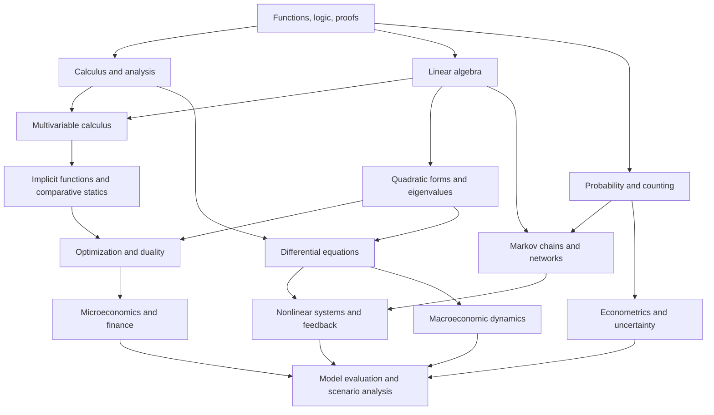

# Core Mathematics for Economics, Econometrics, Finance, and Modeling

> **A source-grounded, graduate-preparation self-study curriculum:** two 12-week quarters (24 weeks), with rigorous foundations, applied mathematical economics, computational exercises, mathematical maturity, and explicit bridges to the other curriculum folders.
>
> **Texts:** Carl P. Simon and Lawrence Blume, *Mathematics for Economists*; Thomas A. Garrity, *All the Mathematics You Missed (But Need to Know for Graduate School)*; Scott E. Page, *The Model Thinker*. The archive also includes the *Mathematics for Economists* answers pamphlet.

## Purpose and scope

The objective is to learn **why mathematical methods work, when they apply, how their assumptions can fail, and how to use them to construct and evaluate models**. This is not intended to be a general-purpose collection of disconnected formulas. It provides a common mathematical language for the graduate microeconomics, macroeconomics, finance, operations research, and econometrics guides.

The three books serve **different—not interchangeable—functions**:

| Text | Role | How it is used here |
|---|---|---|
| **Simon & Blume** (S&B) | Primary mathematical-economics sequence | Calculus, linear algebra, multivariable analysis, implicit functions, optimization, eigenvalues, ODEs, economic applications. Its chapter numbers anchor the required readings. |
| **Garrity** (G) | Mathematical maturity and breadth | Proofs and counterexamples, real analysis, topology, higher-dimensional calculus, differential equations, probability, algorithms, and elective advanced topics. |
| **Page** (P) | Mathematical modeling and model pluralism | Linear models, convexity, networks, stochastic dynamics, feedback, contagion, strategic behavior, and validation of alternative model explanations. |
| **S&B answers pamphlet** | Self-assessment | Check selected chapter exercises **after** attempting them independently. It is an answer reference, not a replacement for full worked solutions or proof-writing. |

### Three-file guide and textbook layout

This curriculum uses **three Markdown files only**:

1. **`README.md` (this file):** the 24-week sequence, embedded knowledge map, weekly learning goals, mathematical and computational practice, assessments, and capstones.
2. **[`source-index.md`](source-index.md):** chapter-by-chapter index of the supplied books and alternative reading paths.
3. **[`mathematical-reference.md`](mathematical-reference.md):** core results, formula conditions, proof obligations, and failure modes.

The three guide files can be copied into your existing **`core-math/` folder beside the original PDFs**. Their links assume that original folder arrangement. **The textbooks are not included in this small guides-only package.**

- [Simon & Blume — *Mathematics for Economists*](Carl%20P.%20Simon%2C%20Lawrence%20E.%20Blume%20-%20Mathematics%20for%20economists.pdf)
- [Simon & Blume — Answers Pamphlet](Mathematics-for-Economists-SOLUTION.pdf)
- [Garrity — *All the Mathematics You Missed*](All%20the%20Mathematics%20You%20Missed%20But%20Need%20to%20Know%20for%20Graduate%20School.pdf)
- [Page — *The Model Thinker*](The%20Model%20Thinker%20What%20You%20Need%20to%20Know%20to%20Make%20Data%20Work%20for%20You.pdf)

**Navigation:** Start in this README; use the source index to choose exact chapters and the mathematical reference to check a theorem's hypotheses before using it.

**Provenance:** The S&B PDF is image-based; its chapter organization was cross-checked against the PDF contents pages and the accompanying searchable answers pamphlet. Garrity and Page are text-searchable. References below are **chapter numbers rather than PDF page indices**, which vary between front matter, printed page numbers, and PDF page numbers. Exercises, simulations, and capstones in this README are **newly proposed**, not claimed to be historical assignments from these books.

## Who this is for and how much time to allow

Readers should have at least precalculus algebra and familiarity with functions. Those entering from economics may need additional programming practice; readers from mathematics/engineering may want to spend more time on economic interpretations and identifying model assumptions.

**Standard pace:** 24 weeks, 10–14 hours weekly; two 12-week quarters. **Accelerated option:** learners already comfortable with multivariable calculus and linear algebra can begin at Week 6, complete Quarter 1's capstone, and then undertake Quarter 2. This is an adaptation, not a replacement for prerequisite checks. Do not treat these volumes as a single 12-week introductory course: their combined scope is too broad.

For each week: (1) read the indicated sections; (2) derive and prove results on paper; (3) solve five or more textbook exercises where available; (4) implement the weekly computation in Python, R, MATLAB, Julia, or a spreadsheet; (5) explain the limitations in a short mathematical memo. The end product is an annotated **mathematical modeling portfolio**, not simply solved textbook questions.

### Required baseline competencies

Before beginning, test yourself without reference materials:

1. Simplify logarithms and exponentials, solve systems of two equations, and differentiate a product and quotient.
2. Describe a function's domain/range, distinguish an implication from its converse, and give a counterexample.
3. Solve a quadratic optimization problem and explain what a first-order condition *does not* establish.
4. Multiply two small matrices and identify the dimension of the result.
5. Explain the distinction between a parameter, observation, stochastic disturbance, and numerical approximation.

If several of these are difficult, allocate **1–2 preparatory weeks** to S&B Chapters 1–5 and Appendices 1–2. The 24-week plan begins with review but assumes consistent daily practice.

## Organizing principles

The curriculum follows several recurring mathematical questions:

| Question | Tools | Applications |
|---|---|---|
| Does a solution exist? | continuity, compactness, fixed points (extension), algebraic solvability | equilibria, optimal allocations, estimator existence |
| Is the solution unique? | rank, positive definiteness, convexity/strict concavity | identification, cost minimization, portfolio optimization |
| How does it change under a shock? | derivatives, Jacobians, implicit functions, eigenvalue perturbation | comparative statics, elasticities, policy response |
| What is optimal under constraints? | gradients, Hessians, Lagrangians, constrained optimality | choice, resource allocation, portfolio and project design |
| What happens over time? | eigenvalues, differential equations, Markov chains, feedback | growth, capital dynamics, diffusion, state changes |
| What can randomness change? | probability, expectations, variance, limit laws, entropy | asset returns, inference, rare events, model risk |
| How do we compare models? | simulation, numerical accuracy, sensitivity, validation | forecasting, scenario analysis, research design |

A mathematical derivation and a convincing economic explanation should **agree**; neither substitutes for the other.

## Learning dependency map

The following Mermaid map is embedded directly in this README and renders in GitHub. It shows the foundational dependencies and their downstream applications:

## Quarter I — Mathematical foundations for optimization and economic reasoning

**Goal:** Build enough command of linear algebra, calculus, implicit-function reasoning, and constrained optimization to read serious graduate economics and econometrics without treating the mathematics as a black box.

| Week | Main dependency | Principal text anchors | Tested artifact |
|---|---|---|---|
| 1 | Definitions and logic | S&B 1–2, App. 1; G introductory structure | Proof notebook and notation glossary |
| 2 | Calculus, Taylor, elasticity | S&B 3–5; G 2 | Comparative-change calculator |
| 3 | Linear systems and rank | S&B 6–11; G 1 | Linear-solver and rank report |
| 4 | Quadratic forms and eigenvalues | S&B 16, 23; G 1 | Least-squares geometry report |
| 5 | Multivariable calculus | S&B 12–14; G 3 | Jacobian and gradient notebook |
| 6 | Implicit functions | S&B 15; G 3 | Comparative-statics memo |
| 7 | Unconstrained optimization | S&B 16–17, 21; P 8 | Numerical optimum audit |
| 8 | Equality constraints and multipliers | S&B 18–19 | Consumer/producer optimization |
| 9 | Inequality constraints and shadow values | S&B 18–19, 22 | Resource-allocation KKT cases |
| 10 | Convexity, topology, functional form | S&B 20–21, 29; G 2, 4 | Existence/uniqueness argument |
| 11 | Integrated economic applications | S&B 22; P 7–9, 20 | Parameter-shock model |
| 12 | Quarter I synthesis | Review S&B 6–23; G 1–4 | **Optimization and comparative-statics capstone** |

### Week 1 — Functions, sets, notation, and proof habits

**Read:** S&B Chs. 1–2 and Appendix 1 (sets, numbers, and proofs); Garrity, *On the Structure of Mathematics* and the first part of Ch. 2. **Question:** What does a mathematical assertion actually claim?

**Learn:** sets and mappings, domain/codomain, inverses, necessary versus sufficient conditions, quantifiers, counterexamples, functional notation, and mathematical assumptions. Distinguish a definition, a theorem, and an empirical conjecture. Practice direct proof and proof by contradiction; avoid trying to infer a universal theorem from numerical examples.

**Derive:** For a function $f:A\to B$, identify conditions for injectivity and surjectivity; demonstrate why the inverse $f^{-1}$ does not exist on all of $B$ without appropriate restrictions. Show a counterexample to the converse of a valid implication. Write the derivative definition as a limit rather than memorizing a rule.

**Applications/lab:** Implement a small function library that rejects out-of-domain inputs and records assumptions. Use an inverse demand schedule to distinguish a function's economic domain from the full real line. **Exercises:** 3 set/function exercises, 2 proof/counterexample exercises, 1 economic-domain explanation. **Deliverable:** a one-page assumption glossary and four correct short proofs.

**Mastery:** You can identify hidden assumptions and can explain why a counterexample suffices to refute a universal statement.

### Week 2 — Single-variable calculus, logarithms, Taylor expansion, and elasticity

**Read:** S&B Chs. 3–5; Garrity Ch. 2 (limits, continuity, differentiation). **Question:** How do local changes approximate nonlinear economic responses?

**Learn:** chain/product/quotient rules, log differentiation, inverse functions, monotonicity, curvature, global versus local extrema, Taylor approximation, and error from linearization. Relate compounding and logarithms to growth and returns.

**Derive:**

$$
\frac{\mathrm d\log f(x)}{\mathrm dx}=\frac{f'(x)}{f(x)},\qquad
f(x+h)\approx f(x)+f'(x)h+\frac{1}{2}f''(x)h^2.
$$

For positive $x$ and $f(x)$, derive point elasticity:

$$
\varepsilon_{f,x}=\frac{x f'(x)}{f(x)}
=\frac{\mathrm d\log f(x)}{\mathrm d\log x}.
$$

**Applications/lab:** Compare exact and approximate price changes in a nonlinear demand model and exact versus log-approximated compound returns. Plot approximation error against step size. **Exercises:** differentiation and curvature problems, a Taylor-error bound where possible, and a numerical elasticity calculation. **Deliverable:** a two-page memo on when first-order approximations are adequate.

**Mastery:** You know why $\log(1+g)\approx g$ requires a small $g$ and why a derivative need not describe a large policy change.

### Week 3 — Linear algebra I: vectors, systems, rank, and matrix transformations

**Read:** S&B Chs. 6–11; Garrity Ch. 1 (vector spaces, basis, linear maps). **Question:** What makes a linear system solvable and identifiable?

**Learn:** vectors, matrix multiplication, systems of equations, Gaussian elimination, rank, null spaces, column spaces, basis, dimension, and geometric meaning of linear dependence. Prove that invertibility requires a square full-rank matrix. Distinguish exact solution from approximation.

**Derive:**

$$
A\boldsymbol{x}=\boldsymbol{b},\qquad
\text{unique solution if } A\text{ is square and nonsingular},
\qquad \boldsymbol{x}=A^{-1}\boldsymbol{b}.
$$

Do **not** implement inversion as the default numerical way to solve a system. Explain why $A\boldsymbol{x}=\boldsymbol{b}$ may have no, one, or infinitely many solutions. **Applications/lab:** Write a linear system for a multi-sector input-output example or supply-demand equilibrium, solve it with a linear solver, and compare to a rank-deficient variant. **Exercises:** 4 textbook systems, 2 rank/null-space proofs. **Deliverable:** annotated computations and a solvability diagnostic.

**Mastery:** You can find a basis and articulate the relation between rank and unidentified coefficients.

### Week 4 — Linear algebra II: projections, quadratic forms, definiteness, eigenvalues

**Read:** S&B Chs. 10–11, 16, 23; Garrity Ch. 1. **Question:** How does geometry determine estimation, optimization, and dynamical stability?

**Learn:** orthogonality, norms, projections, positive-semidefinite and positive-definite matrices, eigenvectors/eigenvalues, symmetric matrices, covariance matrices, condition numbers (computational extension), and least-squares geometry (application beyond the primary S&B chapter sequence).

**Derive:**

$$
\min_{\boldsymbol{\beta}}\|\boldsymbol{y}-X\boldsymbol{\beta}\|_2^2
\quad\Longrightarrow\quad
X^{\mathsf T}X\hat{\boldsymbol{\beta}}=X^{\mathsf T}\boldsymbol{y}.
$$

Explain the additional full-column-rank condition for the familiar closed form, and why the normal equations alone are not evidence of causal identification. Verify that $\boldsymbol{x}^{\mathsf T}Q\boldsymbol{x}>0$ for all nonzero $\boldsymbol{x}$ when $Q$ is positive definite.

**Applications/lab:** Construct collinear predictor matrices; compare least-squares computations using QR/SVD against direct normal-equation inversion; calculate eigenvalues of a covariance matrix. **Exercises:** rank/nullity, two definiteness proofs, and a projection derivation. **Deliverable:** an estimation-geometry report with a numerical instability example.

**Mastery:** You distinguish invertibility, positive definiteness, and numerical conditioning.

### Week 5 — Multivariable functions, gradients, Jacobians, and Hessians

**Read:** S&B Chs. 12–14 and 30 (selected harder problems); Garrity Ch. 3. **Question:** How do changes in several inputs interact?

**Learn:** open sets, multivariate limits, partial versus total derivatives, directional derivatives, gradient, Jacobian, Hessian, chain rule for compositions, cross-partials, differentiability versus existence of partial derivatives.

**Derive:** For $f:\mathbb{R}^n\to\mathbb{R}$, the local approximation is

$$
f(\boldsymbol{x}+\boldsymbol{h})\approx
f(\boldsymbol{x})+\nabla f(\boldsymbol{x})^{\mathsf T}\boldsymbol{h}.
$$

For vector output $F:\mathbb{R}^n\to\mathbb{R}^m$, replace the gradient with the Jacobian $J_F$. Derive total derivatives for a production function or a portfolio-risk function.

**Applications/lab:** Write finite-difference and analytic gradients for a two-input production function; compare with automatic differentiation where available. Show a counterexample where marginal effects depend on the evaluation point. **Exercises:** six derivative/Jacobian/Hessian calculations and one differentiability counterexample. **Deliverable:** derivative-checking notebook.

**Mastery:** You can keep track of matrix dimensions and explain what a cross-partial means in a specific model.

### Week 6 — Inverse and implicit functions; comparative statics

**Read:** S&B Ch. 15; Garrity Ch. 3 (inverse and implicit function theorems). **Question:** How does an equilibrium change even when an explicit solution is unavailable?

**Learn:** implicit systems, local invertibility, nonsingular Jacobians, differentiating equilibrium conditions, and the difference between local and global uniqueness. State the assumptions of the implicit function theorem clearly.

**Derive:** If $F(\boldsymbol{x},\boldsymbol{a})=\boldsymbol{0}$ and the square Jacobian $D_{\boldsymbol{x}}F$ is nonsingular near a solution, then

$$
\frac{\mathrm d\boldsymbol{x}}{\mathrm d\boldsymbol{a}}
=-\bigl(D_{\boldsymbol{x}}F\bigr)^{-1}D_{\boldsymbol{a}}F.
$$

Use this result in a two-market equilibrium or a Cobb–Douglas first-order system. **Applications/lab:** Build a numeric equilibrium solver, perturb the parameters, calculate derivatives analytically, and confirm with finite differences. **Exercises:** 3 implicit-function derivations and 2 economic sign-comparison explanations. **Deliverable:** comparative-statics table with checks.

**Mastery:** You can articulate why a local nonsingularity result does not guarantee existence of a global solution.

### Week 7 — Unconstrained optimization, curvature, and second-order conditions

**Read:** S&B Chs. 16–17 and 21; Page Ch. 8 (concavity and convexity). **Question:** When is a stationary point a genuine optimum?

**Learn:** gradient first-order conditions, one- and multidimensional second-order conditions, strict versus weak concavity, local and global extrema, first-order necessary versus sufficient conditions, boundary effects, numerical optimizers.

**Derive:**

$$
\nabla f(\boldsymbol{x}^{\ast})=\boldsymbol{0},\qquad
\boldsymbol{h}^{\mathsf T}H_f(\boldsymbol{x}^{\ast})\boldsymbol{h}<0
\quad\text{for all }\boldsymbol{h}\ne\boldsymbol{0}
$$

is a sufficient second-order condition for a strict local maximum when the Hessian is negative definite at an interior stationary point. Distinguish this from global concavity over the entire feasible domain.

**Applications/lab:** Maximize a profit function and minimize a quadratic loss under varied curvature assumptions. Plot objective contours and annotate candidate points. **Exercises:** 4 analytic stationary-point problems, one saddle-point counterexample, and one numerical solver comparison. **Deliverable:** optimum-classification notebook.

**Mastery:** You never claim an optimum solely because the derivative equals zero.

### Week 8 — Equality-constrained optimization and Lagrange multipliers

**Read:** S&B Chs. 18–19; applications in Ch. 22. **Question:** How does an optimal choice trade off scarce resources?

**Learn:** equality constraints, Lagrange first-order conditions, regularity and constraint qualifications, constrained Hessian ideas, envelope logic, multiplier meaning and units, interior solutions.

**Derive:**

$$
\max_{\boldsymbol{x}}f(\boldsymbol{x})
\quad\text{subject to}\quad g(\boldsymbol{x})=b,\qquad
\mathcal{L}=f(\boldsymbol{x})+\lambda\bigl(b-g(\boldsymbol{x})\bigr).
$$

At an interior regular optimum, $\nabla f=\lambda\nabla g$; under suitable differentiability and regularity, the derivative of the optimized value with respect to $b$ is $\lambda$ for this sign convention. Explain why the sign convention matters.

**Applications/lab:** Derive a consumer demand problem and a cost-minimization problem; numerically trace the value function against the budget or output target. **Exercises:** 4 Lagrangian calculations, 2 multiplier interpretation questions. **Deliverable:** a shadow-price verification report.

**Mastery:** You interpret multipliers as marginal values, not arbitrary prices in all models.

### Week 9 — Inequality constraints, corners, and sensitivity of optimal solutions

**Read:** S&B Chs. 18–19 and selected Ch. 22 exercises. **Question:** What changes when constraints bind or optimal choices hit boundaries?

**Learn:** active versus inactive constraints, feasible sets, complementary slackness, Karush–Kuhn–Tucker reasoning under suitable regularity, constraint sensitivity, and nonconvexity limitations. **Derive** the conditions using the convention

$$
\max_{\boldsymbol{x}}f(\boldsymbol{x})
\quad\text{subject to}\quad h_i(\boldsymbol{x})\le 0,
\qquad \mathcal{L}=f(\boldsymbol{x})-\sum_i\lambda_i h_i(\boldsymbol{x}),
$$

$$
\lambda_i\ge0,\qquad h_i(\boldsymbol{x}^{\ast})\le0,
\qquad\lambda_i h_i(\boldsymbol{x}^{\ast})=0,
$$

plus stationarity and the relevant constraint qualifications. **Applications/lab:** Allocate a fixed environmental budget across two technologies with capacity limits; demonstrate how the binding constraint changes as a parameter varies. **Exercises:** three corner/interior examples, one failure of a constraint qualification, and one numerical solver check. **Deliverable:** resource-allocation model with complementary-slackness diagnostics.

**Mastery:** You can identify when KKT conditions are sufficient and when they are only candidates.

### Week 10 — Homogeneity, concavity, compactness, and existence

**Read:** S&B Chs. 20–21 and 29; Garrity Chs. 2 and 4; Page Ch. 8. **Question:** Which mathematical properties justify equilibrium and optimization conclusions?

**Learn:** homogeneous/homothetic functions, Euler's theorem, concavity and quasiconcavity, convex sets, open/closed/compact sets, and continuous-function extrema on compact domains. Carefully distinguish convex preferences from concavity of utility representations.

**Derive:** For differentiable $f$ homogeneous of degree $k$,

$$
\sum_{i=1}^n x_i\frac{\partial f}{\partial x_i}(\boldsymbol{x})
=k f(\boldsymbol{x}).
$$

Prove this by differentiating $f(t\boldsymbol{x})=t^k f(\boldsymbol{x})$ with respect to $t$ at $t=1$. Give a counterexample showing why continuity on a noncompact feasible region need not imply existence of a maximum. **Applications/lab:** Compare Cobb–Douglas, CES (optional), and nonconcave production examples. **Deliverable:** proof portfolio (Euler, existence, one counterexample).

**Mastery:** You can state which conclusion follows from compactness and continuity, and which stronger conclusions need strict curvature.

### Week 11 — Mathematical economics synthesis: demand, production, and equilibrium

**Read:** S&B Ch. 22; review 15–21; Page Chs. 7–9 and 20. **Question:** Can one mathematical tool be reused across economic problems with differing behavioral assumptions?

**Learn:** comparative statics of cost/demand, optimization duality at an introductory level, sensitivity of a model to parameters, and interpretation of equilibrium without confusing mathematical identification with empirical identification. Contrast linear simplification and nonlinear curvature in Page's modeling examples.

**Integrated model:** Choose a utility function, a production function, and market-clearing equations. Construct the first-order conditions and derive at least two comparative statics. Compute both analytic and numerical solutions, and explain when these disagree. Extend to a simple spatial or hedonic attribute model only after the baseline is sound.

**Exercises/deliverable:** 8–10 selected S&B Ch. 22 problems and an original five-page model report with assumptions, derivation, stability/solution checks, and plots. **Mastery:** You can justify the conditions under which your interpretation holds and give at least two plausible violations.

### Week 12 — Quarter I capstone: constrained decision-making under changing conditions

**Read:** Review weakest topics; use S&B Chs. 6–23 and selected Garrity Chs. 1–4 as necessary. **Project:** Build and solve **one** of the following original mathematical models: (a) a production plan with scarce inputs and a policy tax; (b) a two-asset portfolio with allocation and exposure constraints; or (c) a consumer-choice problem with shifting prices and endowments.

**Required:** formalize assumptions; prove or justify existence; investigate uniqueness; derive FOCs/KKT conditions; compute relevant Jacobian/Hessian; solve analytically where possible; solve numerically; compare local derivative-based predictions with finite shocks; document failure cases and limitations. The assessment criteria are in **Assessment rubric and capstones** below.

**Gate to Quarter II:** Before proceeding, explain in plain language how eigenvalues diagnose a linearized system, how a Lagrange multiplier changes with constraint conventions, and why no first-order approximation is automatically trustworthy for large shocks.

## Quarter II — Dynamics, probability, mathematical analysis, and model construction

**Goal:** Move beyond static problems: analyze evolution, randomness, convergence, numerical reliability, and emergent behavior. The second quarter alternates formal mathematics with Page's model-building examples. S&B is still the main source for linear dynamics and differential equations; Garrity provides deeper analytic context; Page supplies real-world interpretive models.

| Week | Main dependency | Principal text anchors | Tested artifact |
|---|---|---|---|
| 13 | Scalar differential equations | S&B 24; G 14 | Growth/adjustment simulation |
| 14 | Coupled dynamics and stability | S&B 23, 25; G 14; P 16, 18 | Stability phase-portrait memo |
| 15 | Counting, probability, expectations | S&B App. 5; G 15; P 5–6 | Distribution/risk notebook |
| 16 | Randomness, uncertainty, tail events | G 15; P 5–6, 12–13 | Model-risk simulation |
| 17 | Markov systems and path dependence | P 13–14, 17; S&B 23 | Markov transition report |
| 18 | Limits, convergence, and topology | S&B 12, 29–30; G 2, 4, 10 | Convergence proof workbook |
| 19 | Integration and transforms | S&B App. 4; G 12–14 | Fourier/smoothing experiment |
| 20 | Networks and diffusion | P 10–11, 15 | Network diffusion notebook |
| 21 | Feedback and nonlinear behavior | P 16, 18–19, 28; S&B 24–25 | Feedback stress-test report |
| 22 | Strategic and collective models | P 21–27; S&B 22 | Multi-agent model comparison |
| 23 | Algorithms, approximation, model pluralism | G 16; P 1–3, 29 | Numerical accuracy and sensitivity audit |
| 24 | Integrated modeling capstone | All texts, selectively | **Reproducible modeling portfolio and oral defense** |

### Week 13 — Scalar differential equations and continuous-time adjustment

**Read:** S&B Ch. 24; Garrity Ch. 14 (ODE sections). **Question:** What conditions determine whether a model converges, explodes, or changes direction over time?

**Learn:** first-order ODEs, equilibria, separable and linear equations, integrating factors, initial values, logistic dynamics (applied example), and the relation between a derivative and a one-step numerical update.

**Derive:** For a linear adjustment equation,

$$
\dot{x}(t)=a-bx(t),\qquad b>0,
$$

$$
x(t)=\frac{a}{b}+\left(x(0)-\frac{a}{b}\right)e^{-bt}.
$$

Show why the steady state is $x^{\ast}=a/b$ and converges when $b>0$. Contrast the exact solution with Euler's approximation $x_{t+\Delta t}=x_t+\Delta t(a-bx_t)$. **Applications/lab:** adjustment toward equilibrium in inventories, capital stock, or a price level under an explicitly specified law. **Exercises:** solve four initial-value ODEs and compute discretization errors. **Deliverable:** exact-versus-numerical solution plot with time-step sensitivity.

**Mastery:** You know the difference between a stable continuous-time process and an unstable numerical discretization.

### Week 14 — Coupled differential equations, eigenvalues, and stability

**Read:** S&B Chs. 23 and 25; Garrity Ch. 14; Page Chs. 16 and 18. **Question:** How can several variables jointly create oscillation, feedback, or instability?

**Learn:** vector differential equations, characteristic roots, eigenvectors, stable and unstable fixed points, phase portraits, local linearization, Lyapunov-function intuition (Page), and the distinction between continuous-time and discrete-time eigenvalue stability conditions.

**Derive:**

$$
\dot{\boldsymbol{x}}=A\boldsymbol{x},\qquad
\boldsymbol{x}(t)=e^{At}\boldsymbol{x}(0).
$$

Explain why the real parts of eigenvalues matter in continuous time. In a discrete linear system $\boldsymbol{x}_{t+1}=A\boldsymbol{x}_t$, compare this with the condition that eigenvalue moduli are strictly less than one. **Applications/lab:** simulate a two-dimensional adjustment system with a stable node, saddle, and spiral. **Exercises:** 3 characteristic-polynomial calculations, 2 qualitative system sketches, and a Lyapunov-style stability argument in a simple case. **Deliverable:** diagnostic table and phase portraits.

**Mastery:** You no longer confuse eigenvalues with causal shocks or infer stability from a single simulation.

### Week 15 — Counting, probability, conditional expectation, and variance

**Read:** S&B Appendix 5; Garrity Ch. 15; Page Chs. 5–6. **Question:** How do uncertain events alter a quantitative conclusion?

**Learn:** events, combinatorics, conditional probability, independence, Bayes' rule, discrete and continuous random variables, expected values, covariance, variance, sampling distributions, and normal versus power-law shapes. Introduce laws of large numbers and central limit intuition without pretending these books constitute a full measure-theoretic probability course.

**Derive:**

$$
\mathbb{P}(A\mid B)=\frac{\mathbb{P}(B\mid A)\mathbb{P}(A)}{\mathbb{P}(B)},
\qquad \mathbb{P}(B)>0,
$$

$$
\mathrm{Var}(X)=\mathbb{E}[X^2]-\mathbb{E}[X]^2.
$$

**Applications/lab:** Compare Monte Carlo sums under normal and heavy-tailed distributions; calculate variance, tail quantiles, and sample-mean instability. **Exercises:** 5 counting/probability questions, 3 expectation/covariance calculations. **Deliverable:** distribution-assumption audit.

**Mastery:** You can distinguish an unconditional distribution from a conditional one and explain why extreme outcomes matter.

### Week 16 — Model risk, random walks, entropy, and rare events

**Read:** Garrity Ch. 15; Page Chs. 5–6, 12–13. **Question:** How far does a model's tail behavior or uncertainty measure depend on its assumptions?

**Learn:** random walks, variance accumulation, entropy as a measure of distributional uncertainty, power laws and long tails, aggregation, the distinction between ensemble and observed trajectories, and sensitivity to distributional misspecification.

**Derive:** If $S_n=\sum_{t=1}^n\varepsilon_t$ with independent innovations of mean zero and common finite variance $\sigma^2$,

$$
\mathbb{E}[S_n]=0,\qquad\mathrm{Var}(S_n)=n\sigma^2.
$$

For probabilities $p_i$ on a finite state set, define Shannon entropy as

$$
H(\boldsymbol{p})=-\sum_i p_i\log p_i,
$$

with a consistent logarithm base and the convention $0\log 0=0$. **Applications/lab:** model liquidity needs under normally distributed versus fat-tailed shocks; simulate many paths and document where estimates cease to stabilize. **Exercises:** entropy calculations, random-walk moments, an independence counterexample. **Deliverable:** a two-distribution risk comparison.

**Mastery:** You never apply $\mathrm{Var}(S_n)=n\sigma^2$ without considering covariances.

### Week 17 — Markov chains, state transitions, and path dependence

**Read:** Page Chs. 13–14 and 17; review S&B Ch. 23. **Question:** When can tomorrow's distribution be described using today's state alone?

**Learn:** finite-state Markov property, transition matrices, multi-step transition probabilities, invariant distributions, ergodic intuition, communicating classes, absorbing states, and model limitations. Contrast Markov models with the more general path-dependence stories in Page.

**Derive:** Let $P$ be a **row-stochastic** transition matrix and $\boldsymbol{\pi}_t$ a row probability vector. Then

$$
\boldsymbol{\pi}_{t+1}=\boldsymbol{\pi}_tP,\qquad
\boldsymbol{\pi}^{\ast}=\boldsymbol{\pi}^{\ast}P.
$$

Distinguish an invariant distribution from guaranteed convergence to it. **Applications/lab:** credit-rating migration, unemployment states, or ecological regimes; simulate trajectories and compare stationary solutions across parameter scenarios. **Exercises:** calculate powers of a transition matrix, investigate reducibility/periodicity in example chains. **Deliverable:** a transition-dynamics memo.

**Mastery:** You state when Markov and long-run claims require extra assumptions.

### Week 18 — Real analysis, convergence, continuity, and mathematical rigor

**Read:** S&B Chs. 12, 29–30; Garrity Chs. 2, 4, selected Ch. 10. **Question:** Which interchange of limit, derivative, expectation, or integral is actually justified?

**Learn:** sequences, Cauchy and convergence arguments, compactness, continuity, pointwise versus uniform convergence, dominated-convergence intuition (Garrity Ch. 12 if pursuing advanced track), existence theorems, and counterexamples. This week is intentionally proof-heavy.

**Derive:** Compare

$$
f_n(x)=x^n,\qquad 0\le x\le1,
$$

with its pointwise limiting function; prove that convergence is **not uniform** on $[0,1]$ using the discontinuity of the limit. Contrast with uniform convergence on $[0,a]$ for any $a<1$. **Applications/lab:** compare numerical approximations to expected payoff when the distribution or integrand is poorly behaved; identify unjustified exchanges of limit and integration. **Exercises:** 3 limit proofs, 2 counterexamples, 1 compactness argument. **Deliverable:** convergence-and-assumptions workbook.

**Mastery:** You understand that differentiating or integrating a limit requires specific conditions, not just visual smoothness.

### Week 19 — Integral methods, Lebesgue intuition, Fourier analysis, and transformations

**Read:** S&B Appendix 4; Garrity Chs. 12–14 (selected sections). **Question:** How can functions and signals be decomposed and integrated to study dynamic phenomena?

**Learn:** Riemann-versus-Lebesgue motivation, integration under uncertainty, Fourier series/transforms at a conceptual and computational level, orthogonal decompositions, smoothing, boundary conditions, and PDE context (optional). Garrity's material is a broad mathematical survey; this week is an introduction, not a complete proof-based real analysis course.

**Derive:** Fourier-series coefficients for a periodic, integrable function over $[-\pi,\pi]$:

$$
a_n=\frac{1}{\pi}\int_{-\pi}^{\pi}f(x)\cos(nx)\,\mathrm dx,
\qquad
b_n=\frac{1}{\pi}\int_{-\pi}^{\pi}f(x)\sin(nx)\,\mathrm dx,
$$

with the usual $a_0/2$ convention. **Applications/lab:** decompose a synthetic seasonal economic series into periodic components; compare Fourier smoothing with a moving average and document boundary artifacts. **Exercises:** basic integrals, one Fourier coefficient derivation, numerical quadrature error checks. **Deliverable:** decomposition and interpretation report.

**Mastery:** You can explain what a frequency representation conveys and why filtering alone is not causal identification.

### Week 20 — Networks, graph structure, diffusion, and contagion

**Read:** Page Chs. 10–11 and 15; Garrity Ch. 16 (graph algorithms). **Question:** How does interaction structure change a system's collective behavior?

**Learn:** graphs, adjacency matrices, paths, degree, network topology, local interaction, thresholds, diffusion, and the difference between contact network and contagion mechanism. Explore a simple network's adjacency eigenvalues as a model-specific diagnostic, not as a universal contagion rule.

**Define:** A simple discrete diffusion rule (an **illustrative model**, not an equation attributed to Page) is

$$
\boldsymbol{x}_{t+1}=(1-\delta)\boldsymbol{x}_t+\beta A\boldsymbol{x}_t,
$$

where $A$ is a nonnegative adjacency matrix, $\delta$ a removal rate, and $\beta$ a propagation parameter. Examine when iterates grow or decay under a linear approximation.

**Applications/lab:** Simulate adoption of a technology or transmission of a financial shock on line, star, random, and clustered networks with identical average degree when feasible. **Exercises:** construct graph adjacency and transition matrices, analyze two thresholds, discuss confounding from topology. **Deliverable:** comparative network-scenario dashboard.

**Mastery:** You distinguish a network's structure from a choice of dynamics imposed upon it.

### Week 21 — Nonlinear feedback, tipping points, and rugged landscapes

**Read:** Page Chs. 16, 18–19, and 28; S&B Chs. 24–25. **Question:** Why can small parameter changes yield qualitatively different trajectories?

**Learn:** positive/negative feedback, attractors, threshold systems, local versus global stability, sensitivity to initial states, path dependence, local maxima and rugged landscapes. Study how linear approximations can fail in nonlinear systems.

**Example:** In the discrete logistic map

$$
x_{t+1}=r x_t(1-x_t),
$$

calculate fixed points and the derivative $r(1-2x^{\ast})$. Explain why local stability for a one-dimensional discrete system requires $|f'(x^{\ast})|<1$ (for hyperbolic fixed points) and test distinct parameter values. **Applications/lab:** simulate adoption thresholds, ecosystem resources, market penetration, or feedback from expectations; compare trajectories with nearly identical starts. **Exercises:** fixed-point derivations, a stability calculation, and a sensitivity heatmap. **Deliverable:** tipping-point note with explicit limitations.

**Mastery:** You can distinguish sensitivity to *parameters*, initial conditions, and model structure.

### Week 22 — Multi-agent models: strategic choice, collective action, and learning

**Read:** Page Chs. 21–27; S&B Ch. 22 as mathematical background. **Question:** How can individual optimization produce interactive, sometimes inefficient outcomes?

**Learn:** payoff matrices, best responses, Nash equilibrium (selected finite games), cooperation and public goods, coordination, mechanism design, signaling, learning rules, and multi-armed bandit intuition. Use these chapters as **modeling applications** rather than pretending the collection supplies a full graduate game theory or formal mechanism-design treatment.

**Derive:** In an illustrative two-player payoff matrix, solve for pure-strategy equilibria by checking unilateral deviations. Compare with expected payoffs under a mixed strategy:

$$
\mathbb{E}[u_i\mid p]=\sum_j p_j u_i(s_i,s_j).
$$

**Applications/lab:** Simulate a repeated coordination or contribution game under different information and payoff conditions. **Exercises:** best-response analysis, one public-goods scenario, and one implementation critique. **Deliverable:** game/model assumptions matrix, equilibrium calculations, and a short critique of behavioral realism.

**Mastery:** You can distinguish a descriptive dynamic from an equilibrium prediction and discuss how incentives affect outcomes.

### Week 23 — Algorithms, numerical error, sensitivity, and model pluralism

**Read:** Garrity Ch. 16; Page Chs. 1–3 and 29; review relevant S&B methods. **Question:** Which results survive changes in algorithm, assumptions, and representation?

**Learn:** computational complexity, Newton's method, convergence criteria, local minima, ill-conditioning, Monte Carlo uncertainty, approximation error, parameter sensitivity, and model comparison. The design of formal cross-validation and causal experiments is an **optional extension** supported by the later econometrics curriculum rather than a central result claimed from these three books.

**Derive:** Newton's scalar iteration:

$$
x_{k+1}=x_k-\frac{f(x_k)}{f'(x_k)},\qquad f'(x_k)\ne0.
$$

Explain failure modes near vanishing derivatives or when starting far from a root. **Applications/lab:** Compare Newton, bisection, and a library solver on smooth and troublesome functions; apply global parameter sweeps to one previous weekly model. **Exercises:** convergence proof sketch in a simple case, a computational failure counterexample, and error decomposition. **Deliverable:** model-validation and numerical-risk audit.

**Mastery:** You disclose which conclusions depend on numerical methods or model choice.

### Week 24 — Final capstone: an applied mathematical modeling dossier

**Read:** Return to the chapters required by your chosen application; use Page Chs. 1–3 as guidance on working with multiple models. Choose a project from **Assessment rubric and capstones** below, or propose an equivalent project.

**Minimum viable capstone:** one structural model and one meaningful alternative model; mathematically correct derivations; equilibrium or optimality/stability analysis; uncertainty or parameter sensitivity; numerical replication; model comparison; and a 10–15 page report. Attach an assumption ledger, a proof appendix, figures, and reproducible code. Be explicit whether your exercise is explanatory, predictive, normative, or causal; mathematical fit alone cannot establish cause and effect.

**Final defense:** In ten minutes, explain (1) the underlying mathematical structure, (2) what the assumptions buy you, (3) whether the solution exists and is unique, (4) where the computations may fail, and (5) what further empirical evidence would be needed before acting on the results.

## Specialized mathematical enrichment — optional, not collapsed into the 24-week core

Garrity deliberately surveys areas beyond the typical mathematical toolkit for economics. These chapters are **available in the uploaded book** but are not all prerequisite for micro, macro, or applied econometrics. Undertake these short tracks after the relevant core weeks:

| Track | Reading | Mathematical goal | Typical use |
|---|---|---|---|
| Geometry and generalized Stokes | G 5–8 | Vector calculus, forms, manifolds, curvature, geometry | Advanced theory, optimization geometry, mathematical physics |
| Complex analysis | G 9 | Holomorphic functions, Cauchy–Riemann, contour integrals | Transform methods, analytic continuation, specialized mathematical economics |
| Set theory and algebra | G 10–11 | Countability, choice, groups/rings/fields | Foundations, proof maturity, abstract structure |
| Measure and Fourier | G 12–13 | Lebesgue integration, convergence, Fourier transforms | Probability foundations, stochastic processes, signal analysis |
| PDE and advanced differential systems | G 14 | Laplace/heat/wave equations | Continuous-time models, advanced mathematical finance |
| Combinatorics and algorithms | G 15–16 | Counting, graphs, computational complexity | Network modeling, simulation, combinatorial optimization |

The source books **do not jointly provide a comprehensive graduate treatment** of measure-theoretic probability, convex duality at full generality, stochastic calculus, optimal control, numerical PDEs, or modern causal identification. Those are legitimate *next courses*, not topics to attribute silently to these textbooks.

## How Core Math connects to the other curriculum folders

| Core Math result | Next curriculum | Application and caution |
|---|---|---|
| Lagrangians, concavity, implicit functions | Graduate Microeconomics | Consumer/producer optimization, comparative statics, welfare; assumptions drive existence and uniqueness |
| Linear dynamics, eigenvalues, numerical stability | Graduate Macroeconomics | Growth, linearized DSGE, adjustment paths; stability depends on timing and system structure |
| Matrices, projections, asymptotic reasoning | ECON 216 / 217 | OLS, regressors, nonlinear estimation, diagnostics; full-rank models are not automatically causally identified |
| Differential equations, probability, spectral methods | ECON 211C | Stochastic processes and time series; forecastability is not causal effect |
| Conditional distributions and numerical simulation | AMS 206 Bayesian Statistics | Posterior computation; rigorous Bayesian measure-theoretic foundations need additional texts |
| Counterfactual optimization and formal assumptions | Causal Inference | Modeling supports identification arguments but is not a substitute for design assumptions |
| Covariance and quadratic programming | Finance I | Mean-variance portfolios, shrinkage and risk constraints; estimated inputs create substantial model risk |
| Gradients, convexity, constraints, sensitivity | Corporate Finance | Capital budgeting, capital rationing, enterprise-risk tradeoffs |
| Calculus, ODEs, probability | Financial Engineering | Prerequisites for derivative modeling; **Itô calculus is not covered by this core program** |

## Study protocol and reproducibility

1. Maintain a **definitions-and-assumptions notebook** with counterexamples.
2. For each model, derive a symbolic or analytic result **before** computing it.
3. Use a numerical solver only with a residual check and scale-aware tolerance.
4. Test finite differences against analytic/automatic derivatives and record the step sizes used.
5. Run at least one deliberate stress test: alter an assumption, perturb parameters, or expose nonuniqueness.
6. Report actual units, time horizons, state spaces, and numerical approximation methods.
7. Keep a dependency manifest or environment file and a deterministic random seed for repeatable stochastic examples.
8. Verify textbook solutions only after making a self-contained attempt, including any proof obligations.

For the computational exercises and assessment rubric, see the self-contained sections below; for mathematical formulas, theorem conditions, and proof checks see [mathematical-reference.md](mathematical-reference.md).

## Self-contained computational practice

Each week already includes a concrete **application, laboratory task, or model check**. The following ten milestone laboratories consolidate those tasks into reusable projects; **no external lab guide, starter script, or required software installation is assumed**. Implement them in Python, R, MATLAB, Julia, or a spreadsheet when suitable. These are proposed self-study assignments, not exercises represented as historical course requirements.

| Milestone | Weeks | Practical task | Evidence of correctness / stress test |
|---|---|---|---|
| Taylor approximation and elasticity | 2 | Compare exact and first-/second-order demand or growth responses under small and large changes | Plot approximation error versus change size; state function domain |
| Rank, projection, and least squares | 3–4 | Solve linear systems and estimate regression coefficients via QR or SVD | Report residual norms, dimensions, rank, and response to near-collinearity |
| Equilibrium comparative statics | 5–6 | Derive an implicit equilibrium response and re-solve after a parameter shock | Check the original equilibrium residual and finite-difference derivatives |
| Constrained decision model | 7–9 | Optimize a production, consumption, or mean-variance objective with active constraints | Verify stationarity, feasibility, complementary slackness, and a benchmark case |
| Differential-equation simulation | 13–14 | Compare exact linear ODE solutions with Euler and higher-order numerical integration | Vary step sizes and distinguish genuine instability from discretization error |
| Distribution and tail risk | 15–16 | Simulate shocks using at least two plausible distributions and compare extreme outcomes | Separate sampling variability, parameter uncertainty, and model choice |
| Markov transitions | 17 | Solve a stationary distribution and simulate finite-state transitions | Check nonnegativity, row sums, stationarity residuals, reducibility |
| Convergence and approximation | 18–19 | Examine pointwise versus uniform convergence; approximate an integral or Fourier series | Record approximation error and the conditions required to interchange limits |
| Network dynamics and feedback | 20–22 | Compare diffusion across networks and add one nonlinear feedback rule | Check whether the model respects the intended state constraints and stability conditions |
| Numerical/structural robustness | 23 | Compare root solvers and two genuinely different formulations of a previous model | Record tolerances, convergence failures, and global parameter sensitivity |

### Submission standard for any lab

Record the research question; data or simulated parameters and units; assumptions; symbolic derivation; algorithm and version/environment; plots or numerical tables; a benchmark or residual check; a parameter perturbation; and a short statement of what the analysis **does not** establish. Set a random seed for simulations and report solver tolerances. The requirement is **reproducibility and reasoning**, not reliance on any one coding language.

## Assessment rubric and capstones

Use roughly **10–14 hours per week**, with around three hours of reading, three hours of derivations/proofs, three hours of textbook exercises, and the remainder for simulation and explanation. The assessments are intended for independent study; readers may adjust weights while retaining proof and error-checking standards.

| Assessment | Suggested weight | Evidence |
|---|---:|---|
| Textbook exercises and proof notebook | 30% | Sound reasoning, correct hypotheses, counterexamples |
| Computational work | 25% | Reproducible implementation, validation and sensitivity |
| Weekly explanation memos | 15% | Interpretation, limitations, economic meaning |
| Quarter I capstone | 15% | Constrained optimization and comparative statics |
| Final capstone | 15% | Integrated models, dynamics and robustness |

**Project evaluation rubric (100 points):** mathematical correctness and proof assumptions (30), model formulation and units (20), computational reliability (20), model criticism and robustness (20), and presentation (10). A successful learner should do more than reproduce theorems: derive them, transfer them to unfamiliar models, and explain when their conclusions fail.

### Quarter I capstone (Week 12)

Choose **one** of the following and deliver a **5–8 page technical memo**, plus a derivation appendix, calculations and sensitivity table:

- **Producer response and capacity.** Specify a strictly concave production or profit model with scarce inputs and capacity constraints; derive multipliers, KKT conditions and responses to an input-price shock; explain corner solutions.
- **Portfolio optimization.** Build a covariance matrix; optimize a mean-variance objective with full-investment and exposure constraints; compare an analytical benchmark with a numerical constrained solution and stress its covariance assumptions.
- **Consumer demand.** Solve a utility-maximization problem, state the regularity conditions, derive price and income responses, and compare analytical predictions with numerical perturbations.

For **all three options**, discuss existence, uniqueness, gradients/Hessians, which constraints bind, whether the calculated result is local or global, and what fails when assumptions are relaxed. A numeric optimum without a residual or feasibility check is incomplete.

### Final capstone (Week 24)

Choose **one** of the following and deliver a **10–15 page dossier** with mathematical appendix, reproducible computation, figures and a one-page nontechnical brief:

- **Macroeconomic adjustment:** model coupled stock-flow dynamics, classify steady-state stability, and compare exact, linearized and nonlinear shock paths.
- **Financial risk and regimes:** combine a constrained allocation problem, alternative tail assumptions, and a finite-state Markov regime model, including stress scenarios.
- **Network diffusion:** compare adoption or contagion under different graph structures and thresholds; test the limits of a linear approximation.
- **Strategic public intervention:** combine a constrained planner's objective with a simple multi-agent game; compute equilibrium and welfare under alternative incentives.

The final dossier must present **two meaningfully different models**, identify the assumptions supporting each, check at least one existence/uniqueness or stability claim, document sensitivity to important inputs, and distinguish descriptive, predictive, normative, and causal claims. In a short oral or written defense, answer: What breaks when a key assumption is removed? How trustworthy is the numerical solution? How would competing specifications change the recommendation? What evidence beyond the model would be required to make a causal claim?

---

## Final learning objectives

By the end, a successful learner can construct and solve constrained economic models; state rather than merely invoke mathematical conditions; analyze local comparative statics; understand rank and matrix geometry; model scalar and coupled dynamics; reason about randomness and distribution assumptions; prove elementary existence or convergence claims; recognize uncertainty from numerics and structural assumptions; and articulate why multiple mathematical models may explain different aspects of the same phenomenon.

The highest-value outcome is not formula memorization. It is the ability to **turn an economic or scientific claim into a precise model, derive its implications, identify when those implications are valid, and test the result against plausible alternatives**.
