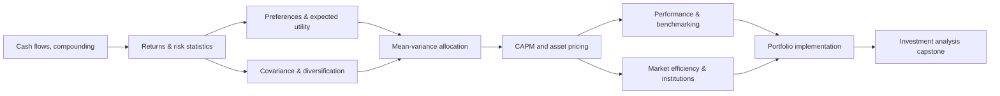

# ECON 233 — Finance I

## Asset pricing, portfolio construction, and financial markets

**Purpose.** Learn how to measure financial returns, characterize risk, construct efficient portfolios, understand asset pricing models, assess market efficiency and make defensible investment decisions. This guide is grounded in the supplied UCSC ECON 233 description: risky/intertemporal choice, asset pricing, efficient markets, institutions, derivatives; and the supplied coverage list: CAPM, Markowitz, Sharpe ratio, EAR, return measurement, leverage, diversification and portfolio optimization. The topic sequence, examples and project exercises are **designed for independent study**, not asserted to be actual university assignments. No specific Finance I textbook, lecture notes or problem sets were provided.

[← Return to Graduate Finance](../README.md) · [Corporate Finance](../ECON-235-Corporate-Finance/README.md) · [Financial Engineering](../ECON-236-Financial-Engineering/README.md)

## Outcomes: what mastery looks like

By the end, you should be able to:

- Translate quoted interest rates into comparable time-scaled returns and use cash-flow timing correctly.
- Distinguish expected vs realized, arithmetic vs geometric, nominal vs real, price vs total, and simple vs continuously compounded returns.
- Explain risk aversion, marginal utility, diversification, covariance, beta and why correlation matters more than standalone variance to a diversified investor.
- Derive and solve the two-asset and general mean–variance portfolio problems, with and without constraints.
- Derive the intuition and central relationships behind the capital allocation line, market portfolio, CAPM and security market line; articulate their assumptions and limits.
- Assess portfolio performance using risk-adjusted metrics and benchmark attribution, avoiding misleading comparisons.
- Interpret weak, semi-strong and strong efficiency as information-set claims, not guarantees of rational or frictionless markets.
- Prepare a concise investment policy and evidence-based portfolio recommendation, including estimation uncertainty and implementation frictions.

## Prerequisites and mathematical toolset

**Required:** basic microeconomics, risk and intertemporal choice, algebra, derivatives, unconstrained/constrained optimization, probability, expectations/variance, elementary statistics and matrix notation. **Useful:** linear algebra (positive-semidefinite matrices, matrix inverses), regressions and a programming language for portfolio calculations. A newcomer from math or OR may need more time on financial instrument mechanics; an economics reader may need more time on matrix optimization.

### Compact notation and units

| Symbol | Meaning | Beware |
|---|---|---|
| $P_t$ | Ex-dividend asset price at time $t$ | Specify valuation timestamp and currency |
| $D_t$ | Cash distribution between $t-1$ and $t$ | Include dividends when computing total return |
| $R_t$ | Simple holding-period total return | 1-month and 1-year returns are not directly comparable |
| $r_f$ | Risk-free return matched to horizon/currency | A proxy security can still carry reinvestment or price risk |
| $\mu$, $\Sigma$ | Expected return vector and covariance matrix | Estimated from noisy samples |
| $\mathbf w$ | Portfolio weights | State whether short sales and leverage are permitted |
| $\beta_i$ | Market beta $Cov(R_i,R_M)/Var(R_M)$ | Beta is not total risk |

## Learning sequence and dependency graph

### Module 1 — Financial instruments, markets, and intertemporal choice

**Questions.** What claims do debt and equity represent? What is a cash flow worth today? Why can identical cash-flow totals have different values?

**Concepts:** equity vs debt, securities and financial intermediaries, spot vs forward markets, primary vs secondary markets, prices versus cash flows, arbitrage in simple settings, nominal vs real values, risky and intertemporal optimization, consumption smoothing, liquidity and market institutions. Clarify the distinct role of cash-flow timing and risk preferences.

**Core derivations:** For discrete-period cash flows, the present value is

$$
PV=\sum_t \frac{CF_t}{(1+i)^t}.
$$

For intertemporal choice, illustrate the Euler equation in a simplified setting with suitable assumptions:

$$
u'(c_t)=\beta(1+r)E_t\!\left[u'(c_{t+1})\right].
$$

Compare equivalent payment streams and explain why timing and the discount rate matter.

**Application:** compare two loans offering different payment timings; identify the market institution that enables borrowing and lending across periods.

**Mastery check:** Explain why two investors with different consumption needs might choose different assets even when they agree on probabilities and prices.

### Module 2 — Interest-rate and return mathematics

**Concepts:** simple versus compound interest, quoted APR, effective annual rate (EAR), continuous compounding, discount factors, holding-period returns, time-weighted and money-weighted returns, internal rate of return, reinvestment assumptions, nominal/real return approximation (Fisher relation), dividend/total return adjustments.

**Relationships:** For an APR convertible $m$ times per year, the effective annual rate is

$$
EAR=\left(1+\frac{APR}{m}\right)^m-1.
$$

The accumulation factor for continuous rate $r_c$ over $T$ years is

$$
A(T)=e^{r_cT}.
$$

For an asset with ex-dividend prices $P_t$ and a period dividend $D_t$, holding-period and log returns are

$$
\begin{aligned}
R_t &= \frac{P_t-P_{t-1}+D_t}{P_{t-1}},\\
r_{\log,t} &= \ln(1+R_t).
\end{aligned}
$$

Multi-period gross returns compound multiplicatively:

$$
1+R_{total}=\prod_{t=1}^{T}(1+R_t).
$$

The arithmetic mean of periodic returns is not the compounded growth rate.

**Application:** create a spreadsheet comparing investments with the same quoted rate but differing compounding frequencies, deposits, fees and dividends. Calculate both time-weighted and money-weighted performance when capital flows occur midperiod.

**Mastery check:** Explain why averaging annual returns arithmetically generally misstates compound wealth growth.

### Module 3 — Measuring uncertainty and risk preferences

**Concepts:** discrete states and probabilities, expected return, variance, standard deviation, covariance, correlation, downside tail risk, skewness, kurtosis, risk aversion, utility curvature, certainty equivalent and risk premium. Distinguish **risk** under modeled probabilities from unmodeled uncertainty and estimation error.

**Relationships:** Expected return, variance, and Arrow–Pratt absolute risk aversion are

$$
\begin{aligned}
E[R] &= \sum_s p_s R_s,\\
\operatorname{Var}(R) &= E\!\left[(R-E[R])^2\right],\\
A(W) &= -\frac{u''(W)}{u'(W)}.
\end{aligned}
$$

Under small-risk approximations, the risk premium is related to variance and utility curvature; do not present a local approximation as a general equality.

**Application:** compare a sure payoff with a lottery under linear, log and CRRA utility; calculate certainty equivalents where possible. Explain why a utility-maximizing decision is not determined by expected cash value alone.

**Mastery check:** Why is a high-volatility asset not necessarily unattractive if its returns are negatively correlated with the investor's other holdings?

### Module 4 — Diversification and covariance structure

**Concepts:** systematic and idiosyncratic risk, diversification, covariance matrices, imperfect correlation, portfolio return distributions, correlation versus causality, concentration risk, sector/factor exposures.

**Relationships:** For portfolio weights $\mathbf w$, expected returns $\boldsymbol\mu$, and covariance matrix $\Sigma$,

$$
\begin{aligned}
E[R_p] &= \mathbf w^\top\boldsymbol\mu,\\
\sigma_p^2 &= \mathbf w^\top\Sigma\mathbf w,\\
\mathbf 1^\top\mathbf w &= 1.
\end{aligned}
$$

For two assets, with weight $w$ in asset 1 and $1-w$ in asset 2,

$$
\sigma_p^2=w^2\sigma_1^2+(1-w)^2\sigma_2^2+2w(1-w)\sigma_1\sigma_2\rho_{12}.
$$

**Application:** build a two-asset chart varying correlation from $-1$ to $+1$. Then move to 5–10 assets, construct an estimated correlation heat map and compare equal-weight vs concentration-heavy allocations.

**Mastery check:** Derive the minimum-variance weight for two risky assets without constraints, then explain why unrestricted optimization may suggest a short position.

### Module 5 — Markowitz portfolio optimization

**Concepts:** feasible set, efficient frontier, global minimum-variance portfolio, expected-return targeting, constrained versus unconstrained solutions, long-only and leverage constraints, regularization and estimation risk **[Extension]**.

**Optimization templates:**

$$
\min_{\mathbf w}\; \mathbf w^\top\Sigma\mathbf w\quad\text{s.t.}\quad\mathbf1^\top\mathbf w=1,\;\boldsymbol\mu^\top\mathbf w=\mu_*,
$$

An alternative mean–variance objective, subject to realistic constraints, is

$$
\max_{\mathbf w}\;\boldsymbol\mu^\top\mathbf w-\frac{\lambda}{2}\mathbf w^\top\Sigma\mathbf w.
$$

For the unrestricted global-minimum-variance portfolio, when $\Sigma$ is invertible,

$$
\mathbf w_{GMV}=\frac{\Sigma^{-1}\mathbf 1}{\mathbf 1^\top\Sigma^{-1}\mathbf 1}.
$$

**Application:** solve with a spreadsheet optimizer and with SciPy/cvxpy. Compare the theoretical frontier to one that includes minimum/maximum positions, transaction costs and no-short-selling constraints. Report sensitivity to small changes in estimated means.

**Mastery check:** Explain why a mathematically optimal portfolio can be unstable and practically inferior to a simple diversified benchmark.

### Module 6 — Risk-free lending, borrowing, and the Sharpe ratio

**Concepts:** capital allocation line, tangency portfolio, separation intuition, borrowing at a risky lending spread, leverage, margin constraints, risk-free cash benchmark, Sharpe ratio.

**Relationships:** The Sharpe ratio, using matched time horizons, is

$$
\operatorname{Sharpe}=\frac{E[R_p]-r_f}{\sigma_p}.
$$

The capital allocation line, for positive exposure to a risky portfolio, is

$$
E[R_c]=r_f+\frac{\sigma_c}{\sigma_p}\left(E[R_p]-r_f\right).
$$

Interpret these measures cautiously for non-normal, asymmetric or illiquid return distributions.

**Application:** compare two funds with different nominal returns but different volatility; assess whether leverage raises expected returns while also raising losses and financing costs.

**Mastery check:** A portfolio reports an impressive Sharpe ratio. What additional information (sample window, leverage, drawdowns, tails, illiquidity) is needed before concluding it is a superior investment?

### Module 7 — CAPM and equilibrium asset pricing

**Concepts:** market portfolio, systematic risk, beta, security market line, equity risk premium, Jensen alpha, assumptions underlying equilibrium, comparison with APT and multi-factor models **[Extension]**.

**Relationships:** Market beta and CAPM expected return are

$$
\begin{aligned}
\beta_i &= \frac{\operatorname{Cov}(R_i,R_M)}{\operatorname{Var}(R_M)},\\
E[R_i] &= r_f+\beta_i\left(E[R_M]-r_f\right).
\end{aligned}
$$

An estimated alpha (with sample mean returns and an estimated beta) is

$$
\alpha_i=\bar R_i-\left[r_f+\hat\beta_i(\bar R_M-r_f)\right].
$$

Interpret alpha subject to estimation error and the benchmark's assumptions.

**Application:** regress an asset's excess return on a broad market excess return; report intercept, beta, confidence intervals, residual variation and results across windows. Relate estimated cost of equity to ECON 235, but do not assume a historical beta is automatically the correct project discount rate.

**Mastery check:** Can an asset have high total volatility and low CAPM beta? Why does that matter for pricing versus portfolio-level risk management?

### Module 8 — Asset-pricing tests, market efficiency, and institutions

**Concepts:** weak/semi-strong/strong information efficiency, random-walk intuition versus martingale claims, market anomalies, joint-hypothesis problem, index funds, mutual funds, ETFs, brokerage, short-selling frictions, market liquidity, bid–ask spreads and price discovery.

**Application:** choose an apparently exploitable trading signal. List the information available at decision time, transaction costs, potential look-ahead bias, market impact, survivorship bias and a proper out-of-sample test.

**Mastery check:** Does evidence of abnormal returns necessarily refute market efficiency, or could the expected-return model be misspecified?

### Module 9 — Performance measurement and investment management

**Concepts:** total vs active return, benchmark selection, tracking error, information ratio, Treynor ratio, Jensen alpha, portfolio turnover, drawdown and downside statistics, factor attribution, rebalancing, taxation and fees.

**Key relationships:** Information and Treynor ratios are

$$
\begin{aligned}
IR &= \frac{E[R_p-R_b]}{\operatorname{SD}(R_p-R_b)},\\
\operatorname{Treynor} &= \frac{E[R_p]-r_f}{\beta_p}.
\end{aligned}
$$

Treynor's ratio requires economically meaningful beta; information ratios require consistent periods and robust estimates. Both are unstable when their denominators are near zero.

**Application:** build an investment manager comparison using identical dates, currencies, dividends and fee treatments. Show how rankings change when different benchmarks or volatility estimates are used.

**Mastery check:** Distinguish an investment with good standalone Sharpe ratio from one with strong *incremental* value to an existing portfolio.

### Module 10 — Portfolio policy, leverage, and introductory derivatives

**Concepts:** portfolio mandates, liability-aware investing, investment horizon, liquidity budgets, rebalancing bands, diversification across asset classes, leverage and borrowing constraints, introduction to forward/futures/option payoffs, derivative exposure versus ownership.

**Application:** produce an investment policy statement containing objective, risk budget, eligible assets, concentration/borrowing restrictions, benchmark, rebalancing and monitoring plan. Give an example of using a future for exposure management and distinguish that from an option's nonlinear insurance-like payoff.

**Mastery check:** A portfolio's expected return and Sharpe ratio improve with leverage in a frictionless model. Identify at least five real-world constraints that could make the strategy inappropriate.

## Concepts you must not conflate

- **Return vs yield:** realized holding-period return includes price change; a quoted yield is a rate defined under a particular cash-flow assumption.
- **Standard deviation vs beta:** total risk differs from exposure to a market benchmark.
- **Price efficiency vs investor rationality:** informational efficiency is a hypothesis about prices relative to an information set, not a statement that everyone behaves optimally.
- **CAPM vs no-arbitrage derivative pricing:** CAPM concerns required returns in a market equilibrium; derivatives may be priced by replication with risk-neutral expectations under appropriate assumptions.
- **Expected versus estimated inputs:** optimizing noisy forecasts can produce implausible portfolio weights; always investigate sensitivity.
- **Sharpe vs alpha:** one measures excess return per unit total risk; the other is a model-dependent intercept or abnormal return measure.

## Recommended learning outputs

| Checkpoint | Artifact | Acceptance standard |
|---|---|---|
| After Modules 1–3 | Time-value and risk notebook | Cash-flow timing, compounding conventions and probability assumptions are explicit |
| After Modules 4–5 | Markowitz optimizer | Constrained/unconstrained cases; weights sum correctly; covariance valid; chart and limiting checks |
| After Modules 6–7 | CAPM research note | Beta/alpha, regression period, matching risk-free rate, interpretation and uncertainty |
| After Modules 8–10 | Investment policy memo | Benchmark, turnover/costs, leverage controls, monitoring plan and critique of strategy |

## Final applied project — from raw data to an investment recommendation

Construct a multi-asset portfolio with at least six instruments or asset-class proxies. Use an explicitly dated and aligned return sample; calculate simple/log and annualized return measures and the covariance matrix; plot a constrained efficient frontier; identify tangency and minimum-variance portfolios; estimate market betas; report Sharpe, drawdown and benchmark-relative performance. Conduct an out-of-sample evaluation or clearly state why one is unavailable. Stress the portfolio under at least three coherent return/correlation shocks and compare results to a simple equal-weight baseline. Prepare a 2–3 page investment memo separating measured historical facts from estimated expectations and assumptions.

**Rubric (self-assess):** financial conventions 20%; correct portfolio math 25%; reproducible calculations 20%; implementation realism 15%; interpretation and model criticism 20%.

## Suggested six-week study rhythm

| Week | Modules | Deliverable |
|---|---|---|
| 1 | 1–2 | Cash-flow and return audit |
| 2 | 3–4 | Risk preferences and diversification notebook |
| 3 | 5 | Efficient-frontier optimizer |
| 4 | 6–7 | Sharpe/CAPM/alpha note |
| 5 | 8–9 | Market-efficiency test plan and performance comparison |
| 6 | 10 and final project | Investment policy and portfolio report |

## Readings, source status, and next additions

**Verified from user's description:** risky and intertemporal choice, asset pricing, efficient-market hypotheses, financial institutions, derivative securities; Markowitz, CAPM, Sharpe ratio, leverage, diversification, return measures, EAR and optimization. **Suggested preparatory/advanced content:** regression diagnostics, estimation shrinkage, APT/factors, portfolio implementation research and more extensive performance attribution. These support the stated goals but are not claimed to have been covered by ECON 233.

**To complete source mapping when course files arrive:** insert exact lecture names/page references; instructor topic order; assessed derivations; problem-set links; textbook edition and chapters. Until then, work the mastery problems above as authored exercises, not purported university exam questions.

**Next:** [Use required returns for corporate capital budgeting](../ECON-235-Corporate-Finance/README.md) or [transition from financial assets to derivatives](../ECON-236-Financial-Engineering/README.md).
