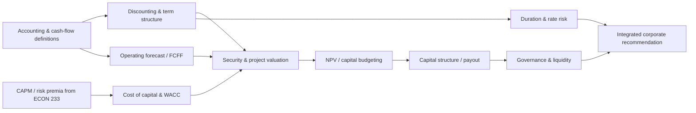

# ECON 235 — Corporate Finance

## Capital budgeting, corporate valuation, financing, and governance

**Purpose.** Apply financial theory to a firm's investment, financing, payout and governance decisions. The source basis is the supplied UCSC ECON 235 course description (capital budgeting, investment decisions, capital structure, dividends and governance) and the user's inventory (free cash flow, dividend growth, duration/maturity, NPV, operating cash flow, EBITDA, break-even analysis and the yield curve). This is a **source-informed self-study design**; no course slides, assigned chapters, company cases or assessments have been uploaded for ECON 235. Content marked **[Extension]** goes beyond the confirmed topic inventory.

[← Graduate Finance](../README.md) · [Finance I](../ECON-233-Finance-I/README.md) · [Financial Engineering](../ECON-236-Financial-Engineering/README.md) · [Risk-management playbook](../risk-management-playbook.md) · [Risk-management playbook](../risk-management-playbook.md)

**Quarter format:** 12 weeks, approximately 10–14 hours/week, with cash-flow modeling, investment cases, treasury and enterprise-risk labs, and a final investment committee defense. The complete week-by-week plan follows the core modules.

**Navigation:** [Jump to the 12-week course schedule](#twelve-week-teaching-and-assessment-plan) · [Shared risk-management playbook](../risk-management-playbook.md) · [Program knowledge map](../README.md#knowledge-map-concept-dependencies)

## Learning outcomes

Upon completion, you should be able to:

- Translate accounting statements into operating cash flows, working-capital needs, capital expenditures, and free cash flow to the firm/equity.
- Value a bond, dividend stream, project, business or enterprise with rates and cash flows defined consistently.
- Evaluate independent and mutually exclusive projects using NPV, and interpret IRR, payback and break-even without misusing them.
- Estimate cost of equity, cost of debt and a defensible, capital-structure-consistent WACC.
- Analyze operating versus financial leverage and distinguish enterprise value from equity value.
- Explain how capital structure, financial distress, tax shields and agency incentives affect financing choices.
- Evaluate dividends and share repurchases without confusing accounting earnings with available cash.
- Interpret yield-curve changes, maturity, bond duration, convexity and exposure to changing interest rates.
- Produce an investment committee memorandum that reports assumptions, scenarios, stakeholder impacts and decision rules.

## Prerequisite bridges from Finance I

Review time value of money, effective vs nominal rates, risk premia, CAPM, beta, diversification, opportunity cost, market prices and financial instrument basics in [ECON 233](../ECON-233-Finance-I/README.md). Add basic financial statement literacy: balance sheets, income statements, cash flow statements, accruals vs cash, depreciation, tax effects, debt schedules and working capital. An engineering or OR reader should not skip the accounting bridge: a precisely optimized model built on inconsistent accounting definitions is unreliable.

### Notation, cash flow and valuation consistency

- $EBIT$: earnings before interest and taxes; operating earnings after depreciation/amortization when those expenses are included.
- $EBITDA$: earnings before interest, taxes, depreciation and amortization. **EBITDA is not cash flow**: it excludes CapEx, working capital, taxes and other cash needs.
- **Net operating profit after tax** under a simplified marginal tax rate $T$:

  $$
  NOPAT=EBIT(1-T).
  $$
- **Free cash flow to the firm** in the simplified unlevered operating framework (adjust non-operating items as required):

  $$
  FCFF=EBIT(1-T)+D\&A-CapEx-\Delta NWC.
  $$
- **Free cash flow to equity** under consistent definitions (not interchangeable with FCFF):

  $$
  FCFE=NetIncome+D\&A-CapEx-\Delta NWC+NetBorrowing.
  $$
- **Enterprise value (EV)** reflects value of operations to capital providers; **equity value** is the residual after debt and other claims plus applicable non-operating assets and adjustments. Do not conflate EV and market capitalization.
- Match **nominal cash flows with nominal discount rates**, **real with real**, and cash-flow currency with discount-rate currency.

## Learning dependency map

## Structured modules

### Module 1 — Corporate objective, financial statements, and sources of value

**Questions:** What exactly does a company maximize? Who claims its cash flows? What distinguishes profit from cash?

**Concepts:** enterprise vs shareholder value; stakeholders and contractual claims; accounting profit, EBIT, EBITDA, net income, depreciation, operating cash flow, free cash flow; book vs market values; invested capital; cash conversion; governance, agency and corporate objectives.

**Core exercise:** take a simplified income statement, cash flow statement and balance sheet; reconcile net income to cash from operations and then to FCFF. Show explicitly why EBITDA is not the amount available to all capital providers.

**Application:** compare a fast-growing company with positive EBITDA but negative FCFF to a mature company with positive FCFF. Explain how growth and working capital can consume cash.

**Mastery:** explain the distinction between an accounting improvement, a working-capital release, and a genuine increase in long-run value.

### Module 2 — Interest-rate mathematics, debt instruments and yield curves

**Concepts:** discounting, compounding, spot and forward rates, coupon bonds, yield to maturity, price–yield inverse relation, maturity, term structure, reinvestment versus price risk, borrowing conventions, floating vs fixed-rate debt.

**Relationships:** For fixed coupon payments $C_t$ and face value $F$, with a yield $y$ matched to the payment frequency,

$$
P=\sum_{t=1}^{T}\frac{C_t}{(1+y)^t}+\frac{F}{(1+y)^T}.
$$

With a term structure of cash-flow-specific zero-coupon discount factors $D(0,t)$,

$$
P=\sum_t CF_t D(0,t).
$$

Specify the appropriate day-count and cash-flow timing conventions.

**Application:** price a bond using a flat yield and a non-flat discount curve. Change rates and see why a long-maturity, low-coupon security generally has greater rate sensitivity.

**Mastery:** distinguish coupon rate, current yield, yield to maturity, spot rate, forward rate and an effective borrowing cost after issuance fees.

### Module 3 — Operating forecasts, free cash flow, and terminal value

**Concepts:** sales drivers, pricing, costs, taxes, operating margins, maintenance versus growth CapEx, depreciation schedules, net working capital, reinvestment, cash-flow timing, forecast horizon, terminal value, enterprise-to-equity bridge.

**Relationships:** In a steady-state perpetuity with $WACC>g$ and consistent assumptions, terminal value is

$$
TV_T=\frac{FCFF_{T+1}}{WACC-g}.
$$

With an explicit $T$-period forecast in the usual end-of-period discrete-time setup,

$$
EV_0=\sum_{t=1}^{T}\frac{FCFF_t}{(1+WACC)^t}+\frac{TV_T}{(1+WACC)^T}.
$$

**Application:** create a five-year operating model, with a working-capital schedule and explicit maintenance/growth CapEx. Reconcile implied long-run growth to reinvestment, capacity and the economy's constraints; compare terminal growth and exit multiple methods **[Extension]**.

**Mastery:** identify why applying a high growth rate forever or mixing unlevered FCFF with cost of equity overstates value.

### Module 4 — Capital budgeting and investment decision rules

**Concepts:** sunk vs incremental cost, opportunity costs, cannibalization, taxes, depreciation shields, net working capital recovery, NPV, IRR and multiple IRRs, modified IRR **[Extension]**, profitability index, simple/discounted payback, mutually exclusive projects, equivalent annual cost/annuity, economic lives, capital rationing.

**Key rule:** For cash flows $CF_t$ and an appropriate per-period discount rate $k$,

$$
NPV=\sum_{t=0}^{T}\frac{CF_t}{(1+k)^t}.
$$

The initial cash flow $CF_0$ is often negative. Under the model's assumptions, accept independent positive-NPV projects; for mutually exclusive projects, compare NPVs while accounting for differing scale and timing.

**Application:** compare two pieces of equipment with different upfront costs and lifetimes. Calculate incremental NPV and equivalent annual cost where repeatable replacement assumptions hold. Explain when a higher IRR can accompany a lower NPV.

**Mastery:** construct a project cash-flow table without including interest expense and then discounting again at WACC (which would double count financing).

### Module 5 — Operating leverage, financial leverage, and break-even analysis

**Concepts:** fixed and variable costs, accounting and cash break-even, contribution margin, degree of operating leverage, debt-related financial leverage, margin of safety, sensitivity of profit/FCF to sales volume.

**Relationships:** For price $p$, variable unit cost $v$, and fixed operating cost $F$, with $p-v>0$,

$$
Q_{BE}=\frac{F}{p-v}.
$$

In a simple cost–volume–profit setting, the degree of operating leverage (away from break-even) is

$$
DOL=\frac{Q(p-v)}{Q(p-v)-F}.
$$

Operating leverage is a business-cost property; financial leverage relates to debt and the claims structure.

**Application:** model a company with higher fixed costs but lower variable costs versus a flexible producer. Stress demand, wages and financing rates separately. Distinguish EBIT break-even from zero free-cash-flow break-even.

**Mastery:** explain how a firm can have low debt but still face high economic risk due to fixed operating commitments.

### Module 6 — Cost of capital, CAPM, and WACC

**Concepts:** opportunity cost of capital, business versus financial risk, project beta, equity/debt market weights, tax shields, marginal cost of debt, risk-free rate and equity risk premium estimation, WACC versus APV **[Extension]**.

**Relationships:** CAPM provides an estimate of the cost of equity within its assumptions:

$$
r_E=r_f+\beta_E\left(E[R_M]-r_f\right).
$$

For a basic debt/equity capital structure with market-value weights, a usable interest tax shield and tax rate $T$,

$$
WACC=\frac{E}{D+E}r_E+\frac{D}{D+E}r_D(1-T).
$$

Financing policy, project risk and tax treatment may require adjustments.

**Application:** estimate WACC for a firm with traded debt and equity. Revalue the same operating cash flows under different risk assumptions while avoiding treating a firm's average WACC as universal for all projects.

**Mastery:** why is a project riskier than the company potentially assigned a higher required rate, even when financed from existing cash?

### Module 7 — Capital structure and financing policy

**Concepts:** Modigliani–Miller benchmark under restrictive assumptions, leverage and required equity return, interest tax shields, distress costs, debt overhang, trade-off and pecking-order theories **[Extension]**, asymmetric information, financing flexibility, covenant capacity and maturity choice.

**Derivation focus:** show why redistributing a fixed operating payoff across debt and equity does not necessarily create operating value in a frictionless no-tax benchmark, and how taxes, default costs and agency effects can change the conclusion. Distinguish equity-value effects from enterprise-value effects.

**Application:** compare an all-equity, moderately levered and highly levered firm using interest coverage, liquidity and scenario losses. Estimate the costs and benefits of added leverage rather than assuming debt always reduces WACC.

**Mastery:** identify when the tax benefits of borrowing are not fully usable or are outweighed by expected distress costs.

### Module 8 — Dividend growth, equity valuation, and payout policy

**Concepts:** dividend discount models, constant-growth Gordon model, multi-stage dividend valuation, payout ratio, retained earnings and reinvestment, dividends versus buybacks, signaling/information, payout irrelevance benchmark and practical frictions.

**Relationship:** For a sustainable constant-growth dividend stream with $r_E>g$,

$$
P_0=\frac{D_1}{r_E-g}.
$$

Growth does not create value automatically: financing, reinvestment and returns on incremental capital matter.

**Application:** value a stable dividend-paying firm and a growth company that reinvests cash. Explain when an FCFF model is more meaningful than a dividend growth model; model payout scenarios under limited cash.

**Mastery:** explain why retaining all earnings does not automatically increase firm value, and why dividends should not be modeled independently of investment and financing constraints.

### Module 9 — Governance, agency, and investment incentives

**Concepts:** separation of ownership and control, managerial incentives, agency costs, principal–agent problems, conflicts between shareholders and creditors, financing contracts, managerial option compensation, board oversight and incentive compatibility. These connect directly to the user's ECON 200 game theory and mechanism design foundations.

**Application:** analyze an executive proposal for an acquisition that increases the manager's control but has a negative expected NPV. Design a decision process using independent valuation, incentive limits and performance benchmarks.

**Mastery:** show how a corporate policy might optimize a manager's objective while reducing total enterprise value.

### Module 10 — Duration, convexity, yield curves, and asset–liability choices

**Concepts:** maturity, Macaulay and modified duration, effective duration when cash flows change with rates, DV01, convexity, refinancing risk, term-structure shapes, fixed/floating debt, interest-rate exposure and duration matching. Advanced interest-rate hedging is studied in ECON 236.

**Approximations:** For duration $D_{mod}$, convexity $C$ and an appropriately quoted yield change $\Delta y$,

$$
\frac{\Delta P}{P}\approx-D_{mod}\Delta y+\frac12 C(\Delta y)^2.
$$

For a one-basis-point parallel move, an approximate value change in price-currency units is

$$
DV01\approx P\,D_{mod}\times10^{-4}.
$$

Duration and convexity must be defined under the same yield convention; both are local approximations.

**Application:** simulate rate increases, decreases and nonparallel curve shifts for the firm's outstanding debt. Compare short fixed, long fixed and floating finance, including reset and refinancing risk. Compute duration by cash-flow weighting and verify with finite differences.

**Mastery:** why does matching duration at a point in time not fully hedge a liability when the yield curve twists or cash flows are option-dependent?

### Module 11 — Risk, liquidity, and uncertainty in corporate decisions

**Concepts:** scenario analysis vs simple one-variable sensitivity, business cycle exposure, liquidity buffers, covenant stress, hedging versus speculation, financing flexibility, risk management and value creation. Risk-neutral probability in derivatives pricing is not a company's subjective demand forecast.

**Application:** build base, upside and downside cases for operating cash flow, rates and currency. Identify which exposures are operational and which can be contractually hedged. Map hedge implementation to ECON 236 forwards, options, futures and swaps.

**Mastery:** explain why hedging a currency translation effect may not hedge long-run competitive exposure and why a hedge can create short-run collateral demands.

## Expanded corporate finance: valuation, capital allocation, treasury, and enterprise risk

The eleven core modules above develop the central theory. The next set of techniques and the weekly plan provide a **complete twelve-week graduate course**, with a treasury and enterprise-risk dimension threaded through valuation, financing, and governance. Terms such as cash-flow-at-risk, Monte Carlo valuation, real options, credit metrics, M&A and enterprise risk management are **proposed additions** beyond the specific ECON 235 topics named by the user. They are included to make the course operationally useful, not presented as documented historic lecture coverage.

### Financial statement diagnostics and quality of cash flow

A strong valuation begins with reconciled statements, not a multiple. Analyze revenue recognition, margins, working capital, cash conversion, tax cash paid versus tax provision, leases and commitments, debt maturity schedules, restricted cash, one-time charges, pensions (if relevant), contingent liabilities, and non-operating assets. Construct an **operating forecast and a debt/cash/liquidity schedule** that balance across the income statement, balance sheet and cash flow statement. State whether leases, minority interests, cash, stock-based compensation and other claims are included in EV and how each is treated in the equity bridge.

Compare ROIC with the marginal cost of capital and examine invested-capital efficiency:

$$
ROIC=\frac{NOPAT}{\text{Average invested capital}},
$$

$$
EVA\approx NOPAT-WACC\times\text{Capital invested at beginning of period}.
$$

Economic value added (EVA) is a period performance measure under these definitions, not a replacement for forecasting all future cash flows; accounting adjustments and the capital base matter. Evaluate growth as reinvestment *and* returns on new capital, rather than assuming that high revenue growth implies high shareholder value.

**Diagnostic lab:** rebuild a company's simplified operating cash flow from earnings, reconcile working capital and CapEx, calculate FCF, explain the difference between ROIC and ROE, and identify a case where positive EPS coexists with weak liquidity. Audit your terminal-value implied reinvestment rate against assumed growth and marginal ROIC.

### Better project appraisal under uncertainty

NPV is the primary valuation benchmark for incremental after-tax cash flows, but project decisions may be exposed to correlated price, volume, FX, commodity and financing shocks. Add scenario-weighted decisions, simulation, real options and staged commitments:

$$
E[NPV]=\sum_{s=1}^{S}p_s\,NPV_s,\qquad \sum_{s=1}^{S}p_s=1.
$$

**Important:** discounting scenario cash flows at a risk-adjusted rate and changing their probabilities to risk-neutral probabilities are not interchangeable operations; document the valuation framework. An expected NPV alone may not adequately describe default, liquidity or downside constraints.

**Methods to practice:** sensitivity tables; internally consistent multi-variable scenarios; break-even and switching values; decision trees with learning; Monte Carlo cash-flow distributions; probability of negative NPV; project abandonment, deferral and expansion options; mutually exclusive projects; capital rationing and integer investment decisions **[Extension]**. Derive a simple option-to-wait exercise with an investment available now versus one period later, recognizing that delay may sacrifice current revenue. Connect the option concept to ECON 236 while distinguishing real-option valuation from a fully replicable traded option.

A project hurdle rate should reflect **project business risk and the financing policy**, not simply the firm's current borrowing yield. Under a simplified APV approach, partition operating and financing value instead of mechanically changing the WACC without reconciliation:

$$
APV=NPV_{\text{unlevered}}+PV(\text{financing side effects}).
$$

Financing side effects may include tax shields, issuance costs, expected distress costs and subsidies; avoid double-counting them in operating FCF and the discount rate.

### Credit analysis, leverage, liquidity, and debt capacity

Build a lender-style view as well as an equity valuation. Distinguish cash-flow volatility, balance-sheet leverage, interest coverage, refinancing calendars, debt covenants, collateral restrictions and *access to funding*. Define the denominator and cash flows when using financial ratios; these are conventions that vary by loan agreement and industry.

For example, a simplified interest coverage and debt-service coverage ratio can be written as

$$
ICR=\frac{EBIT}{\text{Cash interest expense}},
$$

$$
DSCR=\frac{\text{Cash available for debt service}}{\text{Scheduled interest + principal}}.
$$

**Risk questions:** Can the firm survive a 20% revenue shortfall? What if refinancing spreads increase while earnings decline? Does a rate hedge reduce cash risk, or move it to collateral/margin calls? How much covenant headroom is required? How do supply-chain obligations and operating leases affect economic leverage? Do not treat one year's EBITDA as a sufficient measure of debt capacity.

**Lab:** choose three financing packages (cash, fixed debt, floating debt) and simulate base, adverse demand, rate, and combined stress cases. Report minimum unrestricted cash, interest coverage, DSCR, debt maturity concentration, debt/EBITDA with limitations, ability to pay dividends, and the break-even conditions triggering covenant violations.

### Enterprise risk management is part of financial policy

Risk management in corporate finance is about the **value and continuity of the firm**, not merely buying derivatives. Create an enterprise exposure register with the owner, underlying economic exposure, horizon, probability/severity assumptions, natural offsets, hedgeability and residual risk. Separate risks into:

| Exposure | Measurement in ECON 235 | Typical action | Residual risk needing ECON 236 tools or governance |
|---|---|---|---|
| Demand and margin | Operating leverage, forecast dispersion, cash-flow stress | Pricing, capacity flexibility, diversification | Structural demand changes and correlation across business lines |
| FX transaction and translation | Net contractual receipts/payments by currency; reporting translation | Netting, operational matching, forward/option policy | Competitive/economic FX exposure, hedge rollover and basis |
| Commodity/input cost | Cost-driver sensitivity, margin-at-risk | Purchasing contracts, inventory, commodity hedges | Basis mismatch, volume uncertainty and liquidity |
| Interest rates | Debt repricing gap, maturity wall, DV01 proxy | Fixed/floating mix, maturity policy | Curve twists, swap collateral and refinancing spreads |
| Funding/liquidity | Cash runway, revolver draw, covenants, stressed FCF | Liquidity buffer, lines of credit, staggered maturities | Frozen markets, drawdown timing and counterparty risk |
| Credit/customer/supplier | Concentrations, receivables aging, default stress | Credit terms, insurance, collateral, diversification | Wrong-way risk, disputed recoveries, payment delays |
| Strategic/operational | Scenario tree, investment milestones, key-person/supply risks | Insurance, flexible capacity, governance, contingency | Nonmarket losses and hard-to-model tail events |

**Cash-flow-at-risk (CFaR):** a quantile of the distribution of the firm's operating cash flow over a specified horizon; do not call this the same thing as a trading portfolio's VaR. If $C$ is a random operating cash-flow measure and the concern is low cash generation, a lower-tail cash threshold may be summarized as

$$
CFaR_{\alpha}=E[C]-Q_{1-\alpha}(C),
$$

where $Q_{1-\alpha}(C)$ is the lower quantile. State whether the goal is a level shortfall relative to expected cash flow, budget or debt service. CFaR depends heavily on modeled price/volume/cost joint distributions and cannot replace explicit liquidity stress scenarios.

**Hedging decision framework:** identify risk and natural offsets → select target risk budget → evaluate derivatives, insurance and operational alternatives → model carry, premiums and collateral → approve authority limits → test hedged/unhedged scenarios → monitor economic and accounting outcomes. Derivative usage may reduce earnings volatility without reducing economic risk—or reduce risk while producing accounting volatility. Distinguish economic from hedge-accounting results without assuming a particular jurisdiction's accounting rules.

### Value distribution, governance and exceptional transactions

Add an extended analysis of payouts, repurchases, dilution, employee equity options, creditor-shareholder conflicts and governance. For M&A and restructurings, separate **standalone enterprise value**, **synergies net of integration costs**, **purchase consideration**, **financing effects** and **execution risk**. Do not automatically attribute all synergy value to the bidder. Treat valuation multiples as corroborating evidence, not as independent truths.

**M&A lab:** build a basic accretion/dilution calculation alongside incremental NPV of merger synergies; explain why earnings accretion does not establish value creation. Evaluate whether a buyback funded by new debt could improve EPS while increasing expected distress costs.

### Twelve-week teaching and assessment plan

**Target workload:** 10–14 hours/week, including readings and derivations, statement/model-building practice, a corporate case, and a one-page decision memo. Suggested assessment: numerical problem sets 25%, cumulative forecasting/treasury labs 30%, Week-6 investment midterm 15%, Week-12 committee capstone 30%.

| Week | Economic and financial theory | Practical modeling assignment | Risk-management deliverable |
|---|---|---|---|
| **1** | The corporate objective, stakeholders, agency, financial statements, EBIT/EBITDA/OCF/FCFF. | Reconcile three statements; calculate ROIC and FCFF; construct EV-to-equity bridge. | Quality-of-earnings and accounting-risk note. |
| **2** | Interest rates, debt valuation, yield curves, spot/forward rates, maturity and duration. | Price a ladder of bonds using zero factors and test a nonparallel curve shift. | Debt repricing and maturity inventory. |
| **3** | Operating economics, forecasts, reinvestment, NWC, terminal value, DCF. | Build integrated five-year driver-based forecast; reconcile growth and reinvestment. | Base/downside financial forecast and cash runway. |
| **4** | Capital budgeting, incremental FCF, NPV/IRR/MIRR/EAC, tax shields and project interaction. | Compare mutually exclusive investments and an equipment replacement case. | Switching value and downside NPV. |
| **5** | Capital costs, CAPM, beta, WACC and project-specific discount rates; APV. | Calculate WACC under alternative leverage; verify with an APV case. | Sensitivity to ERP, beta, spreads and terminal growth. |
| **6** | Operating leverage, break-even, debt coverage, project financing and **midterm**. | Build contribution-margin models and a financing plan with interest and amortization. | DSCR, covenant headroom and liquidity stress memo. |
| **7** | Modigliani–Miller, tax benefits, distress, pecking order, equity/debt issue choices. | Compare three capital structures by value, risk, shareholder return and refinancing cost. | Debt maturity/refinancing stress dashboard. |
| **8** | Dividend and FCFE valuation, payout, repurchases, governance and agency conflicts. | Multi-stage DDM vs FCFF valuation and dividend/buyback scenario. | Payout sustainability under stress. |
| **9** | Advanced capital budgeting: decision trees, Monte Carlo, capital rationing, real options. | Simulate coherent price/volume/cost scenarios and value a delay/expand option. | Probability of negative NPV; cash-flow-at-risk model. |
| **10** | Treasury: FX/rates/commodities, natural hedges, insurance, contract alternatives, hedge accounting concepts. | Build an exposure register and compare forward, option and swap-linked policies. | Unhedged/hedged cash flow and collateral-liquidity report. |
| **11** | Enterprise risk management, acquisition/restructuring analysis, governance and investment committees. | Evaluate synergy NPV and acquisition financing; test combined recession/FX/rate shocks. | Board-level ERM and contingency playbook. |
| **12** | Synthesis: investment, valuation, capital structure, payout, and risk. | Submit and defend a five-year integrated model and decision recommendation. | Auditable investment-committee memo plus crisis funding response. |

**Week-6 threshold:** cash-flow definitions, debt schedules and WACC/APV methodology must reconcile. **Week-12 threshold:** a positive NPV is not sufficient; demonstrate that the strategy is financeable under defined adverse cases and that management knows which risks are accepted or transferred.

### Expanded corporate-finance capstone

Extend the existing final project to incorporate: (1) reconciled simplified historical statements; (2) five-year FCFF and FCFE reconciliation; (3) a debt-maturity and floating/fixed-rate schedule; (4) WACC/APV or project-specific discount-rate justification; (5) base, low and high economic scenarios; (6) a Monte Carlo or scenario-weighted investment distribution; (7) a risk register with owners and controls; (8) no hedge, natural hedge and at least one derivative hedge comparison; (9) debt covenants and liquidity runway; and (10) a board recommendation that explicitly values flexibility, governance and risk tolerance.

**Submission:** linked spreadsheet or notebook, model assumptions log, one-page risk dashboard, two-page valuation summary and three-page investment committee memo. Compare the action to a credible *do nothing* alternative. Do not double count hedge costs in both risk-adjusted cash flows and the discount rate.

## Synthesis: how corporate finance joins the other courses

| Corporate question | Input from ECON 233 | Tool in ECON 235 | Complement in ECON 236 |
|---|---|---|---|
| What is the required return? | CAPM, systematic risk and risk premia | Cost of equity, WACC and project discount rate | Separate hedge pricing from required corporate returns |
| Should the firm build a plant? | Uncertainty and diversification | Incremental cash flows, NPV, real/nominal consistency | Hedges for FX, rates and commodity inputs |
| Should it borrow long or short? | Bond returns and risk | Term structure, duration, financing flexibility | Swaps, futures and option-based rate protection |
| What is the value of the shares? | Risk premia and market pricing | FCFF/FCFE/DDM and equity bridge | Embedded options, warrants and convertible claims **[Extension]** |
| How should management handle risks? | Risk budgets and preferences | Liquidity, covenants, governance | Quantitative hedge ratios and stress tests |

## Modeling and quality-control checklist

- [ ] Forecast cash flows are **incremental**, after tax, and dated correctly.
- [ ] CapEx and changes in working capital are included, not substituted by EBITDA.
- [ ] Free cash flow definition is matched to discount rate and valued claim.
- [ ] Terminal growth and reinvestment economics are feasible and consistent.
- [ ] Capital structure, tax treatment and WACC assumptions are explicit.
- [ ] Values are reconciled between enterprise, debt and equity claims.
- [ ] Mutually exclusive investments are compared on NPV, not IRR alone.
- [ ] The conclusions survive material price, volume, margin, discount-rate and financing shocks.
- [ ] Liquidity, covenant, and governance risks are considered.
- [ ] A decision-maker can identify the assumptions that would reverse the recommendation.

## Final project — corporate investment and financing memo

Evaluate a proposed expansion at a fictional or public company. Build five years of operating and working-capital forecasts plus a defendable terminal value. Derive FCFF, estimate a market-based cost of capital, calculate enterprise/project NPV and compare three funding structures. Add a dividend/buyback choice and assess whether the financing plan can survive a downside revenue case and a yield-curve shock. Submit: (1) auditable spreadsheet/notebook; (2) EV-to-equity bridge; (3) scenario/sensitivity table; and (4) 2–4 page investment committee memo with decision, uncertainties and governance risks.

**Self-assessment rubric:** cash-flow mechanics 25%; valuation and rates 25%; financing/capital structure 20%; scenario robustness 15%; clarity and institutional realism 15%.

## Source and reading status

**Specified:** ECON 235 description and the listed applied topics: free cash flow, dividend models, duration, maturity, NPV, operating cash flow, EBITDA, break-even analysis, the yield curve, capital structure, capital budgeting, payout and governance. **Proposed but not specifically documented by lecture files:** APV, modified IRR, advanced valuation multiples, expanded pecking-order material, real options and quantitative hedge case designs. No claimed lecture pagination or textbook assignments appear here because the necessary materials have not been supplied.

**Next reading:** [ECON 236 Financial Engineering](../ECON-236-Financial-Engineering/README.md) develops the contracts that can hedge the interest-rate, FX, commodity and equity risks identified here.
