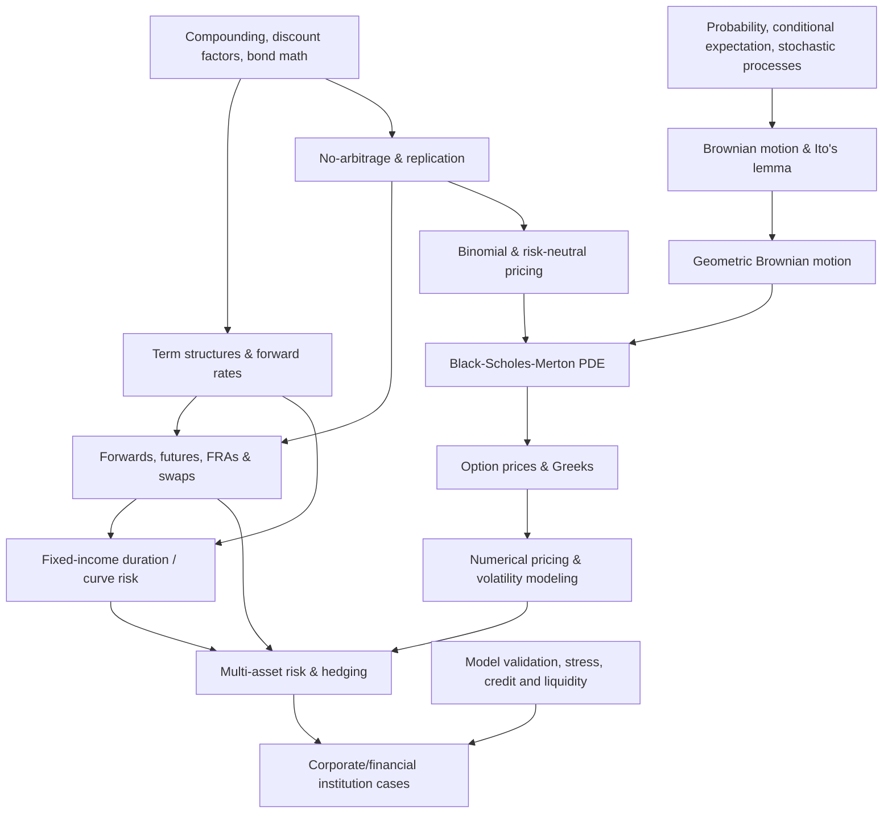

# ECON 236 — Financial Engineering

## Interest-rate mathematics, derivative securities, stochastic models, and financial risk management

**Purpose.** Develop the mathematics and economic reasoning needed to describe contingent claims, price them by no-arbitrage or consistent models, and use them to manage financial risks at corporations, banks and other institutions.

**Reading anchor:** John C. Hull, *Options, Futures, and Other Derivatives*, is the named core textbook. The user also studied **financial mathematics** and **interest-rate mathematics** texts (titles and editions not provided). This guide deliberately puts those subjects **at the beginning** and revisits them throughout the pricing and risk-management modules. Its coverage follows the supplied UCSC ECON 236 course description—interest rate, FX, commodity and equity risk; futures, forwards, options, swaps, structured notes and asset-backed securities; pricing/payoffs and corporate cases—plus explicitly named topics including Black–Scholes, Itô's lemma and stochastic processes. **No finance lecture notes, assignments, or exact book chapters were provided.** Therefore this is an advanced *proposed self-study sequence*, not a verified reconstruction of an individual course syllabus. Material marked **[Extension]** goes beyond what the brief course description confirms.

[← Graduate Finance](../README.md) · [Finance I](../ECON-233-Finance-I/README.md) · [Corporate Finance](../ECON-235-Corporate-Finance/README.md)

## The intellectual spine

Financial engineering is not a list of derivative formulas. The central progression is:

1. **Date and value cash flows:** understand rates, discount factors, compounding, no-arbitrage and contracts.
2. **Describe uncertainty:** specify payoff functions and stochastic models for underlying assets and rates.
3. **Find a consistent price:** use replication, hedging, risk-neutral valuation and numerical approximations subject to assumptions.
4. **Measure sensitivities:** quantify changes in value with spot, volatility, time, rates, curves and credit parameters.
5. **Construct hedges:** offset exposures under cost, margin, liquidity, basis and counterparty constraints.
6. **Challenge the model:** test hedging effectiveness, scenario losses, path dependence, tail risks and model breakdowns.

### Dependency map

## Entry requirements: mathematics and finance

| Area | Essential ability | Preparation if rusty |
|---|---|---|
| Discounting/interest math | Move between nominal, effective, periodic and continuously compounded rates; discount irregular cash flows | Module 1; external financial mathematics text |
| Multivariate calculus | Partial derivatives, Taylor approximations, change of variables | Refresh calculus before Itô and Greeks |
| Probability | Conditional expectation, normal distributions, stochastic independence, covariance, conditioning | Refresh measure/probability foundations as necessary |
| Differential equations | Solve basic ODEs; recognize PDE terminal/boundary-value problems | Review before Black–Scholes PDE |
| Linear algebra/numerics | Solve systems, interpolate, simulate, check convergence | Review for curves and numerical pricing |
| Finance fundamentals | Bond cash flows, forwards, investment risk and corporate exposures | ECON 233 and ECON 235 fundamentals |
| Coding | Reproducible Python, MATLAB, R or spreadsheet functions | Build basic discounting and option-payoff scripts |

**A mathematically mature reader need not arrive already fluent in stochastic calculus.** Its foundations are taught within this guide. Conversely, knowing Brownian motion is not a substitute for contract settlement conventions and economic interpretation.

## Reference conventions and assumptions

Use $t$ for valuation time, $T$ for maturity, $S_t$ for the underlying spot price, $K$ for strike/delivery price, $r$ for a continuously compounded *risk-free* rate in simplified examples, $q$ for a continuous yield/foreign-rate analogue where applicable, $\sigma$ for diffusion volatility, $W_t$ for Brownian motion, and $E_t^{Q}$ for expectation under a model's risk-neutral measure. Specify currency, calendar, payment time, day count, settlement, collateral/discount curve and compounding before performing numerical valuation.

> **Model discipline:** Black–Scholes–Merton is an idealized benchmark, not a universal empirical law. Drift assumptions, diffusion volatility, trading ability, market completeness, collateral, transaction costs, jumps, exercise features and default risk can all change a valuation or hedge strategy.

---

# Part I — Financial mathematics and contractual cash flows

### Module 1 — Compounding, annuities, discount factors, and financial equivalence

**Concepts:** simple interest, nominal rates and compounding frequency, EAR, continuously compounded rates, accumulation functions, present value, discount factors, annuities, perpetuities, amortizing loans, loan balances, internal-rate calculations, day-count and calendar conventions.

**Key formulas:** For nominal annual rate $j$ convertible $m$ times,

$$
EAR=\left(1+\frac jm\right)^m-1.
$$

For constant continuously compounded rate $r$ over year fraction $T$,

$$
D(0,T)=e^{-rT}.
$$

Discount dated deterministic cash flows using consistent discount factors:

$$
PV=\sum_i CF_{t_i}D(0,t_i).
$$

For $n$ end-of-period level payments $A$ at effective per-period rate $i\ne0$,

$$
PV=A\frac{1-(1+i)^{-n}}{i}.
$$

**Financial mathematics practice:** create a cash-flow engine that supports payment schedules, different effective/nominal quote conventions, present/future values, amortization and sensitivity to payment timing. Check a zero-rate limiting case and a cash-flow replication case.

**Why this matters:** a one-basis-point convention error across a large notional can be economically material; consistent dates and conventions are prerequisites for any pricing model.

**Mastery check:** two bonds advertise the same yield but compound on different bases. Requote them consistently and explain why price comparisons can otherwise be misleading.

### Module 2 — Fixed-income mathematics: spot, forward and yield curves

**Concepts:** zero-coupon bonds, bootstrapping a discount curve, zero/spot rates, forward rates, par coupon rates, yield to maturity, yield curve interpolation, forward rate agreements (FRAs), basis, parallel and nonparallel curve shifts, term structure interpretation, interest accrual.

**Relationships:** For continuously compounded rates, the forward rate between $T_1$ and $T_2$ is

$$
f(T_1,T_2)=-\frac{\ln[D(0,T_2)/D(0,T_1)]}{T_2-T_1}.
$$

Equivalently, in the same convention,

$$
D(0,T_2)=D(0,T_1)e^{-f(T_1,T_2)(T_2-T_1)}.
$$

**Application:** bootstrap discount factors from a hypothetical set of deposit, zero and par swap quotes under clearly stated conventions, then price a nonstandard coupon bond. Compare using a flat yield with cash-flow-specific discount factors.

**Mastery check:** explain why a high yield-to-maturity is not identical to an expected realized return; describe curve and reinvestment risks.

### Module 3 — No-arbitrage, payoff diagrams, and market mechanics

**Concepts:** arbitrage portfolios, law of one price, long/short positions, borrowing and lending, state-contingent payoffs, static versus dynamic replication, arbitrage bounds, bid–ask spreads, margin, collateral, clearinghouses and exchange versus over-the-counter trading.

**Application:** build a payoff table for cash, stock, bond, forward, call and put across multiple underlying-price scenarios. Detect when two traded combinations have identical payoffs but different initial prices; explicitly include the assumptions needed to enforce the price equality.

**Mastery check:** why does the existence of a spread, limited borrowing capacity or different funding rates change the exploitability of a theoretical arbitrage?

# Part II — Linear derivatives and interest-rate risk

### Module 4 — Forwards and futures: pricing, payoff, basis, and hedging

**Concepts:** long and short positions, delivery versus settlement, forward contract value after initiation, futures marking-to-market, convergence, basis risk, hedging effectiveness, cost-of-carry, dividends/income, foreign-currency forwards and commodity storage/convenience yields.

**Idealized benchmarks:** For a stock with known continuous yield $q$ and constant financing rate $r$,

$$
F_0=S_0e^{(r-q)T}.
$$

For currency with analogous domestic and foreign continuously compounded rates, if spot $S_0$ is quoted as **domestic currency per unit of foreign currency**,

$$
F_0=S_0e^{(r_d-r_f)T}.
$$

Commodity forward pricing additionally requires storage, income and convenience-yield assumptions and may not reduce to this simple formula.

**Application:** choose a forward hedge for a foreign-currency invoice, a futures hedge for inventory input cost and a commodity contract with meaningful basis risk. Compute profit-and-loss at expiry and mark-to-market scenarios before expiry.

**Mastery check:** distinguish spot exposure from basis exposure, and distinguish futures daily cash flows from a forward's terminal settlement.

### Module 5 — Interest-rate swaps, FRAs, and corporate rate hedging

**Concepts:** fixed-for-floating swaps, net settlement, notional principal, swap legs, par swap rate, forward rate agreements, interest-rate caps/floors, payer and receiver swaps, swap value as differences of discounted cash-flow legs, counterparty/collateral conventions.

**Valuation principle:** at initiation, an idealized par swap has approximately zero value when its fixed rate equals the appropriate rate implied by consistent discounting and forward projection. Later valuation equals the difference between present values of remaining legs. In modern collateralized settings, discounting and projection curves can differ **[Extension]**.

**Application:** a firm has floating-rate debt and wants predictable interest payments. Create a fixed-pay/float-receive swap cash-flow table, examine a +100 bp / −100 bp rate move, and describe how hedge effectiveness depends on reference indices, reset dates, credit, and cash-flow matching.

**Mastery check:** what residual risks remain after a borrower swaps floating payments for fixed ones?

### Module 6 — Bond duration, convexity, and curve exposure

**Concepts:** Macaulay/modified duration, DV01/PV01, key-rate duration **[Extension]**, convexity, immunization, asset–liability management, duration mismatch, yield sensitivity versus credit spread sensitivity, callable bond optionality.

**Benchmark approximations:** With duration $D_{mod}$ and convexity $C$,

$$
\frac{\Delta P}{P}\approx-D_{mod}\Delta y+\frac12 C(\Delta y)^2.
$$

For a one-basis-point yield move and consistent price units,

$$
DV01\approx P\,D_{mod}\times10^{-4}.
$$

For multi-curve exposures, key-rate/repricing calculations are more informative than assuming a uniform parallel yield shift.

**Application:** calculate duration and convexity from bond cash flows; check with finite differences. Build a duration-matched hedge with futures or a swap and analyze nonparallel shifts, convexity differences and basis effects.

**Mastery check:** why can a duration-neutral portfolio still lose money when interest-rate volatility or curve shape changes?

# Part III — Optionality and discrete-time valuation

### Module 7 — Options and structured payoffs

**Concepts:** European versus American exercise, calls and puts, intrinsic/time value, moneyness, payoff versus profit, put–call parity, static option strategies (covered call, protective put, bull spread, straddle), payoff decomposition of structured notes, early exercise and embedded options.

**Core payoffs:** At maturity, a European call and a European put pay, respectively,

$$
\begin{aligned}
\text{Call payoff}&=(S_T-K)^+,\\
\text{Put payoff}&=(K-S_T)^+,\\
x^+&=\max(x,0).
\end{aligned}
$$

Under a known continuous yield $q$, European put–call parity in the idealized model is

$$
C-P=S_0e^{-qT}-Ke^{-rT}.
$$

**Application:** graph payoffs and net profits for long stock, protective put, collar and short call. Include the option premium and financing explicitly; avoid mistaking a low premium for a free hedge.

**Mastery check:** why can American options be worth at least their European counterparts, and why does the optimal exercise decision depend on carry and distributions?

### Module 8 — Binomial replication and risk-neutral probabilities

**Concepts:** one-period and multiperiod trees, replicating delta and bond holdings, unique state prices in a complete binomial world, risk-neutral pricing, martingales under a change of measure, backward induction, American exercise decisions.

**One-step benchmark:** In a one-step tree, the underlying moves from $S$ to $Su$ or $Sd$ over $\Delta t$. When $d<e^{r\Delta t}<u$, the risk-neutral pricing weight is

$$
p^*=\frac{e^{r\Delta t}-d}{u-d}.
$$

The corresponding contingent payoff has price, under the usual complete frictionless model assumptions,

$$
V_0=e^{-r\Delta t}\left[p^*V_u+(1-p^*)V_d\right].
$$

**The risk-neutral weight $p^*$ is not necessarily the physical probability.**

**Application:** implement 1-, 2-, 50-, 100- and 500-step trees; compare prices with the Black–Scholes benchmark as the step count increases, and include early-exercise comparison for an American put.

**Mastery check:** explain how replication prices an option without assuming that all investors agree on the expected stock return.

# Part IV — Continuous-time finance and Black–Scholes

### Module 9 — Stochastic processes, Brownian motion, and Itô's lemma

**Concepts:** filtration and available information, random walks and Brownian motion, independent increments, conditional expectation, diffusion processes, martingales (introductory level), stochastic differential equations, quadratic variation, Itô integral and Itô's lemma.

**Canonical process:** Under geometric Brownian motion,

$$
dS_t=\mu S_t\,dt+\sigma S_t\,dW_t.
$$

For constant $\mu,\sigma$ and $W_0=0$, this implies

$$
S_T=S_0\exp\!\left[\left(\mu-\frac12\sigma^2\right)T+\sigma W_T\right].
$$

**Itô's lemma (one factor):** for smooth $f(t,S_t)$,

$$
df=\left(f_t+\mu S f_S+\tfrac12\sigma^2 S^2 f_{SS}\right)dt+\sigma S f_S dW_t.
$$

The second-derivative term arises from Brownian quadratic variation, so ordinary chain rules are insufficient.

**Application:** simulate Brownian paths and GBM paths with fixed random seeds; compare approximate sample mean/variance of log returns with theoretical values. Derive $d\ln S$ using Itô and show where the $-\sigma^2/2$ correction arises.

**Mastery check:** derive the expected price under GBM and explain the difference between drift of $S_t$ and drift of $\ln S_t$.

### Module 10 — Black–Scholes–Merton: hedging, PDE, and risk-neutral valuation

**Concepts:** delta hedging, self-financing replication intuition, no-arbitrage PDE, terminal/boundary conditions, lognormal distribution under the model, risk-neutral drift, closed-form European option prices, dividends, put–call parity and model assumptions.

**Core derivation:** Apply Itô's lemma to option value $V(t,S)$. Under continuous trading, frictionless financing, a stock with continuous yield $q$, constant $r,\sigma$, and dynamic hedging assumptions, eliminating the instantaneous Brownian shock gives

$$
V_t+\tfrac12\sigma^2S^2V_{SS}+(r-q)SV_S-rV=0.
$$

For a European call,

$$
C=S_0e^{-qT}N(d_1)-Ke^{-rT}N(d_2),\qquad
 d_1=\frac{\ln(S_0/K)+(r-q+\sigma^2/2)T}{\sigma\sqrt T},\quad
 d_2=d_1-\sigma\sqrt T.
$$

**Application:** code BSM call and put prices; test put–call parity, zero-volatility intuition (with care around limiting cases), bounds, sensitivity signs and convergence against a binomial tree. Provide both a mathematical derivation and an economic explanation of why the expected stock return $\mu$ disappears from the idealized replication price.

**Mastery check:** distinguish $Q$-measure pricing from real-world expected growth; explain why the absence of $\mu$ does **not** imply that risk is irrelevant to investment decisions.

### Module 11 — Greeks, dynamic hedging, and volatility

**Concepts:** delta, gamma, vega, theta, rho, cross-gamma/other sensitivities **[Extension]**, hedge ratios, implied volatility, realized volatility, volatility smiles/skews, discrete rebalancing, gamma P&L, transaction costs and model risk.

**Illustration:** For a Black–Scholes–Merton European call with continuous yield,

$$
\Delta=e^{-qT}N(d_1).
$$

A first-order sensitivity approximation is

$$
dV\approx\Delta\,dS+\mathrm{Vega}\,d\sigma+\rho\,dr+\Theta\,dt.
$$

For larger changes, second-order terms, including

$$
\frac12\Gamma(dS)^2,
$$

matter. Interpret $dt$ and each Greek consistently with the pricing clock and quote conventions.

**Application:** construct delta-neutral option portfolios; shock spot and volatility independently and jointly; run discrete hedging simulations to examine tracking error. Compare hedge P&L in low- vs high-volatility scenarios.

**Mastery check:** can a position be delta-neutral and still have substantial losses? Explain via gamma, vega, jumps, liquidity and rebalancing.

### Module 12 — Numerical pricing methods and model validation

**Concepts:** recombining trees, Monte Carlo under pricing measure, simulation of correlated processes, variance reduction **[Extension]**, finite-difference PDE methods **[Extension]**, least-squares American option pricing **[Extension]**, convergence tests, calibration and reproducibility.

**Application:** price the same European payoff with BSM closed-form, a convergent tree and Monte Carlo using independently implemented methods. Plot absolute error versus tree steps and Monte Carlo standard error versus simulation count. For path-dependent claims such as Asian options, explain why a vanilla closed-form result may not directly apply.

**Mastery check:** why is a numerically precise answer not sufficient evidence that the pricing model is appropriate for the underlying product?

# Part V — Risk management and additional instruments

### Module 13 — Multi-market hedging: FX, commodities, equities, rates

**Concepts:** exposure mapping by risk factor, cash-flow vs accounting exposures, hedge instrument selection, hedge ratios, minimum-variance hedge intuition, liquidity and rollover, cross-hedging, basis risk, calendar mismatch, forward versus options choice, tail-risk constraints.

**Application case A (FX):** a U.S. buyer owes a foreign-currency payment at a fixed future date. Compare no hedge, a forward, and a purchased call on the foreign currency in domestic-currency terms. Calculate total domestic-currency cost for a range of exchange rates, including premium, maturity and settlement terms.

**Application case B (commodities):** an airline-like buyer faces jet fuel price risk but hedges using a related liquid benchmark. Estimate a regression/covariance-based hedge ratio and quantify basis-risk residuals.

**Application case C (rates):** hedge floating-rate financing via a pay-fixed swap or cap, then stress credit and funding spreads separately from reference rates.

**Mastery check:** identify why a contract can be an effective market hedge but an ineffective hedge for the firm's *economic* exposure.

### Module 14 — Structured notes, credit, and asset-backed securities

**Core course-description topics:** structured notes and asset-backed securities; contract waterfall, coupons, embedded option features, tranching, credit enhancement, collateral cash flows, subordination, prepayment and default scenarios, counterparty exposure.

**Suggested analytical sequence:** decompose a structured note into bond-like promised cash flows and embedded derivatives; model how asset-backed cash flows are distributed through a simple waterfall; stress prepayments, defaults, recovery rates and collateral correlation. Do not assume a quoted yield adequately describes option, liquidity or credit risks.

**[Extension]**: credit default swaps, structural/reduced-form credit models, XVA, wrong-way risk, detailed mortgage cash-flow models and comprehensive regulatory capital are useful but not confirmed in the supplied course description.

**Mastery check:** why does tranching redistribute risk without eliminating the underlying collateral's aggregate losses?

### Module 15 — Financial institution risk, model limitations, and stress testing

**Concepts:** market risk, counterparty risk, credit risk, funding liquidity, collateral/margin risk, concentration, basis risk, model risk, scenario and sensitivity analysis, Value at Risk (VaR), Expected Shortfall (ES), historical versus hypothetical stress, backtesting **[Extension]**.

**Definitions:** for loss variable $L$, $VaR_\alpha$ is an $\alpha$-quantile of $L$. For a continuous loss distribution, $ES_\alpha$ can be characterized as expected loss in the upper $1-\alpha$ tail. Estimation requires explicit horizon, percentile, distribution assumptions and valuation model.

**Application:** aggregate simulated P&L from several contracts, show VaR/ES under a historical model and a fat-tailed stress alternative, and explain why normal-distribution approximations can miss nonlinear tail risk. Add a margin-call and liquidity stress case.

**Mastery check:** explain why a hedge that reduces daily marked-to-market volatility can increase short-term funding needs.

### Module 16 — Advanced interest-rate models and optional research track **[Extension]**

This module develops the supplementary interest-rate mathematics into an advanced financial engineering research path. It is **not claimed as confirmed ECON 236 lecture coverage**.

**Topics:** stochastic short-rate models (Vasicek and CIR), no-arbitrage term-structure consistency, risk-neutral bond pricing, calibration to the initial curve, forward-rate models (HJM), market models, cap/floor and swaption pricing, stochastic volatility/local volatility and jumps.

**Example process:** The Vasicek short rate satisfies

$$
dr_t=a(b-r_t)\,dt+\sigma_r\,dW_t.
$$

It illustrates mean reversion but permits negative rates. CIR variants have state-dependent volatility and different boundary behavior. Calibrate and assess any chosen process for the instrument and market being modeled.

**Application:** compare deterministic and stochastic-rate valuations for a long-lived rate-sensitive claim; map which assumptions explain the differences.

**Mastery check:** Why is reproducing today's yield curve not sufficient to establish that a term-structure model prices interest-rate options well?

---

## Hull-centered reading strategy (edition independent)

**Use Hull as the central spine, not as a disconnected encyclopedia.** Because no edition was supplied, the mapping below is by subject rather than invented chapter or page number. Locate the corresponding subject headings in your copy.

| Sequence | Hull topics to locate | Financial-math overlay | Produced output |
|---|---|---|---|
| Modules 1–3 | Mechanics of markets, contracts, arbitrage | Interest-rate conventions, discount factors, day counts | Cash-flow and payoff engine |
| 4–6 | Futures/forwards, interest-rate contracts, swaps | Term structure, forwards, duration/convexity | Hedge pricing and curve notebook |
| 7–8 | Option markets, strategies, binomial models | State prices, discrete compounding | Payoff plotter and tree engine |
| 9–10 | Wiener processes, Itô, Black–Scholes–Merton | Stochastic calculus, PDE tools | Independent BSM derivation and code |
| 11–12 | Greeks, volatility, numerical procedures | Approximation methods and error analysis | Hedging simulation and price-validation report |
| 13–15 | Hedging, securitization, credit/structured instruments where covered by your edition | Exposure aggregation and tail-risk math | Enterprise risk report |
| 16 | Interest-rate models and further quantitative topics if covered | Stochastic rates and yield-curve calibration | Optional research project |

**How to work a chapter:** first identify assumptions and settlement conventions; then reproduce a payoff diagram; derive the price; implement it; compare against an alternative method or limiting case; and finally describe the economic exposure that the instrument transfers.

## Core formula atlas and model interpretation

These are **model-dependent identities**, not general market laws. For assumptions, derivations and conventions, consult the respective modules.

**Discount factor** — flat continuously compounded rate:

$$
D(0,T)=e^{-rT}.
$$

**Continuously compounded forward rate** between $T_1$ and $T_2$:

$$
f(T_1,T_2)=-\frac{\ln[D(0,T_2)/D(0,T_1)]}{T_2-T_1}.
$$

**Equity forward** — known continuous dividend yield and idealized financing:

$$
F_0=S_0e^{(r-q)T}.
$$

**Currency forward** — spot quoted in domestic currency per unit foreign:

$$
F_0=S_0e^{(r_d-r_f)T}.
$$

**One-step binomial risk-neutral pricing weight** — under the stated model conditions:

$$
p^*=\frac{e^{r\Delta t}-d}{u-d}.
$$

**Geometric Brownian motion** — positive diffusion-model prices:

$$
dS_t=\mu S_t\,dt+\sigma S_t\,dW_t.
$$

**Itô's lemma** for a smooth function of GBM:

$$
df=\left(f_t+\mu S f_S+\frac12\sigma^2S^2f_{SS}\right)dt+\sigma S f_S\,dW.
$$

**Black–Scholes–Merton PDE** — frictionless continuous dynamic hedging:

$$
V_t+\frac12\sigma^2S^2V_{SS}+(r-q)SV_S-rV=0.
$$

**European put–call parity** — matched contracts and idealized assumptions:

$$
C-P=S_0e^{-qT}-Ke^{-rT}.
$$

**Bond local price sensitivity** — duration/convexity approximation:

$$
\frac{\Delta P}{P}\approx-D_{mod}\Delta y+\frac12 C(\Delta y)^2.
$$

**VaR and expected shortfall** are quantile and tail-loss measures, respectively, not equations independent of horizon, confidence level, distribution or estimation convention.

## Derivation and computation checkpoints

| Checkpoint | Minimum derivation | Independent computational check |
|---|---|---|
| Contract valuation | Replicate simple payoff using cash and underlying | Compare cash-flow tables across states |
| Term structure | Derive forward from discount factors | Reprice input bonds with bootstrapped curve |
| Option parity | Reproduce identical terminal payoffs | Verify call/put parity numerically |
| Binomial | Derive delta and $p^*$ | Convergence of multi-step tree |
| Itô | Derive $d\ln S$ for GBM | Simulated log-price moments |
| BSM | Derive delta-hedged PDE and its assumptions | BSM versus tree/Monte Carlo |
| Greeks | Differentiate analytic price as appropriate | Central finite-difference bump checks |
| Curve hedge | Calculate duration/DV01 exposure | Reprice under small and large curve shifts |
| Enterprise hedge | Map risk factor to instrument and ratio | Scenario P&L including basis and costs |

## Major distinctions to preserve

1. **Real-world vs risk-neutral probabilities.** Physical probabilities describe modeled outcomes; risk-neutral weights facilitate no-arbitrage pricing under suitable market assumptions. Their equality is not generally expected.
2. **Pricing vs forecasting.** BSM may assign a consistent arbitrage-free price without predicting a stock's expected realized return.
3. **Valuation vs P&L.** The present value of a contract differs from cash it pays on settlement, and collateral cash flows can differ from both.
4. **Hedging vs eliminating risk.** Imperfect maturity matching, volatility, basis, jumps, liquidity and credit risk produce residual exposure.
5. **Local vs global risk measures.** Delta and DV01 are local sensitivities; large or nonlinear changes require repricing and scenarios.
6. **Market price vs model value.** A calibrated price is conditional on data, conventions and assumptions; model agreement on a few instruments is not proof of correctness.
7. **Interest-rate risk vs credit risk.** Movements in a government yield curve and a firm's borrowing spread may be driven by different factors.
8. **Derivative notional vs economic loss.** Notional is a contractual reference amount, not automatically the amount at risk or contract value.

## Example case portfolio

### Case 1 — Foreign exchange hedge decision

A corporation must pay €10 million in six months. Define a domestic-currency-per-euro spot/forward convention; compare a forward hedge, a euro call, and no hedge; calculate premium-adjusted final USD costs across spot outcomes and explain opportunity costs and liquidity needs.

### Case 2 — Fixed versus floating financing

A manufacturer has floating-rate debt and wishes to limit cash-flow volatility. Analyze a pay-fixed swap, a purchased cap and an unhedged position. Use a rate curve, reset schedule and duration exposure; stress rates and funding spread independently.

### Case 3 — Options market-maker risk

Price a small European call/put book with BSM, report delta/gamma/vega, construct a delta hedge and simulate imperfect discrete rebalancing. Explain hedging slippage from transaction costs, volatility shocks and gaps.

### Case 4 — Structured-credit cash flow

Create a simplified pool of loans with scheduled repayments and losses. Allocate cash flows to senior and junior tranches under a clear waterfall and compare slow prepayment versus high-default scenarios. Discuss sensitivity to correlation and assumptions. The model is pedagogical, not a market-ready ABS valuation.

## Capstone — build a derivative pricing and risk-management toolkit

Design and document a toolkit covering a bond/discount curve, forward, fixed–floating swap, binomial option pricer, BSM European pricer, numerical Greek estimator and portfolio scenario evaluator. Apply it to a company exposed to FX, commodity and funding-rate shocks.

**Deliverables:**

1. A `conventions.md` file defining rates, dates, currency quotes, units and settlement assumptions.
2. A reproducible spreadsheet or Python/R/MATLAB notebook with independent pricing checks and unit tests.
3. Plots of option payoffs and hedge P&L, plus at least one BSM-versus-binomial convergence plot.
4. A risk register with factor exposures, hedge instruments, residual risks, margin/collateral assumptions and model limitations.
5. A 3–5 page case recommendation explaining cost-versus-protection tradeoffs and the risks that remain after hedging.

**Assessment rubric:** interest/cash-flow mathematics 20%; economic no-arbitrage reasoning 20%; stochastic/option derivations 20%; validation and numerics 15%; real-world hedge analysis 15%; clear reporting 10%.

## Suggested ten-week route, plus optional advanced work

| Week | Topic | Deliverable |
|---|---|---|
| 1 | Modules 1–2: financial math, interest rates | Discount-curve workbook |
| 2 | Modules 3–4: arbitrage, forwards, futures | Contract/payoff and hedge tables |
| 3 | Modules 5–6: swaps and bond risk | Swap and duration notebook |
| 4 | Module 7: options | Static payoffs and parity checks |
| 5 | Module 8: binomial valuation | Tree pricer and American exercise |
| 6 | Module 9: Brownian motion and Itô | GBM derivation and simulation |
| 7 | Module 10: BSM | PDE derivation, closed form and tests |
| 8 | Modules 11–12: Greeks and numerics | Hedging P&L and convergence report |
| 9 | Modules 13–15: hedging, structured claims, risk | Firm/bank scenario memo |
| 10 | Capstone integration | Validated toolkit and recommendation |
| Optional +2–4 | Module 16: stochastic interest rates | Term structure research notebook |

## Reading boundaries and future course-file integration

**Grounded in user-supplied course description:** corporate/bank market risks from FX, interest, commodity and equity markets; options, forwards, futures, swaps, structured notes and asset-backed securities; risk-management cases. **Grounded in additional user context:** Hull textbook, financial/interest-rate mathematics resources, Black–Scholes, Itô and stochastic processes. **Explicit optional extensions:** complex curve frameworks, HJM, stochastic volatility, XVA, credit derivative technicalities, detailed finite differences and regulatory risk measurement. None are labeled as official course requirements without lecture evidence.

Once lecture slides, problems and named financial math books are supplied, replace the topic-only reading crosswalk with verified book chapters, lecture pages and assignments. Preserve instructor-specific model conventions when they differ from these generic benchmarks and document those differences rather than silently revising them.
