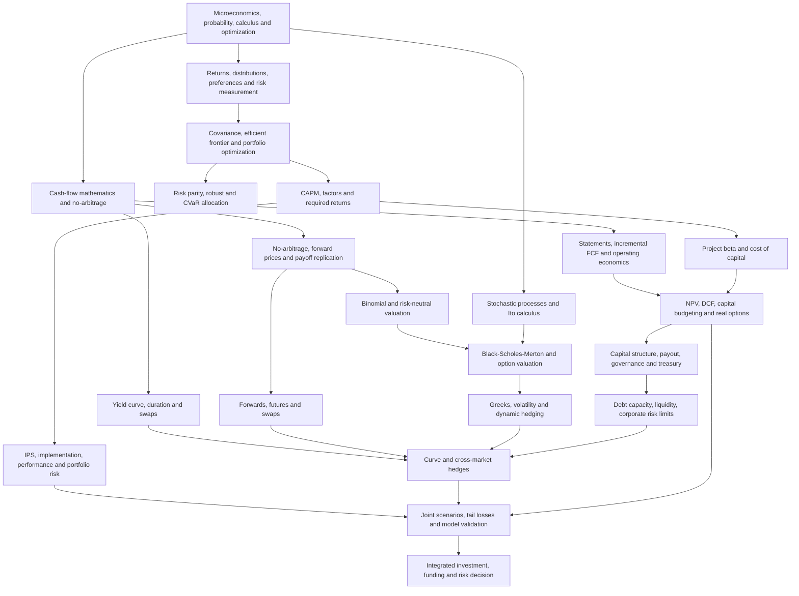

# Graduate Finance: Theory, Corporate Decisions, and Financial Engineering

> **A self-study curriculum and navigation guide** built around three UCSC graduate economics courses: **ECON 233 Finance I**, **ECON 235 Corporate Finance**, and **ECON 236 Financial Engineering**.
>
> **Scope and provenance.** The courses and representative subjects here come from the supplied UCSC course descriptions and the user's topic inventory. **Hull's _Options, Futures, and Other Derivatives_** is identified as a core ECON 236 reading; additional financial mathematics and interest-rate mathematics books were used but have not been identified by title. No ECON 233/235/236 course slides, assignments, syllabi, or textbook editions have been supplied yet. Accordingly, this is a *proposed learning architecture*, not a claim about specific lecture coverage, order, examination requirements, or textbook page numbers. Items marked **[Extension]** are recommended additions rather than verified course content.

## The purpose of this collection

This collection answers four questions, in increasing depth:

1. **What is a financial asset worth, and how should risk be measured?** (ECON 233)
2. **How should a firm invest, finance itself, and distribute value?** (ECON 235)
3. **How do derivative contracts transfer risk, and how do we price and hedge them?** (ECON 236)
4. **How can we combine these methods into a coherent, auditable financial decision?** (the integrated capstone)

The unifying principles are **time value of money, opportunity cost, risk and return, absence of arbitrage, market equilibrium, cash-flow valuation, and constraints on real decisions**. The three classes are related but not interchangeable. Asset-pricing models give required returns; corporate finance uses them to evaluate businesses and projects; financial engineering values and constructs state-contingent cash flows. Real institutions, governance, market frictions, transaction costs, liquidity, estimation error, and model limitations determine whether textbook answers remain useful.

## Start here

| Course | Central question | Primary topics | Course guide |
|---|---|---|---|
| **ECON 233 — Finance I** | How are investments and risks evaluated in markets? | Rates and returns, risky/intertemporal choice, financial institutions, diversification, Markowitz, CAPM, efficient markets, asset pricing and introductory derivatives | [Read the Finance I guide](ECON-233-Finance-I/README.md) |
| **ECON 235 — Corporate Finance** | How should firms invest and finance? | Free cash flow, capital budgeting, valuation, NPV, IRR, WACC, dividends, capital structure, leverage, governance, term structure and duration | [Read the Corporate Finance guide](ECON-235-Corporate-Finance/README.md) |
| **ECON 236 — Financial Engineering** | How are financial exposures priced, decomposed and hedged? | Interest-rate mathematics, forwards/futures, options, swaps, stochastic processes, Itô's lemma, Black–Scholes–Merton, Greeks, numerical methods, institutional risk management | [Read the Financial Engineering guide](ECON-236-Financial-Engineering/README.md) |

**Course format:** Each guide is now a **12-week graduate quarter**, with weekly outcomes, mathematical exercises, coding/valuation labs, recurring risk-management work, a checkpoint and a final assessed capstone. Sequential self-study is **36 weeks**; concurrent study is possible with the indicated prerequisites. [Use the shared risk-management playbook](risk-management-playbook.md) for definitions, controls and a cross-course case.

**Study order:** Begin with shared prerequisites, complete the foundations and portfolio sections of ECON 233, then choose either Corporate Finance or Financial Engineering. Many learners benefit from **233 → 235 → 236**. Mathematically strong readers may pursue **235 and 236 in parallel** once comfortable with discounting, risk, market instruments, and no-arbitrage reasoning. Not every concept in 235 is a prerequisite for 236.

## Knowledge map: concept dependencies

The arrows mean **builds on / provides tools for**, not necessarily course prerequisite or chronology.



[Open the standalone Mermaid source](knowledge-map.mmd) if your Markdown viewer does not render Mermaid.

## Core cross-course connections

| Shared idea | Finance I | Corporate Finance | Financial Engineering | Practical example |
|---|---|---|---|---|
| **Discounting / term structure** | Convert nominal, effective and holding-period returns; value bonds | NPV, DCF, cost of debt, investment timing | Discount factors, forward rates, swap and option valuation | Compare a floating-rate loan against fixed-rate financing |
| **Risk and required return** | Covariance, beta, CAPM, Sharpe | Estimate opportunity cost of capital, distinguish project risk from equity risk | Risk-neutral pricing and replication (not CAPM discounting) | Value a project separately from the derivatives hedging its FX exposure |
| **Diversification and leverage** | Efficient frontier, risk-return tradeoff, levered portfolios | Operating and financial leverage; bankruptcy costs | Margin, exposure aggregation, nonlinear option Greeks | Examine how debt and hedging change loss distributions |
| **No-arbitrage** | Price relationships, efficient markets (distinct concepts) | Capital structure benchmarks under restrictive assumptions | Forward prices, put-call parity, replication, option PDE | Detect an inconsistent derivative quote |
| **Optionality** | Asymmetric returns, embedded exposures | Real options in capital budgeting **[Extension]** | Calls, puts, American exercise, swaps/options | Value the flexibility to delay an investment |
| **Risk management** | Portfolio allocation and downside risk | Liquidity planning and enterprise financial policies | Delta/vega/duration hedging, stress tests | Hedge a foreign-currency purchase commitment |
| **Institutions and incentives** | Market structure, investment intermediation | Agency conflicts, governance and payouts | Margin, collateral, counterparty and model risk | Evaluate hedging under credit limits and board policies |

> **Important conceptual distinction:** An expected return or a CAPM-derived cost of equity is not the same as the **risk-neutral rate or pricing measure** used for derivatives. Corporate projects typically require a risk-adjusted valuation of uncertain business cash flows; a perfectly replicable derivative can be valued from traded prices and hedging relationships under idealizing assumptions. This distinction is tested repeatedly in the guides.

## Shared technical prerequisites

A learner arriving from economics, engineering, mathematics, physics, operations research, statistics, or accounting can use the guides. Review the following *before* the indicated stages:

| Skill | Must be able to do | First used |
|---|---|---|
| Basic finance math | Compound/discount cash flows; distinguish APR, EAR and continuously compounded rates | All three |
| Differential and integral calculus | Optimize a function; compute derivatives and marginal effects | All three |
| Linear algebra | Work with vectors, covariance matrices, quadratic forms and constrained optimization | ECON 233 |
| Probability | Conditional expectation, variance, covariance, normal distributions, expectation of payoffs | ECON 233; deepens in 236 |
| Economics | Risky/intertemporal choice, marginal utility, opportunity cost, equilibrium, imperfect markets | ECON 233 and 235 |
| Financial accounting | Reconcile revenue, operating profit, cash flow and balance sheet items | ECON 235 |
| Computational methods | Spreadsheets or Python/R/MATLAB; solve equations, simulate paths and compare assumptions | All three |
| Stochastic calculus | Brownian motion and Itô processes; not required at entry but developed in the course | Advanced ECON 236 |

**Suggested toolchain:** a spreadsheet for cash-flow schedules and checks, and Python (NumPy, pandas, SciPy, matplotlib) or R/MATLAB for portfolio matrices, simulations and numerical pricing. Use reproducible data sources, document observation dates and units, and independently verify formulas by limiting cases or alternative methods.

## Three full graduate quarters: a 36-week self-study sequence

Each course is a complete **twelve-week quarter**, not a compact six-week survey. The time budgets below are recommendations for independent study, not official UCSC meeting hours. A learner following all three consecutively should budget **36 instructional weeks**, with additional catch-up time if prerequisite mathematics or accounting is rusty. A realistic weekly pattern is: theory and textbook study (3–4 hours), derivations/problems (2–3 hours), reproducible computational or statement-modeling lab (3–5 hours), and a short risk/decision memo (1–2 hours). ECON 236 may require extra stochastic-calculus practice.

| Quarter | Weeks 1–4: foundation | Weeks 5–8: methods and models | Weeks 9–12: implementation and risk | End product |
|---|---|---|---|---|
| **ECON 233 Finance I** | Markets, rates, risk, covariance, Markowitz | Robust allocation methods, CAPM/factors, efficiency, cross-asset instruments | Performance, investment policy, portfolio-level tail risk, project | Research-grade portfolio optimizer, IPS and portfolio risk pack |
| **ECON 235 Corporate Finance** | Statements, bonds, FCFF, NPV | WACC, debt coverage, capital structure, payout | Real options, treasury hedging, ERM, investment committee | Integrated valuation/financing model and stress-tested board memo |
| **ECON 236 Financial Engineering** | Interest mathematics, curves, forwards, futures, swaps | Options, trees, Itô, BSM, full Greeks | Volatility, numerical valuation, cross-market hedging and institutional risk | Tested pricing library, dynamic hedge simulation and risk committee memo |

**Suggested midterms and capstones:** Hold an independently graded theory-and-calculation checkpoint in Week 6 for Finance I/Corporate Finance and Week 7 for Financial Engineering; reserve Week 12 for capstone defense in each course. Each course README specifies outcomes, numerical assignments, risk checkpoints, model checks and a proposed weighting rubric.

**CFA-style breadth:** Finance I now includes professionally oriented asset allocation, investment policy statements, factor exposure, security analysis, performance attribution, ethics, and downside-risk assessment. These are selected educational overlaps, **not an official CFA curriculum, accreditation or certification**. Corporate Finance adds lender/treasury and enterprise-risk methods; Financial Engineering adds a full Greeks-and-hedging lab. Proposals beyond the known UCSC descriptions remain labeled as additions.

### Risk management is the connecting thread—not a final chapter

Risk is treated differently in the three courses, while sharing one discipline:

- **233:** what could an investor lose or fail to earn relative to goals, liabilities, benchmark and risk budget? Study volatility, factor exposures, VaR/ES, drawdowns, turnover, liquidity and concentration.
- **235:** what could impair the firm's value, liquidity, ability to service debt, or strategic survival? Study downside FCFF, cash-flow-at-risk, debt capacity, refinancing, covenant stress, treasury and governance.
- **236:** which shocks move derivative values and hedge cash flows, and can the institution fund a hedge when it matters? Study Greeks, curve DV01, nonlinear stress repricing, basis, counterparty risk, margin and model limits.

The [shared risk-management playbook](risk-management-playbook.md) contains a taxonomy, common metrics, measurement limits, a unified 12-week risk progression and a cross-course corporate FX/rate case. **Every capstone should include a risk register and a written explanation of residual risk.**

## Common study protocol

For **each** module in the three guides:

1. **Define:** write precise definitions of contracts, quantities, units and assumptions.
2. **Derive:** reconstruct the central result from an optimization, cash-flow or no-arbitrage argument.
3. **Compute:** reproduce at least one numerical example and check it independently.
4. **Apply:** state a decision question, choose an appropriate model and compute the answer.
5. **Critique:** identify which assumptions, data limitations or market frictions would change the recommendation.
6. **Explain:** write a brief nontechnical interpretation of the result for a decision-maker.

Use this evidence of mastery, rather than memorizing formulas, to decide when to advance. Each course README contains modules with concepts, derivations, applications and assessment prompts.

## Integrated capstone — a company making a cross-border investment

**Scenario.** A U.S.-based company is considering a foreign manufacturing project. The initial equipment purchase is quoted in foreign currency. Future sales are partly exposed to that currency; financing can be fixed-rate or floating-rate; management wants a risk-adjusted decision rather than just a point-estimate NPV.

### Workstreams

1. **Investment opportunity (233):** measure returns on candidate benchmarks, estimate systematic exposure and build a reference efficient portfolio. Explain what diversification can and cannot eliminate.
2. **Corporate decision (235):** build operating forecasts; calculate operating cash flow, capital expenditures, changes in net working capital and **FCFF**; calculate enterprise/project NPV and compare funding choices. Be explicit about base currency and inflation consistency.
3. **Market exposures (236):** identify FX transaction risk, financing-rate risk and, if relevant, commodity-price risk. Build example hedges with a forward, option and swap. Price or value each under stated conventions; calculate hedge ratios and sensitivities.
4. **Scenario and model testing (all):** compare no hedge / forward / option / partial hedge cases for adverse exchange rates, interest-rate changes and demand shocks. Incorporate hedge costs, collateral/margin, liquidity, basis risk and counterparty assumptions.
5. **Recommendation:** provide a board-style memo: proceed/defer/reject investment; finance using which structure; hedge which exposures; report the range of outcomes, tradeoffs and key missing evidence.

**Minimum deliverables:** a cross-referenced risk register and risk limits (see [playbook](risk-management-playbook.md)); assumptions and units sheet; reproducible cash-flow model; portfolio/risk calculations; at least two independent derivative-pricing checks; scenario table; one-page executive memo. A compelling answer should reconcile the *economic exposure*, *contractual exposure* and *accounting/valuation treatment* rather than mixing them.

## Selected formulas as navigation anchors

These are orientation points; assumptions and derivations appear in the linked course guides. Standalone equations use `$$ ... $$`, while symbols within prose and tables use inline `$ ... $`.

**Effective annual return (ECON 233 / 236)**

$$
EAR=\left(1+\frac{r_{nom}}m\right)^m-1.
$$

**Portfolio variance (ECON 233)**

$$
\sigma_p^2=\mathbf w^\top\Sigma\mathbf w.
$$

**CAPM required return (ECON 233 / 235)**

$$
E[R_i]=r_f+\beta_i\left(E[R_M]-r_f\right).
$$

**Net present value (ECON 235)** — cash flows and discount rate must use consistent time periods and risk assumptions:

$$
NPV=\sum_{t=0}^{T}\frac{CF_t}{(1+k)^t}.
$$

**Unlevered free cash flow (ECON 235)** — simplified operating framework:

$$
FCFF=EBIT(1-T)+D\&A-CapEx-\Delta NWC.
$$

**Equity forward price (ECON 236)** — constant continuous rate/yield and idealized conditions:

$$
F_0=S_0e^{(r-q)T}.
$$

**European Black–Scholes–Merton call (ECON 236)** — simplified model with continuous dividend yield:

$$
C=S_0e^{-qT}N(d_1)-Ke^{-rT}N(d_2).
$$

## Readings and provenance

- **ECON 233:** user-supplied course description and coverage list (including Markowitz, CAPM, portfolio returns and efficient markets). No core textbook or assigned chapter list supplied.
- **ECON 235:** user-supplied course description and coverage list (including capital budgeting, dividend policies, cash flows, duration and governance). No core textbook or assigned chapter list supplied.
- **ECON 236:** user-supplied description; **John C. Hull, _Options, Futures, and Other Derivatives_** is the central named book. Supplementary *financial mathematics* and *interest-rate mathematics* books are acknowledged without assuming specific titles, chapters or editions.
- **Context from prior curriculum:** ECON 200 graduate microeconomics contributes risky choice, intertemporal choice and optimization. This finance set is **not** a replacement for the separate microeconomics and macroeconomics curriculum guides.

### Boundary between specified course content and additions

The guides distinguish **core topics supported by course descriptions** from **proposed study components**, and mark substantial optional additions **[Extension]**. Several essential prerequisites (including accounting mechanics in 235, numerical finance foundations in 236, and estimation diagnostics in 233) appear as preparatory instruction even when not listed in the brief descriptions. Once actual course materials are provided, replace tentative reading and problem anchors with verified references and adjust scope.

## Files and learning outputs

```text
Graduate-Finance/
  README.md                       # Program guide: 3 x 12-week quarters
  knowledge-map.mmd              # Editable cross-course Mermaid diagram
  risk-management-playbook.md    # Shared risk management and model controls
  ECON-233-Finance-I/README.md   # 12-week markets, portfolios and investments
  ECON-235-Corporate-Finance/README.md # 12-week finance and enterprise risk
  ECON-236-Financial-Engineering/README.md # 12-week derivatives and Greeks
```

All displayed standalone mathematics uses `$$ ... $$`; inline mathematical expressions use `$ ... $`. Each course provides detailed weekly deliverables and explicit boundaries between original described coverage and recommended curricular extensions.

## How to extend this repository later

Place actual materials into each relevant course folder, for example `lectures/`, `homework/`, `exams/`, and `readings/`. Do **not** invent missing page numbers or module-to-chapter mappings. When lecture files arrive, add a **verified crosswalk** connecting every module with its lecture/file, pages, assigned textbook chapters and problem-set questions, and identify sections to omit if they were not part of your curriculum.
