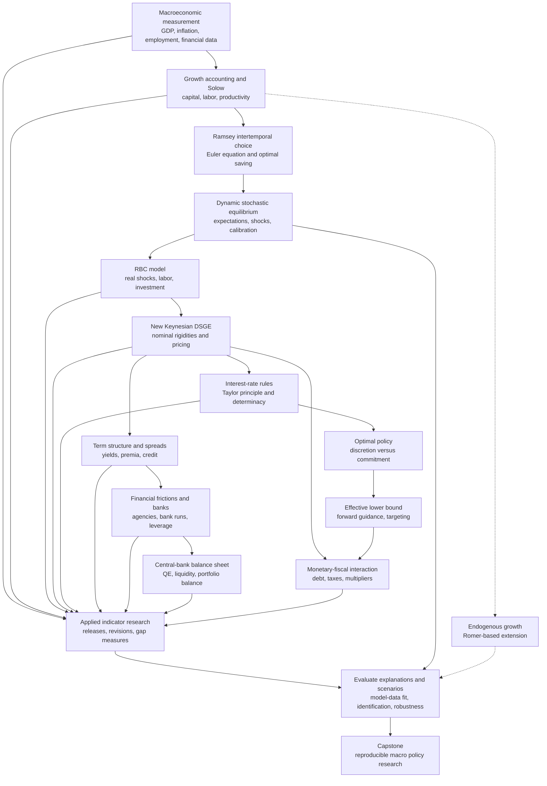

# Graduate Macroeconomics — Econ 202

**A source-based self-study guide, conceptual knowledge map, and applied research pathway**

> **Purpose.** Turn the Econ 202 lecture slides, discussion sections, assignments, and major readings into a navigable graduate macroeconomics curriculum. The aim is not to memorize models separately. It is to understand how growth, intertemporal choice, expectations, business cycles, monetary policy, financial intermediation, and fiscal policy fit together — and to connect those theories to observable economic data and defensible applied analysis.


## Navigation

- [How to use this curriculum](#how-to-use-this-curriculum)
- [Source library and reading roles](#source-library-and-reading-roles)
- [The organizing questions](#the-organizing-questions)
- [Knowledge map](#knowledge-map)
- [Prerequisites and bridge skills](#prerequisites-and-bridge-skills)
- [Learning path: modules A–N](#learning-path-modules-an)
- [Model comparison and concept-to-application crosswalk](#model-comparison-and-concept-to-application-crosswalk)
- [Hands-on research labs](#hands-on-research-labs)
- [Integrated capstone](#integrated-capstone)
- [Self-assessment and proposed schedule](#self-assessment-and-proposed-schedule)
- [Reference and reproducibility conventions](#reference-and-reproducibility-conventions)

## How to use this curriculum

The sequence is organized by **conceptual dependencies**, not simply by the order in which files happened to be packaged. Someone with a background in economics, applied mathematics, statistics, engineering, operations research, or finance should be able to enter at the right level.

Each module gives:

1. **Question:** the macroeconomic problem to explain;
2. **Concepts and mechanisms:** the economic logic;
3. **Formal toolkit:** equations and analytical or numerical methods;
4. **Connections and applications:** how the idea informs research or policy;
5. **Study tasks:** what to derive, compute, plot, explain, or critique;
6. **Sources:** the most relevant material from this folder.

Use the following markers to distinguish levels of evidence:

- **[COURSE]** Directly supported by uploaded lecture, section, homework, or examination material.
- **[CORE READING]** The Walsh/Romer books named as core readings; topical guidance rather than an edition-specific chapter assignment because those books were not uploaded.
- **[SUPPLEMENT]** The money/banking text or economic-indicator guides you described; likewise not uploaded.
- **[EXTENSION]** A motivated addition or bridge to further research, *not* represented as though it were explicitly taught in the PDFs.

**Suggested study loop:** Read the assigned slides and relevant book treatment → reproduce the derivation independently → solve the corresponding problem-set question before checking the supplied answer → simulate or visualize the result → connect the result to an actual macroeconomic time series → write down what the model cannot establish.

**End state:** A learner should be able to (i) construct and analyze a coherent macroeconomic model; (ii) interpret macro data without confusing trend, cycles, measurement, or timing; (iii) simulate well-specified shocks and policy regimes; (iv) connect theoretical mechanisms to macroeconomic and financial indicators; and (v) separate a structural story, an empirical association, a forecast, and a genuinely identified causal claim.

## Source library and reading roles

### Uploaded source files

| Source | What it contains | Primary use |
|---|---|---|
| [Econ 202 — Course Lecture Slides](<Econ 202 - Course Lecture Slides.pdf>) | Growth-rate notes; Solow/Ramsey; RBC; New Keynesian DSGE; monetary rules and optimal policy; effective lower bound; rates, credit, banks, QE, fiscal issues | Main theoretical spine |
| [Econ 202 — Section Lecture Slides](<Econ 202 - Section Lecture Slides.pdf>) | FRED/Excel, Solow problem solving, consumption–labor optimization, Dynare, RBC simulations, NK exercises, financial-friction exercises, exam review | Techniques, worked methods, computing |
| [Homework & Answers](<Homework & Answers.pdf>) | Four assignments with answers covering data, growth, Ramsey/RBC, Dynare, NK monetary policy, inflation/output gaps, term structure, financial frictions | Deliberate practice; primary checkpoints |
| [Review Questions & Exams](<Review Questions & Exams.pdf>) | Midterm and final reviews, answered exam questions, competing equilibria, policy commitment, ELB, and financial models | Retrieval practice and mastery tests |

**Important packaging detail:** The PDFs are **compiled bundles** of smaller named PDFs. Page references below are **page numbers in the compiled PDF** (counting its contents/index page as page 1), *not* the slide number printed within each individual lecture.

### Lecture map: compiled course PDF

| Compiled pages | Core subject |
|---|---|
| **2–4** | Discrete-time growth rates, logs, quarterly/annual conversions |
| **5–64** | Solow growth, growth accounting, convergence, golden rule, and Ramsey consumption choice |
| **65–103** | From Solow/Ramsey to real business cycle (RBC): households, firms, labor, equilibrium, calibration |
| **104–130** | RBC dynamics, simulation, responses to shocks, empirical fit and limitations |
| **131–165** | From RBC to New Keynesian (NK): money, nominal rigidities, imperfect competition, pricing |
| **166–179** | NK transmission, expectation channels, IS and inflation dynamics |
| **180–210** | Interest-rate rules, determinacy, optimal monetary policy, discretion, commitment, sticky wages |
| **211–235** | Effective lower bound (ELB), forward guidance, price-level and inflation targeting, unconventional options |
| **236–262** | Credit spreads, term structure, expectations theory, macro-finance factor approaches |
| **263–298** | Asymmetric information, adverse selection, agency costs, financial accelerator, banks and leverage |
| **299–332** | Bank runs and liquidity, central-bank balance sheets, QE, portfolio balance and asset-market segmentation |
| **333–351** | Monetary–fiscal interaction, government debt, fiscal shocks at the ELB, taxes, tax smoothing |

### Supporting sections and exercises

- **Section slides, pp. 2–10:** FRED add-in, transformations, Solow steady state and golden rule.
- **Section slides, pp. 11–39:** Solow dynamics, intertemporal consumption/labor, RBC, introduction to Dynare.
- **Section slides, pp. 40–63:** Risk and shocks in the RBC model, simulation and calibration interpretation.
- **Section slides, pp. 64–99:** New Keynesian policy problems, zero lower bound, Dynare modifications, term premium, financial-friction exercises.
- **Section slides, pp. 100–115:** Final review and model comparisons.
- **Homework PDF, pp. 5–6:** Assignment 1 — FRED, growth rates, output gap, price indices, volatility, Solow.
- **Homework PDF, pp. 9–10:** Assignment 2 — Solow/Ramsey and RBC simulation.
- **Homework PDF, pp. 16–17:** Assignment 3 — determinacy, NK policy, discretion/commitment, Dynare.
- **Homework PDF, pp. 26–28:** Assignment 4 — observed inflation/output/unemployment, ELB, term structure, financial frictions.
- **Exams PDF, pp. 40–48:** Winter 2017 midterm and review; **pp. 21–39:** final reviews; **pp. 2–20:** earlier course exam/review materials with additional bank, NK, and ELB problems.

These ranges are navigation aids, not a claim that every topic appears only within the indicated pages. Some slides repeat material while building models incrementally.

### Books: the hierarchy that shapes this guide

**Core readings — theory and formal derivation**

- **Carl Walsh, *Monetary Theory and Policy*.** Central-bank objectives and instruments, monetary transmission, dynamic macro models, policy rules, expectations, credibility, banking/financial transmission, and normative monetary policy. Focus most heavily here for modules G–L.
- **Romer macroeconomics text** (named in your description as “Macroeconomics — Romer & Romer”). The problem sets explicitly cite **Romer p. 46, problems 1.5 and 1.8**, tying the course to the growth-theory treatment. Use the actual edition in your library for Solow, Ramsey, growth and subsequent macro foundations; **do not assume chapter or page numbers from another edition**. The bibliography should be updated with your exact author/title/edition before publishing a precise chapter crosswalk.

**Secondary/reference readings — monetary institutions and practical interpretation**

- *Economics of Money, Banking, and Financial Markets* — institutional language around banks, central banks, credit, money, bonds, financial transmission, and crises. Use to interpret the institution behind a formal equation. **[SUPPLEMENT]**
- *The Economic Indicator Handbook: How to Evaluate Economic Trends to Maximize Profits and Minimize Losses* — organizing a current-data indicator dashboard and considering market implications. **[SUPPLEMENT]**
- *The Economist Guide to Economic Indicators: Making Sense of Economics* — release conventions, interpretation, economic measurement, leading/lagging signals and practical context. **[SUPPLEMENT]**

The book descriptions are **reading roles**, not summaries of particular editions. The indicator guides can inform research practice but are **not substitutes** for econometric identification, modern data vintages, or model validation.

## The organizing questions

A graduate macroeconomics learner should be able to reason across **five interdependent levels**:

1. **Measurement:** What are output, inflation, unemployment, productivity, spending, rates, spreads, and financial conditions telling us? What is trend versus cycle?
2. **Growth:** Why do economies accumulate capital, increase productivity, converge or diverge, and grow over decades?
3. **Fluctuations:** How do forward-looking households and firms react to uncertain shocks, and how does their behavior form an aggregate equilibrium?
4. **Policy and institutions:** How do nominal rigidities, monetary policy, fiscal policy, banking, and credit markets alter aggregate outcomes?
5. **Research and decision-making:** Which mechanisms match the observed data, which counterfactuals does the model imply, and how robust or causally credible are those claims?

Do not treat “the model predicts X” as identical to “X happened,” “policy caused X,” or “X will happen next quarter.” Those are different questions requiring different evidence.

## Knowledge map

The integrated conceptual map is reproduced below and saved separately as [`knowledge-map.mmd`](knowledge-map.mmd).

<!-- KNOWLEDGE_MAP_START -->

<!-- KNOWLEDGE_MAP_END -->

Read this map both **vertically** (foundations → integrated models → research) and **horizontally** (one data point may reflect several competing mechanisms). For example, a rise in long-term yields could arise from higher expected future policy rates, higher inflation expectations, or a larger term premium; those mechanisms have different policy and investment implications.

## Prerequisites and bridge skills

### Economic foundations

- Supply and demand, competitive equilibrium, marginal analysis, production functions, intertemporal budget constraints, and the distinction between nominal and real variables.
- Household utility maximization and firm profit maximization; Euler equations; the difference between individual optimality and aggregate equilibrium.
- The distinction between a **technology or demand shock**, a **policy rule**, and a **policy shock**.

### Mathematical and computational foundations

| Skill | Why it matters | Minimum exercise |
|---|---|---|
| Calculus and constrained optimization | FOCs for households, firms, policymakers | Derive the Euler equation from a two-period objective |
| Linear algebra and difference equations | Dynamic systems, state transitions, stability | Analyze a scalar AR(1); interpret eigenvalues of a linear system |
| Probability and conditional expectation | Uncertainty, rational expectations | Compute an expected next-period outcome conditional on a shock |
| Logarithms and Taylor approximations | Growth and log-linearized DSGE equations | Compare exact and approximate quarterly growth |
| Statistics/time series | Volatility, persistence, cross-correlations, transformations | Plot two inflation definitions; compare sample variability |
| Computing in Matlab/Dynare or an equivalent environment | Simulation, impulse responses, sensitivity | Run an AR(1), then a basic equilibrium model |
| Data handling | Historical series, units, vintages, revisions | Reproduce a GDP/output-gap/recession chart from dated data |

**Notation warnings.** A growth rate is not a level. An annualized quarterly change is not a year-over-year change. A nominal rate is not a real rate. A model’s natural output level is not necessarily the same as a statistical agency’s published potential GDP estimate. A negative output gap is not the same as negative GDP growth.

## Learning path: modules A–N

### Module A — Reading macroeconomic data: growth, prices, labor and cycles **[COURSE]**

**Question:** Before choosing a model, what does the data actually show?

**Concepts.** GDP and its components; real versus nominal output; consumption, investment and productivity; CPI/PCE/GDP-deflator inflation; unemployment; potential output and output gaps; recessions; level versus growth; trend versus cyclical deviations; seasonal adjustment; frequency and annualization; historical revisions and data vintages.

**Formal toolkit.** If `X` is positive, a one-period continuously compounded growth rate is approximately `Δ ln X`. For quarterly observations:

- **Quarter-over-quarter annualized (approximate) percentage rate:** `400 × [ln(X_t) − ln(X_{t−1})]`.
- **Year-over-year log percentage change:** `100 × [ln(X_t) − ln(X_{t−4})]`.
- **Log percentage output gap:** `100 × [ln(Y_t) − ln(Y*_t)]`, where `Y*` is a specified potential-output estimate.

These conventions must always be labeled: “4% inflation” is ambiguous if the reader does not know whether it is month-on-month annualized, quarter-on-quarter annualized, or year-over-year. The annualized log-change expression is an **approximation** to exact compounded growth.

**Applications.** Building a recession/expansion dashboard; evaluating productivity developments; studying inflation persistence; interpreting real activity against potential output; measuring the Great Moderation; preparing a macro briefing.

**Study tasks.**

1. Download real GDP, potential GDP, CPI, PCE, investment, consumption, unemployment, and recession indicators from FRED (or another documented source).
2. Reproduce the *Homework 1* output gap, annualized and year-over-year inflation charts; shade recessions.
3. Compare volatility across the three historical subsamples in the assignment. Explain why the sample definition matters.
4. Write a 250-word economic interpretation distinguishing measurements from possible causes.

**Sources.** Course pp. 2–14; section pp. 2–7; Homework 1 pp. 5–6 (answers pp. 2–4). The section demonstrates an older FRED Excel add-in; use the current official download/API method if that add-in no longer works. **Mastery:** correctly convert frequencies and explain how the same inflation data can generate different-looking charts.

### Module B — Neoclassical growth: Solow, balanced growth and the golden rule **[COURSE]**

**Question:** What drives long-run output per worker, and what can higher saving accomplish?

**Concepts.** Aggregate production `Y = F(K, AL)`; capital, labor and labor-augmenting technology; diminishing marginal product; effective labor; capital deepening; investment versus break-even investment; steady state, balanced growth, convergence; growth accounting and total factor productivity (TFP); golden-rule capital.

**Formal toolkit.** In a basic Solow model with per-effective-worker capital `k = K/(AL)` and `y = f(k)`:

```text
K_(t+1) = (1 − δ) K_t + s Y_t

k_(t+1) = [(1 − δ) k_t + s f(k_t)] / [(1 + n)(1 + g)]
```

The lecture's commonly used first-order approximation sets steady-state investment against `(δ + n + g)k`. Golden-rule steady-state consumption is maximized at approximately `f'(k_GR) = δ + n + g`. Distinguish **a higher steady-state level** following increased saving from **a permanently higher long-run growth rate**, which the basic exogenous-technology model does *not* generate.

**Applications.** Capital accumulation and development; cross-country income comparisons; demographic transition; productivity slowdown; infrastructure investment; decomposition of output growth.

**Study tasks.**

1. Derive the capital accumulation law in aggregate and intensive form, making the exact-versus-approximate distinction explicit.
2. Solve the steady state for a Cobb–Douglas production function; trace the effects of saving, population growth, technical progress, and depreciation.
3. Derive the golden rule; explain why it need not coincide with decentralized household choices.
4. Calculate growth-accounting contributions from capital, labor, and the productivity residual, and list reasons the residual is not a pure measure of technology.

**Sources.** Course pp. 5–45; section pp. 8–10; Homework 1 growth questions and Homework 2 Q1–2; midterm review. **Mastery:** separate transitional changes in growth from changes in long-run growth.

### Module C — Ramsey optimal saving and intertemporal equilibrium **[COURSE]**

**Question:** What changes when the saving rate is chosen optimally by forward-looking households rather than imposed from outside the model?

**Concepts.** Lifetime utility; subjective discounting; intertemporal substitution; consumption smoothing; marginal utility; no-Ponzi/transversality logic; competitive factor prices; Euler equation; the coevolution of consumption and capital; Ramsey steady state versus the Solow golden rule.

**Formal toolkit.** For the simple two-date/representative-household case, with utility `u(c)` and gross return `R`, the Euler condition has the form

```text
u'(c_t) = β E_t[R_(t+1) u'(c_(t+1))]
```

In a frictionless capital model the return can be `R_(t+1) = 1 + f'(k_(t+1)) − δ`, after accounting consistently for units, growth normalization, and timing. Under CRRA preferences, `u'(c) = c^(−σ)`, so consumption responds to expected intertemporal returns and the elasticity of intertemporal substitution. **Use the course's precise normalized Euler equation when solving its assignments**: population/technology scaling and the course's `r_k*` notation matter.

**Applications.** Life-cycle consumption; responses to permanent versus transitory income changes; interest-rate sensitivity; long-horizon investment; welfare analysis of capital accumulation; foundations for DSGE models.

**Study tasks.**

1. Write the lifetime objective and resource constraints; derive the consumption Euler equation.
2. Interpret an increase in impatience or curvature of utility; determine implications for steady-state capital, keeping the course's assumptions clear.
3. Draw a phase diagram or analyze a discrete transition path for capital and consumption.
4. Compare Solow's exogenous saving rule and Ramsey's endogenous consumption plan.

**Sources.** Course pp. 46–64 and review pp. 65–69; section pp. 11–25; Homework 2 Q3 and relevant answers. **Mastery:** explain why expected future incentives move current consumption.

### Module D — Endogenous growth and the source of sustained productivity change **[CORE READING / EXTENSION]**

**Question:** If the basic Solow model takes sustained technological progress as exogenous, what could determine the rate of innovation or knowledge accumulation?

**Scope warning.** You identified **endogenous growth** as part of the broader Romer/Walsh reading program. The **uploaded 2017 lecture slides do not visibly develop a self-contained endogenous-growth unit**, so this module is intentionally labeled a *textbook-led extension*, not attributed to a specific lecture or problem set.

**Concepts.** The limits of decreasing returns; `AK`-type growth as a benchmark; human capital and knowledge accumulation; non-rival ideas and spillovers; research incentives, intellectual property, scale effects and institutions; transitional versus persistent productivity growth.

**Formal toolkit.** Explore the simple benchmark `Y = AK` with `K_(t+1) = (1 − δ)K_t + sAK_t`, then explain why endogenous growth requires different assumptions than neoclassical diminishing returns. Progress, with the Romer text in hand, toward an explicit model of knowledge creation, R&D or human-capital externalities. Do not conflate the **Solow residual**, actual innovation, and endogenous technical change.

**Applications.** Innovation policy, education, productivity differences, R&D subsidies, knowledge spillovers, patent design, long-run development, and the interaction of technology with institutions.

**Study tasks.** Compare steady-state implications of Solow and a simple endogenous-growth model. Specify which policy intervention can affect a *growth rate* rather than a *level* and what assumptions drive the answer. **Mastery:** explain which exogenous-growth assumption is being relaxed and what is gained or lost in doing so.

### Module E — Dynamic stochastic general equilibrium: the bridge to RBC **[COURSE]**

**Question:** How do optimizing economic agents and random disturbances jointly determine the time paths of aggregate variables?

**Concepts.** Dynamic general equilibrium; stocks versus flows; endogenous versus exogenous variables; state and control variables; conditional expectations; equilibrium and steady state; shocks and stochastic processes (`z_t = ρz_(t−1) + ε_t`); stationarity; persistence; log deviations; calibration; numerical solution; impulse response functions (IRFs); second moments and forecast error interpretation.

**Formal toolkit.** Derive a dynamic equilibrium by combining:

1. **Household optimality:** consumption and labor supply Euler/intratemporal conditions.
2. **Firm optimality:** factor prices equal marginal products under competition.
3. **Resource and capital accounting:** output allocated among consumption/investment; capital carries forward.
4. **Shock process:** an explicit law of motion for total factor productivity or demand.
5. **Market clearing:** household/firms' plans form one internally consistent path.

Choose normalization and timing conventions, solve the deterministic steady state, then log-linearize or use a numerical solver. Dynare is software for solving specified systems, **not** a substitute for a valid economic model.

**Applications.** Counterfactual shock experiments; policy scenario analysis; understanding persistence; testing a proposed mechanism against observed comovement and volatility.

**Study tasks.** Write down all unknowns and equations and confirm the model is not under- or over-specified; calculate the steady state; generate IRFs; change `ρ` and explain the resulting persistence; distinguish an equilibrium response from a reduced-form forecasting relationship.

**Sources.** Course pp. 65–103; section pp. 21–39; Homework 2's RBC/Dynare questions. **Mastery:** clearly explain the role of each equation before running the model.

### Module F — Real business cycle model: an equilibrium theory of fluctuations **[COURSE]**

**Question:** How far can productivity shocks, optimizing labor supply and capital adjustment explain observed business cycles?

**Concepts.** Technology-shock transmission; labor–leisure choice; wage and rental-price determination; investment volatility; consumption smoothing; persistence; RBC calibration; comovement; impulse responses; model moments; competing shock processes; critiques of the standard RBC mechanism.

**Formal toolkit.** Start with `Y_t = exp(z_t) K_t^α N_t^(1−α)`; combine the household Euler and labor-supply FOCs, factor-price conditions, resource constraint, capital accumulation and technology AR(1). Calculate deviations around steady state, solve numerically, and inspect the IRFs of `Y`, `C`, `I`, `N`, and real wages.

**Applications.** Assessing productivity explanations for recessions; identifying when an investment slump or labor-market response is hard to reconcile with a simple real-shock model; providing the real equilibrium benchmark for New Keynesian models.

**Study tasks.**

1. Solve the base RBC model with the supplied Dynare exercise; save the baseline simulation and IRFs.
2. Change productivity shock persistence and compare **investment-to-output volatility** and the shape of output IRFs, as requested in Assignment 2.
3. Change labor-supply elasticity and interpret the real-wage versus employment response.
4. Write a one-page critique: which empirical business-cycle regularities does the simple RBC model reproduce, and where does it struggle?

**Sources.** Course pp. 65–130; section pp. 21–63; Homework 2 pp. 9–10; midterm questions pp. 43–48. **Mastery:** explain why real models can generate cycles but have limitations in accounting for short-run monetary policy effects.

### Module G — From RBC to the New Keynesian DSGE model **[COURSE]**

**Question:** Why can monetary policy affect real output and employment if prices, wages, and market allocations are not perfectly flexible?

**Concepts.** Nominal versus real neutrality; money, bonds and interest rates; monopolistic competition and differentiated goods; price-setting power; sticky prices and Calvo-style staggered adjustment; real marginal cost; the natural or flexible-price equilibrium; output gap; household intertemporal demand; expectations-augmented inflation dynamics; the New Keynesian Phillips curve (NKPC).

**Formal toolkit.** The frequently used **three-equation NK model** is:

```text
x_t = E_t[x_(t+1)] − (1/σ) [i_t − E_t[π_(t+1)] − r^n_t]
π_t = β E_t[π_(t+1)] + κ x_t + u_t
policy rule for i_t = f(inflation, output gap, shocks, ...)
```

Here `x_t` is an output gap relative to the **flexible-price model's** benchmark; `π_t` inflation; `i_t` the policy nominal rate; `r^n_t` the natural real rate; `u_t` an inflation/cost-push shock; `β` intertemporal discounting; `σ` and `κ` depend on preference, production, and price-setting parameters. This is a **linearized, assumption-dependent** representation; the coefficients have economic content, not arbitrary curve slopes.

**Connections.** RBC supplies forward-looking optimization and real technology shocks. The NK model adds imperfect competition and nominal rigidity, so changes in nominal interest rates can change **expected real borrowing costs** and thus demand and output before prices adjust. Inflation also has welfare costs when infrequently adjusting firms charge different relative prices.

**Applications.** Inflation–activity tradeoffs; recessions driven by deficient demand; effects of nominal interest rates; interpreting policy shocks against supply shocks; inflation expectations and central-bank communication.

**Study tasks.** Derive or explain the IS relationship from a household Euler condition; connect pricing frictions to the NKPC; distinguish movement of the flexible-price output level from movement of the actual output gap; simulate an aggregate demand shock and an inflation/cost shock and explain why policy tradeoffs differ.

**Sources.** Course pp. 131–179; section pp. 64–80; Homework 3 pp. 16–17. **Mastery:** move fluently between household/firm optimization, the compact equations and a diagram of their macro consequences.

### Module H — Monetary policy rules, determinacy, discretion and commitment **[COURSE]**

**Question:** Which interest-rate rules stabilize the economy, and why can a credible commitment outperform discretionary optimization?

**Concepts.** Policy instrument and target; systematic response versus monetary shock; Taylor principle; rational-expectations determinacy; equilibrium selection; inflation targeting; policymaker welfare-loss function; time inconsistency; discretionary optimization; Ramsey/commitment policy; history dependence; credibility; price dispersion and welfare.

**Formal toolkit.** A simple interest-rate feedback rule is

```text
i_t = r^n_t + φ_π π_t + φ_x x_t + v_t
```

In the basic setup, a sufficient-in-context intuition behind the **Taylor principle** is a response to inflation large enough to increase the **real** interest rate when expected inflation increases (`φ_π > 1` in the canonical simplified case). More general models have additional determinacy conditions: do not treat `>1` as a universal theorem for every policy rule.

A common loss function is proportional to `E_t Σ β^j [π_(t+j)^2 + λ x_(t+j)^2]`. Optimal policy is found subject to the private-sector IS and Phillips relations. **Commitment** matters because announced future policy can shape today's private expectations; a credible policymaker must later honor the earlier plan.

**Applications.** Interest-rate reaction functions; central-bank credibility; inflation persistence; why aggressive stabilization of inflation may increase output-gap volatility; rules versus discretion; monetary policy communication and expectations management.

**Study tasks.** Solve the simplified NK model under different inflation-response coefficients; identify when an equilibrium may be indeterminate; derive the discretion targeting condition in Homework 3; contrast commitment first-order conditions and their history dependence; produce comparative IRFs in Dynare for a policy-rule shock, natural-rate shock and cost-push shock.

**Sources.** Course pp. 180–210; Homework 3 pp. 11–17; Exams PDF pp. 2–8 and 21–39. **Mastery:** explain why a lower nominal policy rate does **not** guarantee easier monetary conditions when expected inflation falls even further.

### Module I — Effective lower bound, expectations and unconventional policy **[COURSE]**

**Question:** What changes when the conventional nominal interest-rate instrument is constrained close to zero?

**Concepts.** Effective/zero lower bound (ELB/ZLB); the expected real rate; disinflation/deflation feedback; liquidity-trap-style demand weakness; forward guidance; expected duration of the lower-bound episode; credible promises; price-level targeting; nominal GDP targeting; raising the inflation target; central-bank balance-sheet instruments as a separate channel.

**Formal toolkit.** In the NK IS relation, current demand responds to `i_t − E_t π_(t+1)` and to expected future output. If `i_t` cannot fall further, weaker expected inflation can **raise the expected real rate** even while the nominal rate is unchanged. A simple two-state model assigns probability `q` to remaining at the ELB next period and uses `E_t x_(t+1) = q x^Z + (1−q) x^N`, similarly for inflation. It provides a transparent demonstration of expectation amplification; it is not an empirical estimate of an actual crisis.

**Applications.** Deflationary recessions, policy announcements and expected durations, exit strategies, the logic of make-up strategies such as price-level targeting, and why the fiscal multiplier may differ when policy rates are constrained.

**Study tasks.** Solve the two-state ELB problem in Homework 4/review materials, graph its IS/Phillips relationships and change `q`; interpret the policy mechanism rather than only algebra. Contrast the forward-guidance channel (future short rates and expected inflation) with QE/market-segmentation mechanisms (asset prices and spreads).

**Sources.** Course pp. 211–235; Homework 4 pp. 26–28; Exams PDF pp. 2–8 and 21–39. **Mastery:** clearly trace an expectations shock into today's real interest rate, inflation and output.

### Module J — Credit spreads, yield curves and macro-financial transmission **[COURSE]**

**Question:** How do policy rates translate into the broad interest rates that actually govern consumption, investment and asset prices?

**Concepts.** Policy short rate versus market lending rate; nominal versus real yields; credit spread; yield curve; expectations theory of the term structure; risk and term premiums; inflation expectations; term structure factors (level, slope, curvature); affine macro-finance representations; model-implied versus observed yields.

**Formal toolkit.** The expectations-hypothesis benchmark links an `n`-period yield to an average of expected future short rates. In realistic settings, allow an additional **time-varying term/risk premium**. A borrowing rate may be written conceptually as `policy/benchmark rate + credit/intermediation spread`, with careful attention to maturity, risk and nominal-versus-real measurement.

**Connections.** The NK IS curve often uses one short-term rate, yet actual household mortgages and corporate funding depend on longer maturities and credit markets. An unchanged central-bank rate can coincide with tightening financial conditions if lending spreads increase. The yield curve contains market-implied expectations **and premiums**, which cannot be separated just by reading its slope.

**Applications.** Monetary transmission, corporate borrowing conditions, mortgage markets, yield-curve interpretations, recession indicators and financial stress dashboards.

**Study tasks.** Graph yields at different maturities; decompose changes into candidate expected-path and premium components; modify the NK/Dynare example to include a longer-term borrowing rate or exogenous term-premium shock; identify what extra data are necessary to discriminate among explanations.

**Sources.** Course pp. 236–262; Section slides pp. 81–94; Homework 4 pp. 26–28. **Mastery:** avoid the fallacy that every bond-yield increase implies the market expects tighter future policy.

### Module K — Information frictions, adverse selection and the financial accelerator **[COURSE]**

**Question:** Why can the volume or price of credit move in ways that ordinary frictionless equilibrium models cannot capture?

**Concepts.** Adverse selection; moral hazard; collateral; agency costs; limited commitment; costly state verification; credit rationing; external finance premium; borrower net worth; accelerator effects; lender/borrower payoff asymmetries; financial constraints as amplification mechanisms.

**Formal toolkit.** Contrast the borrower payoff from a risky investment with the lender's limited upside and downside exposure in a debt contract. Then add incentive-compatibility or participation constraints to the agent's optimization problem. The relevant lending spread is not merely an exogenous interest-rate wedge: it can depend on leverage, expected default, balance sheets and collateral. Financial accelerator logic links weaker net worth to tighter finance, weaker investment and further pressure on balance sheets.

**Applications.** Credit crunches, small-business funding, asset-price declines, bank lending standards, investment collapses, and the transmission of financial shocks into output.

**Study tasks.** Recreate the adverse-selection threshold diagrams; solve a simplified risky-loan example under alternative loan rates and collateral; derive how lender information or borrower net worth affects the external finance premium; explain how the shock can feed back into the real economy.

**Sources.** Course pp. 263–298; section pp. 90–99; Homework 4 and the finance questions in Exams PDF pp. 2–5. **Mastery:** specify the exact friction that prevents a standard arbitrage/equilibrium argument from going through.

### Module L — Bank runs, central-bank balance sheets and quantitative easing **[COURSE]**

**Question:** How do maturity mismatch and financial-market structure affect liquidity provision and nonstandard monetary operations?

**Concepts.** Maturity transformation; liquid deposits against illiquid assets; Diamond–Dybvig bank-run logic; strategic complementarities and multiple equilibria; financial stability; lender of last resort; asset purchases; reserve and asset-side balance-sheet mechanics; portfolio balance; preferred habitat; market segmentation; Modigliani–Miller-type neutrality assumptions and their failure.

**Formal toolkit.** In a bank-run model, distinguish **solvency** (can assets repay in present value?) from **liquidity** (can claims be met *when due*?). Show why early withdrawals can impose costs on remaining depositors and generate self-fulfilling runs. In QE analysis, compare an economy in which assets are effectively perfect substitutes with one in which maturity segmentation or pricing wedges make the composition of publicly held assets consequential.

**Connections.** Rate policy affects the price of short funds; bank balance sheets govern credit supply; QE may influence term/risk premiums even near the ELB if asset substitutability is imperfect. Not every central-bank asset expansion is equivalent to an equal-sized increase in bank lending or aggregate spending.

**Applications.** Liquidity crises, deposit insurance logic, central-bank emergency facilities, QE, bank capital regulation and financial stability assessment.

**Study tasks.** Work through the simplified bank-run numerical example; draw a bank and central-bank balance sheet before and after a transaction; explain when an asset swap is neutral, and identify assumptions necessary for a real portfolio-balance effect; interpret the broader macro implications of impaired credit supply.

**Sources.** Course pp. 283–332 (bank incentive model from pp. 283 onward; runs and QE pp. 299 onward); Exams PDF pp. 2–5. **Mastery:** distinguish bank lending, reserve creation, long-term yield transmission, and the general-equilibrium response of inflation/output.

### Module M — Fiscal policy, government debt and monetary–fiscal interactions **[COURSE]**

**Question:** How do public spending, debt issuance and taxation interact with household behavior and central-bank policy?

**Concepts.** Government resource and intertemporal budget constraints; Ricardian equivalence assumptions; seigniorage and unpleasant monetary arithmetic; monetary versus fiscal dominance; fiscal shocks and output/consumption; multipliers conditioned on monetary response; fiscal effects at the ELB; distortionary taxes and tax smoothing.

**Formal toolkit.** Add government purchases to the resource constraint `Y = C + I + G`, with the appropriate model-specific normalization. Determine how spending affects aggregate demand, labor supply, marginal cost and the NK equations. Examine government debt using an **intertemporal budget identity**; financing arrangements and expected future taxes can change behavior even if current spending is unchanged.

**Connections.** An exogenous increase in `G` is not the same thing as an unanticipated, financed, implemented policy with known monetary accommodation. The response depends on household expectations, the central bank's rule, distortionary taxes, shocks and whether nominal rates are constrained. Fiscal–monetary consistency matters over time.

**Applications.** Stimulus packages, debt sustainability scenarios, fiscal multipliers, funding of public programs, taxes during crises and policy coordination.

**Study tasks.** Derive the simple resource-constraint and marginal-cost consequences of government spending; trace a fiscal shock through IS and Phillips equations; compare an unconstrained policy-rate regime with an ELB regime; explain the assumptions behind an equivalence or non-equivalence claim.

**Sources.** Course pp. 333–351; Walsh core reading and relevant Romer treatment. **Mastery:** identify how fiscal effects depend on the *whole policy regime*, not spending alone.

### Module N — Economic indicators as an applied research discipline **[COURSE + SUPPLEMENT + EXTENSION]**

**Question:** How do we convert formal macroeconomic theory into a research product that is timely, reproducible and appropriately uncertain?

**Core relationship.** Theory tells you **why** a variable might move. Economic indicators tell you **what was measured**, **when it was measured**, **how it was revised** and **whether the proposed mechanism is plausible**. Forecasts and causal policy evaluations require additional methods and evidence.

**Indicator groups and model links:**

| Indicator family | Examples to study | Model connection | Typical ambiguity |
|---|---|---|---|
| Real activity | GDP, industrial production, consumption, investment, retail sales | Solow, RBC, NK demand | Trend, cycle, inventories, revisions |
| Labor | Unemployment, payrolls, hours, wages, participation | RBC labor supply/demand, NK output gap | Supply versus demand; composition |
| Prices | Headline/core CPI, PCE, producer prices, inflation expectations | Phillips curve, policy reaction | Temporary relative-price effects vs persistence |
| Growth capacity | Productivity, capital, labor-force growth, R&D | Solow/Ramsey, endogenous growth | Cyclical productivity vs technological trend |
| Monetary policy | Short rates, target range, expected rate path | Taylor rules, NK IS, commitment | Stance depends on real rate and expectations |
| Treasury markets | Yield curve, real yields, breakevens, term premium | Term structure, policy expectations | Premium shifts vs expected short rates |
| Credit and banking | Spreads, loan growth, standards, liquidity, capital | Accelerator, bank constraints, QE | Credit demand vs credit supply |
| Public finance | Spending, taxes, deficits, debt service | Fiscal–monetary interaction | Automatic stabilizers vs discretionary policy |
| Expectations | Surveys, market prices, confidence | Euler equations, NK forward-looking terms | Pricing of risk vs central expectations |

**Applied workflow.** Begin with a question and two or three rival theoretical mechanisms; choose indicators only after identifying their expected sign, lag, and relevant transformation; document data releases and revisions; compare the observed movement to a baseline; test alternative explanations; show what would change your conclusion. A single surprising release is rarely enough to establish a structural regime change.

**Study tasks.** Prepare a two-page monthly/quarterly macro dashboard with labeled data vintages; produce at least one model-linked chart per channel; write a scenario tree with explicit monitoring triggers; separate observations, explanations, forecasts and recommendations in different paragraphs. Where appropriate, use the indicator handbooks for publication context and conventions **[SUPPLEMENT]**.

**Causal analysis as a follow-on [EXTENSION].** The source PDFs teach structural mechanisms, calibration, historical correlations, simulation and selected policy counterfactuals. They do **not** constitute a full modern empirical-causal-identification course. For credible estimates of *actual policy effects*, add a dedicated identification method (e.g., externally identified shocks, high-frequency surprises, natural experiments, or credible instruments), interrogate its assumptions, and distinguish identification from a DSGE impulse response. **Mastery:** identify precisely which empirical claims are descriptive, model-conditional, forecast-based or causally identified.

## Model comparison and concept-to-application crosswalk

| Framework | Endogenous choices or outputs | Main mechanism | Appropriate use | Key caveat |
|---|---|---|---|---|
| Solow | Capital path, output per effective worker | Accumulation subject to diminishing returns | Long-run levels, transitional dynamics | Saving and technology growth specified externally |
| Ramsey | Saving/consumption path, capital | Forward-looking welfare optimization | Intertemporal choices and long-run allocations | Depends on preferences and representative-agent assumptions |
| Endogenous growth **[EXTENSION]** | Knowledge/human capital or persistent growth | Spillovers, increasing returns, innovation incentives | Explaining sustained growth and innovation policy | Not developed in these course slides |
| RBC | Real activity, labor, consumption, investment | Real shocks + flexible-price general equilibrium | Real business-cycle benchmark, IRFs | Simplified RBC has difficulty with some labor/monetary patterns |
| New Keynesian DSGE | Output gap, inflation, policy rate | Expectations + nominal rigidities | Monetary shocks, inflation stabilization | Results depend on stickiness, rule, expectation structure |
| NK optimal policy | Policy path/targets under loss function | Choice subject to private-sector equilibrium | Rules vs discretion, credibility | Institution must be able to implement credible commitments |
| ELB NK | Demand/inflation under rate constraint | Expected real rates, expectations of future policy | Deflationary slump and forward guidance | Simple setups may exaggerate guidance effects |
| Macro-finance / term structure | Bond yields and spreads | Short-rate expectations plus premiums | Yield curve and policy transmission | Premiums are not directly observed |
| Financial frictions | Credit, leverage, spread, investment | Moral hazard, adverse selection, collateral | Credit amplification and financial crises | Results depend on the assumed contracting friction |
| Banking / runs / QE | Liquidity, portfolio allocation, credit conditions | Maturity transformation and imperfect asset substitution | Run risk, lender of last resort, asset purchases | Balance-sheet expansion is not mechanically credit growth |
| Fiscal–monetary | Government spending/tax/debt effects | Budget constraints and monetary response | Fiscal multipliers and debt policy | Financing/monetary-regime assumptions are decisive |
| Indicator analysis | Observed and estimated measures | Measurement + model-guided diagnostics | Monitoring and scenario construction | Association is not automatically causation or forecast skill |

### Ten important conceptual connections

1. **Solow → Ramsey:** replace an assumed saving rate with an optimal intertemporal consumption decision.
2. **Ramsey → RBC:** retain forward-looking households, add stochastic shocks, labor and equilibrium fluctuations.
3. **RBC → NK:** preserve dynamic general equilibrium, introduce monopoly pricing and nominal rigidity.
4. **NK IS → real interest rates:** nominal policy must be interpreted relative to *expected* inflation and the natural rate.
5. **NKPC → credibility:** expected future inflation feeds into current inflation, giving policy commitments an immediate channel.
6. **Policy rules → determinacy:** equilibrium can be unstable or non-unique when systematic policy does not respond suitably to inflation expectations.
7. **ELB → forward guidance:** inability to reduce current nominal rates shifts emphasis to influencing anticipated future rates and inflation.
8. **Short rates → yield curves and spreads:** market borrowing costs depend on maturity, expected policy path and risk premia.
9. **Credit constraints → amplified recessions:** impaired collateral/net worth raises spreads and suppresses investment, feeding back into balance sheets.
10. **All models → observed indicators:** each framework implies signs, timings or co-movement patterns that can be checked; none eliminates measurement, identification or specification uncertainty.

## Hands-on research labs

These labs are a **companion application path**, not additional material silently attributed to the instructor. Complete them in parallel with the indicated modules.

### Lab 1 — Reproduce the historical macro dashboard (A–B)

**Question:** How did U.S. growth, unemployment and inflation volatility change across historical regimes?

**Input.** Real GDP, potential GDP, unemployment, PCE/CPI price levels, investment, consumption and recession dates; preserve each series' observation date, download date, series description and units.

**Method.** Compute log levels and rates (both annualized quarterly and year-over-year), gap measures and volatility, and shade official recession periods. Replicate the first assignment's period comparisons, then rerun with another end date or alternative potential-output measure. Explain why a retrospective gap estimate could differ from what a policymaker knew at the time.

**Output.** Four labeled charts, a transformation table, one page of findings and a caveats register. **Success criterion:** another learner can reproduce every number from the stated data vintage and formula.

### Lab 2 — Growth decomposition and a saving-rate experiment (B–D)

**Question:** Does higher saving or slower labor-force growth increase the *level* of income, its *transition* growth, or its permanent growth rate?

**Method.** Calibrate a Cobb–Douglas Solow model; calculate steady states and transitional paths; run saving, depreciation, population and exogenous technology scenarios. Next compare to a Ramsey model and, as a clearly separate extension, an endogenous-growth specification.

**Output.** A steady-state table, transition plots and a comparison memo explaining why the model's growth assumption changes the long-run conclusion. **Success criterion:** distinguish correctly among level, transitional growth and steady-state trend growth.

### Lab 3 — Calibrate, simulate, and critique RBC (E–F)

**Question:** Can a technology disturbance explain the observed relative volatility of investment and output and the comovement of hours and real wages?

**Method.** Solve the lecture's baseline Dynare model. Store parameter values, steady state, solution status, simulated moments and IRFs. Change productivity persistence and labor elasticity one parameter at a time for interpretation, then vary them jointly to check interactions. Compare model moments with a documented historical series.

**Output.** Reproducible `.mod`/script, baseline-versus-scenario IRF plots, a data/moments comparison and a short fit critique. **Success criterion:** explain differences economically, not just point to curves.

### Lab 4 — Monetary transmission, optimal policy and the ELB (G–I)

**Question:** How does a policy-rate surprise differ from a cost-push shock, and what changes when the nominal rate is constrained?

**Method.** Solve a simple NK system. Experiment with the inflation response, compare discretion and commitment, and simulate three shocks: demand/natural-rate, inflation/cost-push, and policy. Implement the course's probability-based ELB example to explore expected policy duration.

**Output.** IS–Phillips diagrams, model IRFs and a clear table distinguishing shocks and policy responses. **Success criterion:** trace each effect through expectations, real rates, output and inflation.

### Lab 5 — Yield curve, spreads, bank stress and QE (J–L)

**Question:** Why might market borrowing costs remain elevated after a central-bank rate cut?

**Method.** Assemble short and long government yields, a corporate or interbank spread and available bank/credit indicators. Build at least two competing explanations: expected-path changes versus a term/credit premium shock. Use a stylized bank incentive or portfolio-balance model to examine a proposed policy channel. **Do not assert that an observed co-movement proves QE's causal effect.**

**Output.** A dashboard and transmission diagram with an evidence-versus-assumptions table. **Success criterion:** identify the data required to distinguish the competing mechanisms.

### Lab 6 — Fiscal–monetary counterfactual and robustness (I, M, N)

**Question:** Why can the same fiscal impulse produce different macroeconomic outcomes under different monetary regimes?

**Method.** Add government spending and financing assumptions to a simple NK representation; examine unconstrained-rate versus ELB scenarios, then vary how expectations and taxes enter. Report model-conditional multiplier scenarios, not empirical multiplier estimates, unless you have an identification design.

**Output.** Scenario comparison chart; assumptions register; sensitivity grid. **Success criterion:** make the monetary-policy, fiscal-financing and expectations assumptions prominent enough that a reader can assess the counterfactual.

## Integrated capstone

### Final project: Explain an episode and evaluate an intervention

Select a historical or current macroeconomic episode (for example, a productivity slowdown, inflation surge, severe demand contraction, credit tightening, or a policy regime change). The question should involve **at least two plausible mechanisms** and one policy or institutional response.

**A. Research question and conceptual model**

- Specify a precise dependent outcome (e.g., core inflation, output gap, investment, loan spreads) and the time horizon.
- Offer **two competing causal mechanisms** (e.g., monetary demand vs supply-cost pressure; productivity vs capital formation; rate expectations vs credit spreads).
- Draw a diagram or model-dependency chain mapping every claim to assumptions and measurable predictions.

**B. Measurement and evidence**

- Construct a reproducible data dictionary: series ID, agency, units, transformation, frequency, seasonal adjustment, sample, vintage, retrieval date, release conventions.
- Produce a model-linked dashboard with real activity, prices, labor and relevant monetary/credit/fiscal indicators.
- Reconcile apparent contradictions among series; report revision uncertainty where relevant.

**C. Formal comparison**

- Select the *simplest sufficient model*: Solow/Ramsey for long-run capital and growth; RBC for real-shock cycles; NK for policy/inflation; an extended NK–credit framework for banking and credit shocks.
- State preferences, technology, market clearing, expectations, policy rule, shocks, state variables and equilibrium definition.
- Calculate a steady state; derive the key relationships; solve analytically where tractable and numerically when not; generate counterfactual/IRF plots.

**D. Evaluation and identification**

- Show which observations each competing explanation accounts for and which it fails to account for.
- Perform **sensitivity** to parameter choices, data vintages, output-gap estimates, shock persistence and initial conditions.
- Distinguish an observed association, structural/model-conditional causal mechanism, predictive signal and an **empirically identified causal effect**. If policy causality is central, propose or implement a valid external identification design and describe its limitations.

**E. Decision-ready outputs**

1. **Executive note (2 pages):** question, evidence, mechanism, scenarios, risks, and what new evidence would change the conclusion.
2. **Technical appendix:** model equations/derivations, calibration and solution diagnostics.
3. **Reproducible package:** code, data dictionary, chart scripts, model files and a run instruction.
4. **Robustness appendix:** alternative indicators/parameters, assumptions, contradictory results and uncertainty statements.

**Assessment:** The strongest project is not the one that tells the neatest story. It is one whose data, economic mechanism and counterfactual are mutually consistent, whose alternatives were taken seriously, and whose limitations are visible.

## Self-assessment and proposed schedule

### Conceptual milestones

At the end of each stage you should be able to answer these questions **without** consulting the solutions:

| Stage | Core exam for yourself |
|---|---|
| Data | Can I compute and interpret an inflation rate, output gap and historical growth comparison correctly? |
| Growth | Can I derive Solow capital dynamics, the golden rule and explain transition versus trend? |
| Optimization | Can I derive a consumption Euler equation and interpret changes in patience and risk preferences? |
| RBC/DSGE | Can I identify the equilibrium equations, solve a baseline and explain the IRFs? |
| NK | Can I connect nominal rigidity to aggregate demand, marginal cost and inflation? |
| Monetary policy | Can I distinguish a policy *rule*, a policy *shock*, determinacy, commitment and discretion? |
| ELB | Can I explain the expectation channel when nominal rates cannot fall further? |
| Macro-finance | Can I separate the expected policy-rate path from term/credit premiums and contracting frictions? |
| Banking/fiscal | Can I trace liquidity, leverage, monetary–fiscal interactions and conditional multipliers? |
| Applied research | Can I show what a chart measures, what a model predicts and what causal evidence would require? |

### A suggested 18-week pace

| Weeks | Learning focus | Deliverable |
|---|---|---|
| 1–2 | A: data, log rates, indicators, trends and cycles | Lab 1 |
| 3–4 | B: Solow and growth accounting | Growth calculations; Homework 1 growth portion |
| 5–6 | C: Ramsey; optional D reading in parallel | Euler derivation, Homework 2 growth/Ramsey |
| 7–8 | E–F: stochastic equilibrium and RBC | Dynare baseline and Lab 3 |
| 9–10 | G: New Keynesian structure | Three-equation NK model and shock diagrams |
| 11–12 | H–I: policy rules, optimal policy, ELB | Homework 3, ELB example, Lab 4 |
| 13–14 | J–K: term structure and financial frictions | Yield/spread dashboard and credit mechanism |
| 15 | L: bank runs and QE | Liquidity/portfolio-balance comparison |
| 16 | M: fiscal–monetary interactions | Lab 6 policy scenarios |
| 17–18 | N and capstone | Research note, code, caveats, peer-style defense |

**Alternative entries.** If you are strong in *economics* but rusty in computation, spend a preparatory week on time-series transformations, state variables and Dynare. If you come from *OR/math*, study preferences, equilibrium and welfare before solving dynamic programs. If you come from *finance*, emphasize the relationship between policy rules, inflation expectations, real yields, term premiums and financial frictions. If you come from *data science*, do not skip equilibrium conditions or treat an accurately fitted time-series model as structural proof.

### A weekly routine

- **Read:** the course slides and corresponding Walsh/Romer topic; inspect the section notes for derivations.
- **Derive:** at least one central equation from primitives, with symbols and timing identified.
- **Solve:** one original problem without looking at the answers, then mark and revise it.
- **Compute:** reproduce at least one chart or simulated shock with saved inputs.
- **Apply:** connect the result to a macroeconomic observation or policy question.
- **Critique:** state the most consequential assumption and what evidence would challenge it.

## Reference and reproducibility conventions

### Common notational distinctions

- `Y` level of output; `y` output per effective worker *or* a log deviation, according to the source; always define it.
- `K`, `N/L`, `A` capital, labor and productivity; avoid using `k` for both capital and Phillips-curve slope.
- `g`, `n`, `δ`, `s` productivity growth, population growth, depreciation and saving, in Solow contexts.
- `β`, `ρ`, `σ` discount factor, shock persistence/time preference parameter, utility curvature or inverse intertemporal elasticity — check the specific model. `ρ` does **not** have one universal meaning.
- `π`, `i`, `r` inflation, nominal interest rate and real interest rate; always specify actual, expected, annualized and/or natural/flexible-price as appropriate.
- `x` output gap; can differ from measured GDP minus potential GDP depending on theoretical and statistical definitions.
- `E_t` expectations conditional on information at `t`; `ε_t`, `u_t`, `v_t` may denote different shock categories in different papers.

### How to file future additions

```text
Econ202-Macroeconomics/
├── README.md                     # This guide
├── knowledge-map.mmd             # Standalone editable map
├── Econ 202 - Course Lecture Slides.pdf
├── Econ 202 - Section Lecture Slides.pdf
├── Homework & Answers.pdf
├── Review Questions & Exams.pdf
├── books/                        # Optional: bibliographic metadata, owned copies/notes
├── labs/                         # Data scripts, Dynare files, transformations, charts
└── capstone/                     # Your final project and reproducibility package
```

The four PDF links in this README are **relative paths** and will open as written after you place the PDFs beside `README.md`. There is no claim that your separately owned books have been copied into this package.

### Data and interpretation cautions

1. **Historical course data IDs may change.** The 2017 assignments use series identifiers current at that time (e.g., `GDPC96`); for present-day replication inspect the live FRED series metadata and replacement IDs rather than silently changing the old assignment. Preserve the original identifier in the replication log.
2. **Release dates and observation dates differ.** A GDP observation labeled Q1 is not necessarily available to a researcher in Q1. Use real-time/vintage data for ex ante forecasts or historical policy decisions when possible.
3. **Correlation is not structural or identified causality.** Calibrated IRFs represent model-conditional mechanisms, while externally identified policy effects require credible exogenous variation and additional assumptions.
4. **Model robustness is not only one-factor-at-a-time.** Explore plausible joint variation, alternative shock processes and measurement definitions; report dependence on important parameters.
5. **Avoid mechanical market prescriptions.** Indicator handbooks help interpret releases and scenarios, but economic reports and financial decisions remain uncertain and context-dependent.
6. **Maintain source hierarchy.** If the slides, textbook edition and a modern secondary source diverge, record the distinction rather than retroactively rewriting the assigned course.

---

**In one sentence:** This curriculum progresses from **measuring the macroeconomy** to **explaining long-run growth**, to **modeling dynamic stochastic fluctuations**, to **analyzing price rigidity and stabilization policy**, to **understanding the financial and fiscal institutions through which shocks propagate**, and finally to **evaluating observed indicators, counterfactuals, and the strength of empirical claims**.
