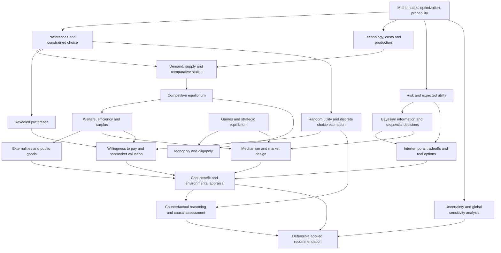

# Graduate Microeconomics: Theory, Decisions, Institutions, and Evidence

> A self-study guide and concept map for a graduate microeconomics collection. The aim is not to memorize isolated models; it is to learn how to **derive behavioral predictions, analyze interacting decisions, evaluate welfare, design incentives, estimate preferences, and assess the credibility and robustness of applied conclusions**.

**Scope:** Graduate microeconomic theory and its applications to markets, business decisions, strategic interaction, public policy, natural resources, and decision analysis. **Not** a macroeconomics syllabus. The uploaded PDFs are the primary curriculum; books listed by the collection owner are supporting references, not assumed to be present in this folder. Methodological extensions are identified as such.

## Contents

1. [How to use this guide](#1-how-to-use-this-guide)
2. [The knowledge map](#2-the-knowledge-map)
3. [Source library and course crosswalk](#3-source-library-and-course-crosswalk)
4. [Prerequisite toolkit](#4-prerequisite-toolkit)
5. [Structured learning path](#5-structured-learning-path)
6. [Concept-to-application crosswalk](#6-concept-to-application-crosswalk)
7. [Integrated case studies and capstone](#7-integrated-case-studies-and-capstone)
8. [Sixteen-week self-study plan](#8-sixteen-week-self-study-plan)
9. [Mastery and evaluation standards](#9-mastery-and-evaluation-standards)

---

## 1. How to use this guide

### Intended audience

This guide assumes an undergraduate foundation in **economics, mathematics, operations research, engineering, statistics, or an adjacent quantitative field**. Prior formal economics coursework helps, but a mathematically prepared learner can begin with the prerequisite section and learn the economic interpretations alongside the derivations.

The original Econ 200 notes introduce market equilibrium early, then develop firms, consumers, risk, decision theory, market power, and externalities. This README **reorders some units by conceptual dependency**: preferences and technology generate demand and supply; they then underpin equilibrium and welfare. Both routes are legitimate. The [course crosswalk](#3-source-library-and-course-crosswalk) preserves the actual lecture sequence.

### The recurring analytical workflow

For each problem, ask:

1. **Decision-maker and feasible set:** Who chooses? What are the goods, actions, dates, states, alternatives, resources, and constraints?
2. **Objective:** Utility, profit, expected utility, expected discounted value, or social welfare? What assumptions justify the objective?
3. **Optimization:** What first-order, second-order, boundary, or discrete-choice conditions characterize behavior?
4. **Interaction:** Are decision-makers price-takers, strategic competitors, informed differently, or affected by externalities?
5. **Equilibrium and counterfactual:** What is predicted under current rules, and what changes under a proposed intervention?
6. **Welfare and distribution:** Who benefits, who pays, how much net surplus is created or lost, and what value judgments are implicit?
7. **Evidence:** Which quantities are observed, estimated, assumed, or genuinely causally identified?
8. **Robustness:** Which assumptions and uncertain inputs materially affect the conclusion?

### A repeatable study loop

For each module: **(a)** read the assigned lecture/text, **(b)** draw the economic diagram, **(c)** derive the model algebraically, **(d)** solve one numerical problem without looking at its answer, **(e)** explain the economic mechanism in plain language, **(f)** change one assumption and predict how the result changes, and **(g)** record one applied use and one limitation. The consolidated homework PDF contains answer keys; hide them until after your independent attempt.

Keep a running notebook with these headings: **model / assumptions / choice variable / constraints / equilibrium or optimum / welfare measure / testable prediction / application / limitation**. Calculating an answer is not yet evidence that the model is appropriate.

**Outcome:** Someone finishing this sequence should be able to formulate and solve a graduate-level microeconomic decision problem; distinguish efficient from privately optimal outcomes; translate a choice model into testable empirical quantities; evaluate an intervention using a coherent counterfactual; and state what is and is not causally supported by evidence.

---

## 2. The knowledge map

The arrows indicate the **main learning dependencies**, not an assertion that any one theory proves all subsequent theories. Some applied topics recur at several points; for example, environmental valuation draws on choice theory, empirical estimation, and welfare economics.



**A second map: the reasoning pipeline**

```text
Preferences + resources + technology + information + institutions
                         |
                         v
              Individual/firm optimization
                         |
                         v
       Prices, quantities, strategies, or choice shares
                         |
                         v
            Equilibrium and predicted responses
                         |
                         v
    Private gains/losses + external effects + distribution
                         |
                         v
            Social evaluation of alternatives
                         |
              +----------+-----------+
              |                      |
              v                      v
    Evidence / identification   Sensitivity / uncertainty
              |                      |
              +----------+-----------+
                         |
                         v
          Decision, design, monitoring, revision
```

### Five connections to keep in mind

- **Demand theory ↔ welfare:** A demand curve is not only a prediction about quantity; under appropriate assumptions it also contains information about marginal willingness to pay and consumer welfare.
- **Production duality ↔ resource allocation:** Cost functions and conditional input demands translate technological possibilities into observable expenditures, shadow values, and efficiency comparisons.
- **Risk ↔ information ↔ time:** A risky project, a useful signal, and the option to wait must be evaluated together; the value of flexibility can change an investment decision.
- **Game theory ↔ mechanism design:** Game theory predicts behavior given rules; mechanism design chooses rules to induce desired behavior when agents have incentives and private information.
- **Economic theory ↔ evidence:** Theory suggests behavioral restrictions and counterfactual predictions. Observed correlation, structural modeling, causal identification, and robustness analysis answer **different** questions and should not be conflated.

---

## 3. Source library and course crosswalk

### Files in this sample

All links below are **relative**: they will work when this README sits beside the PDFs, with the same filenames.

| File | Main purpose | How to use it |
|---|---|---|
| [Econ 200 – Course Lecture Notes](Econ%20200%20-%20Course%20Lecture%20Notes.pdf) | Main theoretical spine, including numbered lectures and a separate intertemporal section | Read relevant lecture pages before assigned problems |
| [Homework & Midterms](Homework%20%26%20Midterms.pdf) | Consolidated solutions, problem sets, practice tests, midterms, and final exams | Work problems **before** opening solutions; use to check assumptions, derivations, and units |
| [Revealed Preference](revealed%20preference0.pdf) — Hal R. Varian | Choice consistency, WARP/SARP/GARP, Afriat, empirical applications | Bridge from consumer theory to preference inference |
| [Random Utility](random%20utility.pdf) — Moshe Ben-Akiva lecture | Choice sets, random utility, binary/multinomial logit and probit, forecasting | First empirical choice-model reading |
| [Discrete Choice Models](Discrete%20Choice%20Models.pdf) — Kenneth Train | Choice models, estimation, simulation, mixed/nested logit, welfare, contingent valuation | Main advanced empirical methods reference |
| [Mechanism Design](mechanism%20design.pdf) — Matthew O. Jackson | Incentive compatibility, revelation, auctions, public goods, implementation | Advanced institutional design reading |
| [Arrow – Uncertainty](Arrow%20-%20Uncertainty.pdf) — Kenneth J. Arrow | Uncertainty, welfare economics, and the medical-care industry | Case study in the limits of textbook market assumptions |
| [Causality – Hicks](Causality%20-%20Hicks.pdf) — John Hicks | Economic explanation, different types of causality, equilibrium, sequences, probability | Methodological reflection; **not** a modern causal-inference textbook |
| [Sensitivity](sensitivity.pdf) — Saltelli and coauthors | Defensible uncertainty and sensitivity analysis; critique of weak methods | Final-stage model audit and robustness |

**Named books, not supplied as PDFs here:** Hal R. Varian, *Microeconomic Analysis*; Mas-Colell, Whinston & Green, *Microeconomic Theory* (the likely reference meant by “Green”); von Neumann & Morgenstern, *Theory of Games and Economic Behavior*; *Cost-Benefit Analysis: Concepts and Practice*; and *Environmental and Natural Resource Economics*. Book authors/editions for the last two are not specified, so this guide gives **topics, not unverified chapter numbers**. A chapter reference in the Econ 200 notes refers to the instructor's cited Varian edition and may not match every edition.

### Where to find the nine Econ 200 lectures

Page numbers below are **PDF page numbers**, including the merged file's beginning, not the lecture's own printed page numbers.

| Original material | PDF pages in `Econ 200 – Course Lecture Notes.pdf` | Concepts |
|---|---:|---|
| **Separate intertemporal section** | 2–20 | Fisher-style production and exchange over time, interest, investment, real/nominal quantities |
| Lecture 1 — **Competitive Markets** | 21–29 | Demand/supply, equilibrium, consumer/producer surplus, efficiency, price controls, taxes, incidence |
| Lecture 2 — **Technology and Cost** | 30–42 | Production sets/functions, cost minimization, factor demands, Shephard's lemma, scale/scope, CES |
| Lecture 3 — **Profit and Supply** | 43–50 | Profit maximization, marginal costs, firm/industry supply, shutdown, entry, rent seeking |
| Lecture 4 — **Preferences and Demand** | 51–65 | Utility, preferences, MRS, Marshallian/Hicksian demand, Slutsky effects, income effects |
| Lecture 5 — **Notes on Risky Choice** | 66–84 | Lotteries, expected utility, risk aversion, certainty equivalents, diversification/portfolios |
| Lecture 6 — **Decision Theory** | 85–95 | Bayesian updating, value of information, decision trees, backward induction, Bellman equations |
| Lecture 7 — **Monopoly and Price Discrimination** | 96–106 | Market power, markup, discriminatory pricing, nonlinear tariffs, bundling |
| Lecture 8 — **Oligopoly** | 107–123 | Strategic interaction, Nash equilibrium, Cournot, Bertrand, related oligopoly models |
| Lecture 9 — **Public Goods and Externalities** | 124–130 | Public goods, free riding, Lindahl pricing, external damage, corrective institutions |

### Assignment navigation

In `Homework & Midterms.pdf`, find the following consolidated segments:

| PDF pages | Material | Main uses in this guide |
|---|---|---|
| 42–51 | Problem Set 1 and supplement | Competitive equilibrium; agricultural price supports; sugar import quotas; fuel taxes; welfare; matching and incentives; short policy essays |
| 52–57 | Problem Set 2 solutions | Production, cost, factor demands, short/long-run supply, profit and preferences |
| 58–61 | Problem Set 3 solutions | Preferences and risky choice; probability and information; Bayesian reasoning |
| 62–69 | Problem Set 4 solutions | Sequential decisions, investment timing, monopoly, nonlinear pricing and related applications |
| 21–26 | Midterm solutions | Markets, firms, consumers, and applied comparative statics |
| 27–32 | Midterm practice answer key | Integrated early-course practice |
| 2–8, 9–18, 33–41 | Final/practice-final solutions, different course years | Cross-module synthesis: uncertainty, strategic choices, externalities, markets, intertemporal effects |
| 19–20 | Formula sheet | Useful reference, **not** a substitute for explaining when its conditions hold |

The PDFs are consolidated compilations containing solutions; topic boundaries may not match the page boundaries perfectly.

---

## 4. Prerequisite toolkit

Work through these ideas as needed rather than treating every prerequisite as a separate course.

| Prerequisite | Competency | Why it reappears |
|---|---|---|
| **Calculus** | Partial derivatives, total differentials, chain rule, elasticity, integrals, Taylor expansions | Marginal analysis, surplus, comparative statics, approximating risk |
| **Constrained optimization** | Lagrangian, Kuhn–Tucker conditions, second-order conditions, corner solutions | Utility maximization, cost minimization, firm behavior, mechanism constraints |
| **Linear algebra** | Vectors, matrices, quadratic forms, covariance matrices | Many-good choice, portfolios, regression, simulated choice models |
| **Convex analysis** | Convex/concave functions, feasible sets, duality, separating intuition | Preference and production assumptions; uniqueness, existence and dual problems |
| **Probability** | Expected values, conditional probabilities, Bayes' rule, covariance, distributions | Risk, insurance, information, random utility, forecasting |
| **Statistics/econometrics** | Likelihood, sampling, estimation, uncertainty, model checking | Revealed-choice applications, logit/probit, parameter estimates and forecasts |
| **Dynamic optimization** | Discounted objectives, backward induction, recursion | Investments, timing options, sequential decisions |
| **Economic vocabulary** | Opportunity cost, marginal vs average, efficiency vs equity, positive vs normative | Correct interpretation of every result |

A useful recurring template is

$$
\max_{x\in X(\theta)} f(x;\theta),
$$

where `x` represents a **choice**, `X` the **feasible set**, and `θ` the **parameters** of the environment. For each application identify which aspects are observed and which are assumptions. Check whether an interior solution exists, whether boundary conditions matter, and whether comparative-static signs are determinate.

### Entry diagnostic

Before moving on, be able to: derive first-order conditions for a two-variable constrained objective; explain the economic meaning of a Lagrange multiplier; differentiate an implicit equation; interpret an elasticity; use Bayes' rule in a two-state problem; compute expected value and variance; and distinguish a mathematical optimum from an empirical prediction.

---

## 5. Structured learning path

**Ordering logic:** Foundations → behavior of consumers and firms → market equilibrium/welfare → uncertainty and intertemporal decisions → strategic interaction → market failure and design → preference measurement and policy appraisal → causality and robustness. Some modules can run in parallel after their listed prerequisites. Module numbers below describe this **self-study path**, not the original lecture numbers.

### Module 1 — Preferences, utility, and consumer demand

**Core question:** How do preferences and budget constraints generate observable choices?

**Prerequisites:** Calculus, constrained optimization, elementary consumer economics.

**Read:** Econ 200 Lecture 4 (PDF pp. 51–65); Varian *Microeconomic Analysis* or Mas-Colell–Whinston–Green, sections on consumer theory. Save the separate revealed-preference paper for Module 10.

**Learn and derive:**

- Preference relations: completeness, transitivity, local nonsatiation, monotonicity, convexity; which assumptions ensure a utility representation or tractable optimum.
- Ordinal utility and indifference curves; marginal utility and the **marginal rate of substitution (MRS)**.
- Budget sets, utility maximization and **Marshallian (uncompensated) demand** `x(p,m)`; interior tangency vs corner solutions.
- Expenditure minimization, **Hicksian (compensated) demand** `h(p,u)`; the expenditure function `e(p,u)` and indirect utility `v(p,m)`.
- Income and substitution effects; normal/inferior goods; Slutsky decomposition; elasticities and Giffen cases.
- Duality: the connection between achieving maximum utility with a budget and achieving target utility at minimum expenditure.

**Core relationships:**

$$
 x(p,m)\in\arg\max_{x\ge0}\{u(x):p\cdot x\le m\},\quad
 h(p,\bar u)\in\arg\min_{x\ge0}\{p\cdot x:u(x)\ge\bar u\}.
$$

For differentiable demands, the Slutsky relationship can be expressed as

$$
 \frac{\partial x_i}{\partial p_j}=
 \frac{\partial h_i}{\partial p_j}-x_j\frac{\partial x_i}{\partial m},
$$

with compensated demand evaluated at the initial utility level.

**Apply:** Consumer response to sales taxes, water-rate tiers, transport fares, housing choices, energy prices and product attributes. Consider whether the relevant decision is a continuous quantity or a discrete alternative.

**Do:** Re-derive demand for Cobb–Douglas and a quasilinear utility function; vary a price and separate substitution from income effects; sketch a corner solution. Use the consumer-choice exercises in PS2 and the midterm. Explain why a price increase need not generate a simple quantity response when there are constraints, nonlinear tariffs or heterogeneous consumers.

**Mastery test:** Can you move consistently among preferences, a utility function, Marshallian demand, Hicksian demand, and measures of welfare change? **Bridge:** Actual purchases lead to revealed preference (Module 10); willingness to pay feeds welfare and cost-benefit analysis (Modules 3 and 11).

### Module 2 — Technology, cost, profit, and firm supply

**Core question:** How do feasible production technologies and input prices determine costs, output, and supply?

**Prerequisites:** Module 1's optimization language is useful; the production theory can otherwise be studied independently.

**Read:** Econ 200 Lectures 2–3 (PDF pp. 30–50); Varian or Mas-Colell–Whinston–Green, production and cost chapters.

**Learn and derive:**

- Production sets, production functions `y=f(x)`, isoquants, technical rates of substitution, marginal product.
- Returns to scale (increasing/constant/decreasing) vs diminishing marginal returns; elasticity of substitution and CES technologies.
- Cost minimization, **conditional factor demands**, cost functions `c(w,y)`, the envelope theorem and Shephard's lemma.
- Fixed/sunk/avoidable costs, variable cost, short-run vs long-run marginal and average costs; learning effects and economies of scope.
- Competitive profit maximization, factor demand, firm supply, shutdown, long-run entry/exit, producer surplus and economic rents.
- Contrast accounting profitability with economic profit and opportunity costs.

**Core relationships:**

$$
 c(w,y)=\min_{x\ge0}\{w\cdot x:f(x)\ge y\},\qquad
 \frac{\partial c(w,y)}{\partial w_i}=x_i^*(w,y)
$$

under the standard differentiability/regularity conditions for Shephard's lemma. A price-taking firm chooses output so that `p = MC(y)` **at an interior optimum**, provided producing covers relevant avoidable cost.

**Apply:** Input substitution under wage or energy-price shocks, plant-size planning, economies of scale, multi-product operations, natural monopoly, procurement costs and long-run market entry.

**Do:** PS2 (PDF pp. 52–57): derive a cost function from a production function, compare short- and long-run supply, and interpret the answer. Construct a CES example and change an input price. Record the circumstances under which the mathematical FOC is insufficient (shutdown and nonconvexities).

**Mastery test:** Can you recover a supply decision from technology and factor prices, and explain why a high fixed cost does not always affect a short-run marginal decision? **Bridge:** Aggregated supply feeds equilibrium (Module 3); economies of scale motivate market power (Module 7).

### Module 3 — Competitive markets, equilibrium, and welfare economics

**Core question:** How do individually optimal decisions interact through prices, and when are the results efficient?

**Prerequisites:** Modules 1 and 2. You may preview Econ 200 Lecture 1 before those modules to obtain the basic market intuition.

**Read:** Econ 200 Lecture 1 (PDF pp. 21–29); PS1 (PDF pp. 42–51).

**Learn and derive:**

- Individual and market demand/supply, linear and constant-elasticity representations, market clearing `D(p*) = S(p*)`.
- Existence/uniqueness intuition, comparative statics of shifts and shocks, short-run vs long-run responses.
- **Positive** predictions vs **normative** assessments; consumer surplus (CS), producer surplus (PS), total surplus (TS), Pareto efficiency.
- The efficiency rationale for competitive allocation **under its maintained assumptions**; the roles of missing markets, externalities, information problems and market power.
- Price ceilings/floors, per-unit and ad valorem taxes, quotas, tax incidence, demand/supply elasticity, tax revenue and deadweight loss.
- Distribution of benefits and costs: an efficiency gain need not be equitable, and a transfer is not necessarily a net social gain.

**Core relationship:**

$$
 TS(Q)=\int_0^Q \big[P_D(q)-MC_S(q)\big]\,dq,
$$

when the demand curve represents relevant marginal willingness to pay and `MC_S` represents full marginal social opportunity cost. Competitive output solves marginal benefit equals marginal social cost **when external effects and other distortions are absent**.

**Apply:** Price supports, agricultural trade restrictions, excise taxes, fuel markets, quota rents and regulation.

**Do:** PS1's wheat-support case, sugar import-quota case, gasoline-tax case and single-unit matching case. For each, compute baseline equilibrium and counterfactual, annotate transfers versus deadweight losses, and explain the winners and losers. Interpret PS1's matching-app example as a warning that **maximizing number of transactions is not the same as maximizing gains from trade**.

**Mastery test:** Can you distinguish (i) changed equilibrium prices, (ii) real resource costs, (iii) transfers and rents, (iv) aggregate welfare effects, and (v) the distribution of those effects? **Bridge:** Welfare economics underpins environmental valuation (Module 9) and cost-benefit analysis (Module 11).

### Module 4 — Risk, expected utility, and insurance

**Core question:** How does a person choose among lotteries rather than known consumption bundles?

**Prerequisites:** Module 1, probability and calculus.

**Read:** Econ 200 Lecture 5 (PDF pp. 66–84); Varian's risk/uncertainty material; Arrow's *Uncertainty and the Welfare Economics of Medical Care*.

**Learn and derive:**

- Known-probability **risk** versus less well-specified **Knightian uncertainty**; state-contingent outcomes and lotteries.
- Expected monetary value vs von Neumann–Morgenstern **expected utility**; risk neutrality, aversion and preference for risk.
- Concavity and Jensen's inequality; certainty equivalent `CE` and risk premium `E[X] - CE` (for a monetary payoff with the appropriate normalization).
- Absolute and relative Arrow–Pratt risk aversion; local mean–variance approximations and their limits.
- Covariance, correlation, diversification, portfolio choice and the distinction between risk borne privately and risk shared socially.
- Arrow's institutional argument: uncertainty about illness and treatment quality helps explain insurance, trust, professional norms and nonstandard market arrangements in healthcare.

**Core relationships:**

$$
 EU(X)=\sum_s p_su(x_s),\qquad
 u(CE)=EU(X),\qquad
 A(w)=-\frac{u''(w)}{u'(w)},\quad R(w)=wA(w).
$$

**Apply:** Insurance premiums, product warranties, medical-care markets, disaster risk, uncertain investments and resource-management outcomes.

**Do:** The risk/certainty-equivalent problems in PS3 and the final/practice exams. Compare the insurance valuation of a risk-neutral person and a risk-averse person facing the same lottery. Explain where the expected-utility assumptions are stronger than the observed evidence warrants.

**Mastery test:** Can you compute and explain how aversion to risk changes behavior without confusing expected payoff, expected utility, and certainty equivalent? **Bridge:** Information changes beliefs about risk (Module 5); uncertainty and discounting affect project appraisal (Module 11).

### Module 5 — Bayesian information, sequential decisions, and intertemporal choice

**Core question:** When should an agent act, acquire information, delay, invest, or change course?

**Prerequisites:** Modules 1 and 4; probability; discounted cash flow and dynamic optimization.

**Read:** Econ 200 Lecture 6 (PDF pp. 85–95), the **separate** intertemporal-equilibrium section (PDF pp. 2–20), and the investment-timing problems in PS4/final exams. Train, Chapter 7.7, extends discrete choice to dynamic settings.

**Learn and derive:**

- Prior probabilities, likelihoods, conditional probabilities, **Bayes' rule**, posterior odds, independent versus informative signals.
- Decision trees with chance nodes and choice nodes, backward induction, expected value of perfect/sample information; the opportunity cost of information and delay.
- Sequential optimization, continuation value, Bellman recursion, stopping rules and **real options** to delay, abandon or expand.
- Intertemporal consumption and production, present value, borrowing/lending, the marginal rate of time preference, marginal productivity and the real interest rate.
- Intertemporal equilibrium and the distinction between **real** and **nominal** values/rates; financial-market and money-numeraire interpretations.
- Irreversibility, sunk costs, future learning, and why a positive immediate NPV need not always justify immediate investment.

**Core relationships:**

$$
 P(s\mid z)=\frac{P(z\mid s)P(s)}{\sum_{s'}P(z\mid s')P(s')},
 \qquad PV=\sum_{t=0}^T\frac{B_t-C_t}{(1+r)^t}.
$$

A useful generic recursion is

$$
 V_t(s)=\max_{a\in A(s)}\left\{r_t(s,a)+\delta\,\mathbb E[V_{t+1}(s')\mid s,a]\right\}.
$$

The period payoff, state transition, discount factor and terminal condition must be specified for the actual application.

**Apply:** Capital budgeting, technology adoption, startup decisions, phased infrastructure, conservation investments, learning-before-committing decisions, adaptive management and job search.

**Do:** Solve an investment project twice: (1) commit now using unconditional expected value; (2) wait one period for a signal and choose whether to invest after observing it. Include the cost of delay. Rework the final exam's investment-timing question and explicitly identify the **option value**. Use the intertemporal notes to explain how a productivity improvement changes savings/investment incentives and equilibrium interest rates.

**Mastery test:** Can you separate the value of the underlying investment, the value of information, and the value of postponing an irreversible action? **Bridge:** Dynamic natural resources (Module 11) and strategic information/design (Module 8) reuse these ideas.

### Module 6 — Monopoly, oligopoly, and strategic behavior

**Core question:** What changes when an agent knows that its actions influence price or other agents' decisions?

**Prerequisites:** Modules 2–3; best responses and introductory game theory can be learned here.

**Read:** Econ 200 Lectures 7–8 (PDF pp. 96–123); von Neumann & Morgenstern for a foundational game-theoretic perspective; the relevant monopoly/game-theory sections of Mas-Colell–Whinston–Green.

**Learn and derive:**

- Monopoly with inverse demand `p(q)`, total revenue `p(q)q`, marginal revenue, elasticity and markup; contrast `MR = MC` with competitive `p = MC`.
- First-, second- and third-degree price discrimination; screening menus, two-part tariffs, bundling, peak-load pricing and arbitrage constraints.
- Market entry barriers, economies of scale, network effects, natural monopolies, entry and rent seeking.
- Games as players, strategies, information and payoff functions; dominant strategies, best-response correspondences, **Nash equilibrium** and its interpretation.
- Quantity competition (**Cournot**), price competition (**Bertrand**) and sequential strategic moves (**Stackelberg**); why equilibrium depends on strategic variables and timing.
- Repeated interaction, differentiation, collusion incentives, strategic commitments and the difference between cooperative and noncooperative outcomes.

**Core relationships:**

$$
 \max_{q\ge0}\ \pi(q)=p(q)q-c(q),\qquad
 MR(q)=p(q)+q p'(q)=MC(q).
$$

For an interior single-product monopoly optimum and a negative own-price demand elasticity `ε`, the Lerner markup condition is

$$
 \frac{p-MC}{p}=-\frac{1}{\varepsilon}.
$$

In a normal-form game, a Nash equilibrium `s*` satisfies

$$
 u_i(s_i^*,s_{-i}^*)\ge u_i(s_i,s_{-i}^*)
 \quad\text{for every feasible }s_i\text{ and each player }i.
$$

**Apply:** Pricing platforms, telecoms, energy markets, airport/road capacity, subscription services, procurement bidding, price matching, product differentiation and strategic entry.

**Do:** Derive a linear-demand monopolist's optimum and compare output, price, profit and deadweight loss with a competitive benchmark. Solve two-firm Cournot and Bertrand examples, then change the timing to sequential moves. Rework oligopoly and monopoly problems in the final exams and PS4. State *which* assumption changes the equilibrium when price-setting replaces quantity-setting.

**Mastery test:** Can you determine when a competitive prediction ceases to apply, solve best responses, and explain how the game form changes behavior? **Bridge:** Mechanism design (Module 8) takes the strategic behavior as a constraint when designing institutions.

### Module 7 — Externalities, public goods, and market failure

**Core question:** When do individually rational market decisions fail to maximize social welfare?

**Prerequisites:** Modules 3 and 6; the basic efficiency benchmark is essential.

**Read:** Econ 200 Lecture 9 (PDF pp. 124–130); Varian's externality/public-good sections; *Environmental and Natural Resource Economics* for a broader resource-policy treatment.

**Learn and derive:**

- **Private** marginal benefit and cost versus **social** marginal benefit and cost; positive and negative production/consumption externalities.
- Pecuniary effects (via market prices) versus direct/nonpecuniary external effects; avoid treating every price change as an unpriced social cost.
- Public goods, nonrivalry, nonexcludability, free riding and optimal provision; congestion and common-pool resources require additional attention.
- Voluntary contribution, Lindahl-style personalized prices, collective provision, taxes/subsidies, tradable permits and the role of property rights/transactions costs.
- Network effects, natural monopoly and lock-in; public-choice and institutional complications.
- **Efficiency vs distribution vs feasibility:** The theoretically optimal corrective instrument may demand information and implementation capacity that policymakers do not have.

**Core relationship:**

$$
 SMB(Q^*)=SMC(Q^*),
 \qquad SMC(Q)=PMC(Q)+MED(Q),
$$

where `MED` is **marginal external damage** in a case of negative production externality. For a pure public good, the marginal social benefit sums individual marginal willingness to pay **vertically**, rather than aggregating quantities horizontally.

**Apply:** Pollution, congestion, emissions, public parks, flood protection, watershed quality, infrastructure, fisheries, groundwater, data/network platforms and vaccination externalities.

**Do:** In the final exam's ingot-industry externality problem, compare competitive output with socially efficient output, compute total external damage and derive an illustrative corrective tax. Revisit PS1's gasoline-tax essay to determine why **conventional** tax deadweight loss may omit environmental benefits. Explain why a public-good funding rule can underprovide even a highly valuable project.

**Mastery test:** Can you identify the missing price/market, compute the associated welfare wedge, and compare realistic remedies—including information and implementation obstacles? **Bridge:** Corrective policy creates a design problem (Module 8); estimating nonmarket benefits creates an empirical problem (Modules 9–10).

### Module 8 — Incentives, auctions, and mechanism design

**Core question:** Can we choose rules so that self-interested agents reveal information and produce better outcomes?

**Prerequisites:** Module 6's games, Module 7's welfare problems, and Module 5's information framework.

**Read:** Jackson, [*Mechanism Design*](mechanism%20design.pdf), especially Sections 1–4; revisit the single-unit matching problem in PS1 and the public-good examples in Econ 200 Lecture 9.

**Learn and derive:**

- The **forward problem** (predict equilibrium given rules) versus the **inverse problem** (find rules that implement an objective).
- Agents' private types, reports, outcome and transfer functions; direct mechanisms and the revelation principle.
- **Incentive compatibility**: dominant-strategy truth-telling and Bayesian truth-telling; distinguish the two.
- **Individual rationality** or voluntary participation, efficiency, and **budget balance**; why satisfying all goals simultaneously can be impossible under some environments.
- Vickrey/second-price auctions, Clarke pivot and Groves mechanisms, information rents, public-project provision.
- Bayesian mechanisms, social choice, implementation, and the restrictions that matter for strategy-proofness.
- Rules are not neutral: allocation, payment, participation, reporting and enforcement arrangements change behavior.

**Core template:**

A mechanism maps messages to an outcome: `g(m_1,...,m_n)` plus transfers `t_i(m)`. A direct, dominant-strategy incentive-compatible mechanism must satisfy, for every agent `i`, true type `θ_i`, possible misreport `r_i`, and other agents' reports `m_-i`,

$$
 u_i\big(g(\theta_i,m_{-i}),t_i(\theta_i,m_{-i});\theta_i\big)
 \ge u_i\big(g(r_i,m_{-i}),t_i(r_i,m_{-i});\theta_i\big).
$$

Sign conventions for transfers vary by source; specify whether a positive `t_i` is money paid **to** or **by** agent `i`.

**Apply:** Procurement auctions, matching platforms, electricity-market rules, environmental credit auctions, conservation contracts, public-good financing, congestion pricing and resource-allocation institutions.

**Do:** Design a one-item sealed-bid auction, state allocation/payment rules, and examine whether honest valuation reports are an equilibrium. Return to the PS1 app example: a rule maximizing transaction counts can reduce surplus; a rule relying on truthful reports may itself need incentive-compatible payments. List which efficiency, participation and budget-balance requirements your proposal satisfies.

**Mastery test:** Can you formulate a mechanism, specify information and incentive constraints, and articulate tradeoffs rather than treating incentive compatibility as an afterthought? **Bridge:** Empirical preference estimates can inform mechanism design, while the mechanism itself changes the data-generating process.

### Module 9 — Revealed preferences, random utility, and empirical demand

**Core question:** How do we learn about preferences from choices and predict responses to alternatives or policies?

**Prerequisites:** Modules 1 and 3, probability, elementary econometrics and numerical optimization. This module can be studied alongside Modules 6–8 after the foundations.

**Read, in order:**

1. Varian, [*Revealed Preference*](revealed%20preference0.pdf), especially the axioms, Afriat construction, empirical restrictions and forecasting discussion.
2. Ben-Akiva, [*Discrete Choice Analysis I*](random%20utility.pdf), to connect consumer choice, unobserved utility and logit/probit.
3. Train, [*Discrete Choice Methods with Simulation*](Discrete%20Choice%20Models.pdf): Chapters 1–3 (foundation and logit), 4–6 (nested/GEV, probit, mixed logit), 7 (stated/revealed preferences and contingent valuation), then 8–12 for advanced simulation, estimation and Bayesian inference. These numbers refer to Train's actual chapter structure in the provided PDF.

**Part A — Nonparametric revealed preference:**

- Prices `p_t`, observed bundles `x_t`, feasible alternatives, direct/indirect revealed preference.
- **WARP, SARP, GARP**, choice cycles and rationalizability. Understand which axioms apply under which assumptions.
- **Afriat's theorem:** When finite price/choice data can be represented as maximizing a well-behaved utility function; how tests of behavior differ from estimating a parametric utility specification.
- Strengths and limits: observed choices reflect constraints and context; consistency with optimization is not proof that a particular utility function or decision process is literally true.

**Part B — Statistical random utility:**

- Individual `n`, alternatives `j` in choice set `C_n`, attributes `x_nj`, systematic utility and an unobserved component:

$$
 U_{nj}=V_{nj}(x_{nj},z_n;\beta)+\varepsilon_{nj},\qquad
 P_{nj}=P(U_{nj}\ge U_{nk}\ \forall k\in C_n).
$$

- Binary logit/probit, multinomial logit, likelihood maximization, interpretation of coefficients and predicted probabilities.
- Under independent type-I extreme-value errors and conventional scale normalization, **multinomial logit**:

$$
 P_{nj}=\frac{e^{V_{nj}}}{\sum_{k\in C_n}e^{V_{nk}}}.
$$

- **IIA** (independence of irrelevant alternatives) and substitution-pattern limitations; nested logit, probit, mixed logit/random coefficients and preference heterogeneity.
- Identification, utility-level/scale normalizations, choice-set construction, omitted attributes, sample selection, panel data, stated-preference versus revealed-preference sources.
- Estimation, standard errors, elasticity, holdout/forecast tests, aggregate shares, prediction under counterfactual attributes.
- **Willingness to pay:** In a *linear-in-parameters* deterministic utility index with a price coefficient in consistent units, the marginal rate of substitution for an attribute `z` against price is `-β_z/β_price`, provided the price coefficient is negative. This is a model-dependent welfare calculation, not a universal conversion rule.

**Part C — Computation (Train advanced path):**

Numerical maximum likelihood; simulation of choice probabilities; low-discrepancy/random draws; maximum simulated likelihood; mixed logit estimation; Bayesian procedures and posterior distributions. These are valuable for an OR/statistics reader who wants to move from models on paper to estimates from observed choices.

**Apply:** Commuter mode choice, route selection, energy suppliers, consumer products, insurance, recreational site choice, conservation programs, and **stated willingness to pay for nonmarket environmental improvements**.

**Do:**

1. Write down a small collection of prices and observed consumption bundles; test whether the observations generate an obvious revealed-preference violation.
2. Use Ben-Akiva's bus-versus-car example to specify observed alternatives, travel time, monetary cost and heterogeneous travelers.
3. Estimate or simulate a two-alternative logit model; increase the bus fare and compute predicted shares, then contrast this with a claim of a **causal** fare effect.
4. Explore Train's nested or mixed logit as a response to implausible substitution patterns, and compute a conditional attribute willingness-to-pay measure.

**Mastery test:** Can you say precisely whether a result is (a) a logical revealed-choice restriction, (b) an estimate under a probability model, (c) a forecast, or (d) a causally identified response? **Bridge:** Empirical willingness to pay feeds cost-benefit analysis (Module 10); model assumptions and selection issues lead to causal assessment (Module 11).

### Module 10 — Cost-benefit analysis and environmental/resource applications

**Core question:** Is a proposed project or rule socially worthwhile compared with a clearly defined alternative?

**Prerequisites:** Modules 3–5, 7, and 9; Modules 6 and 8 as needed for policy feasibility and strategic responses.

**Read:** The named *Cost-Benefit Analysis: Concepts and Practice* and *Environmental and Natural Resource Economics* texts (specific editions/chapters not supplied); use Econ 200 Lecture 9, the intertemporal notes, and Train Chapter 7.5 for bridges grounded in the available PDFs.

**Learn and integrate:**

- Define the policy choice and the **without-project counterfactual**; map affected populations, geographic scope, time horizon and relevant alternatives.
- Identify incremental physical impacts before monetizing them: resource use, emissions, health, recreation, habitat, travel time, operating costs and induced behavior.
- Separate **financial cash flows** from **economic opportunity costs**, taxes/transfers, market distortions and shadow prices.
- Value traded outputs using defensible market information; value untraded effects using revealed preference, travel-cost/hedonic logic (extensions), stated preference/contingent valuation, avoided cost or damage estimates, with method-specific limitations.
- Consumer/producer surplus changes and compensating/equivalent variation as distinct ways to characterize welfare changes, depending on data and model assumptions.
- Time: social discounting, present value, project lifetime, terminal effects, intergenerational and irreversible natural-resource decisions.
- Risk, project sequencing, probability-weighted outcomes, real options, distributional impacts, equity weights when explicitly justified, and nonmonetized considerations.
- Environmental economics extensions: open access, common-pool extraction, renewable stock dynamics, nonrenewable scarcity, pollution stocks, property-rights institutions and incentives. These subjects come from the **named environmental/resource text and standard application context**; not all are covered in the uploaded Econ 200 PDFs.
- Implementation incentives: regulation, permits, contracts, auctions, participation, asymmetric information and enforcement.

**Core accounting identity:**

$$
 NPV_{social}=\sum_{t=0}^T\frac{\Delta B_t-\Delta C_t}{(1+r)^t},
$$

where deltas mean **incremental to the counterfactual**, values are measured consistently, and distributional or nonmonetized effects are documented separately. Do not count transfers both as benefits and as resource costs, and avoid counting the same welfare impact in multiple categories.

**Apply:** Watershed restoration, air-pollution regulation, transportation infrastructure, habitat conservation, environmental taxes, groundwater management, coastal protection and public-health investments.

**Do:** Assemble a one-page appraisal matrix with rows for each effect and columns for **mechanism / physical unit / baseline / counterfactual / economic valuation / discounting / uncertainty / beneficiaries and losers / evidence source**. Evaluate at least two alternatives, not simply project versus doing nothing. Report an NPV together with transparent uncertainty and any nonmonetized considerations.

**Mastery test:** Can you explain every benefit and cost in terms of a behavioral or technological mechanism, show the counterfactual, and defend the valuation without double counting? **Bridge:** A positive modeled NPV is not automatically a causal estimate of policy impact or a robust conclusion; that is Modules 11–12.

### Module 11 — Causality, counterfactuals, and the limits of prediction

**Core question:** Which changes can genuinely be attributed to an action or policy, rather than merely predicted or associated with it?

**Prerequisites:** Modules 3, 9–10 and basic statistics. Some of the methodological background here is a **deliberate extension** of, rather than a fully taught unit in, the supplied PDFs.

**Read:** Hicks, [*Causality in Economics*](Causality%20-%20Hicks.pdf), especially *The Kinds of Causality*, *Theory and Application*, *Statics and Equilibrium*, *Sequential Causality*, and *Probability and Judgement*. Read Arrow as an example of institution-level economic explanation. Use the discrete-choice work to ask what an estimated behavioral model does and does not identify.

**Distinguish four different achievements:**

1. **Theoretical explanation:** Under stated assumptions, a mechanism implies an equilibrium or behavioral response. Example: a tax wedge changes equilibrium prices and quantities.
2. **Descriptive/forecasting model:** A statistical relation fits or forecasts observed choices. Example: higher fares are correlated with lower transit usage in a logit model.
3. **Structural policy simulation:** Estimated preference/cost parameters plus a maintained economic model generate a **model-dependent counterfactual**. This may be useful, but validity depends on identification and behavioral/institutional stability.
4. **Causal effect identification:** A research design isolates the effect of the policy from other causes of the outcome. This is an additional evidentiary task—not something supplied automatically by a utility model, an equilibrium calculation or predictive accuracy.

**Core causal questions:** What exactly is the intervention (`do`/treatment)? What outcome and population are targeted? What would happen **without** it? What confounders, selection mechanisms, simultaneous responses, spillovers or time trends undermine comparison? Which assumptions make the counterfactual credible?

**Modern causal-inference methods to study separately:** Randomization, natural experiments, instrumental variables, regression discontinuity, difference-in-differences/event studies, causal diagrams, potential outcomes and sensitivity to unobserved confounding. **These are recommended additions, not claimed to be comprehensively taught by the uploaded Hicks book or Econ 200 notes.**

**Example:** Suppose transit users select buses partly because they dislike driving. Estimating an association between fare and bus ridership is not sufficient to prove that cutting fares will produce the same change. The causal question is about the **response to an exogenous fare change**, accounting for selection, rival transport options, service adjustments and general-equilibrium effects.

**Do:** For a project from Module 10, write: **estimand** (the effect you want), **counterfactual**, **identification assumption**, **plausible threats**, **available data**, **alternative explanations**, and **what evidence would change your conclusion**. Label estimates explicitly as descriptive, forecast, structurally simulated or causally identified.

**Mastery test:** Can you say “this model predicts X if assumptions A–C hold, but the observed data do not yet identify the effect of intervention Z” without losing the substantive economic insight? **Bridge:** Test both causal assumptions and quantitative parameter uncertainty before acting (Module 12).

### Module 12 — Uncertainty analysis, sensitivity analysis, and robust conclusions

**Core question:** How much confidence should a decision-maker place in a result, and which uncertainties dominate the recommendation?

**Prerequisites:** Probability, Modules 5 and 10–11, simulation/numerical tools.

**Read:** Saltelli et al., [*Why So Many Published Sensitivity Analyses Are False*](sensitivity.pdf). Revisit the assumptions in the applied model under assessment.

**Learn and distinguish:**

- **Uncertainty analysis (UA):** How uncertain is the model's output across plausible input ranges/distributions?
- **Sensitivity analysis (SA):** Which uncertain factors, including interactions, account for variation in that output?
- Local derivatives, elasticities and **one-at-a-time** perturbations are useful for local questions but may miss nonlinearities and parameter interactions across plausible joint ranges.
- Global methods, variance-based measures, experimental design/Monte Carlo, parameter prioritization and factor fixing; correlation and dependence among uncertain inputs require special care.
- Separate **parameter uncertainty**, measurement error, structural/model uncertainty, scenario uncertainty and uncertainty about identification assumptions.
- Decision robustness: probability of negative net benefit; switching thresholds; regret and reversibility; sensitivity of rankings, not merely sensitivity of point predictions.
- Communicating uncertainty without disguising contested value judgments as precise inputs.

**Illustrative questions:** What discount rate would reverse the preferred alternative? How sensitive is a welfare estimate to price elasticity, health damage valuation or preference heterogeneity? Do input interactions matter? Does a plausible alternative behavioral specification reverse the result? Would a different causal design alter the estimated treatment effect?

**Do:** Vary **multiple** uncertain inputs jointly for the Module 10 capstone, calculate the distribution of social NPV, show the main contributors to output uncertainty, and identify thresholds at which the decision changes. Explain why one-at-a-time testing does not characterize the full joint uncertainty of a nonlinear model.

**Mastery test:** Can you describe (a) the plausible uncertainty, (b) what dominates it, (c) model and identification limitations, and (d) whether the policy recommendation survives reasonable alternatives?

---

## 6. Concept-to-application crosswalk

This table makes the **translation between theory, measurable quantities, and use** explicit. For each application, the output is credible only to the extent the behavioral and measurement assumptions are.

| Conceptual tool | Key economic object | What might be observed or estimated? | Application | Crucial validity check |
|---|---|---|---|---|
| Consumer utility and duality | MRS, `x(p,m)`, `h(p,u)`, expenditure function | Prices, quantities, budgets, demand elasticities | Household tax/water-bill response | Are choices feasible and preferences sufficiently stable? |
| Revealed preference | WARP/SARP/GARP, rationalizable choice data | Repeated prices and selected bundles | Test consistency of observed consumption | Does the researcher know the actual opportunity sets? |
| Production and cost duality | `f(x)`, `c(w,y)`, factor demand, MC | Input prices, output, expenditures | Efficient plant or resource allocation | Fixed vs variable costs, omitted inputs, returns to scale |
| Market equilibrium | Supply and demand; clearing prices | Transaction prices and volumes | Tax incidence, quota and subsidy effects | Price-taking, market boundaries, elasticities |
| Welfare economics | CS, PS, total surplus, compensating measures | Demand/supply estimates; economic costs | Policy impact or regulation | Externalities, missing markets, income/distribution effects |
| Expected utility | Lottery payoffs, certainty equivalent, risk aversion | Insurance choices; risky investment decisions | Insurance and disaster policy | Are probabilities and preferences appropriately represented? |
| Bayesian decisions | Priors, likelihoods, posteriors, value of information | Signals, diagnostics, outcomes | Delay, monitoring, staged investment | Is information informative, credible and available in time? |
| Intertemporal optimization | Discounted utility, NPV, Bellman value | Cash flows, rates, resource trajectories | Long-lived investments, conservation | Irreversibility, discount choice, dynamic constraints |
| Monopoly and games | MR, markups, best responses, Nash equilibrium | Prices, market shares, entry and rivals' actions | Pricing/competition policy | What are the relevant strategic variables and timing? |
| Mechanism design | Allocation, transfers, IC/IR constraints | Bids, reports, participation, outcomes | Auctions, procurement, program enrollment | Can agents manipulate information or opt out? |
| Public goods/externalities | Marginal external damage, social MC, willingness to pay | Emissions, exposure, damages, program uptake | Pollution policy and infrastructure provision | Which relevant impacts fall outside the market transaction? |
| Random utility | `U=V+ε`, choice probabilities, heterogeneity | Individual choice + attribute data | Mode-choice, energy suppliers, environmental demand | Identification, IIA, choice sets, sampling, predictions |
| Nonmarket valuation | Marginal WTP, consumer surplus and choice-based measures | Recreation trips, choices, stated valuations | Ecosystem restoration, amenities | Welfare interpretation, survey/selection bias |
| Cost-benefit analysis | Incremental social NPV and distribution | Physical impacts, valuations, resources, time | Public investments and regulation | Counterfactual, double counting, shadow values, discounting |
| Causal assessment | Intervention, counterfactual, estimand | Credible quasi-experiment or research design | Attribute impacts to policy | Confounding, selection, trends, spillovers, external validity |
| Sensitivity analysis | Output distribution, variance attribution, thresholds | Input ranges, joint simulations, scenarios | Robust policy ranking | Interactions, dependence, structural uncertainty |

### Recurring conceptual distinctions

A graduate learner should be able to explain these pairs without treating them as synonyms:

- **Preferences vs utility representation:** A numerical utility index ordinarily represents an ordering; its absolute number has no direct behavioral meaning. Expected-utility representations have their own affine-invariance structure.
- **MRS vs price ratio:** The MRS is a preference tradeoff; an equality with relative prices is a conditional **optimum** result, not an identity everywhere.
- **Marginal vs average:** Optimal decisions typically compare incremental gains and costs; average cost or historical expenditure answers a different question.
- **Sunk vs avoidable cost:** Costs that cannot be changed by the decision should not determine its marginal optimum, although they may matter to earlier entry or irreversible commitment.
- **Risk vs ambiguity:** A lottery with specified outcomes and probabilities is not the same as a situation with poorly characterized states or probabilities.
- **Private vs social value:** An action may maximize profit or individual utility while harming others or failing to provide a public good.
- **Pareto efficiency vs fairness:** An efficient allocation can be highly unequal; a welfare appraisal should describe distribution separately.
- **Competitive price vs strategic price:** Different assumptions about market power change the agent's first-order condition and the resulting equilibrium.
- **Information vs incentives:** An agent may know their type but have a reason to misreport it; better estimation does not by itself solve incentive compatibility.
- **Forecast vs causal effect:** A high-performing choice model can still give a biased estimate of an intervention's effect.
- **Uncertainty analysis vs sensitivity analysis:** The first measures uncertainty in outputs; the second identifies what drives that uncertainty.

### Four threads that run through nearly every module

**1. Marginal valuation.** MRS → individual demand → willingness to pay → surplus → public-good valuation → environmental benefits → policy appraisal.

**2. Scarcity and shadow prices.** Feasible sets → constrained optimization → marginal production cost → equilibrium scarcity rents → discounted resource values → optimal investments and conservation.

**3. Strategic adaptation.** Prices and constraints → firm/consumer reactions → Nash equilibrium → incentive-compatible mechanisms → endogenous participation and policy compliance.

**4. Evidence and learning.** Rationality assumptions → revealed-choice tests → probabilistic choice estimation → model-based counterfactuals → causal identification checks → global uncertainty/sensitivity audit.

---

## 7. Integrated case studies and capstone

These exercises deliberately combine modules that are often taught separately. Each case can be completed as a short written technical memo (2–5 pages) plus a spreadsheet or notebook.

### Case A — Agricultural price support and trade restrictions

**Anchor:** PS1 wheat price support and sugar quota (Homework & Midterms, PDF pp. 42–46).

1. Derive market demand/supply equilibrium, quantities and welfare areas.
2. Introduce a binding price floor or import quota; distinguish government purchases and quota rents from real lost surplus.
3. Quantify gains and losses by group, and describe the political incentive to defend a policy with net efficiency losses.
4. Test sensitivity to supply/demand elasticities and the opportunity cost of government spending.
5. State the evidence required to estimate effects rather than merely simulating a policy using supplied functions.

**Concepts joined:** Equilibrium → comparative statics → welfare → rents and incentives → CBA → model uncertainty.

### Case B — Firm technology and strategic pricing

**Anchor:** PS2 technology/cost problems; lecture monopoly and oligopoly examples; final-exam price-competition questions.

1. Derive `c(w,y)` from a production function; calculate MC, AC, variable/fixed costs.
2. Optimize output under price-taking behavior; then use inverse market demand and optimize as a monopolist.
3. Introduce a competitor and compare Cournot quantity-setting with Bertrand price-setting outcomes.
4. Consider entry, switching costs, product differentiation or nonlinear tariffs.
5. Explain what observed sales data could identify and what additional variation would be needed to assess the **causal** effect of a price change.

**Concepts joined:** Production → supply → welfare → industrial organization → discrete choice → causal assessment.

### Case C — Risky investment and the value of waiting

**Anchor:** Econ 200 Lecture 6, intertemporal-equilibrium section, and the final/practice exam's delayed investment question.

1. Compute deterministic NPV and then probability-weighted expected NPV.
2. Replace expected value with an expected-utility decision for a risk-averse investor.
3. Add a signal arriving next period; update beliefs using Bayes' rule.
4. Write a decision tree and solve it backward; include the explicit cost of waiting and an irreversible investment cost.
5. Simulate scenarios for success probability, discount rate, information accuracy and costs; locate switching thresholds.

**Concepts joined:** Risk → Bayes → time → real options → global sensitivity analysis.

### Case D — Transport and environmental policy

**Anchor:** Ben-Akiva's route and mode-choice lecture, Train's consumer-surplus/contingent-valuation chapters, Econ 200 externalities, and the named environmental/CBA books.

1. Define travelers, available modes and alternative attributes (time, cost, service quality).
2. Specify a logit model, estimate/simulate mode shares and compute a scenario with changed transit fares or service levels.
3. Predict congestion, air-quality and travel-time implications. Identify which effects are *not* in each individual's private utility.
4. Build a social appraisal: investment cost, operating costs, time savings, environmental effects, distribution and discounting.
5. Explain why a before/after change in ridership may be confounded by gasoline prices, economic activity or changing transit supply.
6. Compare a structural demand forecast, a causal evaluation of an implemented pilot, and a robustness check of the social NPV.

**Concepts joined:** Consumer choice → statistical demand → externalities → environmental valuation → CBA → causality → sensitivity.

### Capstone — A watershed-restoration decision

**Question:** A region can pursue **(A) no new action**, **(B) restoration plus voluntary incentives**, or **(C) restoration with binding land-use restrictions and a funding mechanism**. Which should it choose, subject to financial, environmental, distributional and institutional constraints?

**Deliverables:**

1. **Conceptual model (1–2 pages):** Actors (residents, farms, agencies), resources, externalities, private incentives, state variables, institutional options.
2. **Choice/value model:** Explain how household or recreation willingness to pay could be inferred (revealed/stated preference), plus unmeasured ecological outcomes.
3. **Economic counterfactual:** Specify baseline trajectory and project impacts, with units and separate benefit/cost categories; calculate discounted social NPV.
4. **Institution design:** Compare taxes, subsidies, contracts, auctions and/or cooperative arrangements using incentive compatibility, participation and implementation cost.
5. **Empirical/causal design:** Define the outcome and estimand; discuss monitoring data, suitable controls, spillovers, and what cannot be causally claimed before evaluation.
6. **Uncertainty:** Jointly vary water-quality response, WTP, implementation cost, participation and discount rate; report threshold/switching analysis and uncertainty in rankings.
7. **Final recommendation (1–2 pages):** What would you recommend **conditional on the evidence**? Who bears costs, which conclusions are robust, and what should be measured after implementation?

**Why this is a graduate microeconomics capstone:** No single method is enough. Correctly valuing an environmental benefit does not ensure that landowners will participate; well-designed incentives do not prove ecological impacts; and a model-predicted net benefit is not automatically robust or causally identified.

**Suggested work-product structure:** `problem.md` → `assumptions.md` → `model.ipynb`/spreadsheet → `results.md` → `decision_memo.md`. These are suggested outputs, **not additional files assumed to exist** in the curriculum folder.

---

## 8. Sixteen-week self-study plan

Use this as a sequencing guide, not a fixed promise of time required. More time will be necessary for readers new to optimization, probability, or empirical estimation. The schedule relies on **independent derivation and problem solving**, not only reading.

| Week | Focus | Primary readings | Required output |
|---:|---|---|---|
| 1 | Prerequisites and economic modeling | README §4; Econ 200 introduction/Lecture 1 preview | Diagnostic: constrained optimization and positive/normative examples |
| 2 | Preferences and demand | Econ 200 Lecture 4 | Derive Marshallian/Hicksian demands; Slutsky exercise |
| 3 | Technology and cost | Econ 200 Lecture 2 | Derive conditional factor demand and cost from technology |
| 4 | Profit, supply, equilibrium | Econ 200 Lectures 3 and 1; PS1/PS2 | Firm supply plus welfare comparison |
| 5 | Welfare and interventions | Econ 200 Lecture 1; PS1 | Wheat support or sugar-quota policy memo |
| 6 | Risk and expected utility | Econ 200 Lecture 5; Arrow | Lottery, certainty-equivalent, insurance calculation |
| 7 | Bayesian decisions and real options | Econ 200 Lecture 6; PS3/PS4 | Bayesian update and timing decision tree |
| 8 | Intertemporal equilibrium | Separate intertemporal section; exam cases | Discounting, savings/investment comparative statics |
| 9 | Monopoly and price discrimination | Econ 200 Lecture 7 | Markup, deadweight loss, discriminatory pricing |
| 10 | Oligopoly and games | Econ 200 Lecture 8; game-theory book | Best-response and Nash/Stackelberg exercise |
| 11 | Externalities and public goods | Econ 200 Lecture 9; environmental text | Social MC and corrective-policy appraisal |
| 12 | Mechanism design | Jackson | Auction/public-good mechanism with IC/IR discussion |
| 13 | Revealed preference and choice estimation | Varian paper, Ben-Akiva lecture, Train Ch. 1–3 | Choice consistency test and binary/multinomial logit |
| 14 | Advanced choice and applied valuation | Train Ch. 4–7 (Ch. 8–12 as elective); named CBA/environmental texts | Choice-based WTP and environmental appraisal |
| 15 | Causal reasoning and sensitivity | Hicks, Saltelli | Identification critique plus global uncertainty analysis |
| 16 | Capstone integration | Revisit selected materials | Technical report and decision memo with limitations |

**Alternative paths:**

- **Economics-first:** Spend more time on consumer/producer duality, equilibrium, welfare propositions, game-theory proofs and welfare measures; treat computation as an empirical extension.
- **Mathematics/OR-first:** Start with the optimization template, convexity/duality, strategic games and dynamic programming; deliberately practice explaining their **economic** content, welfare meaning and institutional assumptions.
- **Statistics/data-first:** Complete Modules 1–4 before going deep into discrete choice; learn the difference between model fit, choice substitution, willingness-to-pay inference and causal identification before applied policy work.

**Practical cadence:** A module is complete after a derivation, an independently solved exercise and a short application memo—not after its reading assignment has been finished.

---

## 9. Mastery and evaluation standards

### Level 1 — Explain

- [ ] Define the decision-makers, actions, constraints, technology, information and objectives.
- [ ] Distinguish positive prediction, normative evaluation and causal claim.
- [ ] State the economic meaning of key parameters (elasticity, marginal value, shadow price, discount rate, risk aversion).
- [ ] Identify an assumption whose failure changes the prediction or welfare interpretation.

### Level 2 — Derive and solve

- [ ] Formulate a utility-maximization and a cost-minimization problem, including boundaries and dual interpretations.
- [ ] Obtain competitive equilibrium, compute CS/PS and identify tax incidence and deadweight loss.
- [ ] Optimize under monopoly and solve a two-player best-response/Nash equilibrium.
- [ ] Compute expected utility, a certainty equivalent, a Bayesian update and a sequential stopping decision.
- [ ] Formulate incentive-compatibility/participation constraints for a simple mechanism.
- [ ] Specify a logit choice probability and interpret a price or attribute coefficient appropriately.

### Level 3 — Apply and evaluate

- [ ] Build a credible economic **counterfactual** and a complete ledger of incremental benefits, costs and transfers.
- [ ] Compare privately optimal with socially optimal outcomes, including implementation incentives.
- [ ] Use choice/market data to estimate or calibrate relevant quantities and document model limitations.
- [ ] State which estimated responses are **associations**, which are conditional model forecasts and which are causally identified.
- [ ] Present joint input uncertainty and show the thresholds at which the policy recommendation changes.
- [ ] Communicate conclusions to both technical and nontechnical audiences without claiming more than the evidence warrants.

### Standard format for any finished analysis

Every project should include: **(1)** question and decision, **(2)** economic mechanism, **(3)** assumptions and data, **(4)** model/derivation, **(5)** baseline and counterfactual, **(6)** efficiency and distribution, **(7)** identification/evidence limitations, **(8)** uncertainty and sensitivity, **(9)** recommendation and monitoring plan.

---


### The organizing principle

> **Model the feasible choices → derive individual incentives → work out market/strategic outcomes → evaluate private and social consequences → estimate relevant behavior and values → interrogate the counterfactual and causal evidence → test robustness → make a qualified decision.**

The desired endpoint is not a collection of formulas. It is a disciplined way to analyze economic problems—from a consumer buying a product to a firm choosing a strategy or a government deciding how to fund and value an environmental intervention.
